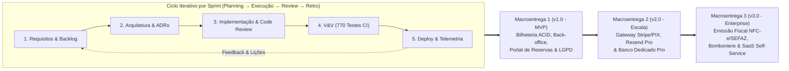

# Capítulo 3 – Processos Organizacionais Habilitadores

## 3.1 Modelo de ciclo de vida adotado e justificado

A **CineSoft Solutions** adota o modelo de ciclo de vida **Iterativo e Incremental Ágil** (ABNT NBR ISO/IEC/IEEE 12207:2021 – Cláusula 6.2.1), combinando Sprints de desenvolvimento com fluxo contínuo no quadro Kanban e integração/entrega contínua (CI/CD).

### Estrutura das Fases, Cerimônias e Macroentregas

O ciclo de vida do produto **CineDoom** é organizado em **três Macroentregas evolutivas (Releases Comerciais)**, cada qual subdividida em iterações (Sprints) que percorrem obrigatoriamente cinco etapas de engenharia: **Elicitação e Refinamento de Requisitos $\to$ Arquitetura e Design $\to$ Implementação e Integração $\to$ Verificação e Validação Automatizada $\to$ Implantação em Produção (Release)**.

As cerimônias operacionais da equipe compreendem:
1. **Sprint Planning:** Seleção e quebra das tarefas no GitHub Projects, estimativa de esforço e atribuição de responsáveis e prazos.
2. **Daily Check-in Assíncrono/Síncrono:** Alinhamento diário sobre o avanço das branches, identificação de impedimentos técnicos e revisão de métricas da pipeline.
3. **Code Review & Quality Gate:** Revisão por pares obrigatória em cada Pull Request antes da mesclagem em `develop`, `staging` e `main`.
4. **Sprint Review & Homologação:** Demonstração do incremento funcional em ambiente de staging/produção e coleta de feedback com usuários reais e stakeholders.
5. **Sprint Retrospective:** Avaliação contínua do processo e registro de ações de melhoria (conforme documentado no Capítulo 6).

### Justificativa da Escolha do Modelo
1. **Decomposição Modular de Risco:** O domínio de exibição cinematográfica permite desacoplar o núcleo transacional crítico (motor ACID de assentos e multi-tenancy) de integrações externas evolutivas (gateways de pagamento e mensageria fiscal).
2. **Time-to-Market e Validação Antecipada:** A entrega da **Macroentrega 1 (`v1.0.0 — MVP Operacional`)** coloca o sistema em operação real em cinemas-piloto rapidamente, gerando valor imediato na bilheteria presencial e no portal de reservas enquanto financia a evolução das Macroentregas 2 e 3.
3. **Adaptabilidade a Mudanças Regulatórias e de Mercado:** A abordagem iterativa permite incorporar ajustes de usabilidade mobile, políticas de privacidade da LGPD e novos modelos de salas (IMAX, VIP) sem retrabalho arquitetural.

---

## 3.2 Inventário de infraestrutura e ferramentas necessárias

A gestão de infraestrutura (Cláusula 6.2.2) assegura que a CineSoft Solutions disponha de ferramentas padronizadas e ambientes resilientes para desenvolver, testar, implantar e operar o CineDoom:

| Categoria | Ferramenta / Infraestrutura | Finalidade no Projeto |
| :--- | :--- | :--- |
| **Gestão e Código** | **GitHub & GitHub Projects v2** | Hospedagem do código-fonte (Git), controle de branches protegidas, gestão do quadro Kanban, issues, milestones e revisão de Pull Requests. |
| **CI/CD e Automação** | **GitHub Actions** | Pipeline automatizada de integração e entrega contínua (validação de schema Prisma, TypeScript `tsc`, ESLint `no-cycle`, 770 testes e build). |
| **Hospedagem e Computação** | **Vercel Serverless & Edge Network** | Execução das rotas de API e Server Components do Next.js 14, distribuição global de assets na borda (CDN) e ambientes isolados de *Preview* e *Production*. |
| **Banco de Dados e ORM** | **Supabase / Neon PostgreSQL + Prisma ORM** | Persistência relacional ACID em nuvem, pooler de conexões transacional (*Supavisor* porta `6543`), migrações versionadas e triggers de auditoria imutável. |
| **Design e Prototipação** | **Figma + Tailwind CSS + Lucide** | Prototipação de alta fidelidade, construção do Design System escuro (*Dark Cinema UI*) e componentes responsivos acessíveis (WCAG 2.1 AA). |
| **Testes e Qualidade** | **Vitest + ESLint + TypeScript 5** | Execução rápida de testes unitários, de integração e de concorrência (50 threads simultâneas), análise estática de código e prevenção de dependências circulares. |
| **Observabilidade e Mensageria** | **Axiom Cloud + Resend API** | Ingestão contínua de logs estruturados com retenção legal de 365 dias (LGPD) e despacho transacional de vouchers de reserva por e-mail. |

---

## 3.3 Justificativa estratégica e viabilidade do projeto

A gestão de portfólio (Cláusula 6.2.3) avalia o alinhamento do **CineDoom** aos objetivos estratégicos da **CineSoft Solutions** sob quatro dimensões de viabilidade:

- **Alinhamento Estratégico e de Mercado:** O mercado brasileiro de exibição conta com centenas de cinemas independentes, salas de rua, centros culturais e redes regionais de pequeno e médio porte que sofrem com sistemas legados caros (cobrados por participação pesada na bilheteria) ou controles manuais em planilhas. O CineDoom posiciona a CineSoft Solutions como fornecedora de um SaaS moderno, leve e acessível para esse segmento.
- **Viabilidade Técnica:** A stack selecionada (Next.js 14 App Router, TypeScript estrito, Prisma ORM e PostgreSQL) possui maturidade industrial comprovada. A arquitetura de Monólito Modular com extensão de tenancy no Prisma elimina a sobrecarga operacional de microsserviços mantendo isolamento lógico rigoroso e garantia ACID nativa.
- **Viabilidade Operacional:** A operação 100% baseada em navegador web (desktop nos guichês físicos e mobile responsivo para espectadores) dispensa instalação de executáveis locais nas bilheterias dos cinemas clientes, reduzindo drasticamente o custo de suporte e implantação (*onboarding*).
- **Viabilidade Econômica e Financeira (TCO vs. Receita SaaS):**
  - **Fase de Validação e Homologação (Macroentrega 1):** A arquitetura *serverless* permite operar ambientes de piloto e homologação com custo fixo inicial próximo de zero, pagando apenas conforme o crescimento da demanda.
  - **Fase de Escala Comercial (Macroentregas 2 e 3):** A estrutura de custos fixos da infraestrutura comercial paga — somando **Supabase/Neon Pro** (~US$ 25/mês), **Vercel Pro** (~US$ 20/mês), **Resend Pro** (~US$ 20/mês) e **Axiom Cloud** (~US$ 25/mês), totalizando cerca de **US$ 90/mês (~R$ 480/mês)** para sustentar dezenas de cinemas simultaneamente — é integralmente coberta já pela assinatura mensal do **primeiro cliente B2B contratante** (ticket médio estimado de R$ 590 a R$ 1.290/mês por complexo exibidor), proporcionando margem bruta recorrente superior a **80%**.

---

## 3.4 Papéis, competências e plano de capacitação (RACI)

A gestão de recursos humanos (Cláusula 6.2.4) estrutura os papéis técnicos da equipe da CineSoft Solutions, mapeia as competências requeridas para a stack tecnológica e define a matriz formal de responsabilidades.

### Composição da Equipe e Competências Requeridas

| Integrante | Cargo na CineSoft Solutions | Competências Técnicas Exigidas no Stack |
| :--- | :--- | :--- |
| **Gabriel Henrique Lourenço Dias** | **Tech Lead & Arquiteto de Software** | Arquitetura Next.js 14, modelagem PostgreSQL avançada, transações ACID (`SELECT FOR UPDATE`), isolamento multi-tenant, segurança RBAC e testes de concorrência. |
| **Carlos Eduardo Freire da Silva** | **Engenheiro de Backend, Segurança & DevOps** | Criptografia aplicada (`HMAC-SHA256`, `AES-256-GCM`), conformidade LGPD, APIs RESTful com Zod, pipelines GitHub Actions, integração Resend/Axiom e deploy Vercel. |
| **Kayque Vicente Silva** | **Engenheiro de Qualidade (QA) & Gerente de Projeto** | Gestão ágil de projetos (ISO 12207 / MPS.BR), análise de riscos, automação de testes no Vitest, verificação e validação (V&V) e métricas de fluxo. |
| **Yury Nogueira de Oliveira Silva** | **Engenheiro de Requisitos, UX & Compliance** | Engenharia de requisitos (MoSCoW, BDD), modelagem arquitetural C4 e UML, modelagem de ameaças STRIDE, experiência do usuário (UI/UX) e auditoria de processos. |

### Matriz RACI Consolidada por Membro da Equipe

Conforme as diretrizes de governança organizacional, a tabela abaixo relaciona diretamente cada membro da CineSoft Solutions às macroatividades do ciclo de vida do CineDoom:

| Macroatividade / Entregável do Ciclo de Vida | Gabriel Lourenço (Tech Lead / Arquiteto) | Carlos Eduardo (Backend / DevOps) | Kayque Vicente (GP / QA Lead) | Yury Nogueira (Requisitos / Compliance) |
| :--- | :---: | :---: | :---: | :---: |
| **1. Planejamento do Projeto, Cronograma e Gestão de Riscos** | C | C | **A / R** | C |
| **2. Elicitação de Requisitos, Histórias e Matriz de Rastreabilidade** | C | I | C | **A / R** |
| **3. Arquitetura de Software, Modelagem C4/UML e ADRs** | **A / R** | C | I | R |
| **4. Modelagem de Banco de Dados, Multi-Tenancy e Triggers SQL** | **A / R** | R | I | C |
| **5. Criptografia PII (CPF), Anonimização LGPD e Threat Modeling** | A | **R** | C | **R** |
| **6. Implementação do Motor ACID de Bilheteria, Salas e Portal Web** | **A / R** | R | C | I |
| **7. Integração de Notificações (Resend), Observabilidade e CI/CD** | A | **R** | C | I |
| **8. Suíte de Testes Automatizados (Vitest), Concorrência e V&V** | R | C | **A / R** | C |
| **9. Auditoria de Qualidade do Processo e Melhoria Contínua (MPS.BR)** | C | I | **A / R** | R |

*Legenda:* **R** = Responsável pela execução (*Responsible*); **A** = Aprovador final / Dono da conta (*Accountable*); **C** = Consultado (*Consulted*); **I** = Informado (*Informed*).

### Plano de Capacitação Técnica Contínua

Para suprir lacunas técnicas e manter a alta produtividade ao longo das três Macroentregas, a CineSoft Solutions executa trilhas internas de capacitação prática (*hands-on workshops*):
1. **Concorrência e Isolamento em Bancos Relacionais:** Treinamento em bloqueios pessimistas (`SELECT ... FOR UPDATE`), prevenção de *deadlocks* por ordenação determinística de chaves e configuração de *connection pooling* com Supavisor/PgBouncer.
2. **Segurança Aplicada e Engenharia de Privacidade (LGPD):** Capacitação em criptografia simétrica autenticada (`AES-256-GCM`), indexação cega por `HMAC-SHA256` e técnicas de anonimização irreversível *in-place*.
3. **Arquitetura Serverless e Testes Automatizados de Alta Carga:** Práticas de desenvolvimento em Next.js App Router, isolamento de contexto com `AsyncLocalStorage` e simulação de baterias de estresse concorrente no Vitest.
4. **Integrações Financeiras e Fiscais (Preparação Macroentregas 2 e 3):** Estudo técnico de webhooks idempotentes do Stripe (PCI-DSS) e mensageria assíncrona de notas fiscais eletrônicas (NFC-e/SEFAZ).

---

## 3.5 Plano de qualidade com critérios e métricas

A gestão da qualidade organizacional (Cláusula 6.2.5) define padrões objetivos e bloqueios automatizados (*Quality Gates*) para assegurar que nenhuma alteração degrade a estabilidade do CineDoom em produção:

1. **Padronização Estática e Arquitetural:**
   - Tipagem estrita obrigatória (`TypeScript strict: true`) sem erros de compilação (`npm run typecheck`).
   - Proibição de dependências circulares entre módulos validada automaticamente via regra `import/no-cycle` do ESLint.
2. **Cobertura e Aprovação de Testes Automatizados:**
   - **100% de aprovação obrigatória** nas **26 suítes de teste (770 testes automatizados)** cobrindo regras de domínio, criptografia, reserva atômica, expiração JIT e 500 cenários de isolamento *cross-tenant*.
   - Cobertura mínima de **100% nas funções críticas de negócio** (emissão de ingressos, bloqueio de assentos, cancelamento auditado e anonimização LGPD).
3. **Política de Revisão de Código (*Code Review*):**
   - Nenhuma alteração é enviada diretamente para a branch `main`. Todo código deve passar por validação da esteira do GitHub Actions e revisão técnica antes da promoção entre `develop`, `staging` e `main`.
4. **Critérios de Estabilidade Pré-Deploy:**
   - Zero vulnerabilidades críticas abertas, zero erros de build e validação de *smoke test* no ambiente de *Preview/Staging* antes da liberação para os cinemas clientes.

---

## 3.6 Estratégia de gestão do conhecimento

A gestão do conhecimento (Cláusula 6.2.6) garante que o capital intelectual da CineSoft Solutions seja documentado, versionado e acessível a toda a organização, prevenindo dependência de indivíduos isolados (*bus factor*):

- **Abordagem *Docs-as-Code* (Fonte Única da Verdade):** Todas as especificações de requisitos, modelos de dados, planos de testes, manuais operacionais e diretrizes residem no controle de versão Git (`specs/` e `manual/`), evoluindo no mesmo ritmo do código-fonte.
- **Registro Formal de Decisões de Arquitetura (ADRs):** Qualquer decisão estrutural (escolha de banco, estratégia de lock, criptografia de CPF, modelo de polling ou provedor de e-mail) é imortalizada em fichas padronizadas (`ADR-001` a `ADR-012`), contendo contexto, alternativas descartadas, decisão e trade-offs.
- **Rastreabilidade viva no Código:** Os arquivos de serviço, rotas de API e suítes de teste contêm cabeçalhos padronizados referenciando os requisitos (`RF-XX`), regras de negócio (`RN-XX`) e ADRs correspondentes.
- **Base de Lições Aprendidas e Runbooks Operacionais:** Ao término de cada Sprint e Macroentrega, incidentes técnicos resolvidos (como ajustes de connection pooling, alinhamento responsivo de mapas de sala e otimizações de queries) são documentados em *runbooks* para acelerar diagnósticos futuros pela equipe de suporte.

---
