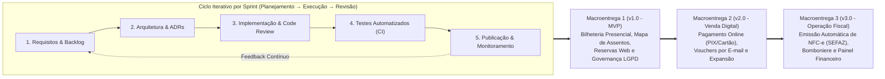

# Capítulo 3 – Processos Organizacionais Habilitadores

Este capítulo apresenta a estrutura organizacional, as práticas de engenharia e os recursos que sustentam a operação da **CineSoft Solutions** no desenvolvimento e na evolução da plataforma **CineDoom**. As diretrizes aqui descritas alinham-se às práticas de processos organizacionais da norma ABNT NBR ISO/IEC/IEEE 12207:2021, adaptadas de forma ágil e objetiva para a realidade de uma equipe de alta produtividade.

---

## 3.1 Modelo de Ciclo de Vida do Projeto

A CineSoft Solutions adota o modelo de ciclo de vida **Iterativo e Incremental Ágil**, unindo ciclos curtos de entrega (*Sprints*) à gestão visual contínua com quadro Kanban e automação de testes na esteira de integração contínua (CI/CD).

### Fases de Engenharia e Evolução em Três Macroentregas

O ciclo de vida do CineDoom é estruturado em **três Macroentregas evolutivas**. Cada iteração (Sprint de 2 semanas) percorre de ponta a ponta as etapas essenciais de engenharia de software:

No dia a dia, a equipe mantém um fluxo de comunicação dinâmico e sem burocracia excessiva:
1. **Planejamento da Sprint (*Sprint Planning*):** Seleção e priorização de tarefas no GitHub Projects, definindo objetivos claros e entregáveis testáveis para o período.
2. **Alinhamento Diário (*Daily Check-in*):** Troca de informações ágil (assíncrona via chat ou síncrona quando há bloqueios) para destravar impedimentos técnicos.
3. **Revisão por Pares (*Code Review*):** Nenhuma alteração entra na base principal sem a aprovação de pelo menos outro desenvolvedor, garantindo conformidade com padrões e ausência de regressões.
4. **Demonstração e Homologação (*Sprint Review*):** Apresentação prática dos novos fluxos implementados para validação de usabilidade e funcionalidade.
5. **Retrospectiva de Melhoria (*Retrospective*):** Análise rápida do que funcionou e ajuste imediato nas rotinas de trabalho da equipe.

### Por que esse modelo foi escolhido?

- **Redução Gradual de Riscos:** O núcleo mais sensível da aplicação — o bloqueio atômico de assentos para evitar venda duplicada e o isolamento seguro dos dados de cada cinema — foi construído e amplamente testado logo na primeira fase, antes de acoplar integrações externas como gateways bancários e sistemas fiscais.
- **Entrega Rápida de Valor (*Time-to-Market*):** A Macroentrega 1 disponibiliza um produto imediatamente utilizável para cinemas-piloto realizarem vendas físicas e receberem reservas online, validando a aceitação do mercado antes dos investimentos das fases seguintes.
- **Flexibilidade com Base em Feedback Real:** Ajustes no fluxo de atendimento de guichê, melhorias visuais no mapa de poltronas para telas menores e conformidade com a LGPD puderam ser incorporados com agilidade a partir de testes com operadores reais.

---

## 3.2 Ferramentas e Infraestrutura de Trabalho

Para manter a produtividade alta e a operação estável, a equipe utiliza um conjunto consolidado de ferramentas modernas:

**Tabela 7 – Inventário de Ferramentas e Ambientes de Trabalho**

| Categoria | Ferramenta / Plataforma | Papel no Projeto |
| :--- | :--- | :--- |
| **Controle de Código e Tarefas** | **GitHub & GitHub Projects** | Repositório Git com branches protegidas, rastreamento de tarefas no quadro Kanban, discussões de design e revisão de Pull Requests. |
| **Automação e CI/CD** | **GitHub Actions** | Execução automática de análise de tipos (`tsc`), regras de lint, verificação do schema do Prisma e execução de todos os testes a cada envio de código. |
| **Hospedagem e Execução** | **Vercel Serverless & Edge** | Publicação das páginas e rotas de API do Next.js 14, geração de links de demonstração para cada Pull Request (*preview deployments*) e deploy de produção em segundos. |
| **Banco de Dados Relacional** | **PostgreSQL (Supabase) + Prisma** | Persistência transacional com suporte a travas de concorrência (`SELECT FOR UPDATE`), migrações controladas por código e pooling eficiente de conexões. |
| **Design de Interface** | **Figma + Tailwind CSS + Lucide** | Criação do protótipo de alta fidelidade com visual cinematográfico escuro (*Dark UI*) e componentes acessíveis e responsivos para balcão e celular. |
| **Qualidade e Testes** | **Vitest + TypeScript** | Bateria de 711 testes automatizados executados em poucos segundos, validando desde regras simples até cenários simultâneos de concorrência pesada. |
| **Auditoria e Comunicação** | **Axiom + Resend** | Armazenamento de logs estruturados para auditoria e segurança, e entrega rápida de ingressos e vouchers no e-mail dos clientes. |

*Fonte: CineSoft Solutions (2026).*

---

## 3.3 Viabilidade Técnica, Operacional e Financeira

A criação do CineDoom apoia-se em quatro pilares de viabilidade:

- **Oportunidade de Mercado:** Cinemas independentes e salas culturais frequentemente utilizam planilhas manuais ou sistemas legados antigos, complexos e caros. O CineDoom entrega uma solução ágil, moderna e acessível no modelo SaaS B2B, permitindo que pequenos e médios exibidores operem com a mesma tecnologia de grandes redes.
- **Viabilidade Técnica:** A escolha do Next.js 14 com TypeScript e PostgreSQL oferece robustez comprovada. Em vez de adotar uma arquitetura complexa de microsserviços, a CineSoft optou por um monólito modular bem organizado com isolamento lógico multi-tenant, o que simplifica a manutenção sem abrir mão de segurança e desempenho.
- **Facilidade Operacional:** Toda a aplicação funciona 100% diretamente no navegador web. Isso elimina a necessidade de instalar programas locais nos computadores dos cinemas, facilitando o treinamento de atendentes e zerando custos de visita presencial para suporte técnico.
- **Sustentabilidade Financeira:** Na fase inicial de validação, os custos de infraestrutura em nuvem mantêm-se mínimos. Na operação comercial com múltiplos cinemas, o custo total de ferramentas pagas em nuvem gira em torno de **US$ 90/mês (~R$ 480/mês)**, valor que é integralmente coberto já com a mensalidade do **primeiro cinema cliente contratante**, proporcionando alta margem para investimento em novas melhorias.

---

## 3.4 Equipe, Responsabilidades e Capacitação

A equipe da CineSoft Solutions é multidisciplinar e organizada de forma a garantir autonomia técnica e cobertura completa do ciclo de desenvolvimento do software.

### Integrantes e Frentes de Atuação

**Tabela 8 – Composição da Equipe Técnica**

| Integrante | Função Principal | Foco Técnico e Especialidades |
| :--- | :--- | :--- |
| **Gabriel Henrique Lourenço Dias** | **Tech Lead & Arquiteto de Software** | Arquitetura Next.js 14, modelagem de banco de dados PostgreSQL, transações de concorrência ACID (`SELECT FOR UPDATE`), isolamento multi-tenant e segurança RBAC. |
| **Carlos Eduardo Freire da Silva** | **Engenheiro de Backend, Segurança & DevOps** | Criptografia aplicada e conformidade com a LGPD, APIs seguras com validação Zod, pipelines de CI/CD no GitHub Actions e automação de infraestrutura. |
| **Kayque Vicente Silva** | **Engenheiro de Qualidade (QA) & Gerente de Projeto** | Gestão de cronograma, análise de riscos técnicos, automação de testes no Vitest, controle de métricas e garantia da qualidade de ponta a ponta. |
| **Yury Nogueira de Oliveira Silva** | **Engenheiro de Requisitos, UX & Compliance** | Elicitação de regras de negócio, modelagem de casos de uso e diagramas C4, design de experiência do usuário (UI/UX) e conformidade normativa. |

*Fonte: CineSoft Solutions (2026).*

### Matriz de Responsabilidades (RACI)

Para assegurar clareza e evitar sobreposições ou lacunas nas tarefas, as principais atividades do projeto contam com papéis definidos:

**Tabela 9 – Matriz de Responsabilidades (RACI)**

| Atividade do Projeto | Gabriel Lourenço | Carlos Eduardo | Kayque Vicente | Yury Nogueira |
| :--- | :---: | :---: | :---: | :---: |
| Planejamento de Sprints, Cronograma e Riscos | C | C | **A / R** | C |
| Levantamento de Requisitos e Regras de Negócio | C | I | C | **A / R** |
| Arquitetura da Solução e Decisões Técnicas (ADRs) | **A / R** | C | I | R |
| Modelagem do Banco de Dados e Isolamento de Tenants | **A / R** | R | I | C |
| Criptografia de Dados Pessoais e Governança LGPD | A | **R** | C | **R** |
| Desenvolvimento do Motor de Bilheteria e Guichê | **A / R** | R | C | I |
| Automação de CI/CD e Monitoramento de Produção | A | **R** | C | I |
| Criação e Execução de Testes Automatizados (Vitest) | R | C | **A / R** | C |
| Revisão de Processos e Padrões de Qualidade | C | I | **A / R** | R |

*Legenda:* **R** = Responsável pela execução (*Responsible*); **A** = Aprovador final (*Accountable*); **C** = Consultado (*Consulted*); **I** = Informado (*Informed*).

### Programa Prático de Capacitação Interna

A equipe realiza treinamentos práticos direcionados aos desafios reais da plataforma:
- **Transações Concorrentes em Banco de Dados:** Práticas sobre ordenação de chaves para evitar travamentos (*deadlocks*) e uso correto de travas pessimistas sob alta concorrência.
- **Engenharia de Privacidade e LGPD:** Aplicação prática de algoritmos de anonimização e criptografia para proteção de dados de clientes no banco.
- **Simulação de Alta Carga com Testes Automatizados:** Criação de rotinas no Vitest disparando dezenas de transações simultâneas para garantir que o sistema não falhe em horários de pico.
- **Preparação para Integrações Futuras:** Estudo dos padrões de webhooks de pagamento (Stripe/PIX) e rotinas assíncronas para mensageria fiscal (NFC-e).

---

## 3.5 Critérios de Qualidade e Boas Práticas

A CineSoft adota barreiras de qualidade automatizadas (*Quality Gates*) para garantir que código instável ou inseguro não chegue aos cinemas clientes:

1. **Validação Automática em Cada Pull Request:**
   - O código precisa compilar sem erros de tipos (`TypeScript strict`).
   - A regra de lint impede dependências circulares entre módulos (`no-cycle`).
   - **100% de aprovação obrigatória** em toda a suíte de testes (711 testes automatizados cobrindo regras de assento, transações de compra e isolamento entre cinemas).
2. **Revisão Humana Obrigatória:**
   - Nenhuma funcionalidade é mesclada na branch principal sem revisão prévia por outro desenvolvedor.
3. **Ambiente de Teste Prévio (*Preview Deploy*):**
   - Antes de subir para produção, cada alteração gera uma URL de demonstração automática na Vercel para validação visual e operacional da equipe.
4. **Fundamentos de Arquitetura Limpa:**
   - Separação clara de responsabilidades com foco nas regras de domínio do cinema (DDD) e aplicação contínua de código modular, legível e desacoplado (SOLID).

---

## 3.6 Gestão do Conhecimento e Registro Técnico

Para evitar dependência exclusiva de pessoas e garantir que qualquer integrante possa assumir tarefas com segurança, o conhecimento da CineSoft é formalizado através de três mecanismos:

- **Documentação Versionada com o Código (*Docs-as-Code*):** Manuais, especificações funcionais e instruções de instalação ficam no mesmo repositório Git do projeto, sendo atualizados no mesmo momento em que o código evolui.
- **Registro de Decisões de Arquitetura (ADRs):** Todas as escolhas estruturais importantes (como a decisão de usar travas pessimistas no banco relacional em vez de filas distribuídas, ou a seleção do Supabase) são registradas em fichas sucintas (`ADR-001` a `ADR-012`), explicando o motivo da escolha e as alternativas consideradas.
- **Guias Operacionais e Resoluções de Incidentes:** Soluções para problemas encontrados em homologação (como ajustes de consultas lentas ou dimensionamento de conexões) são transformadas em passos objetivos para consulta rápida pelo time de suporte.
