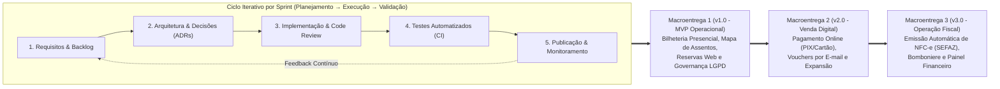

# Capítulo 3 – Processos Organizacionais Habilitadores

Este capítulo apresenta a estrutura organizacional, as políticas de engenharia e os recursos que sustentam a operação da **CineSoft Solutions** no desenvolvimento contínuo da plataforma **CineDoom**. As práticas aqui descritas alinham-se aos processos organizacionais da norma ABNT NBR ISO/IEC/IEEE 12207:2021, demonstrando como a organização fornece governança, infraestrutura centralizada, equipe capacitada e controle de qualidade para que o projeto atinja seus objetivos com previsibilidade.

---

## 3.1 Modelo de Ciclo de Vida do Projeto

A CineSoft Solutions adota como padrão organizacional o modelo de ciclo de vida **Iterativo e Incremental Ágil**, combinando o planejamento de entregas em *Sprints* de 2 semanas com o acompanhamento contínuo de fluxo no quadro Kanban e validação automatizada em integração contínua (CI/CD).

### Fases de Engenharia e Evolução em Três Macroentregas

O ciclo de vida do CineDoom é estruturado em **três Macroentregas evolutivas (Releases)**. Cada iteração percorre obrigatoriamente cinco etapas fundamentais de engenharia de software:

No dia a dia operacional, a equipe estabelece cerimônias diretas e focadas na produtividade:
1. **Planejamento da Sprint (*Sprint Planning*):** Seleção e detalhamento dos itens do backlog no quadro do projeto, definindo responsáveis e critérios de aceitação claros.
2. **Alinhamento Diário (*Daily Check-in*):** Comunicação ágil (predominantemente assíncrona no chat da equipe e síncrona sob demanda) para identificar e eliminar impedimentos técnicos.
3. **Revisão Técnica Obrigatória (*Code Review*):** Nenhuma alteração é integrada à base comum sem a análise e aprovação de outro desenvolvedor em um Pull Request.
4. **Demonstração e Homologação (*Sprint Review*):** Validação prática das funcionalidades implementadas em ambiente de demonstração antes da liberação.
5. **Retrospectiva de Melhoria Contínua (*Retrospective*):** Avaliação periódica do processo de trabalho, gerando ajustes práticos nas rotinas da equipe.

### Fluxo de Trabalho no Git (Política Corporativa de Branches)

Para garantir estabilidade em produção e permitir desenvolvimento paralelo sem conflitos, a organização adota um fluxo de ramificação estruturado no Git:

- **`main`:** Ramo estável que reflete o código atualmente implantado em produção (`https://cinedoom.vercel.app`). Commits diretos são estritamente bloqueados; apenas Pull Requests testados e aprovados vindos de `staging` podem ser integrados aqui.
- **`staging`:** Ambiente de pré-produção e homologação. Recebe as versões consolidadas vindas de `develop` para validação com usuários e testes de ponta a ponta.
- **`develop`:** Ramo principal de integração contínua do dia a dia. É onde as novas funcionalidades são unificadas e testadas pela esteira automática.
- **`feat/*` ou `fix/*`:** Ramos temporários criados a partir de `develop` para desenvolver uma história específica ou corrigir uma não conformidade, sendo excluídos após o merge do Pull Request.

### Critérios de Escolha do Modelo

- **Mitigação Progressiva de Riscos:** O núcleo de maior complexidade — o motor de reservas com bloqueio atômico para impedir venda duplicada e o isolamento seguro dos dados de cada cinema — foi implementado e estressado logo na primeira fase, evitando retrabalho nas integrações futuras.
- **Geração de Valor Imediato (*Time-to-Market*):** A Macroentrega 1 entrega uma versão funcional para cinemas-piloto realizarem vendas físicas e aceitarem reservas pela web, permitindo validar o produto em operação real.
- **Adaptabilidade Contínua:** O formato iterativo permitiu aperfeiçoar a interface do mapa de poltronas para telas menores e ajustar fluxos de atendimento de balcão com base no feedback direto de operadores.

---

## 3.2 Infraestrutura e Ferramentas Organizacionais

Para garantir que a equipe técnica opere com alta produtividade e segurança, a CineSoft Solutions estabeleceu uma infraestrutura corporativa centralizada, apoiada em uma Organização formal no GitHub e em serviços gerenciados em nuvem.

### A Organização Corporativa no GitHub (`CINESOFT-SOLUTIONS`)

A infraestrutura de desenvolvimento foi consolidada sob a organização **`CINESOFT-SOLUTIONS`** no GitHub (`https://github.com/CINESOFT-SOLUTIONS`), que centraliza:

1. **Repositórios Segregados:**
   - **`cinedoom-app`:** Repositório que hospeda o código-fonte da aplicação, migrações de banco, componentes visuais e suítes de testes automatizados.
   - **`manual-processos-software`:** Repositório dedicado à documentação formal de engenharia, especificações de requisitos e manuais de processo (*Docs-as-Code*).
2. **Governança de Acesso e Segurança:** Controle centralizado de permissões dos membros da equipe e proteção de branches com regras que impedem push forçado e commits diretos nos ramos protegidos (`main`, `staging` e `develop`).
3. **Gestão de Projeto com GitHub Projects v2:** Quadro Kanban corporativo unificado, permitindo rastrear o progresso das tarefas, issues e marcos (*milestones*) de cada Sprint.
4. **Pipeline Automatizada com GitHub Actions:**
   - **`ci.yml` (Validação Contínua):** Disparado em todo push e Pull Request para `main`, `staging` e `develop`. Executa checagem de tipos (`pnpm tsc --noEmit`), análise estática de código e detecção de ciclos (`pnpm eslint`), e a execução de todos os testes unitários e de integração (`pnpm test`).
   - **`deploy.yml` (Entrega Contínua):** Automatiza a promoção de versões e o provisionamento de ambientes específicos para cada estágio do ciclo de vida.

### Inventário de Ferramentas e Serviços

**Tabela 7 – Inventário de Ferramentas e Infraestrutura da CineSoft Solutions**

| Categoria | Ferramenta / Plataforma | Papel e Utilização no Projeto |
| :--- | :--- | :--- |
| **Organização e Código** | **GitHub (`CINESOFT-SOLUTIONS`)** | Organização corporativa que hospeda repositórios, controle de permissões de membros e quadros de gestão (Projects v2). |
| **Integração e Entrega (CI/CD)** | **GitHub Actions** | Execução de pipelines automáticas de validação (tipagem, lint, testes e build) e esteiras de deploy por ambiente. |
| **Hospedagem e Execução Serverless** | **Vercel** | Hospedagem da aplicação Next.js 14 com distribuição na borda (CDN), geração de links de demonstração para Pull Requests e deploy em produção. |
| **Banco de Dados Relacional** | **PostgreSQL (Supabase) + Prisma ORM** | Banco relacional em nuvem com suporte a transações ACID (`SELECT FOR UPDATE`), pooling de conexões e migrações versionadas. |
| **Design e Identidade Visual** | **Figma + Tailwind CSS + Lucide** | Prototipação das telas, Design System no tema escuro (*Dark Cinema UI*) e componentes visuais acessíveis e responsivos. |
| **Testes e Qualidade** | **Vitest + TypeScript 5** | Execução rápida de testes automatizados com cobertura de regras de negócio, testes de isolamento multi-tenant e concorrência. |
| **Auditoria e Notificações** | **Axiom Cloud + Resend API** | Retenção segura de logs para fins de conformidade e auditoria, e disparo confiável de vouchers de reserva para os clientes. |

*Fonte: CineSoft Solutions (2026).*

---

## 3.3 Justificativa Estratégica e Viabilidade do Projeto

O investimento no desenvolvimento do CineDoom decorre de uma decisão estratégica da CineSoft Solutions para atender a um segmento de mercado historicamente desassistido por soluções tecnológicas acessíveis.

### Oportunidade e Alinhamento Estratégico

O mercado brasileiro de exibição cinematográfica conta com centenas de salas independentes, cinemas de rua, centros culturais e redes regionais que frequentemente operam com processos manuais (planilhas) ou dependem de sistemas legados de alto custo, que cobram taxas excessivas sobre cada ingresso emitido. 

O CineDoom posiciona a CineSoft Solutions como fornecedora de um SaaS moderno, cobrado por mensalidade fixa previsível, democratizando a tecnologia de reserva online e gestão de bilheteria para exibidores de pequeno e médio porte.

### Dimensões de Viabilidade

- **Viabilidade Técnica:** A arquitetura adotada combina Next.js 14, TypeScript e PostgreSQL sobre Prisma ORM. A escolha de um monólito modular com isolamento lógico multi-tenant no banco relacional eliminou a alta complexidade e os custos de infraestrutura de microsserviços distribuídos, garantindo transações atômicas nativas e fácil manutenção.
- **Viabilidade Operacional:** Por ser uma aplicação que opera integralmente no navegador web (tanto nos computadores da bilheteria quanto nos smartphones dos clientes), não há necessidade de instalar ou atualizar programas nas máquinas físicas dos cinemas, o que reduz custos operacionais de implantação e simplifica o suporte.
- **Viabilidade Financeira:**
  - *Fase Inicial (Macroentrega 1):* Operação com custos de nuvem reduzidos para homologação e projetos-piloto.
  - *Fase de Escala Comercial (Macroentregas 2 e 3):* A infraestrutura de produção em nuvem — somando planos corporativos de banco de dados, hospedagem, e-mail transacional e auditoria — totaliza cerca de **US$ 90/mês (~R$ 480/mês)**. Esse custo é integralmente coberto já com a mensalidade do **primeiro cinema contratante** (ticket médio previsto de R$ 590 a R$ 1.290/mês por complexo), gerando sustentabilidade financeira e margem operacional saudável para a empresa.

---

## 3.4 Papéis, Competências e Plano de Capacitação (RACI)

A equipe da CineSoft Solutions é organizada de maneira multidisciplinar, distribuindo competências técnicas complementares para cobrir todas as necessidades do ciclo de vida da plataforma.

### Composição da Equipe Técnica

**Tabela 8 – Composição da Equipe e Especialidades Técnicas**

| Integrante | Função Principal | Foco Técnico e Especialidades |
| :--- | :--- | :--- |
| **Gabriel Henrique Lourenço Dias** | **Tech Lead & Arquiteto de Software** | Arquitetura Next.js 14, modelagem de banco de dados relacional, transações concorrentes ACID (`SELECT FOR UPDATE`), multi-tenancy e testes de concorrência. |
| **Carlos Eduardo Freire da Silva** | **Engenheiro de Backend, Segurança & DevOps** | Criptografia aplicada e conformidade LGPD, APIs com validação estrita (Zod), automação de CI/CD no GitHub Actions e monitoramento. |
| **Kayque Vicente Silva** | **Engenheiro de Qualidade (QA) & Gerente de Projeto** | Gestão de cronograma e escopo, automação de testes no Vitest, controle de métricas de qualidade e garantia dos critérios de aceitação. |
| **Yury Nogueira de Oliveira Silva** | **Engenheiro de Requisitos, UX & Compliance** | Elicitação de regras de negócio, modelagem de casos de uso e diagramas de arquitetura, usabilidade (UI/UX) e conformidade normativa. |

*Fonte: CineSoft Solutions (2026).*

### Matriz de Responsabilidades (RACI)

A matriz abaixo estabelece a governança sobre as principais atividades técnicas e organizacionais do projeto:

**Tabela 9 – Matriz de Responsabilidades por Atividade (RACI)**

| Atividade do Ciclo de Vida | Gabriel Lourenço | Carlos Eduardo | Kayque Vicente | Yury Nogueira |
| :--- | :---: | :---: | :---: | :---: |
| Planejamento de Sprints, Cronograma e Riscos | C | C | **A / R** | C |
| Elicitação de Requisitos e Especificações Técnicas (SDD) | C | I | C | **A / R** |
| Arquitetura da Solução e Decisões Técnicas (ADRs) | **A / R** | C | I | R |
| Modelagem de Dados e Isolamento de Tenants | **A / R** | R | I | C |
| Criptografia de Dados Pessoais e Conformidade LGPD | A | **R** | C | **R** |
| Implementação do Motor de Reservas e Bilheteria | **A / R** | R | C | I |
| Automação de CI/CD e Infraestrutura de Nuvem | A | **R** | C | I |
| Criação e Execução de Testes Automatizados (Vitest) | R | C | **A / R** | C |
| Governança de Qualidade e Revisão de Processos | C | I | **A / R** | R |

*Legenda:* **R** = Responsável pela execução (*Responsible*); **A** = Aprovador final (*Accountable*); **C** = Consultado (*Consulted*); **I** = Informado (*Informed*).

### Plano de Capacitação Contínua

Para manter a equipe alinhada às melhores práticas de mercado e capacitada para os desafios das próximas Macroentregas, foram estruturadas sessões de treinamento prático interno (*workshops*):
1. **Transações e Concorrência em Bancos de Dados:** Técnicas de ordenação determinística de chaves para prevenção de travamentos mútuos (*deadlocks*) e uso de travas pessimistas sob picos de acesso simultâneo.
2. **Engenharia de Privacidade e LGPD:** Criptografia autenticada para dados sensíveis, geração de índices de busca anônimos e rotinas de anonimização irreversível sem corromper históricos de venda.
3. **Simulação de Alta Concorrência com Vitest:** Construção de cenários de estresse automatizados disparando múltiplas requisições simultâneas contra o motor de reservas.
4. **Integrações de Pagamento e Fiscais:** Estudo de fluxos de conciliação de webhooks de pagamento (PIX e cartão) e padrões de contingência para emissão de notas fiscais (NFC-e na SEFAZ).

---

## 3.5 Plano de Qualidade: Diretrizes, Critérios e Métricas

A política de qualidade da CineSoft Solutions estabelece barreiras automatizadas (*Quality Gates*) e princípios de desenvolvimento para garantir que nenhuma alteração degrade a segurança ou a estabilidade da plataforma em produção.

### Diretrizes e Princípios de Engenharia Adotados

A organização estabelece quatro pilares técnicos que orientam a escrita de código em todos os repositórios:

- **Spec-Driven Development (SDD):** Nenhuma funcionalidade é implementada sem especificação prévia documentada em `specs/` com schemas de entrada e saída validados por contratos formais (Zod).
- **Domain-Driven Design (DDD):** Organização do sistema por contextos bem delimitados (*Bounded Contexts*), isolando a lógica de negócio do cinema (sessões, ingressos, bloqueios temporários) de preocupações externas de infraestrutura e persistência.
- **Princípios SOLID:** Aplicação contínua de código modular com responsabilidade única, desacoplamento de serviços e injeção de dependências, facilitando testes e manutenções futuras.
- **Test-Driven Development (TDD) e Pirâmide de Testes:** Construção prioritária de testes automatizados para regras críticas de domínio antes ou conjuntamente à implementação do código de produção.

### Critérios de Qualidade e Bloqueios Automatizados (*Quality Gates*)

Para que qualquer código seja integrado aos ramos principais (`develop`, `staging` e `main`), os seguintes critérios devem ser atendidos na esteira do GitHub Actions:

1. **Validação Estática e Compilação:** Tipagem estrita no TypeScript sem erros (`tsc --noEmit`) e ausência de dependências circulares entre arquivos (`eslint no-cycle`).
2. **Execução Completa da Suíte de Testes:** **100% de aprovação obrigatória nos testes automatizados do Vitest**, incluindo testes unitários de regras de negócio, testes de concorrência com 50 threads simultâneas e 500 cenários de teste de isolamento entre cinemas (*cross-tenant*).
3. **Revisão Humana de Código:** Exigência de pelo menos uma aprovação de outro desenvolvedor em todo Pull Request.
4. **Verificação de Build:** Compilação bem-sucedida do pacote de produção no ambiente do runner antes da autorização de deploy.

---

## 3.6 Estratégia de Gestão do Conhecimento

A organização assegura que todo o conhecimento técnico, arquitetural e processual do CineDoom seja documentado, versionado e facilmente acessível, reduzindo a dependência de pessoas isoladas e preservando o capital intelectual da empresa.

### Mecanismos de Registro e Preservação

- **Abordagem *Docs-as-Code*:** Todas as especificações funcionais, modelos de dados, planos de teste e manuais de processo residem no repositório Git junto à documentação técnica, sendo atualizados e revisados no mesmo fluxo de Pull Requests do código.
- **Registro Formal de Decisões de Arquitetura (ADRs):** Decisões estruturais relevantes da plataforma (como a seleção do banco relacional gerenciado, o uso de bloqueios pessimistas em vez de filas e a estratégia de multi-tenancy) são documentadas em fichas formais (`ADR-001` a `ADR-012`), registrando o contexto, as opções avaliadas e as consequências da decisão.
- **Rastreabilidade nos Artefatos de Código:** Os serviços, controladores e arquivos de teste contêm referências explícitas aos requisitos funcionais (`RF-XX`), regras de negócio (`RN-XX`) e critérios de aceitação correspondentes.
- **Base de Lições Aprendidas e Guias Técnicos:** Resoluções de desafios encontrados durante os ciclos de desenvolvimento (como parametrização de limites de conexões no banco ou ajustes de concorrência) são registradas em guias internos para agilizar a resolução de novos chamados e guiar novos desenvolvedores.
