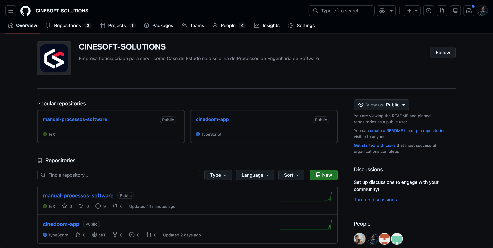
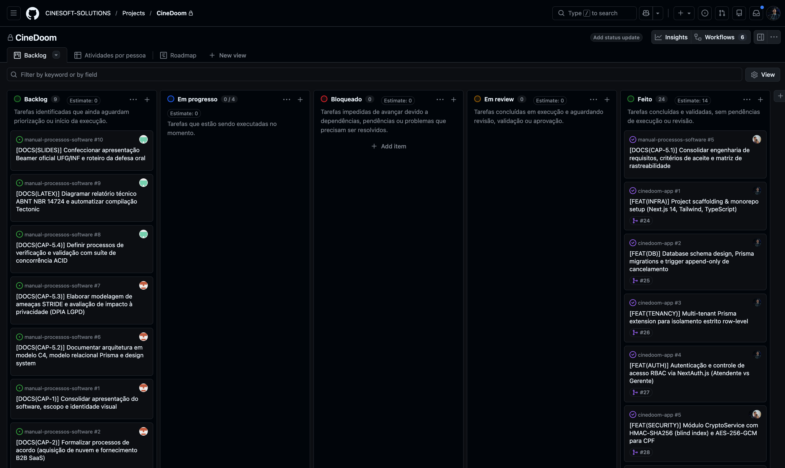

# Capítulo 3 – Processos Organizacionais Habilitadores

Este capítulo apresenta a estrutura organizacional, as políticas de engenharia e os recursos que sustentam a operação da **CineSoft Solutions** no desenvolvimento contínuo da plataforma **CineDoom**. As práticas aqui descritas alinham-se aos processos organizacionais da norma ABNT NBR ISO/IEC/IEEE 12207:2021, demonstrando como a organização fornece governança, infraestrutura centralizada, equipe capacitada e controle de qualidade para que o projeto atinja seus objetivos com previsibilidade.

---

## 3.1 Modelo de Ciclo de Vida do Projeto

A CineSoft Solutions adota o modelo de ciclo de vida **Iterativo e Incremental**, com práticas ágeis de desenvolvimento. O trabalho é organizado em ciclos de duas semanas (*Sprints*), nos quais são planejadas, desenvolvidas e avaliadas partes funcionais do sistema. O acompanhamento das atividades ocorre por meio de um quadro Kanban, enquanto práticas de integração contínua (CI) e entrega contínua (CD) apoiam a integração, a verificação e a disponibilização das alterações.

### Fases de Engenharia e Evolução em Três Macroentregas

O desenvolvimento do CineDoom é conduzido por iterações sucessivas, nas quais as atividades de engenharia são realizadas conforme as necessidades de cada incremento. Essas atividades compreendem:

1. **Requisitos e planejamento:** refinamento das necessidades, priorização do backlog e definição dos critérios de aceitação.
2. **Arquitetura e design:** avaliação das soluções técnicas, definição de componentes e registro de decisões arquiteturais relevantes (ADRs), quando necessário.
3. **Implementação e revisão:** desenvolvimento das funcionalidades, integração do código e revisão por pares (*Code Review*).
4. **Verificação e testes:** execução de testes automatizados e verificações de qualidade para avaliar o comportamento das alterações.
5. **Publicação e acompanhamento:** disponibilização dos incrementos em ambiente apropriado e monitoramento de seu funcionamento.

As atividades não constituem fases sequenciais rígidas: podem ocorrer de maneira sobreposta e ser retomadas ao longo de uma mesma iteração, conforme a complexidade e as necessidades do desenvolvimento.

```plantuml
@startuml
skinparam monochrome true
skinparam shadowing false
skinparam defaultFontName Helvetica
skinparam packageStyle rectangle
skinparam roundcorner 8

left to right direction

package "Ciclo Iterativo de Desenvolvimento (Sprints de 2 semanas)" {
    rectangle "1. Requisitos\n& Planejamento" as R
    rectangle "2. Arquitetura\n& Design" as D
    rectangle "3. Implementação\n& Code Review" as I
    rectangle "4. Verificação\n& Testes" as T
    rectangle "5. Publicação\n& Acompanhamento" as P

    R --> D
    D --> I
    I --> T
    T --> P
    P ..> R : Feedback e refinamento
}

rectangle "Incrementos\nvalidados" as INC

package "Roadmap de Evolução do Produto" {
    rectangle "Macroentrega 1\nv1.0 – MVP\n\nBilheteria presencial\nMapa 2D\nReservas Web\nGovernança LGPD" as M1

    rectangle "Macroentrega 2\nv2.0 – Expansão Digital\n\nPagamento PIX/Cartão\nVouchers por e-mail\nVenda digital" as M2

    rectangle "Macroentrega 3\nv3.0 – Operação Fiscal\n\nNFC-e\nBomboniere\nPainel financeiro" as M3

    M1 ==> M2
    M2 ==> M3
}

P --> INC : Incrementos das iterações
INC --> M1 : Consolidação progressiva

note bottom of INC
  Cada macroentrega pode envolver
  múltiplas Sprints.
end note

@enduml
```

A evolução do produto está organizada em três macroentregas, que agrupam funcionalidades relacionadas e representam marcos de evolução da solução:

- **Macroentrega 1 (v1.0 – MVP):** bilheteria presencial, mapa de assentos 2D, reservas pela web e funcionalidades de governança e proteção de dados.
- **Macroentrega 2 (v2.0 – Expansão Digital):** pagamento on-line por PIX e cartão, emissão de vouchers por e-mail e ampliação das funcionalidades de venda digital.
- **Macroentrega 3 (v3.0 – Operação Fiscal e Financeira):** integração para emissão de NFC-e, módulo de bomboniere e painel financeiro.

Cada macroentrega pode envolver diversas Sprints, e os incrementos produzidos ao longo desses ciclos contribuem progressivamente para sua conclusão.

### Fluxo de Trabalho no Git (Política Corporativa de Branches)

Para garantir estabilidade em produção e permitir desenvolvimento paralelo sem conflitos, a organização adota um fluxo de ramificação estruturado no Git:

- **`main`:** ramo estável que reflete o código atualmente implantado em produção (`https://cinedoom.vercel.app/`). Commits diretos são bloqueados; apenas Pull Requests testados e aprovados vindos de `staging` são integrados.
- **`staging`:** ambiente de pré-produção e homologação, que recebe as versões consolidadas de `develop` para validação com usuários e testes de ponta a ponta.
- **`develop`:** ramo principal de integração contínua do dia a dia, onde as novas funcionalidades são unificadas e testadas pela esteira automática.
- **`feat/*` e `fix/*`:** ramos temporários criados a partir de `develop` para uma história específica ou correção de não conformidade, excluídos após o merge do Pull Request.

### Organização das Iterações e Práticas de Trabalho

Durante os ciclos de desenvolvimento, a equipe adota práticas de planejamento, acompanhamento, revisão e melhoria contínua:

1. **Planejamento da Sprint (*Sprint Planning*):** seleção e detalhamento dos itens priorizados do backlog, com definição dos objetivos do ciclo e dos critérios de aceitação.
2. **Alinhamento diário (*Daily Check-in*):** acompanhamento do progresso, predominantemente assíncrono pelos canais de comunicação da equipe, com reuniões síncronas quando necessário para discutir impedimentos.
3. **Revisão de código (*Code Review*):** análise das alterações por outro desenvolvedor antes da integração à base comum, utilizando Pull Requests.
4. **Revisão dos incrementos (*Sprint Review*):** demonstração e avaliação das funcionalidades desenvolvidas, com coleta de feedback e identificação de ajustes necessários.
5. **Retrospectiva (*Sprint Retrospective*):** avaliação das práticas de trabalho, identificação de dificuldades e definição de melhorias para os ciclos seguintes.

Essas práticas são complementadas pelo quadro Kanban, que permite visualizar o estado das atividades nas etapas de Backlog, Em progresso, Bloqueado, Em review e Feito.

### Governança, Avaliação e Melhoria Contínua do Ciclo de Vida

A governança do modelo adotado é sustentada por quatro diretrizes:

- **Padronização do processo:** as práticas de desenvolvimento, revisão e validação são documentadas para orientar a execução das atividades e manter a consistência entre os ciclos.
- **Responsabilidades:** o Gerente de Projeto e QA Lead, Kayque Vicente Silva, e o Tech Lead, Gabriel Henrique Lourenço Dias, acompanham a aplicação do processo em suas respectivas atribuições, apoiando sua manutenção e evolução.
- **Avaliação periódica:** ao término de cada Sprint e na conclusão das macroentregas, a equipe avalia a eficácia do processo por meio de indicadores de fluxo, como Lead Time, tempo de revisão e identificação de gargalos no GitHub Projects.
- **Melhoria contínua:** as oportunidades identificadas nas retrospectivas são avaliadas e, quando aprovadas, incorporadas à *Definition of Done* (DoD) e às práticas de desenvolvimento.

Entre os critérios de qualidade estabelecidos para as entregas, destacam-se a execução de testes automatizados de concorrência nas operações críticas de bilheteria e a verificação estática de dependências circulares no código, por meio de ferramentas de análise configuradas no projeto.

Dessa forma, o modelo adotado estabelece uma dinâmica de evolução progressiva do CineDoom, combinando planejamento, desenvolvimento, verificação e avaliação contínua, com mecanismos de acompanhamento e melhoria dos processos da CineSoft Solutions.

---

## 3.2 Infraestrutura e Ferramentas Organizacionais

A infraestrutura da CineSoft Solutions provê os recursos computacionais, serviços em nuvem e ferramentas necessários para desenvolver, testar, implantar e manter o **CineDoom** ao longo de todo o seu ciclo de vida.

### Critérios de Seleção e Requisitos

A infraestrutura foi desenhada para viabilizar um SaaS multi-tenant sem a sobrecarga de gerenciar servidores físicos dedicados. A escolha dos recursos guiou-se por três requisitos centrais:

- **Operação 100% em Nuvem:** Adoção de serviços gerenciados com alta disponibilidade e cobrança por uso, mantendo o custo fixo próximo de zero na fase inicial de validação.
- **Consistência Transacional Estrita:** Banco relacional com suporte a travas de concorrência (`SELECT FOR UPDATE`), essencial para impedir reserva duplicada da mesma poltrona entre web e guichê.
- **Segregação de Ambientes:** Isolamento rigoroso entre desenvolvimento local, homologação (*Preview*) e produção, com segredos protegidos fora do código-fonte.

### A Organização no GitHub (`CINESOFT-SOLUTIONS`)

Como base institucional de governança e trabalho colaborativo, a empresa estruturou a organização **`CINESOFT-SOLUTIONS`** no GitHub (`https://github.com/CINESOFT-SOLUTIONS`), centralizando:

1. **Repositórios Segregados:** Separação formal entre a aplicação (`cinedoom-app`) e a documentação de engenharia e requisitos (`manual-processos-software`), tratada como código (*Docs-as-Code*).
2. **Governança de Acessos:** Controle centralizado de permissões nominais da equipe com autenticação em dois fatores (2FA).
3. **Gestão Visual com GitHub Projects v2:** Quadro Kanban corporativo para planejamento das Sprints e acompanhamento contínuo do fluxo de trabalho.

*Figura: Organização corporativa CINESOFT-SOLUTIONS no GitHub e repositórios oficiais.*

*Figura: Quadro Kanban corporativo no GitHub Projects v2.*

### Inventário de Ferramentas Disponibilizadas

A tabela a seguir consolida os recursos selecionados para sustentar o ciclo de vida da plataforma:

**Tabela 7 – Inventário de infraestrutura e ferramentas organizacionais**

| Categoria | Recurso / Ferramenta | Papel e Justificativa no Projeto |
| :--- | :--- | :--- |
| **Código e Governança** | **Git e GitHub (`CINESOFT-SOLUTIONS`)** | Hospedagem dos repositórios, controle de versões e gestão centralizada de membros. |
| **Gestão do Trabalho** | **GitHub Projects v2** | Quadro Kanban para priorização do backlog, acompanhamento de Sprints e identificação de gargalos. |
| **Integração e Entrega (CI/CD)** | **GitHub Actions** | Pipelines automatizadas de compilação, validação de lint e execução de testes a cada Pull Request. |
| **Hospedagem e Servidores** | **Vercel** | Execução serverless do Next.js 14, distribuição em borda (CDN) e geração de ambientes de *Preview* e produção. |
| **Banco de Dados Relacional** | **PostgreSQL (Supabase) + Prisma ORM** | Persistência transacional ACID com bloqueio pessimista de assentos e migrações versionadas. |
| **Qualidade e Testes** | **Vitest + TypeScript 5** | Execução rápida de testes automatizados de unidade, concorrência e tipagem estática estrita. |
| **Observabilidade e Auditoria** | **Axiom Cloud (Log Drain)** | Ingestão e retenção de logs estruturados por 365 dias para auditoria e conformidade com a LGPD. |
| **E-mail Transacional** | **Resend API** | Disparo de vouchers e confirmações de reserva com autenticação SPF e DKIM. |
| **Design de Interface** | **Figma + Tailwind CSS + Lucide** | Prototipação de telas e padronização do Design System no tema escuro (*Dark Cinema UI*). |

*Fonte: CineSoft Solutions (2026).*

### Ambientes de Execução e Manutenção Contínua

O ciclo de vida do CineDoom opera em três ambientes segregados:
- **Desenvolvimento Local:** Onde os desenvolvedores escrevem código, executam migrações e rodam os testes automatizados.
- **Preview (Homologação):** Gerado automaticamente a cada Pull Request na Vercel para validação funcional e visual da equipe antes do merge.
- **Produção:** Instância estável (`https://cinedoom.vercel.app`) acessível pelos cinemas e clientes finais, atualizada exclusivamente após aprovação da esteira de CI/CD.

A sustentação dessa infraestrutura é mantida por três rotinas contínuas da liderança técnica:
1. **Segurança de Credenciais:** Tokens e chaves de API residem exclusivamente em cofres de variáveis protegidas (GitHub Secrets e painel da Vercel).
2. **Controle de Cotas e Consumo:** Monitoramento quinzenal do uso de banco, logs e e-mails para garantir previsibilidade de custos.
3. **Auditoria de Vulnerabilidades:** Execução frequente de `pnpm security:audit`, que bloqueia vulnerabilidades altas ou críticas fora do baseline documentado em `security/audit-baseline.json`.

---

## 3.3 Justificativa Estratégica e Viabilidade do Projeto

O investimento no desenvolvimento do CineDoom decorre de uma decisão estratégica da CineSoft Solutions para atender a um segmento de mercado historicamente desassistido por soluções tecnológicas acessíveis. Esta seção registra a justificativa do investimento, os critérios de autorização, a alocação de recursos e as regras de avaliação, continuidade e encerramento do projeto, conforme o Processo de Gerenciamento de Portfólio da ISO/IEC/IEEE 12207.

### Oportunidade e Alinhamento Estratégico

O mercado brasileiro de exibição cinematográfica conta com centenas de salas independentes, cinemas de rua, centros culturais e redes regionais que frequentemente operam com processos manuais (planilhas) ou dependem de sistemas legados de alto custo, que cobram taxas excessivas sobre cada ingresso emitido. 

O CineDoom posiciona a CineSoft Solutions como fornecedora de um SaaS moderno, cobrado por mensalidade fixa previsível, democratizando a tecnologia de reserva online e gestão de bilheteria para exibidores de pequeno e médio porte.

### Identificação e Autorização do Projeto

O CineDoom foi identificado como oportunidade prioritária por atender aos seguintes critérios:

- **Alinhamento estratégico:** atende ao objetivo de oferecer um SaaS acessível a exibidores de pequeno e médio porte.
- **Viabilidade:** apresenta viabilidade técnica, operacional e financeira, descrita a seguir.
- **Retorno esperado:** possui modelo de receita recorrente, com mensalidade fixa por cinema.

O início do projeto foi autorizado pela direção da CineSoft Solutions, que é responsável por decidir sobre sua continuidade, redirecionamento ou cancelamento. A gestão do projeto é atribuída ao gerente do projeto, que responde à direção pelo cumprimento de prazos, custos e requisitos.

### Dimensões de Viabilidade

- **Viabilidade Técnica:** A arquitetura adotada combina Next.js 14, TypeScript e PostgreSQL sobre Prisma ORM. A escolha de um monólito modular com isolamento lógico multi-tenant no banco relacional eliminou a alta complexidade e os custos de infraestrutura de microsserviços distribuídos, garantindo transações atômicas nativas e fácil manutenção.
- **Viabilidade Operacional:** Por ser uma aplicação que opera integralmente no navegador web (tanto nos computadores da bilheteria quanto nos smartphones dos clientes), não há necessidade de instalar ou atualizar programas nas máquinas físicas dos cinemas, o que reduz custos operacionais de implantação e simplifica o suporte.
- **Viabilidade Financeira:**
  - *Fase Inicial (Macroentrega 1):* Operação com custos de nuvem reduzidos para homologação e projetos-piloto.
  - *Fase de Escala Comercial (Macroentregas 2 e 3):* A infraestrutura de produção em nuvem, somando planos corporativos de banco de dados, hospedagem, e-mail transacional e auditoria, totaliza cerca de **US$ 90/mês (aproximadamente R$ 480/mês, conforme câmbio de referência)**. Considerando o ticket previsto de R$ 910 a R$ 1.270/mês por complexo (assinatura-base de R$ 790 mais R$ 120 por sala ativa), estima-se que esse custo seja coberto já com a mensalidade do **primeiro cinema contratante**, o que indica sustentabilidade financeira e margem operacional positiva.

### Alocação de Recursos

Os recursos do projeto são distribuídos por macroentrega:

- **Pessoas:** equipe de desenvolvimento da CineSoft Solutions, com papéis definidos no Capítulo 2.
- **Infraestrutura:** serviços em nuvem descritos na Seção 3.2, com custos reduzidos na fase inicial e plano de produção nas fases seguintes.
- **Prazo:** as macroentregas 1, 2 e 3 estabelecem o cronograma de referência.

### Avaliação, Sustentação e Encerramento

O portfólio é avaliado ao término de cada macroentrega, verificando se o projeto continua justificando o investimento. Os critérios de avaliação são:

- aderência aos requisitos dos stakeholders e do projeto;
- cumprimento de prazo e custo previstos;
- evolução do custo de infraestrutura em relação à receita prevista;
- resultado do projeto-piloto, incluindo a contratação de cinemas.

Com base nessa avaliação, a direção decide por uma das ações abaixo:

- **Sustentar:** o projeto atende ao acordo e aos requisitos e segue para a próxima macroentrega.
- **Redirecionar:** o projeto não atende parcialmente aos requisitos, e o escopo, o prazo ou os recursos são ajustados.
- **Cancelar:** os riscos superam os benefícios, por exemplo, se o projeto-piloto não resultar em cinema contratante ou se o custo de infraestrutura superar a receita prevista.
- **Encerrar:** o projeto atende integralmente ao acordo e a todos os requisitos, e as lições aprendidas são registradas para reutilização em projetos futuros.

---

## 3.4 Papéis, Competências e Plano de Capacitação (RACI)

A equipe da CineSoft Solutions é organizada de maneira multidisciplinar, distribuindo competências técnicas complementares para cobrir as necessidades do ciclo de vida da plataforma. Esta seção descreve os papéis, as responsabilidades, as competências requeridas e o plano de desenvolvimento da equipe, conforme o processo de Gerenciamento de Recursos Humanos da ISO/IEC/IEEE 12207.

### Composição da Equipe e Atribuição de Papéis

Os papéis foram atribuídos com base na formação e na experiência de cada integrante, validada pela direção da CineSoft Solutions no início do projeto.

**Tabela 8 – Composição da Equipe e Especialidades Técnicas**

| Integrante | Função Principal | Foco Técnico e Especialidades | Substituto |
| :--- | :--- | :--- | :--- |
| **Gabriel Henrique Lourenço Dias** | **Tech Lead & Arquiteto de Software** | Arquitetura Next.js 14, modelagem de banco relacional, transações concorrentes ACID (`SELECT FOR UPDATE`), multi-tenancy e testes de concorrência. | Carlos Eduardo |
| **Carlos Eduardo Freire da Silva** | **Engenheiro de Backend, Segurança & DevOps** | Criptografia aplicada e conformidade LGPD, APIs com validação estrita (Zod), CI/CD no GitHub Actions e monitoramento. | Gabriel Lourenço |
| **Kayque Vicente Silva** | **Engenheiro de Qualidade (QA) & Gerente de Projeto** | Gestão de cronograma e escopo, automação de testes no Vitest, métricas de qualidade e critérios de aceitação. | Yury Nogueira |
| **Yury Nogueira de Oliveira Silva** | **Engenheiro de Requisitos, UX & Compliance** | Elicitação de regras de negócio, casos de uso, diagramas de arquitetura, usabilidade (UI/UX) e conformidade normativa. | Kayque Vicente |

*Fonte: CineSoft Solutions (2026).*

A direção da CineSoft Solutions é responsável por autorizar o projeto e decidir sobre sua continuidade (Seção 3.3). O gerente do projeto responde à direção pelo cumprimento de prazos, custos e requisitos.

### Matriz de Responsabilidades (RACI)

A matriz abaixo estabelece a governança sobre as principais atividades do projeto. Cada atividade possui um único aprovador final (**A**).

**Tabela 9 – Matriz de Responsabilidades por Atividade (RACI)**

| Atividade do Ciclo de Vida | Gabriel Lourenço | Carlos Eduardo | Kayque Vicente | Yury Nogueira |
| :--- | :---: | :---: | :---: | :---: |
| Planejamento de Sprints, Cronograma e Riscos | C | C | **A / R** | C |
| Elicitação de Requisitos e Especificações Técnicas (SDD) | C | I | C | **A / R** |
| Arquitetura da Solução e Decisões Técnicas (ADRs) | **A / R** | C | I | C |
| Modelagem de Dados e Isolamento de Tenants | **A / R** | R | I | C |
| Criptografia de Dados Pessoais e Conformidade LGPD | C | **A / R** | C | R |
| Implementação do Motor de Reservas e Bilheteria | **A / R** | R | C | I |
| Automação de CI/CD e Infraestrutura de Nuvem | C | **A / R** | C | I |
| Criação e Execução de Testes Automatizados (Vitest) | R | C | **A / R** | C |
| Governança de Qualidade e Revisão de Processos | C | I | **A / R** | C |
| Documentação Técnica e de Processos | C | C | C | **A / R** |
| Gestão de Configuração (Git) e Revisão de Código | **A** | R | R | I |
| Suporte e Manutenção Pós-Implantação | C | **A / R** | R | I |

*Legenda:* **R** = Responsável pela execução (*Responsible*); **A** = Aprovador final (*Accountable*); **C** = Consultado (*Consulted*); **I** = Informado (*Informed*).

### Competências Requeridas e Lacunas

**Tabela 10 – Competências Requeridas, Lacunas e Ações**

| Competência requerida | Responsável | Nível atual | Lacuna | Ação |
| :--- | :--- | :---: | :--- | :--- |
| Transações concorrentes e prevenção de *deadlocks* | Gabriel, Carlos | Intermediário | Picos de acesso simultâneo | Workshop 1 |
| Criptografia e privacidade (LGPD) | Carlos, Yury | Intermediário | Anonimização sem corromper históricos | Workshop 2 |
| Testes de alta concorrência | Kayque, Gabriel | Básico | Cenários de estresse automatizados | Workshop 3 |
| Pagamentos e documentos fiscais | Carlos, Gabriel | Básico | Webhooks, PIX, cartão e NFC-e | Workshop 4 |

*Fonte: CineSoft Solutions (2026).*

### Plano de Capacitação Contínua

O desenvolvimento das competências ocorre por meio de workshops práticos internos, realizados antes da macroentrega em que a competência é necessária.

**Tabela 11 – Plano de Capacitação**

| Workshop | Conteúdo | Responsável | Prazo | Critério de eficácia |
| :--- | :--- | :--- | :--- | :--- |
| 1. Transações e Concorrência | Ordenação determinística de chaves contra *deadlocks* e travas pessimistas | Gabriel | Antes da Macroentrega 1 | Reservas simultâneas sem duplicidade de assento |
| 2. Privacidade e LGPD | Criptografia autenticada, índices de busca anônimos e anonimização irreversível | Carlos | Antes da Macroentrega 2 | Dados pessoais anonimizados sem perda de histórico de vendas |
| 3. Alta Concorrência com Vitest | Cenários de estresse com múltiplas requisições simultâneas ao motor de reservas | Kayque | Antes da Macroentrega 1 | Suíte de concorrência executada com zero falhas |
| 4. Pagamentos e Fiscais | Conciliação de webhooks (PIX e cartão) e contingência de NFC-e na SEFAZ | Carlos | Antes da Macroentrega 3 | Fluxo de pagamento conciliado em ambiente de homologação |

*Fonte: CineSoft Solutions (2026).*

### Avaliação, Registros e Riscos da Equipe

- **Avaliação da eficácia:** ao final de cada workshop, o critério de eficácia é verificado pelo gerente do projeto. Se não for atingido, a ação é repetida ou ajustada.
- **Registros de competência:** as lacunas, os workshops realizados e os resultados ficam registrados no repositório do projeto e são atualizados a cada macroentrega.
- **Dependência de pessoas-chave:** para reduzir o risco de concentração de conhecimento, adotam-se revisão cruzada de código, registro das decisões em ADRs e a designação de um substituto para cada papel (Tabela 8).
- **Acúmulo de papéis:** o integrante que atua como QA e gerente de projeto acumula funções. Para evitar conflito entre testar e cobrar prazos, os resultados dos testes são revisados por outro integrante da equipe.

---

## 3.5 Plano de Qualidade: Diretrizes, Critérios e Métricas

A política de qualidade da CineSoft Solutions estabelece barreiras automatizadas (*Quality Gates*) e princípios de desenvolvimento para garantir que nenhuma alteração degrade a segurança ou a estabilidade da plataforma em produção. Esta seção descreve a política, os objetivos, as responsabilidades, os critérios de controle, as métricas e o ciclo de melhoria, conforme o processo de Gerenciamento da Qualidade da ISO/IEC/IEEE 12207.

### Política e Objetivos de Qualidade

A direção da CineSoft Solutions aprova a política de qualidade, que consiste em entregar o CineDoom com integridade das reservas, isolamento entre cinemas e proteção de dados pessoais, verificados de forma automatizada antes de cada implantação.

Os objetivos de qualidade são:

- **Integridade das reservas:** nenhuma duplicidade de assento sob acesso concorrente.
- **Isolamento entre cinemas:** nenhum acesso a dados de outro cinema (*cross-tenant*).
- **Estabilidade:** nenhuma alteração integrada com falha nos gates.
- **Rastreabilidade:** toda funcionalidade vinculada a uma especificação documentada.

### Responsabilidades

Conforme o RACI (Seção 3.4), o Engenheiro de Qualidade (Kayque Vicente) é o aprovador final da governança de qualidade e dos testes automatizados. A revisão de cada *Pull Request* é feita por integrante diferente do autor, garantindo independência. Os resultados dos testes do próprio Engenheiro de Qualidade são revisados por outro integrante da equipe.

### Diretrizes e Princípios de Engenharia Adotados

Quatro pilares técnicos orientam a escrita de código em todos os repositórios. Cada pilar possui uma forma de verificação:

| Princípio | Descrição | Verificação |
| :--- | :--- | :--- |
| **Spec-Driven Development (SDD)** | Nenhuma funcionalidade é implementada sem especificação prévia em `specs/`, com schemas de entrada e saída validados por contratos formais (Zod). | O *Pull Request* deve referenciar a especificação correspondente; caso contrário, é recusado na revisão. |
| **Domain-Driven Design (DDD)** | Organização por contextos delimitados (*Bounded Contexts*), isolando a lógica de negócio (sessões, ingressos, bloqueios temporários) de infraestrutura e persistência. | Checklist de revisão e regra `eslint no-cycle` contra dependências circulares. |
| **Princípios SOLID** | Código modular com responsabilidade única, desacoplamento de serviços e injeção de dependências. | Checklist de revisão de código. |
| **TDD e Pirâmide de Testes** | Testes automatizados das regras críticas de domínio escritos antes ou junto da implementação. | Gate de testes e meta de cobertura (Tabela de métricas). |

### Critérios de Qualidade e Bloqueios Automatizados (*Quality Gates*)

Para que qualquer código seja integrado aos ramos principais (`develop`, `staging` e `main`), os critérios abaixo devem ser atendidos na esteira do GitHub Actions:

1. **Validação Estática e Compilação:** tipagem estrita sem erros (`tsc --noEmit`) e ausência de dependências circulares (`eslint no-cycle`).
2. **Suíte de Testes:** **100% de aprovação nos testes do Vitest**, incluindo testes unitários de regras de negócio, testes de concorrência com 50 threads simultâneas e 500 cenários de isolamento *cross-tenant*.
3. **Cobertura:** mínimo de 70% de *statements*, funções e linhas e 80% de *branches* nas regras de domínio (`src/modules/**` e `src/shared/**`).
4. **Segurança:** auditoria de dependências de produção (`pnpm security:audit`) sem vulnerabilidades altas ou críticas fora do baseline documentado, além de varredura de segredos no código sem ocorrências.
5. **Revisão Humana de Código:** pelo menos uma aprovação de outro desenvolvedor, com base em checklist (aderência à especificação, SOLID, tratamento de erros, proteção de dados pessoais e isolamento de cinemas).
6. **Verificação de Build:** compilação bem-sucedida do pacote de produção antes da autorização de deploy.

### Métricas e Indicadores de Qualidade

**Tabela 12 – Métricas de Qualidade**

| Métrica | Meta | Fonte de coleta | Frequência |
| :--- | :--- | :--- | :--- |
| Cobertura de testes nas regras de domínio | ≥ 70% (*statements*, funções e linhas) e ≥ 80% (*branches*) | Relatório do Vitest no CI | A cada *Pull Request* |
| Aprovação da suíte de testes | 100% | GitHub Actions | A cada *Pull Request* |
| Falhas de build no CI | Tendência decrescente | GitHub Actions | A cada macroentrega |
| Defeitos escapados para produção | 0 críticos | Registro de incidentes | A cada macroentrega |
| Tempo médio de correção de defeitos | Definido na primeira macroentrega e reavaliado depois | Quadro de tarefas (GitHub Projects) | A cada macroentrega |
| Aderência aos critérios de aceitação | 100% das funcionalidades entregues | Revisão do Engenheiro de Qualidade | A cada macroentrega |

*Fonte: CineSoft Solutions (2026).*

### Avaliação do Processo e Tratamento de Não Conformidades

Ao final de cada macroentrega, o Engenheiro de Qualidade realiza uma avaliação de conformidade com este manual, verificando se os gates foram respeitados e se as métricas atingiram as metas. As não conformidades são tratadas assim:

1. **Registro:** descrição, origem e gravidade, no quadro de tarefas.
2. **Ação corretiva:** definição de responsável e prazo.
3. **Verificação:** confirmação da correção pelo Engenheiro de Qualidade.

### Melhoria Contínua

Ao término de cada macroentrega, a equipe realiza uma retrospectiva para analisar as métricas, as não conformidades e as lições aprendidas. Com base nela, os gates, as metas e o checklist de revisão são atualizados, e as mudanças são registradas neste manual.

---

## 3.6 Estratégia de Gestão do Conhecimento

A organização assegura que todo o conhecimento técnico, arquitetural e processual do CineDoom seja documentado, versionado e facilmente acessível, reduzindo a dependência de pessoas isoladas e preservando o capital intelectual da empresa. Esta seção descreve os objetivos, os ativos, os mecanismos de registro e compartilhamento, a manutenção e a medição da eficácia, conforme o processo de Gerenciamento do Conhecimento da ISO/IEC/IEEE 12207.

### Objetivos

- Reduzir a dependência de integrantes específicos (risco registrado na Seção 3.4).
- Acelerar a integração de novos desenvolvedores.
- Preservar o histórico das decisões e a rastreabilidade entre requisitos, código e testes.

### Ativos de Conhecimento

**Tabela 13 – Ativos de Conhecimento**

| Ativo | Conteúdo | Local | Responsável |
| :--- | :--- | :--- | :--- |
| Especificações (SDD) | Requisitos funcionais, regras de negócio e contratos Zod | `specs/` | Engenheiro de Requisitos |
| ADRs | Decisões de arquitetura, `ADR-001` a `ADR-012` | Repositório Git | Tech Lead |
| Modelos de dados e planos de teste | Esquemas, cenários e critérios de aceitação | Repositório Git | Tech Lead e Engenheiro de Qualidade |
| Manual de processos | Processos, papéis e planos | Repositório Git | Gerente do Projeto |
| Guias técnicos e lições aprendidas | Soluções de problemas recorrentes | Repositório Git (guias internos) | Todos os integrantes |

*Fonte: CineSoft Solutions (2026).*

### Mecanismos de Registro e Preservação

- **Abordagem *Docs-as-Code*:** especificações, modelos de dados, planos de teste e manuais de processo residem no repositório Git e são atualizados e revisados no mesmo fluxo de *Pull Requests* do código.
- **Registro Formal de Decisões de Arquitetura (ADRs):** decisões estruturais, como o banco relacional gerenciado, os bloqueios pessimistas em vez de filas e a estratégia de multi-tenancy, são documentadas com contexto, opções avaliadas e consequências.
- **Rastreabilidade nos Artefatos de Código:** serviços, controladores e testes referenciam requisitos funcionais (`RF-XX`), regras de negócio (`RN-XX`) e critérios de aceitação (`CA-XX`), consolidados na matriz de rastreabilidade da Seção 5.1.2.
- **Lições Aprendidas e Guias Técnicos:** a solução de cada problema relevante, como limites de conexão no banco ou ajustes de concorrência, é registrada em guia interno ao final da correção.

### Compartilhamento do Conhecimento

- **Revisão cruzada de código:** todo *Pull Request* é revisado por outro integrante (Seção 3.5).
- **Workshops internos:** o plano de capacitação (Seção 3.4) dissemina as competências críticas.
- **Integração de novos integrantes:** a leitura do manual, dos ADRs e das especificações compõe o roteiro de entrada.
- **Substitutos por papel:** cada papel crítico possui um substituto designado (Tabela 8).

### Manutenção e Controle

- **Atualização:** alterações de código que afetem um ativo exigem a atualização do documento no mesmo *Pull Request*.
- **Revisão periódica:** ao final de cada macroentrega, os ativos são revisados quanto à atualidade.
- **Obsolescência:** documentos substituídos são marcados como obsoletos, e os ADRs são mantidos com o status "substituído" para preservar o histórico.
- **Controle de acesso:** o acesso ao repositório segue o controle descrito na Seção 3.2, e credenciais não são registradas na documentação.

### Medição da Eficácia

- Proporção de *Pull Requests* com referência a `RF-XX` ou `RN-XX`.
- Proporção de decisões estruturais registradas em ADR.
- Tempo para um novo integrante realizar sua primeira contribuição.
- Resultado da revisão dos ativos ao final de cada macroentrega, avaliado na retrospectiva (Seção 3.5).

