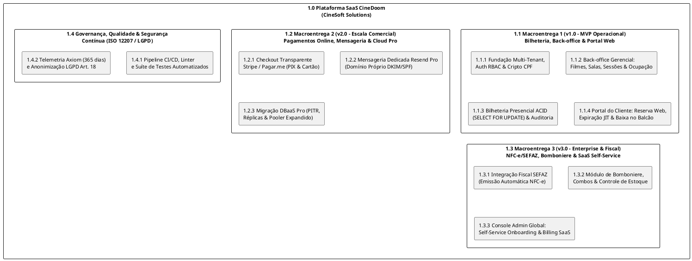
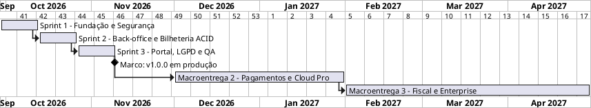
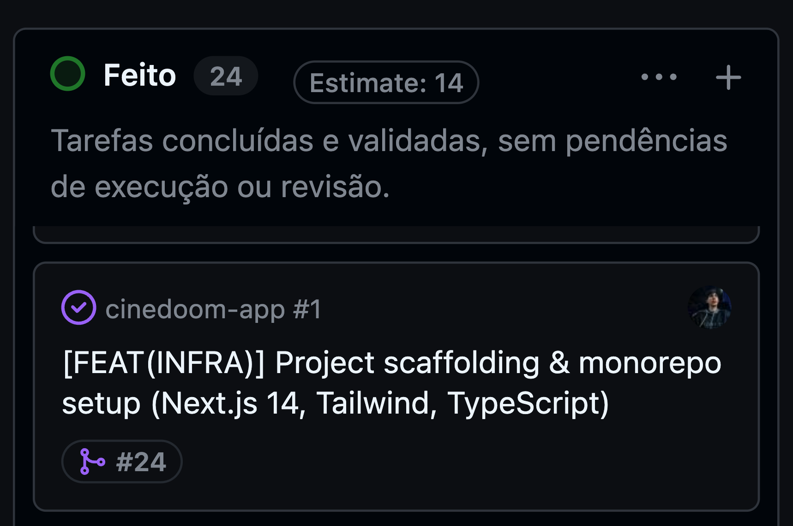
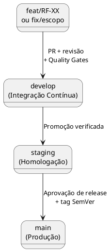
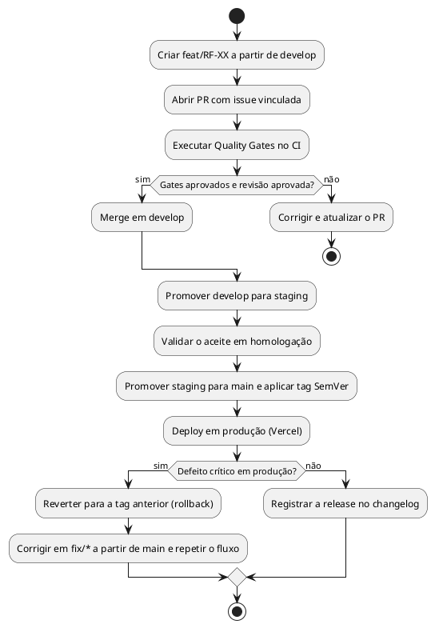
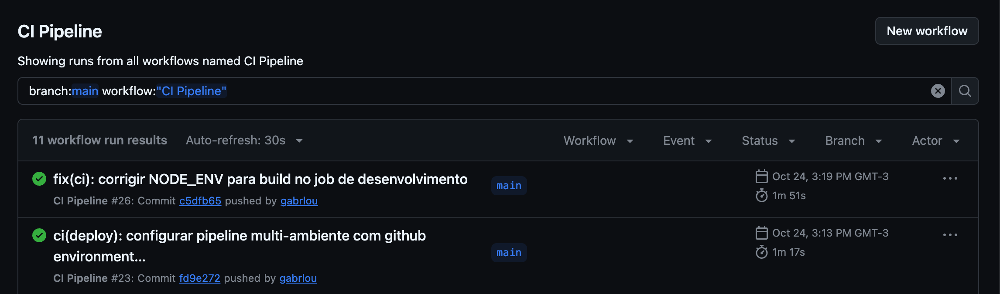
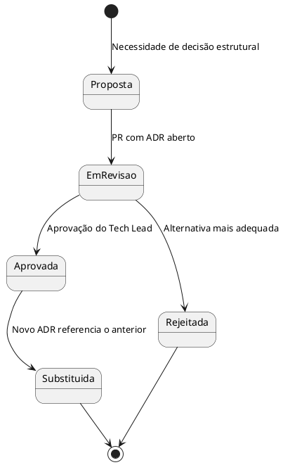
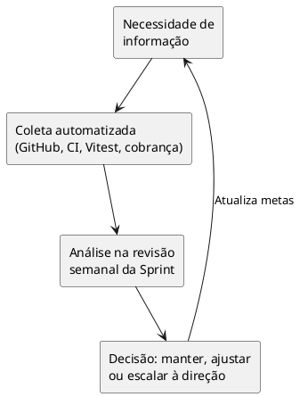
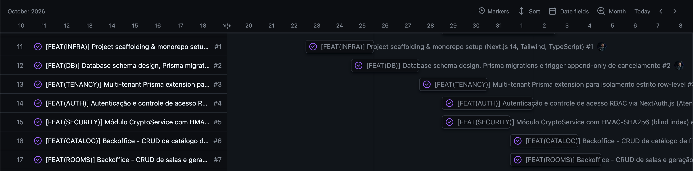

# Capítulo 4 – Processos de Gerenciamento Técnico

## 4.1 Plano de projeto: escopo, cronograma, recursos e entregas

O planejamento do projeto (ABNT NBR ISO/IEC/IEEE 12207:2021 – cláusula 6.3.1) define o escopo, as macroentregas, o cronograma, os recursos, as premissas e a rotina de acompanhamento do CineDoom. A baseline do plano é aprovada pela direção da CineSoft Solutions (Seção 3.3). Alterações de escopo, prazo ou recursos são propostas pelo Gerente de Projeto (Kayque Vicente), aprovadas pela direção e registradas na ata de revisão da Sprint.

### Estrutura Analítica do Projeto (EAP)

A Figura 7 decompõe o produto em três níveis: Nível 1 (produto), Nível 2 (macroentregas e governança) e Nível 3 (pacotes de trabalho verificáveis).

*Figura 7 – Estrutura Analítica do Projeto (EAP) do CineDoom. Fonte: CineSoft Solutions (2026).*

### Escopo e Marcos por Macroentrega

O ciclo de vida do CineDoom é dividido em três macroentregas, cada uma com critério de aceite verificável.

**Tabela 15 – Macroentregas, escopo e critérios de aceite**

| Marco | Versão | Escopo | Critério de aceite | Responsável técnico | Janela | Status |
| :--- | :---: | :--- | :--- | :---: | :---: | :---: |
| **Macroentrega 1** (MVP Operacional) | `v1.0.0` | Multi-tenant, RBAC, criptografia de CPF, CRUDs de filmes, salas e sessões, bilheteria atômica, portal de reservas com expiração JIT, painel de ocupação, anonimização LGPD e deploy (`RF-01` a `RF-18`). | `RF-01` a `RF-18` entregues e suíte de testes 100% aprovada. | Gabriel Lourenço | 29/09/2026 a 09/11/2026 | Concluído |
| **Macroentrega 2** (Escala e Pagamentos) | `v2.0.0` | Gateway de pagamento (PIX e cartão), Resend Pro com domínio próprio, planos Pro de banco de dados e hospedagem. | Pagamento conciliado em homologação e e-mails com DKIM/SPF validados. | Carlos Eduardo | Dez/2026 a Jan/2027 | Planejado |
| **Macroentrega 3** (Enterprise e Fiscal) | `v3.0.0` | NFC-e via Focus NFe/SEFAZ, bomboniere e estoque, fidelidade e console global de tenants. | Emissão fiscal validada em homologação e *onboarding* de tenant sem intervenção manual. | Kayque Vicente e Yury Nogueira | Fev/2027 a Abr/2027 | Backlog |

*Fonte: CineSoft Solutions (2026).*

A M2 depende da conclusão da M1 e da definição do gateway de pagamento. A M3 depende da M2, pois a emissão fiscal exige o fluxo de pagamento consolidado. Essas dependências compõem o caminho crítico do projeto.

### Cronograma

A Figura 8 apresenta o cronograma macro. A M1 foi executada em três Sprints de duas semanas.

*Figura 8 – Cronograma macro das macroentregas. Fonte: CineSoft Solutions (2026).*

**Tabela 16 – Execução das Sprints da Macroentrega 1**

| Sprint | Pacotes de trabalho entregues | Responsáveis | Início | Término | Status |
| :--- | :--- | :--- | :---: | :---: | :---: |
| **Sprint 1** – Fundação, arquitetura e segurança | Setup Next.js 14/TypeScript (`#1`), modelagem Prisma/PostgreSQL e trigger append-only (`#2`), multi-tenant (`#3`), autenticação e RBAC (`#4`), criptografia de CPF (`#5`), *log drain* (`#16`) e pipeline CI/CD (`#17`). | Gabriel Lourenço e Carlos Eduardo (apoio: Yury Nogueira) | 29/09/2026 | 12/10/2026 | Concluído |
| **Sprint 2** – Back-office, salas e bilheteria ACID | Design System e mapa 2D (`#9`), CRUDs de filmes, salas e sessões (`#6`, `#7`, `#8`), *polling* de 2s (`#10`), venda atômica (`#11`) e atendentes (`#14`). | Gabriel Lourenço e Carlos Eduardo (QA: Kayque Vicente) | 13/10/2026 | 26/10/2026 | Concluído |
| **Sprint 3** – Portal do cliente, LGPD e QA | Portal e reserva web com expiração JIT (`#21`), "Minhas Reservas" (`#22`), notificações e baixa no balcão (`#23`), cancelamento auditado (`#12`), painel de ocupação (`#13`), anonimização (`#15`), *seed* (`#20`) e suíte de testes com 500 cenários *cross-tenant* (`#18`, `#19`). | Toda a equipe | 27/10/2026 | 09/11/2026 | Concluído |

*Fonte: CineSoft Solutions (2026).*

### Recursos

A equipe é composta por quatro engenheiros (Seção 3.4). A infraestrutura é *serverless*, com planos gratuitos na M1 e planos pagos a partir da M2.

**Tabela 17 – Recursos de infraestrutura e custo estimado**

| Recurso | Plano na M1 | Plano na M2 e M3 | Finalidade | Custo estimado |
| :--- | :--- | :--- | :--- | ---: |
| **Vercel** | Hobby (gratuito) | Pro | Hospedagem, CDN e ambientes de *Preview* e Produção | US$ 20/mês |
| **Supabase DBaaS PostgreSQL** | Gratuito | Pro (PITR e réplicas) | Persistência ACID, *pooler* e migrações Prisma | US$ 25/mês |
| **Resend** | Gratuito | Pro | Vouchers e confirmações com DKIM/SPF | US$ 20/mês |
| **Axiom** | Gratuito | Cloud (retenção de 365 dias) | *Log drain* e retenção legal | US$ 25/mês |
| **Subtotal dos serviços base** | – | – | Vercel, banco, Resend e Axiom | **US$ 90/mês** |
| **GitHub** | Gratuito | Team (4 assentos) | Repositórios, Projects e Actions | US$ 4/usuário |
| **Focus NFe** | Não utilizado | Somente M3 | Emissão de NFC-e | R$ 149/mês |
| **Gateway de pagamento** | Não utilizado | Somente M2 | PIX e cartão | 3,99% + R$ 0,39 por transação |

*Fonte: CineSoft Solutions (2026).*

Os itens GitHub, Focus NFe e gateway têm base de cobrança distinta (assento, emissão e transação) e por isso ficam fora do subtotal.

### Premissas e Restrições

- **Premissas:** equipe de quatro engenheiros disponível durante todo o projeto; primeiro cinema contratante até a M2; câmbio de referência para a conversão de US\$ 90/mês em cerca de R\$ 480/mês.
- **Restrições:** os limites dos planos gratuitos na M1; a dependência de serviços de terceiros (gateway, SEFAZ); o prazo fixo das macroentregas.
- **Viabilidade:** com essas premissas, estima-se que o custo dos serviços base seja coberto pela mensalidade do primeiro cinema contratante, de R$ 910 a R$ 1.270/mês (Seção 3.3).

### Rotina de Acompanhamento e Tratamento de Desvios

1. **Monitoramento diário:** todo cartão no GitHub Projects possui responsável nominal, data-limite, estimativa e critério de aceite. Tarefa parada em *In Progress* por mais de 48 horas sem atualização é sinalizada como impedimento.
2. **Revisão semanal:** o Gerente de Projeto e o Tech Lead comparam os pacotes concluídos com os planejados.
3. **Tratamento de desvios:** conforme a Tabela 18.

**Tabela 18 – Protocolo de tratamento de desvios**

| Tipo de desvio | Critério | Ação | Registro |
| :--- | :--- | :--- | :--- |
| Leve | Atraso de até 24h em tarefa fora do caminho crítico | Pareamento técnico (*pair programming*) dentro da mesma Sprint | Quadro Kanban |
| Moderado ou crítico | Bloqueio no caminho crítico ou dependência externa | Repriorização MoSCoW, protegendo os requisitos *Must Have* de integridade transacional e LGPD, e adiamento do item secundário | Ata de revisão da Sprint, com ciência da direção |

*Fonte: CineSoft Solutions (2026).*

 

*Figura 9 – Quadro Kanban do projeto no GitHub Projects. Fonte: CineSoft Solutions (2026).*

---

## 4.2 Plano de gestão de riscos: identificação, probabilidade, impacto e respostas

A gestão de riscos (cláusula 6.3.4) identifica, analisa, trata e monitora as ameaças técnicas, operacionais, de segurança e de fornecedores que afetem a disponibilidade, a integridade financeira ou a conformidade legal do CineDoom. O Gerente de Projeto mantém o registro de riscos (*Risk Register*), que é revisado ao final de cada Sprint e antes de cada macroentrega. Riscos críticos são comunicados à direção.

### Critérios de Classificação

**Tabela 19 – Escalas de probabilidade e impacto**

| Nível | Probabilidade | Impacto |
| :--- | :--- | :--- |
| **Alta / Alto** | Tende a ocorrer em operação normal ou em picos de estreia | Indisponibilidade da bilheteria, venda dupla de assentos, perda financeira ou violação da LGPD |
| **Média / Médio** | Pode ocorrer sob condições específicas de carga ou falha de terceiros | Degradação parcial de funcionalidade secundária, com contorno disponível |
| **Baixa / Baixo** | Evento raro ou já contido por barreiras nativas | Inconveniência sem bloqueio operacional |

*Fonte: CineSoft Solutions (2026).*

**Tabela 20 – Matriz de prioridade (probabilidade × impacto)**

| Probabilidade \ Impacto | Baixo | Médio | Alto |
| :--- | :---: | :---: | :---: |
| **Alta** | Médio | Alto | **Crítico** |
| **Média** | Baixo | Médio | **Crítico** |
| **Baixa** | Baixo | Baixo | **Alto** |

*Fonte: CineSoft Solutions (2026).*

Riscos **Críticos** exigem barreira arquitetural e teste automatizado obrigatório. Riscos **Altos** exigem mitigação ativa e monitoramento. Riscos **Médios** e **Baixos** são monitorados, com plano de contingência.

### Registro de Riscos

**Tabela 21 – Identificação e análise dos riscos**

| ID | Risco | Categoria | Prob. | Impacto | Prioridade |
| :---: | :--- | :--- | :---: | :---: | :---: |
| **R-01** | Venda dupla de assento (*double-booking*) por compras simultâneas no portal e no guichê em estreias | Técnico | Média | Alto | **Crítico** |
| **R-02** | Exaustão do pool de conexões ou indisponibilidade do banco por instâncias *serverless* em picos | Infraestrutura | Média | Alto | **Crítico** |
| **R-03** | Exposição de CPF ou vazamento de dados entre cinemas (*cross-tenant*) | Segurança e LGPD | Baixa | Alto | **Alto** |
| **R-04** | Retenção ociosa de poltronas (*no-show*) em reservas web | Negócio | Alta | Médio | **Alto** |
| **R-05** | Falha na entrega de e-mails de vouchers ou bloqueio por filtros anti-spam | Dependência externa | Média | Médio | **Médio** |
| **R-06** | Atraso por dependência entre módulos (UI responsiva e contratos de API) | Projeto | Média | Médio | **Médio** |
| **R-07** | Instabilidade da SEFAZ ou do gateway de pagamento no horário de pico (M2 e M3) | Dependência externa | Média | Alto | **Crítico** |
| **R-08** | Concentração de conhecimento em pessoas-chave (Seção 3.4) | Organizacional | Média | Médio | **Médio** |
| **R-09** | Estouro dos limites dos planos gratuitos ou pagos, elevando o custo acima do previsto | Financeiro | Média | Médio | **Médio** |
| **R-10** | Vulnerabilidade em dependências de terceiros | Segurança | Baixa | Alto | **Alto** |
| **R-11** | Lacuna de competência em pagamentos e NFC-e atrasar a M2 e a M3 | Projeto | Média | Médio | **Médio** |

*Fonte: CineSoft Solutions (2026).*

**Tabela 22 – Tratamento e monitoramento dos riscos**

| ID | Resposta e mitigação | Gatilho de alerta | Responsável | Monitoramento |
| :---: | :--- | :--- | :---: | :--- |
| **R-01** | Pré-população de `SessionSeat`, ordenação de IDs contra *deadlock* e `SELECT ... FOR UPDATE` em transação ACID, validados por teste de concorrência com 50 threads (ADR-007) | Falha no teste de concorrência | Gabriel Lourenço | CI a cada PR |
| **R-02** | *Connection pooler* transacional (porta `6543`), índices por `tenant_id` e migração para plano Pro com réplicas e PITR na M2 (ADR-005) | Erros de conexão na telemetria | Carlos Eduardo | Telemetria e revisão por Sprint |
| **R-03** | CPF nunca em texto puro (`HMAC-SHA256` e `AES-256-GCM`), extensão Prisma com `tenant_id` automático e 500 cenários *cross-tenant* (ADR-008) | Falha em cenário *cross-tenant* | Carlos Eduardo e Yury Nogueira | CI a cada PR |
| **R-04** | Bloqueio de reservas web a menos de 60 minutos da sessão e expiração *Just-in-Time* (ADR-012) | Taxa alta de reservas expiradas | Gabriel Lourenço | Painel de ocupação |
| **R-05** | Interface `EmailProvider` desacoplada, voucher exibido na confirmação e em "Minhas Reservas", e Resend Pro com domínio próprio na M2 | Falhas de entrega nos logs | Carlos Eduardo | Telemetria |
| **R-06** | Contratos `Zod`, CI bloqueante por PR e pareamento quando a tarefa excede 48h | Tarefa parada há mais de 48h | Kayque Vicente | Quadro Kanban |
| **R-07** | Fila assíncrona com contingência offline (Focus NFe) e recebimento presencial como alternativa ao gateway | Falhas de transmissão fiscal ou de pagamento | Gabriel Lourenço e Kayque Vicente | Telemetria (M2 e M3) |
| **R-08** | Revisão cruzada, ADRs e substituto por papel (Tabela 8) | Tarefa crítica dependente de uma só pessoa | Kayque Vicente | Revisão por macroentrega |
| **R-09** | Acompanhamento mensal do consumo e revisão de planos | Custo acima de 10% do teto | Carlos Eduardo | Painéis de cobrança |
| **R-10** | Auditoria de dependências e varredura de segredos no CI (Seção 3.5) | Vulnerabilidade alta/crítica fora do baseline documentado | Carlos Eduardo | CI a cada PR |
| **R-11** | Workshops 3 e 4 antes das macroentregas (Tabela 11) | Critério de eficácia do workshop não atingido | Kayque Vicente | Revisão do plano de capacitação |

*Fonte: CineSoft Solutions (2026).*

O risco residual é avaliado a cada revisão. Um risco é encerrado quando a barreira correspondente passa a ser verificada automaticamente e o gatilho não ocorre ao longo de uma macroentrega.

---

## 4.3 Plano de gestão de configuração: controle de versões, branches e releases

A gestão de configuração (cláusula 6.3.5) assegura a integridade, o rastreamento e a reprodutibilidade dos ativos de software. O Tech Lead (Gabriel Lourenço) é o aprovador do controle de configuração, e o Engenheiro de DevOps (Carlos Eduardo) executa os processos de release (Seção 3.4).

### Itens de Configuração

**Tabela 23 – Itens de configuração controlados**

| Item | Localização | Controle |
| :--- | :--- | :--- |
| Código-fonte da aplicação e APIs | `src/` | Git, via Pull Request |
| Esquema, *seed* e *triggers* do banco | `prisma/schema.prisma`, `prisma/seed.ts` e `prisma/triggers.sql` | Git, via Pull Request |
| Testes automatizados | `tests/` | Git, via Pull Request |
| Pipelines e configuração de deploy | `.github/workflows/` e `vercel.json` | Git, via Pull Request |
| Especificações, ADRs e manual | `specs/` e `manual/` | Git, via Pull Request |
| Segredos e variáveis de ambiente | Variáveis dos serviços (Seção 3.2) | Fora do repositório; acesso restrito |

*Fonte: CineSoft Solutions (2026).*

### Estratégia de Branches

O fluxo usa três branches permanentes e branches efêmeras por funcionalidade (Figura 10).

*Figura 10 – Estratégia de branches. Fonte: CineSoft Solutions (2026).*

**Tabela 24 – Branches e regras de proteção**

| Branch | Função | Regras |
| :--- | :--- | :--- |
| `main` | Produção (`https://cinedoom.vercel.app/`) | Proibido *force push*; somente código aprovado pelo CI; cada release recebe tag |
| `staging` | Homologação e aceite | Espelha a produção; promoção somente após validação |
| `develop` | Integração das entregas da Sprint | Recebe somente Pull Requests aprovados |
| `feat/*` e `fix/*` | Trabalho por requisito ou correção (ex.: `feat/RF-06-venda-atomica`) | Criadas a partir de `develop`; vinculadas a uma issue |

*Fonte: CineSoft Solutions (2026).*

Todo Pull Request deve passar pelos *Quality Gates* da Seção 3.5 (compilação, testes, cobertura, segurança, revisão por outro integrante e build). Toda mudança em item de configuração entra por Pull Request vinculado a uma issue.

### Baselines, Versionamento e Releases

Cada tag `vMAJOR.MINOR.PATCH` aplicada a `main` constitui uma **baseline** de release.

**Tabela 25 – Versionamento semântico e convenção de commits**

| Elemento | Regra |
| :--- | :--- |
| `MAJOR` (`v1.0.0`, `v2.0.0`, `v3.0.0`) | Transição entre macroentregas ou mudança estrutural de arquitetura |
| `MINOR` (`v1.1.0`) | Funcionalidade retrocompatível dentro de uma macroentrega |
| `PATCH` (`v1.0.1`) | Correção de defeito ou ajuste sem quebra de contrato |
| Conventional Commits | `<tipo>(<escopo>): <descrição>`, com tipos `feat`, `fix`, `refactor`, `test`, `docs`, `chore` e `ci`, para gerar o *changelog* e rastrear as issues |

*Fonte: CineSoft Solutions (2026).*

O fluxo de release, incluindo a reversão e a correção urgente, segue a Figura 11.

*Figura 11 – Fluxo de release, reversão e correção urgente. Fonte: CineSoft Solutions (2026).*

### Auditoria e Registro de Status

- **Auditoria:** antes de cada release, o Engenheiro de Qualidade verifica se a tag corresponde ao código aprovado e se os gates passaram.
- **Registro de status:** o *changelog*, as tags e o histórico de Pull Requests informam o estado de cada item de configuração.
- **Reversão:** a reversão consiste em publicar novamente a tag anterior no ambiente de produção.

 
*Figura 12 – Execução do pipeline de integração contínua. Fonte: CineSoft Solutions (2026).*

 
*Figura 13 – Baseline da versão `v1.0.0` no GitHub. Fonte: CineSoft Solutions (2026).*

---

## 4.4 Registro de decisões técnicas relevantes (ADRs)

A gestão de decisões (cláusula 6.3.3) fundamenta as escolhas de alto impacto em análise multicritério e em fichas estruturadas de *Architecture Decision Records* (ADRs), mantidas em `specs/adrs/`.

### Processo de Decisão

- **Quando registrar:** toda decisão que afete a arquitetura, a segurança, o banco de dados, a infraestrutura ou o custo exige um ADR.
- **Quem decide:** o Tech Lead aprova, e o ADR é revisado em Pull Request por outro integrante.
- **Conteúdo mínimo:** contexto, alternativas consideradas, decisão, justificativa e consequências.
- **Ciclo de vida:** o ADR passa pelos estados da Figura 14. Uma decisão substituída é mantida no histórico, com referência ao ADR que a substituiu.

*Figura 14 – Ciclo de vida de um ADR. Fonte: CineSoft Solutions (2026).*

### Matriz de Decisão Ponderada: Arquitetura Base (ADR-001)

A arquitetura central foi escolhida entre três alternativas, avaliadas em cinco critérios ponderados (nota de 1 a 5, sendo 5 a melhor aderência).

**Tabela 26 – Matriz de decisão ponderada da arquitetura base**

| Critério | Peso | A: Monólito modular (Next.js 14 e Prisma) | B: Microsserviços (Node/Go e Kafka) | C: SPA separada e backend em VM |
| :--- | :---: | :---: | :---: | :---: |
| Atomicidade transacional (anti-*double-booking*) | 30% | 5 | 2 | 5 |
| Produtividade da equipe de 4 engenheiros | 25% | 5 | 1 | 3 |
| Custo operacional (TCO inicial e escala) | 20% | 5 | 2 | 3 |
| Isolamento multi-tenant e segurança LGPD | 15% | 5 | 3 | 4 |
| Desempenho de borda e SEO do catálogo | 10% | 5 | 4 | 2 |
| **Pontuação ponderada** | **100%** | **5,00 (adotada)** | **2,10** | **3,65** |

*Fonte: CineSoft Solutions (2026).*

**Tabela 27 – Ficha do ADR-001**

| Elemento | Descrição |
| :--- | :--- |
| **Título e status** | Arquitetura de monólito modular em Next.js 14 – Aprovada |
| **Contexto** | Integrar Portal do Cliente, Bilheteria e Back-office sob o mesmo motor transacional, com equipe enxuta |
| **Alternativas** | (1) Monólito modular Next.js; (2) Microsserviços; (3) SPA e API separadas |
| **Decisão** | Monólito modular com módulos de domínio verticais (`src/modules/*`) e regra ESLint `import/no-cycle` |
| **Consequências** | (+) Transações ACID simples e tipagem unificada; (-) exige disciplina do *linter* para manter as fronteiras entre módulos |

*Fonte: CineSoft Solutions (2026).*

### Índice de Decisões (ADR-001 a ADR-012)

As fichas completas dos 12 ADRs, com data e autor, estão em `specs/adrs/`. A tabela abaixo as relaciona aos riscos e requisitos que sustentam.

**Tabela 28 – Índice dos ADRs**

| ADR | Título | Decisão resumida | Status | Relacionado a |
| :---: | :--- | :--- | :---: | :--- |
| 001 | Monólito modular em Next.js 14 | Módulos verticais e `import/no-cycle` | Aprovada | R-06 |
| 002 | Interface com Tailwind CSS | Tema escuro, sem CSS em tempo de execução | Aprovada | Usabilidade |
| 003 | Backend em TypeScript com Route Handlers | API REST tipada com validação `Zod` | Aprovada | R-06 |
| 004 | PostgreSQL com Prisma ORM | Banco relacional ACID com transações interativas | Aprovada | R-01 |
| 005 | Nuvem *serverless* (Vercel, DBaaS e CI) | Hospedagem na borda, *pooler* na porta `6543` e CI/CD no GitHub Actions | Aprovada | R-02 |
| 006 | API REST e *polling* de 2s no mapa de sala | Atualização periódica sem conexões persistentes | Aprovada | `RF` de bilheteria |
| 007 | Pré-população de `SessionSeat` e `SELECT FOR UPDATE` | Lock pessimista ordenado por ID | Aprovada | R-01 |
| 008 | Criptografia de CPF | `HMAC-SHA256` (busca) e `AES-256-GCM` (confidencialidade) | Aprovada | R-03 |
| 009 | Anonimização *in-place* (LGPD Art. 18) | Sobrescrita irreversível, preservando `Ticket` | Aprovada | R-03 |
| 010 | Auditoria *append-only* por *trigger* | `trg_protect_cancellation_audits` impede `UPDATE` e `DELETE` | Aprovada | Auditoria |
| 011 | *Log drain* gerenciado (Axiom, 365 dias) | Logs estruturados com PII mascarado | Aprovada | LGPD |
| 012 | Expiração *Just-in-Time* de reservas | Avaliação de `expiresAt` na leitura e na escrita | Aprovada | R-04 |

*Fonte: CineSoft Solutions (2026).*

 
*Figura 15 – Registro dos ADRs no repositório. Fonte: CineSoft Solutions (2026).*

---

## 4.5 Métricas de acompanhamento do projeto

O processo de medição (cláusula 6.3.7), junto com a avaliação e o controle do projeto (cláusula 6.3.2), usa indicadores coletados do GitHub, do CI, do Vitest e dos painéis de cobrança para responder a quatro necessidades de informação: o fluxo está saudável? A qualidade é mantida? O escopo avança conforme o plano? O custo está sob controle? A Figura 16 resume o ciclo de medição.

*Figura 16 – Ciclo de medição e decisão. Fonte: CineSoft Solutions (2026).*

**Tabela 29 – Plano de medição**

| Indicador | Necessidade atendida | Meta | Fonte e frequência | Responsável |
| :--- | :--- | :---: | :--- | :---: |
| **Lead time** (da abertura da issue ao merge em `develop`) | Fluxo | ≤ 48h por pacote | GitHub Projects, semanal | Kayque Vicente |
| **WIP por engenheiro** | Fluxo | ≤ 2 tarefas | Quadro Kanban, diária | Kayque Vicente |
| **Aprovação da suíte de testes** | Qualidade | 100% | GitHub Actions, a cada PR | Kayque Vicente |
| **Cobertura nas regras de domínio** | Qualidade | ≥ 70% (*statements*, funções e linhas) e ≥ 80% (*branches*) (Seção 3.5) | Relatório do Vitest, a cada PR | Kayque Vicente |
| **Defeitos críticos em produção** | Qualidade | 0 | Telemetria e registro de incidentes, por macroentrega | Carlos Eduardo |
| **Cumprimento do escopo** | Progresso | 100% dos requisitos do marco | Matriz de rastreabilidade (Seção 5.1.2), por Sprint | Kayque Vicente |
| **Riscos críticos sem mitigação ativa** | Risco | 0 | Registro de riscos (Tabela 22), por Sprint | Kayque Vicente |
| **Custo mensal dos serviços base** | Custo | ≤ US$ 90/mês na M2 e na M3 | Painéis de cobrança, mensal | Carlos Eduardo |
| **Rollbacks por release** | Configuração | Tendência decrescente | Tags e histórico de deploy, por release | Carlos Eduardo |

*Fonte: CineSoft Solutions (2026).*

**Tabela 30 – Resultados na Macroentrega 1 (`v1.0.0`) e ação em caso de desvio**

| Indicador | Resultado aferido | Ação em caso de desvio |
| :--- | :--- | :--- |
| Lead time | Média de 18 a 32 horas por issue | Acima de 48h, o Gerente de Projeto aciona pareamento técnico |
| WIP por engenheiro | Limite respeitado | Revisão do quadro na reunião diária |
| Suíte de testes | 26 arquivos e 770 testes aprovados (100%) | O PR com teste falho não é integrado |
| Cobertura nas regras de domínio | 71,2% de *statements*, 83,4% de *branches* e 76,3% de funções (gate: 70/80/70) | Abrir ação corretiva no registro de não conformidades (Seção 3.5) |
| Defeitos críticos em produção | 0 (apenas ajustes cosméticos e de responsividade) | Defeito crítico aciona a reversão para a versão anterior e correção urgente (Figura 11) |
| Cumprimento do escopo | 18 de 18 requisitos e 15 de 15 critérios de aceite | Ajuste de escopo conforme a Tabela 18 |
| Riscos críticos sem mitigação | Medição iniciada a partir deste plano | Escalar à direção |
| Custo mensal | US$ 0 (planos gratuitos) | Desvio acima de 10% do teto aciona revisão de planos |
| Rollbacks por release | Medição iniciada a partir deste plano | Análise de causa na retrospectiva |

*Fonte: CineSoft Solutions (2026).*

Os valores da Tabela 30 referem-se à entrega da `v1.0.0` e são atualizados a cada macroentrega.

*Figura 17 – Evidência do fluxo de trabalho. Fonte: CineSoft Solutions (2026).*

---
