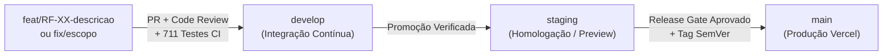

# Capítulo 4 – Processos de Gerenciamento Técnico

## 4.1 Plano de projeto: escopo, cronograma, recursos e entregas

O processo de planejamento do projeto (ABNT NBR ISO/IEC/IEEE 12207:2021 – Cláusula 6.3.1) estabelece a Estrutura Analítica do Projeto (EAP/WBS), o roadmap comercial em **três Macroentregas**, o cronograma detalhado de Sprints, a alocação nominal de responsáveis e a rotina formal para monitorar o progresso e corrigir eventuais desvios.

### Estrutura Analítica do Projeto (EAP / WBS em 3 Níveis)

O diagrama abaixo decompõe o produto **CineDoom** em três níveis hierárquicos (Nível 1: Produto; Nível 2: Macroentregas e Governança; Nível 3: Pacotes de Trabalho e Entregáveis verificáveis):

```mermaid
flowchart TD
    Root["1.0 Plataforma SaaS CineDoom\n(CineSoft Solutions)"]

    Root --> M1["1.1 Macroentrega 1 (v1.0 - MVP Operacional)\nBilheteria, Back-office & Portal Web"]
    Root --> M2["1.2 Macroentrega 2 (v2.0 - Escala Comercial)\nPagamentos Online, Mensageria & Cloud Pro"]
    Root --> M3["1.3 Macroentrega 3 (v3.0 - Enterprise & Fiscal)\nNFC-e/SEFAZ, Bomboniere & SaaS Self-Service"]
    Root --> GOV["1.4 Governança, Qualidade & Segurança\nContínua (ISO 12207 / LGPD)"]

    M1 --> M1_1["1.1.1 Fundação Multi-Tenant,\nAuth RBAC & Criptografia CPF"]
    M1 --> M1_2["1.1.2 Back-office Gerencial:\nFilmes, Salas, Sessões & Ocupação"]
    M1 --> M1_3["1.1.3 Bilheteria Presencial ACID\n(SELECT FOR UPDATE) & Auditoria"]
    M1 --> M1_4["1.1.4 Portal do Cliente: Reserva Web,\nExpiração JIT & Baixa no Balcão"]

    M2 --> M2_1["1.2.1 Checkout Transparente\nStripe / Pagar.me (PIX & Cartão)"]
    M2 --> M2_2["1.2.2 Mensageria Dedicada Resend Pro\n(Domínio Próprio DKIM/SPF)"]
    M2 --> M2_3["1.2.3 Migração DBaaS Pro (PITR,\nRéplicas & Pooler Expandido)"]

    M3 --> M3_1["1.3.1 Integração Fiscal SEFAZ\n(Emissão Automática NFC-e)"]
    M3 --> M3_2["1.3.2 Módulo de Bomboniere,\nCombos & Controle de Estoque"]
    M3 --> M3_3["1.3.3 Console Admin Global:\nSelf-Service Onboarding & Billing SaaS"]

    GOV --> GOV_1["1.4.1 Pipeline CI/CD, Linter\ne 711 Testes Automatizados"]
    GOV --> GOV_2["1.4.2 Telemetria Axiom (365 dias)\ne Anonimização LGPD Art. 18"]
```

### Escopo e Marcos Comerciais por Macroentrega (Milestones)

A estratégia de produto da CineSoft Solutions divide o ciclo de vida do CineDoom em três grandes marcos contratuais de entrega:

| Marco (Milestone) | Versão Alvo | Escopo Funcional e Infraestrutura Associada | Responsável Geral | Prazo / Janela | Status |
| :--- | :---: | :--- | :---: | :---: | :---: |
| **Macroentrega 1 (MVP Operacional)** | `v1.0.0` | Núcleo Multi-tenant, RBAC (`GERENTE`, `ATENDENTE`, `CLIENTE`), criptografia CPF (`HMAC-SHA256` + `AES-256-GCM`), CRUDs de filmes/salas/sessões, bilheteria presencial atômica, portal de reservas web com expiração JIT, painel de ocupação, anonimização LGPD e deploy em produção (`RF-01` a `RF-18`). | **Gabriel Lourenço** | Out/2026 – Nov/2026 | **Concluído (Em Produção)** |
| **Macroentrega 2 (Escala & Pagamentos)** | `v2.0.0` | Integração de gateway financeiro online (PIX QR Code dinâmico e cartão de crédito via Stripe PCI-DSS), ativação do **Resend Pro** com domínio corporativo próprio (`@cinedoom.com.br`), upgrade para **Supabase/Neon Pro** (backups PITR e réplicas) e **Vercel Pro**. | **Carlos Eduardo** | Dez/2026 – Jan/2027 | **Planejado (Próxima Fase)** |
| **Macroentrega 3 (Enterprise & Fiscal)** | `v3.0.0` | Emissão fiscal eletrônica automatizada (**NFC-e / SAT** via API Focus NFe integrada à SEFAZ), módulo de bomboniere e estoque, programa de fidelidade, **Console Global de Administração de Tenants** (*Self-Service Billing*) e BI financeiro avançado. | **Kayque Vicente & Yury Nogueira** | Fev/2027 – Abr/2027 | **Backlog Evolutivo** |

### Cronograma Detalhado de Execução da Macroentrega 1 (`v1.0.0`)

A construção da Macroentrega 1 foi executada em 3 Sprints intensivas de engenharia com pacotes de trabalho atribuídos nominalmente aos engenheiros da CineSoft Solutions:

| Sprint / Iteração | Pacotes de Trabalho e Requisitos Entregues | Responsáveis Diretos | Início | Término | Status |
| :--- | :--- | :--- | :---: | :---: | :---: |
| **Sprint 1 — Fundação, Arquitetura e Segurança** | Setup Next.js 14/TypeScript (`#1`), modelagem Prisma/PostgreSQL e trigger append-only (`#2`), extensão Multi-tenant (`#3`), autenticação NextAuth/RBAC (`#4`), criptografia PII de CPF (`#5`), Log Drain Axiom (`#15`) e pipeline CI/CD (`#16`). | **Gabriel Lourenço** & **Carlos Eduardo** (Apoio: **Yury Nogueira**) | 23/10/2026 | 29/10/2026 | **100% Concluído** |
| **Sprint 2 — Back-office, Salas e Bilheteria ACID** | Design System e mapa interativo 2D (`#17`), CRUDs de filmes, salas e sessões com pré-população (`#6`, `#7`, `#8`), polling a 2s (`#9`), venda atômica com `SELECT FOR UPDATE` (`#10`) e gestão de atendentes (`#13`). | **Gabriel Lourenço** & **Carlos Eduardo** (QA: **Kayque Vicente**) | 30/10/2026 | 04/11/2026 | **100% Concluído** |
| **Sprint 3 — Portal do Cliente, Governança LGPD e QA** | Portal público e reserva web com expiração JIT (`#21`), autenticação de espectador e *"Minhas Reservas"* (`#22`), `NotificationService` e baixa de reserva no balcão (`#23`), cancelamento auditado (`#11`), painel de ocupação (`#12`), anonimização Art. 18 (`#14`) e suíte de 711 testes / 500 cenários *cross-tenant* (`#18`, `#19`). | **Gabriel Lourenço**, **Carlos Eduardo**, **Kayque Vicente** & **Yury Nogueira** | 05/11/2026 | 09/11/2026 | **100% Concluído** |

### Recursos

| Recurso / Serviço | Plano na Macroentrega 1 | Plano nas Macroentregas 2 e 3 | Finalidade no Projeto | Custo Estimado |
| :--- | :--- | :--- | :--- | ---: |
| **Vercel** (PaaS / Edge CDN) | Hobby (*free tier*) | Pro (1 assento de *deploy*) | Hospedagem do Next.js 14, CDN e ambientes de *Preview* e Produção | US$ 20/mês |
| **Neon / Supabase** (DBaaS PostgreSQL) | Free | Pro (PITR e réplicas) | Persistência ACID, *connection pooler* e migrações Prisma | US$ 25/mês |
| **Resend** (e-mail transacional) | Free (console de teste) | Pro (50 mil e-mails/mês) | Envio de vouchers e confirmações com DKIM/SPF | US$ 20/mês |
| **Axiom** (observabilidade) | Free | Cloud (1 TB/mês, 365 dias) | *Log drain* estruturado e retenção legal (LGPD) | US$ 25/mês |
| **GitHub** (código e CI/CD) | Free | Team (4 assentos) | Repositórios, Projects, Actions e branches protegidas | US$ 4/usuário |
| **Focus NFe** (mensageria fiscal) | Não utilizado | Empresarial (somente M3) | Emissão e transmissão de NFC-e à SEFAZ | R$ 149/mês |
| **Stripe / Pagar.me** (gateway financeiro) | Não utilizado | Taxa transacional (somente M2) | Checkout PIX e cartão no Portal do Cliente | 3,99% + R$ 0,39 |
| **Total estimado dos serviços base (M2 e M3)** | — | — | Vercel + Neon + Resend + Axiom | **US$ 90/mês** |

O plano é viável com os recursos disponíveis: a equipe de **4 engenheiros** atua em dedicação integral, a infraestrutura é *serverless* com cobrança *pay-as-you-go* (planos gratuitos na Macroentrega 1, com **US$ 0 de custo fixo** e cobrança apenas por uso excedente) e o custo operacional estimado dos serviços base — **US$ 90/mês** (≈ R$ 480/mês) nas Macroentregas 2 e 3 — é integralmente coberto pela receita do primeiro contrato B2B, cujo ticket médio estimado é de **R$ 590 a R$ 1.290/mês** por complexo exibidor (Cap. 3.3, Viabilidade Econômica e Financeira).

### Rotina de Acompanhamento e Tratamento de Desvios e Atrasos

Para garantir o cumprimento dos prazos e a previsibilidade das entregas, a CineSoft Solutions aplica a seguinte rotina de controle:
1. **Monitoramento Diário no Quadro Kanban (GitHub Projects):** Todo cartão de tarefa deve conter obrigatoriamente **responsável nominal**, **data-limite (deadline)**, **estimativa** e **critério de aceite**. Tarefas paradas na coluna *In Progress* por mais de **48 horas** sem commits ou atualização de status acionam um alerta automático de impedimento (*blocker*).
2. **Revisão Semanal de Sprint e Burndown:** Ao final de cada semana, o Gerente de Projeto (**Kayque Vicente**) e o Tech Lead (**Gabriel Lourenço**) auditam o percentual de pacotes concluídos versus planejados.
3. **Protocolo de Tratamento de Desvios e Atrasos:**
   - **Desvio Leve (atraso $\le 24\text{h}$ em tarefa não crítica):** Realocação de par técnico (*pair programming*) entre os desenvolvedores de backend e frontend para destravar a entrega dentro da mesma Sprint.
   - **Desvio Moderado/Crítico (bloqueio em caminho crítico ou dependência externa):** Aplicação imediata de re-priorização MoSCoW (protegendo os requisitos *Must Have* de integridade transacional e segurança LGPD) e fatiamento da funcionalidade secundária para a iteração seguinte, registrando a decisão em ata de revisão.

---

## 4.2 Plano de gestão de riscos: identificação, probabilidade, impacto e respostas

O processo de gestão de riscos (Cláusula 6.3.4) identifica continuamente ameaças técnicas, operacionais, de segurança e de fornecedores externos que possam afetar a disponibilidade ou a integridade financeira e legal do CineDoom.

### Critérios de Classificação e Reavaliação Contínua

- **Probabilidade de Ocorrência:** **Alta** (forte tendência de ocorrer em operação normal ou picos de estreia), **Média** (pode ocorrer sob condições específicas de carga ou falha de terceiros) ou **Baixa** (evento raro ou já contido por barreiras nativas).
- **Impacto no Negócio:** **Alto** (indisponibilidade da bilheteria, venda dupla de poltronas, perda financeira ou violação da LGPD), **Médio** (degradação parcial de funcionalidade secundária com contorno disponível) ou **Baixo** (inconveniência visual sem bloqueio operacional).
- **Matriz de Prioridade:** A combinação de Probabilidade $\times$ Impacto define a prioridade de tratamento como **Crítico** (exige barreira arquitetural imediata e teste automatizado obrigatório), **Alto** (exige mitigação ativa e monitoramento) ou **Médio** (monitorado com plano de contingência).
- **Ciclo de Reavaliação:** O *Risk Register* é revisado formalmente ao final de cada Sprint e antes do início de cada nova Macroentrega.

### Matriz de Riscos do Produto (*Risk Register*)

| ID | Risco identificado | Categoria | Probabilidade | Impacto | Prioridade | Resposta / Mitigação | Responsável |
| :---: | :--- | :---: | :---: | :---: | :---: | :--- | :---: |
| **R-01** | **Conflito de concorrência (*double-booking*)** entre compras simultâneas no portal web e nos guichês físicos em estreias de alta demanda. | Técnico / Core | Média | Alto | **Crítico** | Pré-população determinística de `SessionSeat`, ordenação de IDs anti-deadlock e bloqueio pessimista `SELECT ... FOR UPDATE` em transação ACID, validado por teste automatizado com 50 threads simultâneas. | **Gabriel Lourenço** |
| **R-02** | **Exaustão do pool de conexões ou indisponibilidade do banco PostgreSQL** devido à criação efêmera de instâncias serverless em picos de acesso. | Infraestrutura / Externa | Média | Alto | **Crítico** | Uso obrigatório de *Connection Pooler* transacional (*Supavisor* porta `6543` com `pgbouncer=true`), índices compostos por `tenant_id` e migração para plano **Pro com réplicas e PITR** na Macroentrega 2. | **Carlos Eduardo** |
| **R-03** | **Exposição de dados pessoais (CPF) ou vazamento de dados entre cinemas concorrentes (*cross-tenant leak*)**. | Segurança / Legal (LGPD) | Baixa | Alto | **Crítico** | Proibição de CPF em texto puro (uso de `HMAC-SHA256` + `AES-256-GCM`), extensão Prisma que injeta `WHERE tenant_id` automaticamente e suíte automatizada com **500 cenários de ataque cross-tenant**. | **Carlos Eduardo & Yury Nogueira** |
| **R-04** | **Retenção ociosa de poltronas (*no-show*)** por espectadores que reservam online e não comparecem para pagar no balcão. | Negócio / Operacional | Alta | Médio | **Alto** | Bloqueio de novas reservas web a menos de 60 minutos da sessão e **Expiração Just-in-Time (JIT)** automática, liberando os assentos instantaneamente para venda presencial na bilheteria (`ADR-012`). | **Gabriel Lourenço** |
| **R-05** | **Falha na entrega de e-mails transacionais de vouchers** ou retenção em filtros anti-spam sem domínio próprio verificado. | Dependência Externa | Média | Médio | **Alto** | Desacoplamento via interface `EmailProvider`, exibição imediata do voucher com código localizador na tela de confirmação e na área *"Minhas Reservas"*, e contratação do **Resend Pro com domínio DKIM/SPF** na Macroentrega 2. | **Carlos Eduardo** |
| **R-06** | **Atraso na integração de dependências entre módulos** (ex.: acoplamento entre refatorações de UI responsiva e contratos de API). | Organizacional / Projeto | Média | Médio | **Médio** | Contratos de validação estritos via schemas `Zod`, esteira de CI bloqueante a cada Pull Request e protocolo de realocação em pares (*pair programming*) quando uma tarefa excede 48h. | **Kayque Vicente** |
| **R-07** | **Instabilidade nos webservices estaduais da SEFAZ ou gateway de pagamento** durante o horário de pico noturno dos cinemas (Macroentregas 2 e 3). | Dependência Externa | Média | Alto | **Alto** | Processamento fiscal em fila assíncrona com emissão em contingência offline (Focus NFe) e fallback imediato para recebimento presencial no guichê caso o gateway online oscile. | **Gabriel Lourenço & Kayque Vicente** |

---

## 4.3 Plano de gestão de configuração: controle de versões, branches e releases

O processo de gestão de configuração (Cláusula 6.3.5) assegura a integridade, o rastreamento e a reprodutibilidade de todos os ativos de software da CineSoft Solutions.

### Itens de Configuração (CIs) Controlados
São submetidos a controle formal de versão no GitHub:
1. Código-fonte da aplicação web e APIs (`src/`).
2. Esquema relacional e migrações determinísticas do banco de dados (`prisma/schema.prisma` e `prisma/migrations/`).
3. Suíte de testes unitários, de integração e de segurança (`tests/`).
4. Pipelines de automação e configuração de deploy (`.github/workflows/ci.yml`, `.github/workflows/deploy.yml` e `vercel.json`).
5. Especificações técnicas, ADRs e Manual de Processos (`specs/` e `manual/`).

### Estratégia de Branches e Regras de Pull Request

A CineSoft Solutions adota um fluxo estruturado em três branches permanentes (`develop`, `staging` e `main`) aliado a branches efêmeras por funcionalidade:

- **`main` (Produção Protegida):** Reflete exclusivamente o código estável em execução para os cinemas clientes (`https://cinedoom.vercel.app/`). Proíbe *force push* e exige que toda alteração tenha passado pela validação completa da esteira de CI.
- **`staging` (Homologação e Pré-Produção):** Ambiente espelhado para validação integrada e testes de aceitação antes da promoção para produção.
- **`develop` (Integração de Engenharia):** Branch base para consolidação diária das entregas aprovadas da Sprint.
- **`feat/*` e `fix/*` (Branches de Trabalho):** Criadas a partir de `develop` para cada requisito ou correção (ex.: `feat/RF-06-venda-atomica`).
- **Regras Obrigatórias de Pull Request:** Todo PR requer (1) compilação TypeScript limpa (`tsc --noEmit`), (2) zero erros de ESLint (`import/no-cycle`), (3) **100% dos 711 testes passando no Vitest** e (4) revisão técnica aprovada por outro engenheiro da equipe.

### Versionamento Semântico (SemVer) e Convenção de Commits
- **Padrão SemVer (`MAJOR.MINOR.PATCH`):**
  - `MAJOR` (`v1.0.0`, `v2.0.0`, `v3.0.0`): Transição entre as **3 Macroentregas** ou mudanças estruturais de arquitetura.
  - `MINOR` (`v1.1.0`, `v1.2.0`): Adição de novas funcionalidades retrocompatíveis dentro de uma Macroentrega.
  - `PATCH` (`v1.0.1`, `v1.0.2`): Correções de bugs, ajustes de responsividade ou melhorias de performance sem quebra de contrato.
- **Conventional Commits:** Mensagens padronizadas no formato `<tipo>(<escopo>): <descrição concisa>` (tipos permitidos: `feat`, `fix`, `refactor`, `test`, `docs`, `chore`, `ci`), garantindo geração automatizada de *changelogs* e rastreabilidade direta com as issues.

---

## 4.4 Registro de decisões técnicas relevantes (ADRs)

O processo de gestão de decisões (Cláusula 6.3.3) fundamenta as escolhas arquiteturais de alto impacto por meio de análise multicritério e fichas estruturadas de *Architecture Decision Records (ADRs)*.

### Matriz de Decisão Ponderada (*Pugh Matrix*) — Escolha da Arquitetura Base (`ADR-001`)

Para definir a arquitetura central da plataforma CineDoom, a CineSoft Solutions avaliou três alternativas tecnológicas contra cinco critérios ponderados de negócio e engenharia (escala de `1` a `5`, onde `5` é a melhor aderência):

| Critério de Avaliação | Peso | Alt. A: Monólito Modular (Next.js 14 Fullstack + Prisma ACID) | Alt. B: Microsserviços Distribuídos (Node/Go + Mensageria Kafka) | Alt. C: SPA React Separada + Backend Tradicional em VM Dedicada |
| :--- | :---: | :---: | :---: | :---: |
| **1. Garantia de Atomicidade Transacional (Anti-Double-Booking)** | **30%** | **5** *(Transação ACID única no banco relacional sem sagas distribuídas)* | **2** *(Consistência eventual complexa; alto risco de race condition)* | **5** *(Transação ACID direta em banco relacional único)* |
| **2. Velocidade de Entrega e Produtividade da Equipe (4 Engenheiros)** | **25%** | **5** *(Repositório único, tipagem TypeScript ponta a ponta e deploy unificado)* | **1** *(Alta sobrecarga de orquestração, múltiplos deploys e contratos)* | **3** *(Duplicação de DTOs/tipagens e manutenção de dois pipelines)* |
| **3. Eficiência de Custo Operacional (TCO Inicial e Escala SaaS)** | **20%** | **5** *(Serverless pay-as-you-go; escala do piloto ao Pro sem ociosidade)* | **2** *(Custo fixo elevado de clusters Kubernetes e brokers ativos 24/7)* | **3** *(Custo fixo de servidores ligados mesmo fora de horário de sessão)* |
| **4. Isolamento Lógico Multi-Tenant e Segurança LGPD** | **15%** | **5** *(Middleware unificado + Prisma Extension centralizada no mesmo runtime)* | **3** *(Necessidade de propagar e auditar contexto de tenant em N serviços)* | **4** *(Isolamento centralizado no backend, mas exige gestão de CORS/Auth)* |
| **5. Desempenho de Borda e SEO para o Catálogo Público** | **10%** | **5** *(Server Components + Edge CDN nativos para carregamento instantâneo)* | **4** *(Requer BFF / API Gateway adicional para agregação na borda)* | **2** *(CSR puro prejudica indexação e tempo de primeira renderização)* |
| **Pontuação Final Ponderada ($\sum \text{Peso} \times \text{Nota}$)** | **100%** | **5,00 (Vencedora — Adotada)** | **2,10 (Descartada)** | **3,65 (Descartada)** |

### Fichas Estruturadas de Decisões Arquiteturais (`ADR-001` a `ADR-012`)

Todas as 12 decisões arquiteturais do CineDoom estão documentadas integralmente em `specs/adrs/` e sintetizadas abaixo com seus cinco elementos formais:

| Código e Título | Status | Contexto do Problema | Alternativas Consideradas | Decisão e Justificativa | Consequências e Trade-offs |
| :--- | :---: | :--- | :--- | :--- | :--- |
| **ADR-001:** Arquitetura Monólito Modular em Next.js 14 | **Aprovada** | Necessidade de integrar Portal do Cliente, Bilheteria e Back-office sob o mesmo motor transacional com equipe enxuta. | (1) Monólito Modular Next.js; (2) Microsserviços; (3) SPA + API separada. | Adotar Monólito Modular com módulos de domínio verticais (`src/modules/*`) e regra ESLint `import/no-cycle`. | (+) Transações ACID simples e tipagem unificada; (-) Exige disciplina de linter para manter fronteiras modulares. |
| **ADR-002:** Interface Reativa com Tailwind CSS | **Aprovada** | Construção de mapa 2D de assentos e painéis responsivos para desktop (guichê) e mobile (espectador). | (1) Tailwind CSS + Componentes próprios; (2) Material UI / Chakra; (3) CSS-in-JS. | Adotar Tailwind CSS com tema escuro cinematográfico (*Dark UI*) e zero runtime JS de estilos. | (+) Bundle leve, alta performance mobile e identidade visual própria; (-) Classes utilitárias extensas no JSX. |
| **ADR-003:** Backend em TypeScript com Route Handlers | **Aprovada** | Exigência de validação rigorosa de payloads e contratos seguros entre frontend e API. | (1) Next.js Route Handlers + Zod; (2) Express/NestJS separado; (3) GraphQL. | Utilizar Route Handlers RESTful tipados em TypeScript estrito combinados com schemas `Zod`. | (+) Zero incompatibilidade de tipos cliente-servidor e deploy serverless nativo; (-) Acoplado às convenções do Next.js. |
| **ADR-004:** Banco PostgreSQL com Prisma ORM | **Aprovada** | Venda e reserva de poltronas exigem integridade relacional absoluta e bloqueio pessimista de linha. | (1) PostgreSQL + Prisma; (2) MongoDB (NoSQL); (3) MySQL + TypeORM. | Adotar PostgreSQL gerenciado com Prisma ORM e suporte a transações interativas e SQL bruto para locks. | (+) Conformidade ACID plena e migrações seguras; (-) Requer `queryRaw` pontual para `SELECT FOR UPDATE`. |
| **ADR-005:** Cloud Serverless (Vercel + Supabase/Neon + CI) | **Aprovada** | Viabilizar operação altamente disponível desde a validação piloto (Macroentrega 1) até a escala comercial (Macroentrega 2). | (1) Vercel + DBaaS PostgreSQL + GitHub Actions; (2) AWS EC2/RDS manual; (3) Heroku/Render. | Adotar Vercel na borda, DBaaS PostgreSQL com pooler na porta `6543` e CI/CD no GitHub Actions, escalando para planos Pro. | (+) Deploy atômico, zero manutenção de SO e TCO enxuto; (-) Exige *connection pooling* para funções serverless. |
| **ADR-006:** API RESTful e Polling de 2s no Mapa de Sala | **Aprovada** | Manter o mapa de assentos atualizado entre múltiplos clientes e guichês em arquitetura serverless. | (1) HTTP Polling leve a cada 2s; (2) WebSockets dedicados; (3) Server-Sent Events (SSE). | Implementar polling RESTful otimizado a cada 2s na rota `/api/sessoes/[id]/assentos`. | (+) Compatibilidade total com serverless sem conexões ociosas; (-) Latência máxima de até 2s na visualização passiva. |
| **ADR-007:** Pré-população de `SessionSeat` e `SELECT FOR UPDATE` | **Aprovada** | Impedir *phantom reads* e *double-booking* quando dois usuários tentam comprar a mesma poltrona vazia simultaneamente. | (1) Pré-popular `SessionSeat` no agendamento + Lock pessimista; (2) Inserção sob demanda; (3) Lock otimista por versão. | Criar todas as linhas de `SessionSeat` (`AVAILABLE`) na criação da sessão e aplicar `SELECT ... FOR UPDATE` ordenado por ID. | (+) Elimina *phantom reads* e *deadlocks* com garantia matemática anti-venda dupla; (-) Mais linhas armazenadas por sessão. |
| **ADR-008:** Criptografia de CPF (`HMAC-SHA256` + `AES-256-GCM`) | **Aprovada** | Proteger o CPF do comprador (LGPD Art. 46) permitindo ao mesmo tempo busca exata no balcão da bilheteria. | (1) Hash simples SHA-256 (vulnerável a *rainbow table*); (2) Cifra determinística; (3) `HMAC-SHA256` + `AES-256-GCM`. | Armazenar `cpf_hash` (`HMAC-SHA256` com chave secreta para busca indexada $O(1)$) e `cpf_encrypted` (`AES-256-GCM` com IV aleatório). | (+) Resistente a *rainbow tables* no universo finito de $10^{11}$ CPFs e confidencialidade total; (-) Não permite busca parcial (`LIKE`). |
| **ADR-009:** Anonimização *In-Place* para LGPD Art. 18 | **Aprovada** | Atender ao direito de eliminação de dados pessoais do titular sem destruir o histórico contábil e fiscal de vendas do cinema. | (1) Deleção física (`DELETE CASCADE`); (2) Tabela paralela de expurgo; (3) Sobrescrita *in-place* irreversível. | Sobrescrever nome, e-mail e hashes de CPF do comprador por valores anonimizados irreversíveis, preservando os registros de `Ticket`. | (+) Concilia perfeitamente a LGPD (Art. 18) com a integridade financeira/fiscal; (-) Operação irreversível para o titular. |
| **ADR-010:** Auditoria *Append-Only* via Trigger PostgreSQL | **Aprovada** | Garantir que registros de cancelamento de ingressos jamais sejam adulterados ou apagados, mesmo por credenciais de aplicação. | (1) Controle apenas no código TypeScript; (2) Trigger PostgreSQL `BEFORE UPDATE OR DELETE`; (3) Bucket S3 WORM externo. | Criar a trigger `trg_protect_cancellation_audits` no PostgreSQL que aborta qualquer `UPDATE` ou `DELETE` na tabela de auditoria. | (+) Imutabilidade garantida no nível do SGBD a custo zero; (-) Exige migração SQL customizada. |
| **ADR-011:** Log Drain Gerenciado (Axiom) por 365 Dias | **Aprovada** | Cumprir a exigência legal de retenção de registros de acesso e auditoria por 1 ano fora do limite efêmero da plataforma serverless. | (1) Gravar logs no próprio PostgreSQL; (2) Axiom Log Drain SaaS; (3) Datadog Enterprise. | Exportar logs estruturados em JSON (com PII mascarado) para o Axiom Cloud com política de retenção de 365 dias. | (+) Conformidade legal sem inflar o armazenamento do banco transacional; (-) Dependência de conector externo de telemetria. |
| **ADR-012:** Portal do Cliente com Expiração *Just-in-Time* | **Aprovada** | Permitir reserva online na Macroentrega 1 sem depender de gateway financeiro, evitando que reservas abandonadas bloqueiem a sessão. | (1) Cronjob de varredura a cada minuto; (2) Expiração *Just-in-Time (JIT)* na leitura/escrita; (3) Fila Redis com TTL. | Avaliar dinamicamente `expiresAt` (60 min antes da sessão) em toda consulta ao mapa e transação de balcão, liberando assentos vencidos na hora. | (+) Precisão de milissegundos sem depender de *workers* ou cronjobs externos; (-) Lógica de verificação embutida nas queries de sessão. |

---

## 4.5 Métricas de acompanhamento do projeto

O processo de medição e avaliação (Cláusula 6.3.2) utiliza indicadores quantitativos coletados do GitHub, da pipeline de CI, do Vitest e dos painéis de *billing* dos provedores de nuvem para monitorar a saúde técnica e financeira da entrega:

| Categoria de Métrica | Indicador Objetivo | Meta Organizacional | Resultado Aferido na Macroentrega 1 (`v1.0.0`) | Como é Monitorado e Ação em Caso de Desvio |
| :--- | :--- | :---: | :---: | :--- |
| **Métrica de Fluxo** | **Lead Time de Issues e PRs** (tempo entre abertura da tarefa e merge em `main`) | $\le 48\text{ horas}$ por pacote de trabalho | Média de **18 a 32 horas** por issue | Monitorado via GitHub Projects. Se exceder 48h, o GP aciona pareamento técnico imediato. |
| **Métrica de Fluxo** | **Work in Progress (WIP Limit)** por engenheiro | Máximo de **2 tarefas** simultâneas em *In Progress* | Respeitado ($\le 2$ por membro) | Conferido na revisão diária do quadro Kanban para evitar gargalos de troca de contexto. |
| **Métrica de Qualidade** | **Suíte de Testes Automatizados e Cobertura Crítica** | **100% de aprovação** e 100% nos serviços críticos | **20 arquivos / 711 testes passando (100%)** em ~10,6s | Bloqueio automático no GitHub Actions; PRs com qualquer teste quebrado são impedidos de merge. |
| **Métrica de Qualidade** | **Densidade de Defeitos em Produção** (bugs críticos pós-deploy) | **0 defeitos críticos** (venda dupla ou perda de dados) | **0 defeitos críticos** (ajustes apenas cosméticos/mobile) | Monitorado via telemetria e testes de usuários reais; defeitos P1 acionam rollback em < 5 min. |
| **Métrica de Progresso** | **Cumprimento do Escopo da Macroentrega (Throughput)** | **100% dos requisitos `RF-01` a `RF-18`** entregues no marco | **18/18 RFs (100%)** e **15/15 Critérios de Aceite** concluídos | Auditado ao final de cada Sprint na Matriz de Rastreabilidade (Capítulo 5.1.2). |
| **Métrica de Custo** | **Custo Operacional dos Serviços Base (OPEX mensal)** | **$\le$ US$ 90/mês nas Macroentregas 2 e 3** (US$ 0 na M1 em *free tier*) | **US$ 0 na Macroentrega 1** (planos gratuitos/Hobby) | Monitorado nos painéis de *billing* de Vercel, Neon, Resend e Axiom, com revisão mensal do líder de DevOps; GitHub Team (US$ 4/usuário × 4 assentos) e Focus NFe (R$ 149/mês, somente M3) são controlados à parte, por terem base de cobrança distinta (assento e emissão). Desvio acima de 10% sobre o teto aciona revisão de planos e otimização de recursos. |

---
