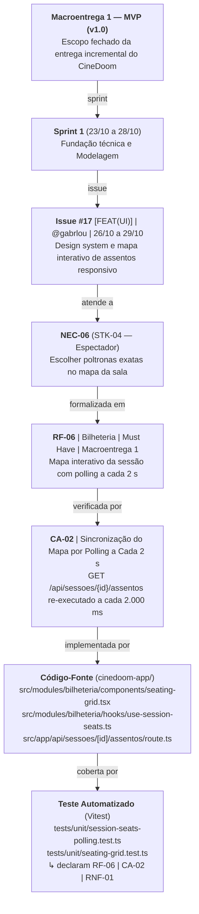
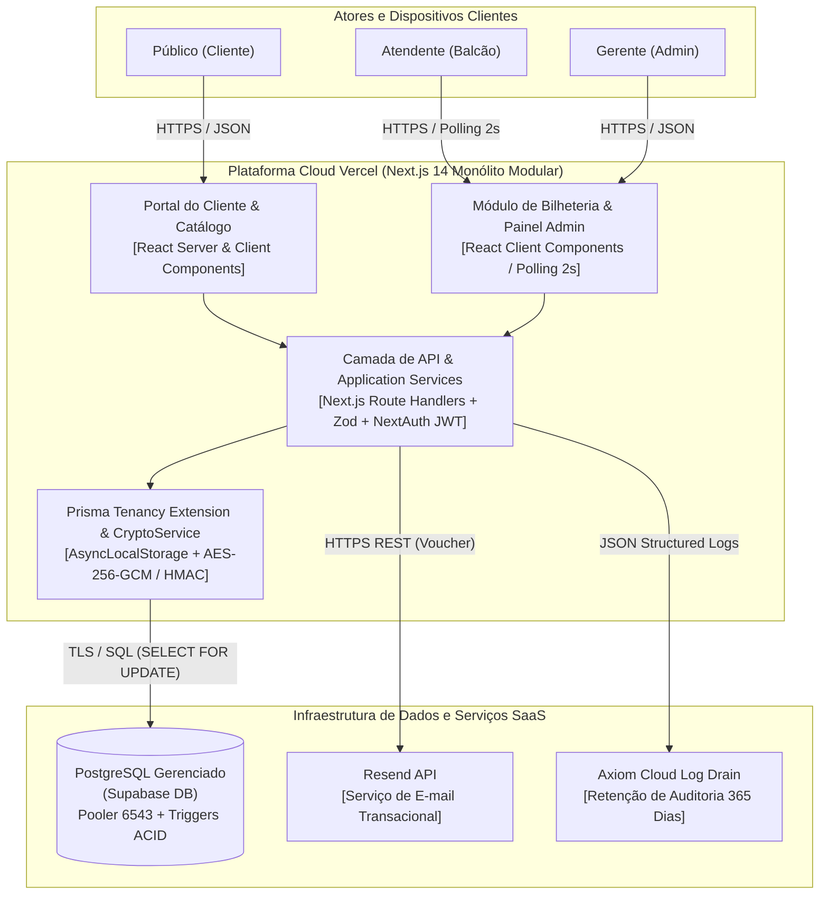
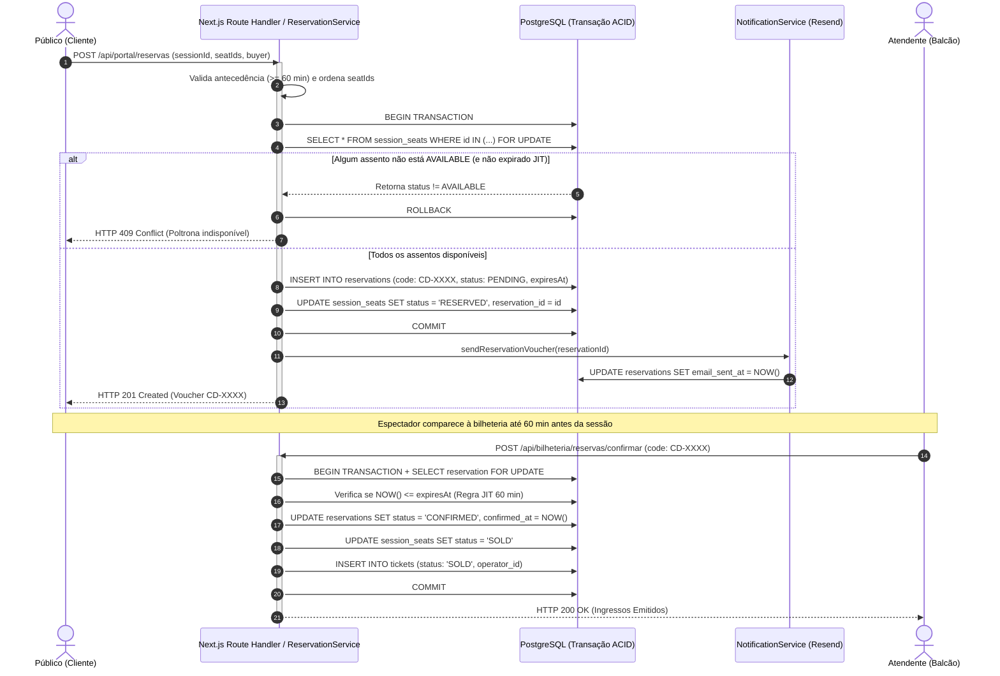
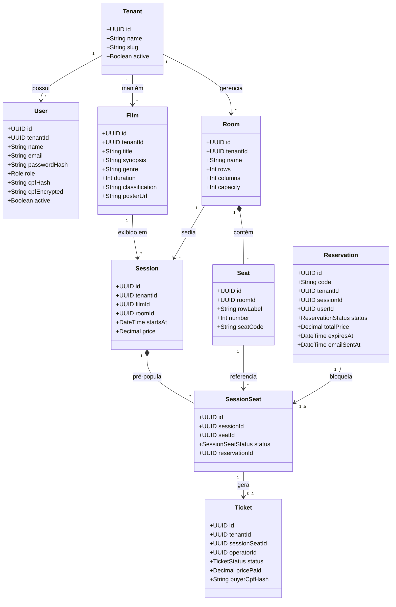

# Capítulo 5 – Processos Técnicos

## 5.1 Requisitos

### 5.1.1 Documento de requisitos do sistema

A especificação formal de requisitos da plataforma **CineDoom** estrutura os requisitos funcionais (`RF`), não funcionais (`RNF`, segundo a norma ISO/IEC 25010) e restrições arquiteturais (`RES`), priorizados pelo método **MoSCoW**.

#### Catálogo Formal de Requisitos Funcionais (`RF-01` a `RF-18`)

| ID | Módulo | Requisito Funcional | Prioridade | Macroentrega |
| :---: | :---: | :--- | :---: | :---: |
| **RF-01** | Identidade & RBAC | Autenticar usuários via credenciais seguras (`bcrypt` cost 12) e sessão JWT contendo `userId`, `role` (`GERENTE`, `ATENDENTE`, `CLIENTE`) e `tenantId`. | *Must Have* | Macroentrega 1 (`v1.0`) |
| **RF-02** | Gestão de Operadores | Permitir ao `GERENTE` criar, listar, atualizar e inativar operadores com perfil `ATENDENTE` vinculados ao seu cinema (*tenant*), revogando sessões ativas. | *Must Have* | Macroentrega 1 (`v1.0`) |
| **RF-03** | Catálogo de Filmes | Permitir ao `GERENTE` manter o acervo de filmes (título, sinopse, gênero, duração em minutos, classificação indicativa e pôster). | *Must Have* | Macroentrega 1 (`v1.0`) |
| **RF-04** | Salas e Assentos | Permitir ao `GERENTE` cadastrar salas de exibição (Clássica, IMAX, VIP) e gerar automaticamente a matriz 2D de poltronas (fileiras A–Z e colunas numeradas). | *Must Have* | Macroentrega 1 (`v1.0`) |
| **RF-05** | Sessões | Permitir ao `GERENTE` agendar sessões (Filme + Sala + Data/Hora + Preço), validando choques de horário na mesma sala e pré-populando `SessionSeat`. | *Must Have* | Macroentrega 1 (`v1.0`) |
| **RF-06** | Bilheteria ACID | Disponibilizar mapa interativo da sessão com atualização por polling a cada 2 segundos. | *Must Have* | Macroentrega 1 (`v1.0`) |
| **RF-07** | Bilheteria ACID | Processar a venda presencial de múltiplos assentos em transação atômica ACID com bloqueio pessimista (`SELECT ... FOR UPDATE`), impedindo *double-booking*. | *Must Have* | Macroentrega 1 (`v1.0`) |
| **RF-08** | Bilheteria ACID | Emitir comprovante operacional de ingresso contendo código identificador único, filme, sala, horário, poltronas e valor pago. | *Must Have* | Macroentrega 1 (`v1.0`) |
| **RF-09** | Auditoria & Guichê | Realizar o cancelamento síncrono de ingresso vendido na bilheteria mediante justificativa obrigatória, gravando trilha *append-only* protegida por trigger SQL. | *Must Have* | Macroentrega 1 (`v1.0`) |
| **RF-10** | Governança LGPD | Proteger o CPF de compradores e clientes por indexação cega `HMAC-SHA256` e criptografia autenticada `AES-256-GCM`, permitindo anonimização *in-place* (Art. 18). | *Must Have* | Macroentrega 1 (`v1.0`) |
| **RF-11** | Ocupação & Logs | Apresentar painel gerencial com cálculo em tempo real da taxa de ocupação (vendidos, reservados e livres) por sessão/sala e exportar logs para o Axiom. | *Must Have* | Macroentrega 1 (`v1.0`) |
| **RF-12** | Portal do Cliente | Exibir catálogo público responsivo de filmes em cartaz com busca por título/sinopse, filtro por gênero e exibição da sinopse. | *Must Have* | Macroentrega 1 (`v1.0`) |
| **RF-13** | Portal do Cliente | Permitir ao espectador selecionar poltronas no mapa interativo e confirmar reserva online com status `PENDING` e bloqueio dos assentos como `RESERVED`, exclusivamente quando faltarem 60 minutos ou mais para o início da sessão. | *Must Have* | Macroentrega 1 (`v1.0`) |
| **RF-14** | Portal do Cliente | Permitir o cadastro e login de espectadores (`CLIENTE`) com validação matemática de CPF (Módulo 11) e termo explícito de consentimento LGPD. | *Must Have* | Macroentrega 1 (`v1.0`) |
| **RF-15** | Notificações | Emitir voucher digital com localizador único (`CD-XXXX`) e acionar o `NotificationService` (`ResendProvider` / `ConsoleLogger`), registrando `email_sent_at`. | *Must Have* | Macroentrega 1 (`v1.0`) |
| **RF-16** | Portal do Cliente | Disponibilizar área autenticada *"Minhas Reservas"* permitindo ao espectador consultar seus vouchers e realizar o cancelamento voluntário de reservas pendentes. | *Must Have* | Macroentrega 1 (`v1.0`) |
| **RF-17** | Bilheteria Híbrida | Permitir ao `ATENDENTE` localizar reservas web no balcão pelo código localizador (`CD-XXXX`) e confirmar o pagamento presencial, convertendo em `SOLD`. | *Must Have* | Macroentrega 1 (`v1.0`) |
| **RF-18** | Expiração JIT | Invalidar automaticamente reservas pendentes não pagas quando faltarem menos de 60 minutos para o início da sessão, liberando os assentos em tempo real. | *Must Have* | Macroentrega 1 (`v1.0`) |

#### Catálogo Formal de Requisitos Não Funcionais (`RNF-01` a `RNF-06` — ISO/IEC 25010)

| ID | Característica ISO 25010 | Especificação e Métrica Objetiva |
| :---: | :--- | :--- |
| **RNF-01** | **Eficiência de Desempenho** | Latência HTTP p95 $< 800\text{ ms}$ e p99 $< 1.500\text{ ms}$ nas transações de venda e reserva; sincronização visual do mapa de assentos por polling a cada $2\text{ s}$. |
| **RNF-02** | **Confiabilidade e Atomicidade** | Zero ocorrências de venda ou reserva dupla (*double-booking*) sob carga concorrente de 50 threads simultâneas disputando a mesma poltrona. |
| **RNF-03** | **Segurança e Isolamento** | Isolamento multi-tenant absoluto validado por 500 cenários automatizados de intrusão *cross-tenant* e criptografia de CPF com `HMAC-SHA256` + `AES-256-GCM`. |
| **RNF-04** | **Usabilidade e Responsividade** | Interface adaptativa para smartphones (a partir de `320px`) e terminais desktop de bilheteria (`1024x768+`), aderente às diretrizes WCAG 2.1 Nível AA. |
| **RNF-05** | **Compatibilidade** | Operação integral via navegadores modernos (Chrome, Safari, Edge, Firefox) sem exigência de plugins locais ou aplicativos nativos. |
| **RNF-06** | **Manutenibilidade** | Arquitetura limpa orientada a módulos com tipagem estática estrita (`tsc --noEmit`) e zero dependências circulares (`ESLint import/no-cycle`). |

---

#### Restrições Técnicas e Limites de Escopo (`RES-01` a `RES-06`)

Restrições arquiteturais e itens explicitamente fora do escopo da **Macroentrega 1 (MVP)**. As entregas previstas para as Macroentregas 2 e 3 (gateway de pagamento online, emissão fiscal NFC-e/SAT e bomboniere) são evoluções planejadas no roadmap e **não contradizem** estas restrições, que delimitam exclusivamente o MVP:

* **`RES-01` — Pagamento Presencial Exclusivo no MVP (Sem Gateway Online):** No escopo da Macroentrega 1, o sistema não processa pagamentos eletrônicos online (cartão de crédito/débito ou checkout PIX web no portal); a liquidação financeira das reservas ocorre exclusivamente no balcão físico da bilheteria até 60 minutos antes da sessão. O gateway online (PIX/Stripe) está planejado para a Macroentrega 2.
* **`RES-02` — Sem Integração de Hardware Fiscal no MVP (NFC-e / SAT):** No escopo da Macroentrega 1, o sistema emite comprovantes operacionais e *vouchers* de reserva/ingresso, não integrando módulos de comunicação direta com SEFAZ para emissão de nota fiscal eletrônica ao consumidor. A emissão fiscal automatizada está planejada para a Macroentrega 3.
* **`RES-03` — Aplicação Web Responsiva (Sem App Nativo Mobile):** O acesso de espectadores, atendentes e gerentes ocorre integralmente via navegadores web (desktop e mobile responsivo), sem distribuição de aplicativos nativos nas lojas Google Play ou Apple App Store.
* **`RES-04` — Exclusão de Bomboniere e Estoque de Alimentos no MVP:** No escopo da Macroentrega 1, o escopo restringe-se à gestão de catálogo cinematográfico, salas, sessões, reservas e bilheteria de ingressos, não abrangendo controle de estoque de pipoca, bebidas ou combos. O módulo de bomboniere está planejado para a Macroentrega 3.
* **`RES-05` — Sem Distribuição de Mídia Digital ou DRM:** O sistema gerencia metadados e cartazes dos filmes, não realizando *streaming* de vídeo nem gerenciamento de chaves digitais de projetores (KDM/DCP).
* **`RES-06` — Idioma e Localização Única (`pt-BR`):** A plataforma é projetada e localizada exclusivamente em português brasileiro, operando segundo o fuso horário e a legislação nacional (LGPD e CDC).

---

#### Regras de Negócio Estruturantes (`RN-01` a `RN-12`)

As políticas de domínio que atravessam os requisitos estão consolidadas nas regras de negócio: exclusividade atômica do assento e máquina de estados (`RN-01`, `RN-02`); antecedência mínima de 60 minutos e expiração *Just-in-Time* (`RN-03`, `RN-04`); integridade do catálogo e anti-choque de sessões (`RN-05`, `RN-06`); auditoria imutável de cancelamento (`RN-07`); RBAC e segurança de credenciais (`RN-08`, `RN-09`); criptografia, consentimento e anonimização LGPD com retenção fiscal (`RN-10`, `RN-11`); e isolamento multi-tenant (`RN-12`).

---

### 5.1.2 Rastreabilidade de requisitos

A integridade da engenharia de software da CineSoft Solutions é garantida por uma matriz de rastreabilidade **bidirecional**: cada linha parte da necessidade do stakeholder (`STK`/`NEC`), passa pelo requisito (`RF`/`RNF`/`RES`) e pelo critério de aceite (`CA`), chega ao código-fonte e retorna pelo caso de teste, que declara explicitamente qual requisito e critério verifica.

Para tornar essa cadeia verificável, o diagrama a seguir percorre um **exemplo completo e real**, da macroentrega planejada até o teste de código que a comprova:

> **Diagrama vetorial (PDF):** [diagrama-rastreabilidade.pdf](../../assets/capitulo-05/diagramas/diagrama-rastreabilidade.pdf) - Fonte PlantUML: [diagrama-rastreabilidade.puml](../../assets/capitulo-05/diagramas/diagrama-rastreabilidade.puml)

O quadro a seguir resume, de forma compacta, as dez linhas da matriz completa; a coluna de código-fonte, suprimida aqui para preservar a legibilidade, é mantida no artefato `assets/capitulo-05/tabelas/matriz-rastreabilidade.tex`:

| Necessidade / Stakeholder | Requisito(s) | Critério de Aceite | Caso de Teste (`tests/`) |
| :--- | :---: | :---: | :--- |
| `STK-02` / `NEC-02` (Controle de Acesso e Equipe) | `RF-01`, `RF-02` | `CA-05` | `auth-rbac.test.ts` (→ `RF-01`, `CA-05`); `users-management.test.ts` (→ `RF-02`, `CA-05`) |
| `STK-02` / `NEC-02` (Gestão de Acervo e Salas) | `RF-03` a `RF-05`, `RES-05` | `CA-08` | `catalog-filmes.test.ts` (→ `RF-03`); `rooms-layout.test.ts` (→ `RF-04`); `sessions-prepopulation.test.ts` (→ `RF-05`) |
| `STK-03`, `STK-04` / `NEC-03`, `NEC-06` (Mapa Reativo e Guichê) | `RF-06`, `RNF-01`, `RNF-04` | `CA-02` | `seating-grid.test.ts` (→ `RF-06`, `RNF-04`); `session-seats-polling.test.ts` (→ `RF-06`, `RNF-01`) |
| `STK-01`, `STK-03` / `NEC-01`, `NEC-03` (Venda Atômica ACID) | `RF-07`, `RF-08`, `RNF-02`, `RES-01`, `RES-02`, `RES-04` | `CA-01`, `CA-15` | `venda-atomica.test.ts` (→ `RF-07`, `CA-01`); `concurrency-acid-50-threads.test.ts` (→ `RF-07`, `CA-01`); `cancelamento-auditavel.test.ts` (→ `RF-08`, `CA-15`) |
| `STK-03`, `STK-05` / `NEC-04`, `NEC-08` (Cancelamento Imutável) | `RF-09` | `CA-03` | `cancelamento-auditavel.test.ts` (→ `RF-09`); `database-schema.test.ts` (→ `RF-09`) |
| `STK-05` / `NEC-04` (Privacidade e LGPD Art. 18) | `RF-10`, `RNF-03` | `CA-06` | `cryptoservice.test.ts` (→ `RF-10`); `compliance-anonymization.test.ts` (→ `RF-10`) |
| `STK-01` / `NEC-01` (Isolamento Multi-Tenant SaaS) | `RNF-03`, `RNF-06` | `CA-04` | `tenancy-isolation.test.ts` (→ `RNF-03`); `security-cross-tenant-suite.test.ts` (→ `RNF-03`); `modules.test.ts`, `ci-workflow.test.ts` (→ `RNF-06`) |
| `STK-02`, `STK-05` / `NEC-02`, `NEC-04` (Painel de Ocupação e Logs) | `RF-11` | `CA-07` | `observability-logger.test.ts` (→ `RF-11`); `security-cross-tenant-suite.test.ts` (→ `RF-11`) |
| `STK-04` / `NEC-05`, `NEC-06` (Portal e Reserva Web) | `RF-12` a `RF-14`, `RNF-04`, `RNF-05`, `RES-01`, `RES-03`, `RES-06` | `CA-09`, `CA-10`, `CA-15` | `reserva-atomica.test.ts` (→ `RF-13`, `CA-09`); `cryptoservice.test.ts` (→ `RF-14`, `CA-10`); `auth-rbac.test.ts` (→ `RF-14`, `CA-10`); `seating-grid.test.ts` (→ `RNF-04`) |
| `STK-04`, `STK-03` / `NEC-07`, `NEC-08` (Voucher, Cancelamento Web, Baixa e JIT) | `RF-15` a `RF-18`, `RES-01`, `RES-02` | `CA-11` a `CA-14` | `reserva-atomica.test.ts` (→ `RF-15`, `RF-16`, `RF-18`, `CA-11`, `CA-14`); **sem automação**: `RF-15` (e-mail/`email_sent_at`), `RF-16`/`CA-12` (cancelamento web), `RF-17`/`CA-13` (baixa presencial) |

**`RNF-05` e `RES-01` a `RES-06` não têm linha própria porque não pertencem a uma única tela ou módulo**: são regras e qualidades que valem para várias partes do sistema ao mesmo tempo.

**Evidência das restrições no repositório:** `RES-01`/`RES-02` — não existem rotas de gateway de pagamento nem modelos fiscais em `src/app/api/` e `prisma/schema.prisma`; `RES-03` — a aplicação é web (`src/app/`), sem projeto mobile nativo; `RES-04` — não há módulo de bomboniere/estoque; `RES-05` — não há *streaming* ou DRM; `RES-06` — `src/app/layout.tsx` declara `lang="pt-BR"`.

---

### 5.1.3 Critérios de aceitação (`CA-01` a `CA-15`)

Os 15 critérios de aceitação foram definidos em formato comportamental BDD (*Dado que / Quando / Então*):

1. **`CA-01` (Venda Presencial Atômica Anti-Double-Booking):** *Dado que* dois operadores ou clientes tentam adquirir a mesma poltrona `AVAILABLE` simultaneamente, *quando* as transações concorrentes são submetidas, *então* o banco deve serializar o acesso via `SELECT FOR UPDATE`, aprovar apenas a primeira (`HTTP 201`) e rejeitar a segunda com `HTTP 409 Conflict`.
2. **`CA-02` (Sincronização do Mapa por Polling a Cada 2 s):** *Dado que* o mapa de assentos de uma sessão está aberto, *quando* o status de um assento muda para `RESERVED`, `SOLD` ou `AVAILABLE`, *então* o sistema deve consultar `GET /api/sessoes/{id}/assentos` a cada 2.000 ms e a resposta da consulta seguinte deve refletir o novo status em até 2 segundos.
3. **`CA-03` (Auditoria Imutável de Cancelamento):** *Dado que* um ingresso vendido é cancelado na bilheteria, *quando* a operação é executada, *então* um registro imutável deve ser gravado em `cancellation_audits` (protegido por trigger PostgreSQL contra `UPDATE/DELETE`) antes de liberar o assento.
4. **`CA-04` (Isolamento Estrito Multi-Tenant):** *Dado que* um operador do *Tenant A* está autenticado, *quando* tenta ler ou modificar filmes, salas, sessões ou reservas do *Tenant B*, *então* a extensão de tenancy deve bloquear o acesso em 100% dos 500 cenários de teste.
5. **`CA-05` (Controle de Acesso RBAC e Gestão de Operadores):** *Dado que* um usuário autenticado possui perfil `ATENDENTE` ou `CLIENTE`, *quando* tenta acessar rotas administrativas (`/admin/*` ou `/api/admin/*`), *então* o sistema deve responder `HTTP 403 Forbidden`; *dado que* o `GERENTE` gerencia operadores do próprio cinema, *quando* cria, lista, atualiza ou inativa um atendente, *então* a operação deve ser persistida e a inativação deve revogar o acesso do operador, retornando `HTTP 403` nas APIs e redirecionando ao login nas páginas.
6. **`CA-06` (Criptografia de CPF e Anonimização LGPD):** *Dado que* um CPF é fornecido na compra ou cadastro, *quando* o registro é persistido, *então* o CPF não deve ser armazenado em texto puro, sendo gravado como `HMAC-SHA256` (`cpf_hash`) e `AES-256-GCM` (`cpf_encrypted`); *quando* a anonimização é solicitada pelo titular, *então* nome, e-mail e CPF cifrado devem ser sobrescritos *in-place*, `anonymized_at` preenchido, os vínculos com os ingressos preservados e uma segunda solicitação rejeitada.
7. **`CA-07` (Painel de Ocupação e Trilha de Logs Estruturados):** *Dado que* uma sessão possui assentos vendidos, reservados, bloqueados e livres e que operações críticas são executadas, *quando* o `GERENTE` consulta o painel de ocupação, *então* o sistema deve exibir as contagens por status e o percentual de ocupação calculado como `(vendidos ÷ capacidade) × 100`, arredondado a uma casa decimal; e, para cada operação crítica efetivamente executada (venda, cancelamento, conflito ACID, violação de segurança, autenticação e anonimização), emitir log estruturado em JSON contendo `tenant_id`, `user_id`, timestamp UTC e identificador do recurso, com retenção de 365 dias no Axiom.
8. **`CA-08` (Gestão Validada de Catálogo, Salas e Sessões):** *Dado que* o `GERENTE` gerencia a programação, *quando* cria, edita ou lista filmes, salas com layout de assentos e sessões cinematográficas, *então* o sistema deve rejeitar com `HTTP 422` qualquer campo obrigatório ausente, rejeitar com `HTTP 409` sessões com sobreposição de horário na mesma sala e pré-popular os assentos da sessão (`SessionSeat`) com status inicial `AVAILABLE`.
9. **`CA-09` (Reserva Online com Antecedência de 60 min):** *Dado que* faltam 60 minutos ou mais para o início da sessão, *quando* o espectador seleciona assentos livres no portal, *então* o sistema deve criar a reserva com status `PENDING` e bloquear os assentos como `RESERVED`.
10. **`CA-10` (Cadastro e Login de Espectador com LGPD):** *Dado que* um espectador preenche nome, e-mail, senha, CPF válido (Módulo 11) e aceita o termo de consentimento LGPD, *quando* conclui o cadastro e efetua login, *então* o sistema deve persistir o CPF como `HMAC-SHA256` + `AES-256-GCM`, gravar `lgpd_consent_at` e autenticar a sessão com perfil `CLIENTE`.
11. **`CA-11` (Voucher Digital com Localizador Único):** *Dado que* uma reserva web é concluída, *então* o sistema deve gerar o voucher digital com código localizador `CD-XXXX` e disponibilizá-lo em `GET /api/portal/reservas/{id}` e na página `/portal/reservas/{id}/comprovante`, contendo filme, sala, data e horário da sessão, assentos e valor total, com instruções para pagamento presencial.
12. **`CA-12` (Cancelamento Voluntário pelo Espectador):** *Dado que* o cliente possui uma reserva com status `PENDING` e `reservation_expires_at` futuro, *quando* solicita o cancelamento em *"Minhas Reservas"*, *então* o status deve mudar para `CANCELLED` e os assentos devem voltar imediatamente para `AVAILABLE`; reservas não pendentes ou expiradas devem ser rejeitadas com `HTTP 400`.
13. **`CA-13` (Baixa Presencial de Reserva no Balcão):** *Dado que* o cliente apresenta o código localizador `CD-XXXX` na bilheteria, *quando* o atendente consulta a reserva e confirma o pagamento enquanto `reservation_expires_at` for futuro, *então* a reserva deve mudar para `CONFIRMED` e os assentos para `SOLD`; reservas não pendentes ou expiradas devem ser rejeitadas com `HTTP 400`.
14. **`CA-14` (Expiração Just-in-Time a 60 min da Sessão):** *Dado que* uma reserva `PENDING` possui `reservation_expires_at` igual ou anterior ao instante atual, *quando* o atendente tenta confirmar o pagamento ou o mapa de assentos é consultado, *então* a baixa presencial deve ser rejeitada com `HTTP 400` e o assento deve ser retornado como `AVAILABLE`, podendo ser reservado ou vendido para outro cliente.
15. **`CA-15` (Catálogo Público e Comprovante de Ingresso):** *Dado que* existem filmes em cartaz com sessões futuras e ingressos vendidos, *quando* o espectador acessa o catálogo público ou o operador consulta um ingresso pelo identificador único, *então* (a) o catálogo deve listar os filmes em cartaz, permitir busca por título ou sinopse e filtro por gênero, exibindo a sinopse do filme; e (b) o comprovante deve retornar o identificador único do ingresso, o filme, a sala, o horário da sessão, a poltrona e o valor pago.

---

### 5.1.4 Registro de stakeholders e necessidades elicitadas

O levantamento de requisitos combinou quatro técnicas complementares de engenharia de requisitos: (1) **Entrevistas estruturadas** com gestores de salas independentes, (2) **Observação de campo** do fluxo de fila em bilheterias físicas, (3) **Prototipação iterativa de alta fidelidade** para validação da experiência mobile/desktop e (4) **Análise regulatória** do texto da LGPD e do Código de Defesa do Consumidor.

| Código | Stakeholder (Parte Interessada) | Técnica de Elicitação Aplicada | Necessidades Capturadas (`NEC`) |
| :---: | :--- | :--- | :--- |
| **STK-01** | **Proprietários e Diretores de Redes de Cinema (Clientes B2B)** | Entrevistas de negócio e análise de TCO | `NEC-01`: Eliminar vendas duplas de poltronas, reduzir ociosidade por *no-show* e operar em modelo SaaS com isolamento total dos dados da empresa. |
| **STK-02** | **Gerentes Operacionais de Cinema (`GERENTE`)** | Entrevistas e workshops de fluxo administrativo | `NEC-02`: Configurar facilmente salas (Clássica, IMAX, VIP), grade de filmes/sessões, equipe de atendentes e acompanhar a lotação em tempo real. |
| **STK-03** | **Atendentes de Bilheteria Física (`ATENDENTE`)** | Observação de operação de guichê e prototipação | `NEC-03` e `NEC-08`: Vender ingressos em poucos cliques no mapa visual, localizar reservas web pelo código localizador rapidamente e cancelar com segurança. |
| **STK-04** | **Espectadores / Clientes Finais (`CLIENTE` B2C)** | Prototipação mobile/desktop e testes de usabilidade | `NEC-05`, `NEC-06` e `NEC-07`: Consultar horários pelo celular ou computador, escolher poltronas exatas no mapa da sala, receber voucher e cancelar online se necessário. |
| **STK-05** | **Encarregado de Dados (DPO) e Auditoria Jurídica** | Análise normativa (LGPD Lei 13.709/2018 e ISO 27701) | `NEC-04`: Garantir criptografia forte de CPF, consentimento explícito, direito à anonimização (Art. 18) e trilha de auditoria imutável por 365 dias. |

---

## 5.2 Arquitetura e Design

### 5.2.1 Documento de arquitetura do sistema

#### Identificação e escopo

| Campo | Definição |
| :--- | :--- |
| **Sistema** | CineDoom — plataforma SaaS de bilheteria, back-office e portal do cliente para cinemas independentes e redes regionais |
| **Repositório de referência** | `cinedoom-app/` — Next.js 14.2.35 (App Router), React 18.3, TypeScript 5.6, Prisma 5.21, PostgreSQL/Supabase |
| **Norma de processo** | ABNT NBR ISO/IEC/IEEE 12207:2021, §6.4.4 e §6.4.5 |
| **Stakeholders** | Gerente de cinema, atendente de bilheteria, espectador (cliente final) e equipe de operação/segurança |
| **Fronteira do sistema** | Aplicação web responsiva (desktop e mobile). O MVP **não** processa pagamento online, emissão fiscal, bomboniere ou *streaming* de mídia |
| **Fora do escopo deste documento** | Detalhamento de telas (`specs/architecture/ui-mockups.md`), modelo de dados completo (`specs/data-model/data-model.md`) e plano de testes (§5.3) |

#### Visão geral da arquitetura

O CineDoom é um **monólito modular** (`ADR-001`) implantado como aplicação Next.js 14 com *App Router*. A fronteira externa é composta por três atores (gerente, atendente e espectador) e quatro sistemas externos (Supabase PostgreSQL, Axiom, serviço de e-mail transacional e Vercel). Internamente, o código organiza-se em quatro zonas com dependência unidirecional:

| Zona | Responsabilidade | Regra de dependência |
| :--- | :--- | :--- |
| **Interface** | Renderização (RSC/Client Components), navegação, modais, cabeçalho autenticado e Route Handlers | Depende de `modules` e `shared` |
| **Aplicação** | Casos de uso, validação Zod, orquestração transacional e tradução de erros de domínio | Depende de `shared/db` e de outros módulos apenas via `index.ts` |
| **Domínio e segurança** | Invariantes (antecedência de 60 min, expiração JIT, CPF Módulo 11), RBAC e criptografia | Não depende de `next/*` nem de componentes React |
| **Infraestrutura transversal** | Conexão Prisma, contexto de tenant via `AsyncLocalStorage`, logging estruturado e guarda de rotas | É dependida pelas demais zonas; não depende de UI |

#### Catálogo de componentes

O sistema é composto pelos **11 módulos de domínio** de `src/modules/`. Cada um expõe um contrato público em `index.ts`, e a rastreabilidade entre módulos e requisitos está no §5.1.2.

| Componente | Função |
| :--- | :--- |
| `auth` | Autenticação por credenciais, RBAC e gestão de operadores |
| `backoffice` | Cadastro de filmes, salas (com matriz de assentos) e sessões |
| `bilheteria` | Venda presencial, cancelamento com auditoria, baixa de reserva web e mapa de assentos |
| `portal` | Catálogo público, cadastro do cliente, reserva online e cancelamento voluntário |
| `compradores` | Cadastro e busca de comprador presencial por CPF |
| `compliance` | Localização e anonimização de titulares (LGPD Art. 18) |
| `crypto` | Criptografia, hash e validação de CPF |
| `notificacoes` | Voucher de reserva com provedor de e-mail plugável |
| `observability` | Log estruturado e rastreabilidade por requisição |
| `ocupacao` | Indicadores de ocupação por sessão e por sala |
| `tenancy` | Contexto de tenant e injeção do filtro `tenant_id` no Prisma |

Além dos módulos, `src/shared/` concentra as peças transversais (cliente Prisma, logger e utilitários) e `src/app/` abriga a camada de interface.

#### Interfaces

**a) Interface HTTP.** O sistema expõe **31 Route Handlers** em `src/app/api/`, agrupados por perfil de acesso: rotas públicas (login e catálogo), `CLIENTE` (portal e mapa de assentos), `ATENDENTE` e `GERENTE` (bilheteria) e `GERENTE` (back-office, ocupação e LGPD). A autorização ocorre em `middleware.ts` e é reconfirmada no handler.

**b) Interface entre módulos.** Cada módulo exporta funções e objetos de serviço, com entrada validada por schema Zod e erros de domínio tipados. Nenhum módulo acessa a implementação interna de outro, o que permite testar os casos de uso sem subir o servidor Next.js.

**c) Interface de persistência.** Acesso por Prisma sobre PostgreSQL, com 11 modelos e 6 enums. Todo serviço recebe o `tenantId` e o aplica explicitamente nas consultas; transações e a trava `SELECT ... FOR UPDATE` garantem a exclusividade do assento.

**d) Interfaces externas.** NextAuth (sessão JWT com `userId`, `role` e `tenantId`), Supabase (banco), Axiom (logs), Resend (e-mail, simulado no MVP) e Vercel com GitHub Actions (deploy e CI).

**e) Interface de erros.** O serviço lança erro tipado e o Route Handler o traduz em status HTTP: `400` para JSON malformado, `401` sem sessão, `403` para RBAC ou conta inativa, `404` para recurso inexistente, `409` para assento ocupado, e-mail duplicado ou choque de grade, `422` para falha de validação, CPF inválido ou antecedência inferior a 60 minutos e `500` para erro inesperado.

#### Decisões arquiteturais (ADRs)

As decisões abaixo estão registradas e aprovadas em `specs/adrs/`; a coluna “Efeito verificável” indica onde a decisão aparece no código ou nos critérios de aceite.

| ADR | Decisão | Efeito verificável |
| :---: | :--- | :--- |
| **ADR-001** | Monólito modular em Next.js 14 com módulos verticais | `src/modules/*` e `src/shared/*`; lint `import/no-cycle` |
| **ADR-002** | Interface reativa com Tailwind CSS e React Server/Client Components | `src/app/`, `src/components/`, `SeatingGrid` como Client Component |
| **ADR-003** | Backend em TypeScript com Route Handlers | 31 `route.ts`, validação Zod e erros de domínio |
| **ADR-004** | PostgreSQL com Prisma ORM | `prisma/schema.prisma`; 11 modelos e 6 enums |
| **ADR-005** | Vercel + Supabase + GitHub Actions | `next.config.mjs`, `ci.yml`, `deploy.yml` |
| **ADR-006** | API RESTful com polling de 2 s no mapa de assentos | `useSessionSeats` e índice `(session_id, status)` |
| **ADR-007** | Pré-população de `SessionSeat` e trava `SELECT FOR UPDATE` | `session-service.ts` e `sale-service.ts`/`portal-service.ts` |
| **ADR-008** | CPF com HMAC-SHA256 (busca) e AES-256-GCM (repouso) | `crypto-service.ts`; `cpf_hash` e `cpf_encrypted` |
| **ADR-009** | Anonimização *in-place* para LGPD Art. 18 | `anonymization-service.ts` e `/api/titulares/anonimizar` |
| **ADR-010** | Auditoria de cancelamentos *append-only* com trigger | `cancellation-service.ts`, modelo `CancellationAudit` e trigger em `prisma/triggers.sql` |
| **ADR-011** | Log estruturado no Axiom com retenção de 365 dias | `src/shared/logger/`, `x-request-id` e `CA-03`/`CA-07` |
| **ADR-012** | Portal do cliente com reserva JIT e notificação desacoplada | `portal-service.ts`, `notification-service.ts` e `CA-11`/`CA-14` |

#### Princípios de modelagem: Domain-Driven Design (DDD)

O domínio do cinema foi modelado segundo o **Domain-Driven Design**, o que se reflete em três propriedades do projeto:

- **Linguagem Ubíqua:** o mesmo vocabulário é usado por desenvolvedores, stakeholders, especificações e código. Termos como *Tenant* (cinema cliente), *SessionSeat* (poltrona de uma sessão), *Reservation* e *Ticket* têm o mesmo significado no schema Prisma, no TypeScript e nas regras de negócio.
- **Contextos Delimitados:** cada contexto de negócio corresponde a um módulo real — bilheteria e ocupação, portal e notificações, catálogo e programação, privacidade, identidade e acesso, observabilidade.
- **Invariantes de domínio:** as regras críticas ficam nos serviços, não na interface. A antecedência de 60 minutos, a exclusividade do assento e a auditoria do cancelamento não podem ser contornadas pela UI.

#### Princípios de design de software: SOLID

O projeto aplica os cinco princípios **SOLID**, com evidência verificável no código:

- **S — Single Responsibility Principle:** cada arquivo de serviço tem um papel delimitado. `sale-service.ts` (`SaleService.processSale`) trata exclusivamente a venda presencial e a emissão de ingressos; `portal-service.ts` (`createReservation`, `cancelMyReservation`) trata a reserva web; `crypto-service.ts` isola as operações criptográficas (`AES-256-GCM` e `HMAC-SHA256`); `ocupacao-service.ts` apenas calcula indicadores.
- **O — Open/Closed Principle:** o subsistema de notificações é aberto para extensão e fechado para modificação por meio da interface `EmailProvider`, implementada por `ConsoleLoggerProvider` e `ResendProvider` e selecionada por `getProvider()`. Trocar o provedor não altera o caso de uso de reserva.
- **L — Liskov Substitution Principle:** as implementações respeitam os contratos que declaram. `withTenancy` devolve um `TenantPrismaClient` compatível com `PrismaClient`, e os dublês de teste substituem os serviços reais sem alterar os casos de uso.
- **I — Interface Segregation Principle:** não há interfaces genéricas infladas. Cada operação tem um schema Zod específico — `createSaleSchema`, `createReservationSchema`, `registerClientSchema`, `createFilmSchema`, `createRoomSchema`, `createSessionSchema`, `createUserSchema`, `cancelTicketSchema`, `anonymizeTitularSchema` — e os serviços recebem apenas os campos de que precisam.
- **D — Dependency Inversion Principle:** as regras de negócio não dependem de `next/*`. Os Route Handlers apenas orquestram sessão, validação e tradução de erros; os serviços dependem de `prisma`/`rawPrisma` e de contratos internos, o que permite testá-los sem o framework web.

---

### 5.2.2 Diagramas de design

Para documentar integralmente a estrutura estática e o comportamento dinâmico do sistema, apresentam-se a seguir os **três diagramas formais de arquitetura e design** do CineDoom.

#### 1. Diagrama C4 - Nível 2 (Diagrama de Contêineres)

O Diagrama de Contêineres ilustra a interação entre os três perfis de usuários (Espectador, Atendente e Gerente), a aplicação web e API serverless hospedada na Vercel, o banco de dados relacional PostgreSQL e os serviços externos de e-mail transacional (Resend) e observabilidade (Axiom):

> **Diagrama vetorial (PDF):** [c4-containers.pdf](../../assets/capitulo-05/diagramas/c4-containers.pdf) — Fonte PlantUML: [c4-containers.puml](../../assets/capitulo-05/diagramas/c4-containers.puml)

#### 2. Diagrama de Sequência UML (Reserva Online Atômica e Baixa Presencial no Balcão)

O Diagrama de Sequência detalha o comportamento temporal da transação crítica que une o Portal do Cliente e a Bilheteria Presencial: o bloqueio pessimista ordenado (`SELECT FOR UPDATE`), a emissão do voucher transacional e a posterior conversão em ingresso vendido (`SOLD`) no guichê físico:

> **Diagrama vetorial (PDF):** [diagrama-sequencia.pdf](../../assets/capitulo-05/diagramas/diagrama-sequencia.pdf) - Fonte PlantUML: [diagrama-sequencia.puml](../../assets/capitulo-05/diagramas/diagrama-sequencia.puml)

#### 3. Diagrama de Classes UML (Modelo de Domínio)

O Diagrama de Classes representa as entidades nucleares do domínio do CineDoom, seus atributos tipados, métodos de negócio e multiplicidades de associação sob isolamento multi-tenant (`Tenant`):

> **Diagrama vetorial (PDF):** [diagrama-classes-dominio.pdf](../../assets/capitulo-05/diagramas/diagrama-classes-dominio.pdf) - Fonte PlantUML: [diagrama-classes-dominio.puml](../../assets/capitulo-05/diagramas/diagrama-classes-dominio.puml)

---

### 5.2.3 Justificativa das escolhas tecnológicas

O stack tecnológico foi selecionado para maximizar a segurança transacional, a ergonomia de desenvolvimento e a eficiência operacional em nuvem:
- **Next.js 14 (App Router) + React 18 + Tailwind CSS:** Permite renderizar o catálogo público na borda com baixíssima latência e manter componentes clientes altamente reativos para o mapa de poltronas em smartphones e terminais de guichê.
- **TypeScript Estrito + Zod:** Garante contratos estáticos fim a fim e validação determinística na fronteira HTTP, eliminando classes inteiras de erros de runtime.
- **PostgreSQL + Prisma ORM:** Bancos NoSQL não oferecem a semântica de bloqueio pessimista de linha (`SELECT ... FOR UPDATE`) indispensável para impedir vendas duplas em bilheterias de alta concorrência. O PostgreSQL aliado ao Prisma entrega migrações seguras, triggers nativas de auditoria e performance relacional superior.

### 5.2.4 Estratégia de gestão de mídias e desacoplamento de storage

O banco relacional armazena exclusivamente a referência textual (`poster_url VARCHAR(500)`), mantendo os backups leves e as queries rápidas. Na Macroentrega 1, os pôsteres são servidos via CDN global da Vercel; nas Macroentregas 2 e 3, o upload gerencial utiliza o padrão *Direct-to-Storage* com *Pre-signed URLs* (Vercel Blob / Cloudflare R2).

---

## 5.3 Implementação e Integração

### 5.3.1 Padrões de codificação e engenharia adotados
- **Estruturação Modular:** Organização em fatias de domínio (`src/modules/{auth,backoffice,bilheteria,compradores,compliance,crypto,notificacoes,observability,ocupacao,portal,tenancy}`) e utilitários compartilhados (`src/shared/`).
- **Convenções de Nomenclatura:** Os arquivos seguem convenções específicas por tipo:
  - Arquivos de serviço, componentes, *hooks* e utilitários: `kebab-case` (ex.: `sale-service.ts`, `seating-grid.tsx`)
  - Arquivos de schema: `kebab-case` (ex.: `sale-schema.ts`, `anonymization-schema.ts`)
  - Métodos, variáveis e parâmetros: `camelCase`
  - Componentes React e tipos: `PascalCase` (ex.: `SeatingGrid`, `SessionSeat`)
- **Qualidade Estática:** `strict: true` no `tsconfig.json` e proibição de ciclos de dependência via ESLint (`import/no-cycle` com `maxDepth: 5`).
- **Metodologia Test-Driven Development (TDD):** A equipe adotou a disciplina do desenvolvimento orientado a testes (*Test-Driven Development*), seguindo o ciclo iterativo **Red $\to$ Green $\to$ Refactor**, com ênfase prioritária nas regras de negócio críticas e transações de alta concorrência:
  1. *Fase Red (Teste de Falha Inicial):* Antes de implementar as rotas e regras finais de negócio, os testes automatizados foram construídos para falhar intencionalmente, espelhando os critérios de aceite (`CA-01` a `CA-15`). Foram antecipadamente criados os testes de corrida concorrente com 50 threads disputando o mesmo assento e os 500 cenários de invasão *cross-tenant*.
  2. *Fase Green (Implementação da Solução Mínima):* Desenvolveu-se a lógica de bloqueio pessimista (`SELECT FOR UPDATE`), ordenação determinística de chaves para prevenção de deadlocks e extensão multi-tenant no Prisma até atingir aprovação plena com sinal verde.
  3. *Fase Refactor (Otimização e Limpeza):* O código aprovado foi refatorado aplicando os princípios SOLID, eliminando duplicações e assegurando tipagem estrita sem introduzir regressões na suíte.
  Essa prática resultou em uma base consolidada de **26 arquivos e 770 testes automatizados no Vitest**, permitindo refatorações contínuas com garantia estrita de integridade.

### 5.3.2 Plano de integração entre componentes (CI/CD)
A integração contínua é executada automaticamente pelo **GitHub Actions** (`.github/workflows/ci.yml` e `deploy.yml`) a cada push ou Pull Request:
1. Instalação determinística de dependências com `pnpm install --frozen-lockfile`.
2. Geração do cliente tipado do ORM (`pnpm prisma generate`).
3. Verificação estática de tipos (`pnpm tsc --noEmit`) e regras de arquitetura (`pnpm eslint`).
4. Execução da suíte com gate de cobertura (`pnpm vitest run --coverage`): mínimo de 70% de *statements*, funções e linhas e 80% de *branches* em `src/modules/**` e `src/shared/**`.
5. Auditoria de dependências de produção (`pnpm security:audit`), que bloqueia vulnerabilidades altas ou críticas fora do baseline documentado.
6. Compilação de produção (`pnpm build`) e publicação na Vercel após o merge.

### 5.3.3 Registro de testes unitários e de integração
A aplicação conta com uma suíte robusta executada pelo **Vitest**, totalizando **26 arquivos de teste e 770 testes automatizados passando com 100% de sucesso** em cerca de 9 segundos:
- **Segurança e Isolamento Multi-Tenant (`security-cross-tenant-suite.test.ts` e `tenancy-isolation.test.ts`):** 509 testes verificando que nenhum tenant consegue ler, alterar ou apagar registros de outro cinema.
- **Concorrência ACID com 50 Threads (`concurrency-acid-50-threads.test.ts`, `venda-atomica.test.ts` e `reserva-atomica.test.ts`):** Simulação de 50 requisições paralelas disputando o mesmo assento entre portal web e balcão, comprovando exatamente 1 aprovação e 49 rejeições `HTTP 409`.
- **Criptografia e Conformidade LGPD (`cryptoservice.test.ts` e `compliance-anonymization.test.ts`):** 40 testes validando cifragem `AES-256-GCM`, busca `HMAC-SHA256`, validação Módulo 11 de CPF e expurgo irreversível *in-place*.
- **Fluxos de Negócio e Interface (`reserva-atomica.test.ts`, `seating-grid.test.ts`, `users-management.test.ts`, `cancelamento-auditavel.test.ts`):** Validação completa de reservas, mapa 2D de poltronas, RBAC e triggers de auditoria.

---

## 5.4 Verificação, Validação e Transição

### 5.4.1 Plano de verificação e validação

A verificação é feita no pipeline de CI (GitHub Actions) a cada commit e Pull Request, com compilação TypeScript, linter, 770 testes automatizados e gate de cobertura. A validação é feita na homologação em staging e na produção, com fluxos ponta a ponta e testes de aceitação (UAT) por usuários reais.

#### Critérios Formais de Entrada e Saída de V&V (*Entry & Exit Criteria*)

| Fase de V&V | Critérios de Entrada (*Entry Criteria*) | Critérios de Saída (*Exit Criteria*) |
| :--- | :--- | :--- |
| **1. Testes Unitários e de Integração (CI)** | Código implementado em branch de feature e schema Prisma atualizado. | 100% dos 770 testes passando, zero erros de linter/tipagem e cobertura mínima de 70% de *statements*, funções e linhas e 80% de *branches* no domínio. |
| **2. Homologação em Staging** | Pull Request aprovado em Code Review e build concluído com sucesso na Vercel. | Fluxos ponta a ponta (cadastro $\to$ reserva $\to$ baixa no balcão $\to$ painel gerencial) executados sem falhas. |
| **3. Validação e Aceite em Produção (*UAT*)** | Ambiente de produção sincronizado na branch `main` com banco PostgreSQL ativo. | Operação validada por usuários externos reais sem ocorrência de *double-booking* ou erros HTTP 500. |

### 5.4.2 Critérios de aceitação por stakeholder
- **Proprietário / Gerente (`STK-01`, `STK-02`):** Precisão matemática no painel de ocupação, bloqueio de sessões conflitantes e isolamento multi-tenant comprovado.
- **Atendente de Bilheteria (`STK-03`):** Venda direta ou localização/baixa de reserva web pelo código localizador concluída em menos de 15 segundos de operação no guichê.
- **Espectador (`STK-04`):** Experiência fluida em dispositivos móveis e desktop para filtrar filmes, visualizar todas as colunas do mapa da sala, reservar poltronas e consultar o voucher em *"Minhas Reservas"*.
- **Encarregado de Dados / DPO (`STK-05`):** Criptografia de CPF (`HMAC-SHA256` + `AES-256-GCM`), consentimento LGPD com *timestamp*, anonimização *in-place* (Art. 18) e retenção da trilha de auditoria por 365 dias comprovadas em produção.

> **Nota:** As funcionalidades administrativas (configuração de salas, gestão de equipe) e os fluxos de exceção (cancelamento de ingresso, cancelamento online) são cobertas pelos critérios de aceite `CA-03`, `CA-08`, `CA-12` e `CA-14`, mantendo a rastreabilidade completa na matriz do item 5.1.2.

### 5.4.3 Relatório de testes de aceitação (Homologação e Produção)

A validação do CineDoom seguiu duas fases de testes com usuários reais, conforme o contexto de uso:

- **Teste Alfa:** ambiente controlado com usuários selecionados (equipe interna e parceiros).
- **Teste Beta:** ambiente real de produção com grupo ampliado antes do lançamento oficial.

Complementarmente, a equipe realizou **testes de experiência do usuário (UX)** com o Portal do Cliente, aplicando o formulário on-line *CineDoom | Pesquisa de Experiência do Usuário* (Google Forms), estruturado em três páginas e apresentado na Figura 22. Antes das perguntas, o participante lê um aviso sobre a participação e confirma que concorda em participar da avaliação. A participação é voluntária e anônima — não são solicitados nome, e-mail ou outros dados pessoais —, e as respostas são utilizadas exclusivamente pela equipe para avaliar a experiência de uso do Portal do Cliente, identificar possíveis problemas e orientar melhorias no sistema.

**Figura 22 – Formulário da Pesquisa de Experiência do Usuário (Google Forms)**

*Fonte: CineSoft Solutions (2026)*

Os resultados confirmam que o sistema atende às necessidades reais dos stakeholders no seu contexto de uso — não apenas ao que foi especificado. Os cenários abaixo representam o **critério final de aprovação** da Macroentrega 1 (`v1.0.0`):

| ID Cenário | Critério(s) | Descrição do Cenário Homologado | Evidência Observada em Produção | Status |
| :---: | :---: | :--- | :--- | :---: |
| **UAT-01** | `CA-10` | Cadastro de novos espectadores com validação de CPF (Módulo 11) e aceite LGPD. | 13 usuários reais cadastrados com sucesso e CPFs cifrados no banco PostgreSQL gerenciado. | **Aprovado** |
| **UAT-02** | `CA-09`, `CA-11` | Seleção de poltronas no mapa 2D (mobile e desktop), reserva atômica e geração de voucher. | 11 reservas confirmadas (múltiplos ingressos de R$ 30 a R$ 75) sem falhas de layout. | **Aprovado** |
| **UAT-03** | `CA-01`, `CA-02` | Disputa simultânea de assentos e atualização do mapa por polling a cada 2 s. | 20 assentos vendidos (`SOLD`) e 10 reservados (`RESERVED`) com zero venda dupla. | **Aprovado** |
| **UAT-04** | `CA-12` | Consulta de histórico em *"Minhas Reservas"* e cancelamento voluntário pelo cliente. | Liberação imediata das poltronas para `AVAILABLE` após cancelamento web. | **Aprovado** |
| **UAT-05** | `CA-13`, `CA-14` | Busca de reserva no balcão por código localizador, baixa para `SOLD` e expiração JIT a 60 min. | Conversão instantânea de reserva em ingresso emitido e liberação de vencidas. | **Aprovado** |
| **UAT-06** | `CA-03`, `CA-06` | Cancelamento de ingresso no guichê com justificativa e anonimização LGPD Art. 18. | Trigger PostgreSQL bloqueando deleção da auditoria e PII anonimizado *in-place*. | **Aprovado** |
| **UAT-07** | `CA-04` | Tentativa de acesso *cross-tenant* a filmes, salas, sessões e reservas de outro cinema com operador autenticado no *Tenant A*. | Extensão de tenancy bloqueando 100% dos 500 cenários de intrusão, sem vazamento entre *tenants*. | **Aprovado** |
| **UAT-08** | `CA-05` | Acesso de `ATENDENTE` e `CLIENTE` a rotas administrativas (`/admin/*` e `/api/admin/*`). | Middleware retornando `HTTP 403 Forbidden` em todas as tentativas, sem exposição de dados. | **Aprovado** |
| **UAT-09** | `CA-07` | Consulta ao painel de ocupação por sessão e verificação da trilha de logs das operações críticas. | Percentuais de vendidos/reservados/livres corretos e logs JSON no Axiom com `tenant_id`, `user_id`, timestamp UTC e retenção de 365 dias. | **Aprovado** |
| **UAT-10** | `CA-08` | Cadastro e edição de filmes, salas com layout de assentos e sessões com sobreposição de horário e campos ausentes. | Rejeição com `HTTP 422`, bloqueio do choque de horário na mesma sala e assentos pré-populados como `AVAILABLE`. | **Aprovado** |

### 5.4.4 Plano de transição/implantação do sistema

A transição do CineDoom para o ambiente operacional segue as seis etapas do *Software Transition Process* da ISO 12207 (Seção 6.4.10), encadeadas de forma controlada a partir das branches do repositório.

#### Etapa 1 — Planejamento da transição

Cada destino de implantação está amarrado a uma branch e a um ambiente próprio, de forma que a publicação só ocorre após o merge aprovado:

| Branch | Ambiente | URL | Critério de sucesso da publicação |
| :--- | :--- | :--- | :--- |
| `develop` | Desenvolvimento | `https://dev.cinedoom.com` | Validação automatizada verde e catálogo consultável |
| `staging` | Homologação | `https://hml.cinedoom.com` | UAT-01 a UAT-10 homologados (item 5.4.3) |
| `main` | Produção | `https://cinedoom.com` | Aceite formal dos stakeholders (etapa 6) |

- **Responsáveis:** o Tech Lead (Gabriel Lourenço) responde pela revisão de código e pelo merge; o Engenheiro de Backend, Segurança & DevOps (Carlos Eduardo) responde pela publicação e pelo monitoramento dos ambientes; no aceite, participam o gerente (`STK-01`/`STK-02`) e o encarregado de dados (`STK-05`).
- **Cronograma:** a publicação é sequencial, ao final de cada Sprint de 2 semanas, com uma única versão em trânsito por ambiente.
- **Critérios de sucesso (*Release Gate*):** todos os testes automatizados verdes (770 testes), build de produção concluído sem erros, smoke test sem falhas e aceite formal registrado.

#### Etapa 2 — Preparação do ambiente

O ambiente de destino é preparado **antes** de qualquer publicação, seguindo quatro cuidados:

- **Compilação reprodutível:** a versão entregue em cada ambiente é sempre reconstruída a partir do mesmo código versionado e do mesmo conjunto de dependências travadas. Assim, o que foi homologado é exatamente o que vai para produção.
- **Configuração por ambiente:** cada ambiente recebe suas próprias credenciais e chaves (banco de dados, autenticação, criptografia de CPF, e-mail e observabilidade), injetadas de forma segura pelo repositório e nunca gravadas no código. A versão publicada é ainda rotulada com o ambiente de destino, o que permite identificar a origem de qualquer alerta.
- **Banco de dados sob controle:** o modelo de dados e a trigger de auditoria imutável (`prisma/triggers.sql`, ADR-010) são aplicados **manualmente e com revisão**, antes da abertura de tráfego. A esteira de publicação não altera o banco por conta própria — nenhum deploy muda o banco sem aprovação humana.
- **Paridade entre ambientes:** a aplicação é empacotada em contêineres e o banco local é provisionado com a mesma versão usada em produção, com verificação automática de disponibilidade e dados persistidos em disco. Assim, o ambiente local e o de homologação reproduzem fielmente o ambiente de produção.

Além disso, cada Pull Request é publicado em um ambiente de prévia temporário, com credenciais e base de dados isoladas, sem reutilizar a conexão de produção, de modo que nenhuma alteração em avaliação alcance a produção.

#### Etapa 3 — Treinamento dos usuários

- **Gestores e atendentes (`STK-02`, `STK-03`):** a capacitação é conduzida a partir do roteiro de demonstração do produto, que percorre o painel de ocupação do gerente, a venda no balcão e a baixa de reserva por código localizador com os usuários de demonstração semeados por `prisma/seed.ts` (`gerente@cinedoom.com` e `atendente@cinedoom.com`).
- **Espectadores (`STK-04`):** dispensam treinamento formal — o portal é autosserviço (cadastro com CPF, mapa de poltronas e voucher em *"Minhas Reservas"*), e o próprio portal funciona como material de apoio.
- **Encarregado de dados (`STK-05`):** briefing sobre consentimento LGPD, cifragem de CPF, auditoria imutável e anonimização do Art. 18 antes da abertura do ambiente.

#### Etapa 4 — Implantação controlada

- **Estratégia faseada (não *big bang*):** a publicação percorre os três ambientes na ordem `develop` $\to$ `staging` $\to$ `main`; nenhum ambiente avança sem o *Release Gate* aprovado.
- **Publicação automatizada por branch:** cada branch tem seu próprio ambiente e sua própria URL, e a esteira publica sozinha assim que o merge é aceito. Como uma publicação em andamento não é interrompida por um novo *push*, o ambiente nunca fica pela metade.
- **Proteção da produção:** a branch de produção é bloqueada contra reescrita de histórico e só recebe merge com revisão técnica aprovada e marcação de versão (SemVer), conforme a estratégia de versionamento do capítulo 4.
- **Ensaio antes da homologação:** cada Pull Request é exercitado em ambiente isolado, com dados de teste próprios, funcionando como prévia da próxima publicação.

#### Etapa 5 — Verificação pós-implantação

- **Smoke test logo após a publicação:** são verificados o catálogo público, o painel de ocupação e o login com usuário real, na URL do ambiente recém-publicado.
- **Monitoramento:** os logs estruturados da aplicação são centralizados no Axiom e alertam o Engenheiro de Backend, Segurança & DevOps (Carlos Eduardo) sobre erros e indisponibilidades.
- **Validação funcional:** é reexecutado o fluxo ponta a ponta $\text{cadastro} \to \text{reserva} \to \text{baixa no balcão} \to \text{painel gerencial}$ no ambiente publicado.

#### Etapa 6 — Aceite formal

O aceite exige UAT-01 a UAT-10 **aprovados** (item 5.4.3), smoke test sem falhas, nenhum alerta crítico em aberto e o registro do aceite por `STK-01`/`STK-02` (operação), `STK-03` (atendente), `STK-04` (espectador) e `STK-05` (LGPD). Assinado o aceite, a versão recebe a marcação SemVer (`v1.0.0` da Macroentrega 1) e a fase de desenvolvimento é encerrada, abrindo a Macroentrega 2.

---

## 5.5 Operação, Manutenção e Descontinuação

### 5.5.1 Procedimentos de operação e monitoramento

A operação em produção é contínua e cobre três frentes simultâneas: o suporte aos usuários dos cinemas, o acompanhamento do desempenho do serviço e o tratamento de incidentes operacionais (Seção 6.4.12 da ISO 12207:2021).

- **Suporte contínuo ao usuário:** canal único de abertura de chamados pelo gerente do cinema, com triagem pela criticidade e pelos prazos da Tabela 5 do capítulo 2 (P1: resposta em até 15 minutos e resolução em até 2 horas). Nos casos críticos o escalonamento ao Tech Lead é imediato.
- **Coleta de logs e correlação:** o logger estruturado registra em JSON as vendas, os cancelamentos auditados, os conflitos de concorrência ACID, as tentativas de acesso entre cinemas, as falhas de autenticação, os acessos negados por perfil e as anonimizações LGPD. Cada requisição recebe um identificador único (`x-request-id`) que permite rastrear o incidente de ponta a ponta, e o mascaramento automático remove dados sensíveis. A retenção é de 365 dias (ADR-011).
- **Monitoramento de desempenho:** latência e código de retorno de cada requisição, com alerta automático para erro 5xx, além da saúde do pooler transacional do PostgreSQL gerenciado (porta `6543`) e dos índices compostos por `tenant_id` (R-02).
- **Tratamento de incidentes operacionais:** o alerta centralizado dispara a triagem; nos incidentes críticos a versão anterior do sistema é promovida em menos de 5 minutos, o cinema é comunicado e o incidente é registrado para análise posterior.
- **Garantia dos parâmetros e requisitos:** o serviço é acompanhado contra a latência máxima de venda e reserva do `RNF-01` (p95 < 800 ms e p99 < 1.500 ms), a meta de disponibilidade de 99,5% pactuada no contrato (capítulo 2) e a exigência de zero venda duplicada do `RNF-02`, com verificação consolidada no relatório mensal de acompanhamento de SLA.

### 5.5.2 Plano de manutenção

Após a entrega, o sistema continua sendo alterado. A CineSoft Solutions organiza essas alterações nas quatro modalidades da ISO 12207:2021 (Seção 6.4.13), sempre pelo mesmo fluxo: a alteração entra como *branch* `fix/*` ou `feat/*`, passa pelo Pull Request com a validação automatizada do capítulo 4 e só é promovida depois de homologada em `staging`.

| Modalidade | Quando é acionada | Como é feita | Responsável |
| :--- | :--- | :--- | :--- |
| **Corretiva** | Defeito apontado pelo cinema ou identificado nos logs (conflito de venda, e-mail de voucher que não chega) | *Branch* `fix/*` → Pull Request → promoção faseada | Desenvolvedor do módulo, com revisão do Tech Lead |
| **Adaptativa** | Mudança fora do controle da equipe: nova versão do Node.js ou do Next.js, alteração nas regras fiscais estaduais (R-07), instabilidade do provedor de e-mail (R-05) ou do banco de dados (R-02) | Atualização da versão e ajuste do ponto afetado, com a suíte de testes completa | Desenvolvedor do módulo e Engenheiro de Backend, Segurança & DevOps |
| **Perfectiva** | Evolução prevista no roadmap: emissão fiscal, portal gerencial e armazenamento de mídias das Macroentregas 2 e 3 | *Branch* `feat/*` ligada ao requisito correspondente | Gerente de Projeto (Kayque Vicente) e equipe |
| **Preventiva** | Revisão mensal do registro de riscos do capítulo 4 | *Pull Request* de manutenção versionada: índices do banco por `tenant_id` (R-02), revisão de dependências e ajuste de acessibilidade | Tech Lead |

- **Prioridade e registro:** toda manutenção é classificada pela criticidade do capítulo 2 (P1 a P4) e registrada no *changelog*, gerado a partir das mensagens padronizadas de commit (capítulo 4). Defeitos P1 acionam a reversão da versão em menos de 5 minutos.
- **Limite conhecido:** a rotação da chave de sessão pode ser feita a qualquer momento. Já a rotação da chave que cifra o CPF dos compradores **não pode** — como os valores já gravados não são versionados por chave, a troca deixaria os CPF antigos ilegíveis. Esse procedimento está previsto para a Macroentrega 2, junto da re-criptografia dos dados.

### 5.5.3 Estratégia de descontinuação e migração de dados

O encerramento do CineDoom — seja o fim do contrato de um cinema, seja a descontinuação do produto — segue quatro etapas planejadas (Seção 6.4.14 da ISO 12207:2021). A regra que orienta todo o processo é simples: **o histórico do cinema é preservado e os dados pessoais são apagados, nunca o contrário**.

| Etapa | O que acontece | Como é feita |
| :--- | :--- | :--- |
| **1. Planejamento e aviso** | Decisão de encerrar, definição do prazo e comunicação oficial | Notificação formal ao cinema e aos atendentes, aviso de desligamento do serviço, encerramento do contrato e da taxa de suporte |
| **2. Arquivamento dos dados** | Guardar o que precisa ser guardado e apagar o que é pessoal | Extração do histórico do cinema e anonimização, um a um, dos dados dos espectadores |
| **3. Desativação controlada** | Cortar o acesso sem destruir nada | Inativação das contas dos atendentes, desativação da instância do cinema e do portal |
| **4. Encerramento da infraestrutura** | Desligar o que estiver ligado | Desativação do ambiente e do banco após o prazo legal, com o arquivo de auditoria preservado |

- **Como os dados pessoais são apagados:** a anonimização substitui nome, e-mail e CPF por valores fictícios, mas mantém o registro do espectador e todos os ingressos vinculados. É o que permite ao cinema guardar o histórico fiscal exigido pelo Código de Defesa do Consumidor mesmo depois do encerramento. Os cancelamentos são imutáveis por definição: o banco recusa qualquer alteração ou apagamento nessa trilha.
- **A extração é rotina do time de DevOps:** o produto não oferece tela de exportação, então o histórico do cinema é extraído diretamente do banco, filtrado pelo cinema, e entregue em arquivo cifrado.
- **O que nunca é feito:** apagar o cinema do banco. O próprio modelo de dados impede a exclusão de um cinema que tenha espectadores, reservas ou ingressos — a garantia está nas regras de integridade do banco. O encerramento é sempre desativação, não exclusão.
- **Quem executa:** o gerente do cinema solicita o encerramento; o encarregado de dados (`STK-05`, DPO) conduz a anonimização e valida a guarda legal; o Engenheiro de Backend, Segurança & DevOps realiza a extração do histórico e a desativação do ambiente; a direção da CineSoft Solutions formaliza o aviso e o encerramento do contrato.
- **Prazos:** o acesso ao sistema cessa no fim do contrato, e a infraestrutura só é desligada depois de cumprido o prazo legal de guarda — 5 anos para os dados fiscais e contábeis e 365 dias para os logs de auditoria.

---
