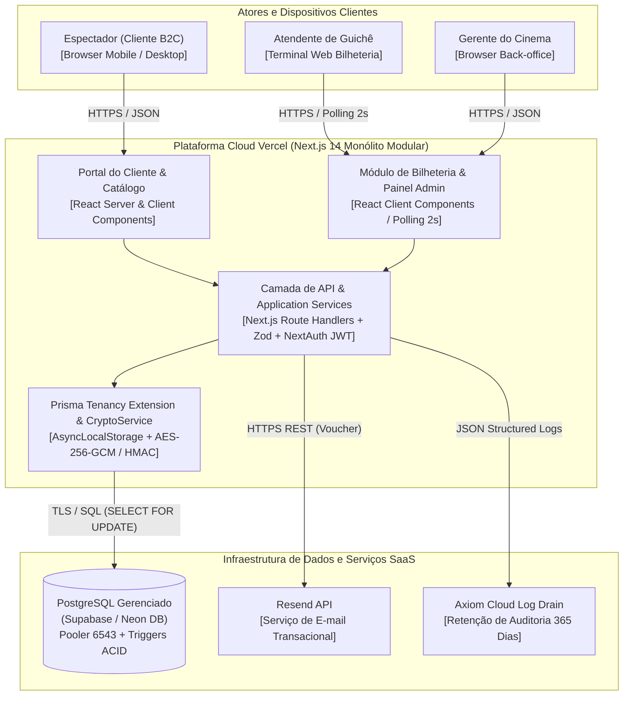
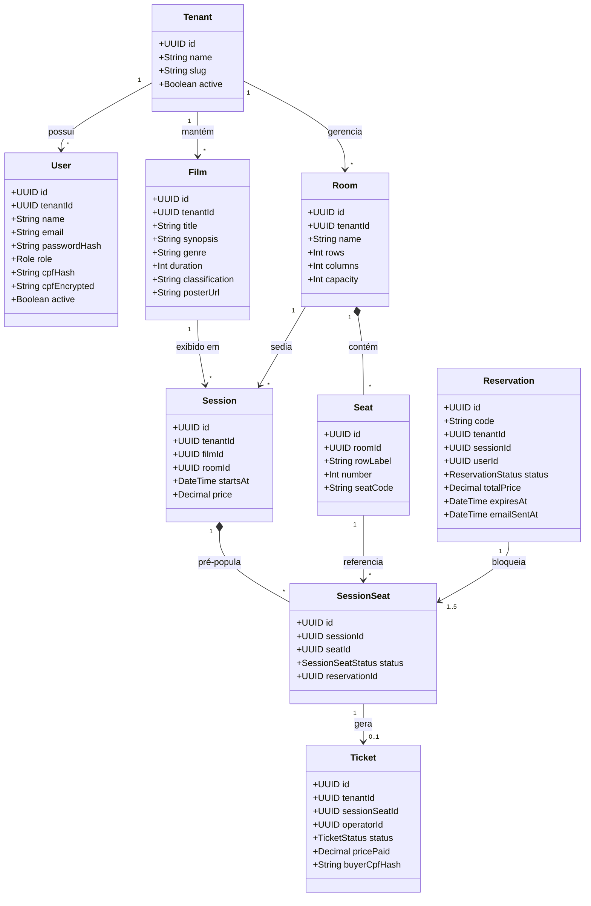
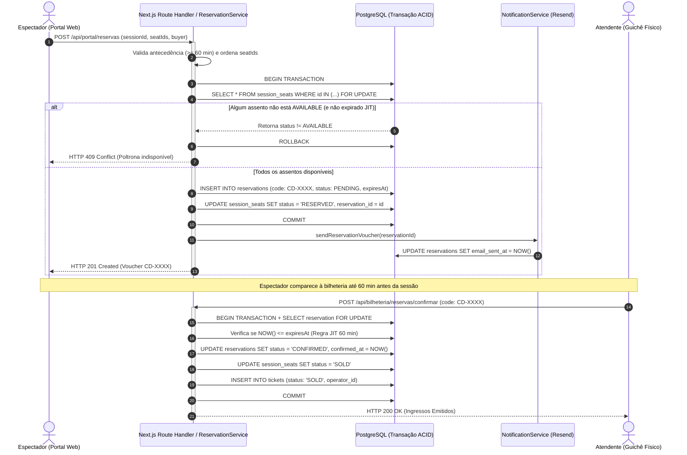
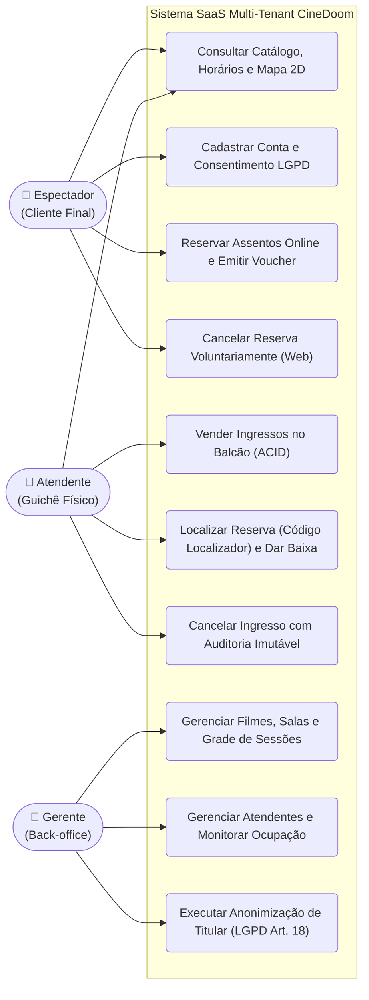
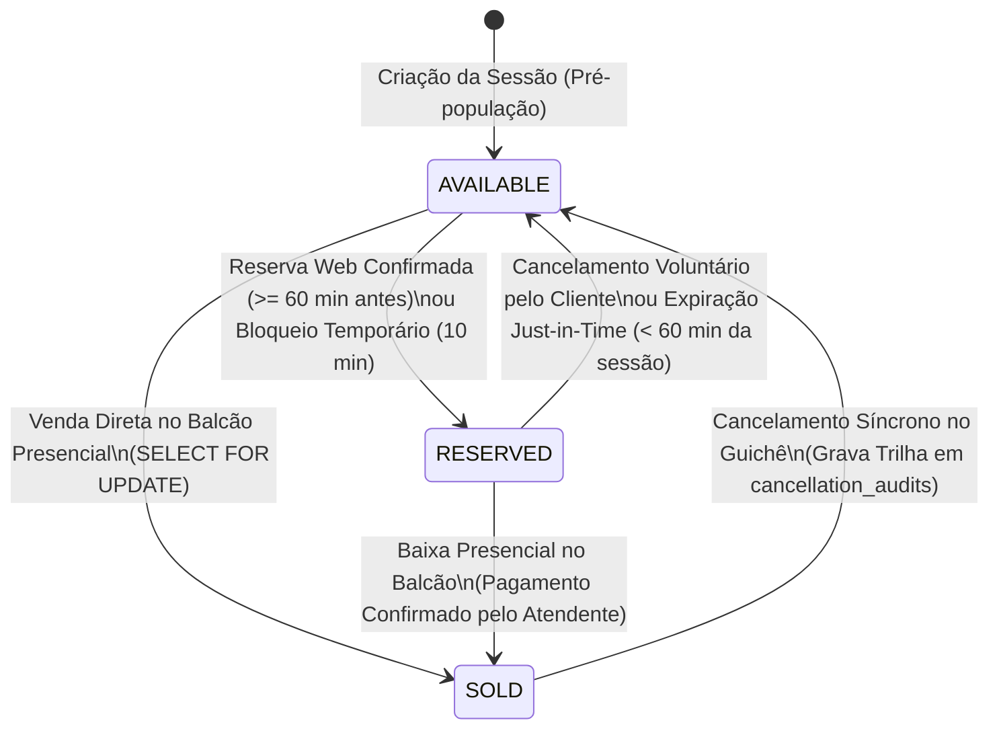
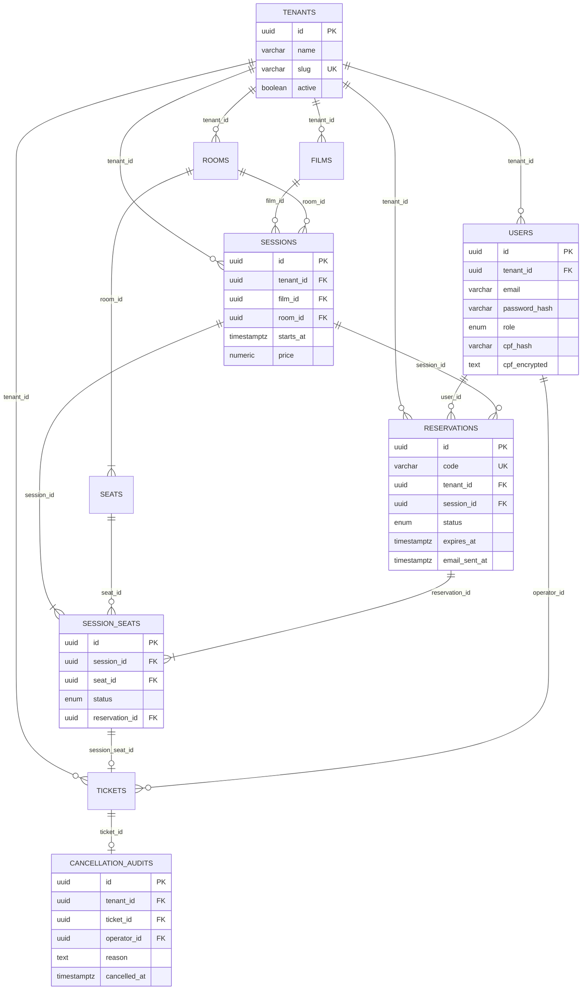

# Capítulo 5 – Processos Técnicos

## 5.1 Requisitos

### 5.1.1 Documento de requisitos do sistema

A especificação formal de requisitos da plataforma **CineDoom** estrutura os requisitos funcionais (`RF`), não funcionais (`RNF`, segundo a norma ISO/IEC 25010) e restrições arquiteturais (`RES`), priorizados pelo método **MoSCoW**.

#### Catálogo Formal de Requisitos Funcionais (`RF-01` a `RF-18`)

| ID | Módulo | Requisito Funcional | Prioridade | Macroentrega |
| :---: | :---: | :--- | :---: | :---: |
| **RF-01** | Identidade & RBAC | Autenticar usuários via credenciais seguras (`bcrypt` cost 12) e sessão JWT contendo `userId`, `role` (`GERENTE`, `ATENDENTE`, `CLIENTE`) e `tenantId`. | *Must Have* | Macroentrega 1 (`v1.0`) |
| **RF-02** | Gestão de Operadores | Permitir ao `GERENTE` criar, listar, atualizar e inativar operadores com perfil `ATENDENTE` vinculados ao seu cinema (*tenant*), revogando sessões ativas. | *Must Have* | Macroentrega 1 (`v1.0`) |
| **RF-03** | Catálogo de Filmes | Permitir ao `GERENTE` manter o acervo de filmes (título, sinopse, gênero, duração em minutos, classificação indicativa e pôster). | *Must Have* | Macroentrega 1 (`v1.0`) |
| **RF-04** | Salas e Assentos | Permitir ao `GERENTE` cadastrar salas de exibição (Clássica, IMAX, VIP) e gerar automaticamente a matriz 2D de poltronas (fileiras A–Z e colunas numeradas). | *Must Have* | Macroentrega 1 (`v1.0`) |
| **RF-05** | Sessões | Permitir ao `GERENTE` agendar sessões (Filme + Sala + Data/Hora + Preço), validando choques de horário na mesma sala e pré-populando `SessionSeat`. | *Must Have* | Macroentrega 1 (`v1.0`) |
| **RF-06** | Bilheteria ACID | Disponibilizar mapa interativo da sessão com atualização por polling a cada 2 segundos. | *Must Have* | Macroentrega 1 (`v1.0`) |
| **RF-07** | Bilheteria ACID | Processar a venda presencial de múltiplos assentos em transação atômica ACID com bloqueio pessimista (`SELECT ... FOR UPDATE`), impedindo *double-booking*. | *Must Have* | Macroentrega 1 (`v1.0`) |
| **RF-08** | Bilheteria ACID | Emitir comprovante operacional de ingresso contendo código identificador único, filme, sala, horário, poltronas e valor pago. | *Must Have* | Macroentrega 1 (`v1.0`) |
| **RF-09** | Auditoria & Guichê | Realizar o cancelamento síncrono de ingresso vendido na bilheteria mediante justificativa obrigatória, gravando trilha *append-only* protegida por trigger SQL. | *Must Have* | Macroentrega 1 (`v1.0`) |
| **RF-10** | Governança LGPD | Proteger o CPF de compradores e clientes por indexação cega `HMAC-SHA256` e criptografia autenticada `AES-256-GCM`, permitindo anonimização *in-place* (Art. 18). | *Must Have* | Macroentrega 1 (`v1.0`) |
| **RF-11** | Ocupação & Logs | Apresentar painel gerencial com cálculo em tempo real da taxa de ocupação (vendidos, reservados e livres) por sessão/sala e exportar logs para o Axiom. | *Must Have* | Macroentrega 1 (`v1.0`) |
| **RF-12** | Portal do Cliente | Exibir catálogo público responsivo de filmes em cartaz com busca por título/sinopse, filtro por gênero e exibição da sinopse. | *Must Have* | Macroentrega 1 (`v1.0`) |
| **RF-13** | Portal do Cliente | Permitir ao espectador selecionar poltronas no mapa interativo e confirmar reserva online com status `PENDING` e bloqueio dos assentos como `RESERVED`, exclusivamente quando faltarem 60 minutos ou mais para o início da sessão. | *Must Have* | Macroentrega 1 (`v1.0`) |
| **RF-14** | Portal do Cliente | Permitir o cadastro e login de espectadores (`CLIENTE`) com validação matemática de CPF (Módulo 11) e termo explícito de consentimento LGPD. | *Must Have* | Macroentrega 1 (`v1.0`) |
| **RF-15** | Notificações | Emitir voucher digital com localizador único (`CD-XXXX`) e acionar o `NotificationService` (`ResendProvider` / `ConsoleLogger`), registrando `email_sent_at`. | *Must Have* | Macroentrega 1 (`v1.0`) |
| **RF-16** | Portal do Cliente | Disponibilizar área autenticada *"Minhas Reservas"* permitindo ao espectador consultar seus vouchers e realizar o cancelamento voluntário de reservas pendentes. | *Must Have* | Macroentrega 1 (`v1.0`) |
| **RF-17** | Bilheteria Híbrida | Permitir ao `ATENDENTE` localizar reservas web no balcão pelo código localizador (`CD-XXXX`) e confirmar o pagamento presencial, convertendo em `SOLD`. | *Must Have* | Macroentrega 1 (`v1.0`) |
| **RF-18** | Expiração JIT | Invalidar automaticamente reservas pendentes não pagas quando faltarem menos de 60 minutos para o início da sessão, liberando os assentos em tempo real. | *Must Have* | Macroentrega 1 (`v1.0`) |

#### Catálogo Formal de Requisitos Não Funcionais (`RNF-01` a `RNF-06` — ISO/IEC 25010)

| ID | Característica ISO 25010 | Especificação e Métrica Objetiva |
| :---: | :--- | :--- |
| **RNF-01** | **Eficiência de Desempenho** | Latência HTTP p95 $< 800\text{ ms}$ e p99 $< 1.500\text{ ms}$ nas transações de venda e reserva; sincronização visual do mapa de assentos por polling a cada $2\text{ s}$. |
| **RNF-02** | **Confiabilidade e Atomicidade** | Zero ocorrências de venda ou reserva dupla (*double-booking*) sob carga concorrente de 50 threads simultâneas disputando a mesma poltrona. |
| **RNF-03** | **Segurança e Isolamento** | Isolamento multi-tenant absoluto validado por 500 cenários automatizados de intrusão *cross-tenant* e criptografia de CPF com `HMAC-SHA256` + `AES-256-GCM`. |
| **RNF-04** | **Usabilidade e Responsividade** | Interface adaptativa para smartphones (a partir de `320px`) e terminais desktop de bilheteria (`1024x768+`), aderente às diretrizes WCAG 2.1 Nível AA. |
| **RNF-05** | **Compatibilidade** | Operação integral via navegadores modernos (Chrome, Safari, Edge, Firefox) sem exigência de plugins locais ou aplicativos nativos. |
| **RNF-06** | **Manutenibilidade** | Arquitetura limpa orientada a módulos com tipagem estática estrita (`tsc --noEmit`) e zero dependências circulares (`ESLint import/no-cycle`). |

---

### Restrições Técnicas e Limites de Escopo (`RES-01` a `RES-06`)

Restrições arquiteturais e itens explicitamente fora do escopo da **Macroentrega 1 (MVP)**. As entregas previstas para as Macroentregas 2 e 3 (gateway de pagamento online, emissão fiscal NFC-e/SAT e bomboniere) são evoluções planejadas no roadmap e **não contradizem** estas restrições, que delimitam exclusivamente o MVP:

* **`RES-01` — Pagamento Presencial Exclusivo no MVP (Sem Gateway Online):** No escopo da Macroentrega 1, o sistema não processa pagamentos eletrônicos online (cartão de crédito/débito ou checkout PIX web no portal); a liquidação financeira das reservas ocorre exclusivamente no balcão físico da bilheteria até 60 minutos antes da sessão. O gateway online (PIX/Stripe) está planejado para a Macroentrega 2.
* **`RES-02` — Sem Integração de Hardware Fiscal no MVP (NFC-e / SAT):** No escopo da Macroentrega 1, o sistema emite comprovantes operacionais e *vouchers* de reserva/ingresso, não integrando módulos de comunicação direta com SEFAZ para emissão de nota fiscal eletrônica ao consumidor. A emissão fiscal automatizada está planejada para a Macroentrega 3.
* **`RES-03` — Aplicação Web Responsiva (Sem App Nativo Mobile):** O acesso de espectadores, atendentes e gerentes ocorre integralmente via navegadores web (desktop e mobile responsivo), sem distribuição de aplicativos nativos nas lojas Google Play ou Apple App Store.
* **`RES-04` — Exclusão de Bomboniere e Estoque de Alimentos no MVP:** No escopo da Macroentrega 1, o escopo restringe-se à gestão de catálogo cinematográfico, salas, sessões, reservas e bilheteria de ingressos, não abrangendo controle de estoque de pipoca, bebidas ou combos. O módulo de bomboniere está planejado para a Macroentrega 3.
* **`RES-05` — Sem Distribuição de Mídia Digital ou DRM:** O sistema gerencia metadados e cartazes dos filmes, não realizando *streaming* de vídeo nem gerenciamento de chaves digitais de projetores (KDM/DCP).
* **`RES-06` — Idioma e Localização Única (`pt-BR`):** A plataforma é projetada e localizada exclusivamente em português brasileiro, operando segundo o fuso horário e a legislação nacional (LGPD e CDC).

---

### Regras de Negócio Estruturantes (`RN-01` a `RN-12`)

As políticas de domínio que atravessam os requisitos estão consolidadas nas regras de negócio: exclusividade atômica do assento e máquina de estados (`RN-01`, `RN-02`); antecedência mínima de 60 minutos e expiração *Just-in-Time* (`RN-03`, `RN-04`); integridade do catálogo e anti-choque de sessões (`RN-05`, `RN-06`); auditoria imutável de cancelamento (`RN-07`); RBAC e segurança de credenciais (`RN-08`, `RN-09`); criptografia, consentimento e anonimização LGPD com retenção fiscal (`RN-10`, `RN-11`); e isolamento multi-tenant (`RN-12`).

---

### 5.1.2 Rastreabilidade de requisitos

A integridade da engenharia de software da CineSoft Solutions é garantida por uma matriz de rastreabilidade **bidirecional**: cada linha parte da necessidade do stakeholder (`STK`/`NEC`), passa pelo requisito (`RF`/`RNF`/`RES`) e pelo critério de aceite (`CA`), chega ao código-fonte e retorna pelo caso de teste, que declara explicitamente qual requisito e critério verifica.

| Necessidade / Stakeholder | Requisito(s) | Critério de Aceite | Código-Fonte (`cinedoom-app/`) | Caso de Teste (`tests/`) |
| :--- | :---: | :---: | :--- | :--- |
| `STK-02` / `NEC-02` (Controle de Acesso e Equipe) | `RF-01`, `RF-02` | `CA-05` | `src/modules/auth/`, `src/middleware.ts`, `src/app/api/backoffice/usuarios/` | `tests/unit/auth-rbac.test.ts` (→ `RF-01`, `CA-05`); `tests/unit/users-management.test.ts` (→ `RF-02`, `CA-05`) |
| `STK-02` / `NEC-02` (Gestão de Acervo e Salas) | `RF-03`, `RF-04`, `RF-05`, `RES-05` | `CA-08` | `src/modules/backoffice/` (film-service, room-service, session-service), `src/app/api/{filmes,salas,sessoes}/` | `tests/unit/catalog-filmes.test.ts` (→ `RF-03`, `CA-08`); `tests/unit/rooms-layout.test.ts` (→ `RF-04`, `CA-08`); `tests/unit/sessions-prepopulation.test.ts` (→ `RF-05`, `CA-08`) |
| `STK-03`, `STK-04` / `NEC-03`, `NEC-06` (Mapa Reativo e Guichê) | `RF-06`, `RNF-01`, `RNF-04` | `CA-02` | `src/modules/bilheteria/components/seating-grid.tsx`, `src/modules/bilheteria/hooks/use-session-seats.ts`, `src/app/api/sessoes/[id]/assentos/` | `tests/unit/seating-grid.test.ts` (→ `RF-06`, `RNF-04`, `CA-02`); `tests/unit/session-seats-polling.test.ts` (→ `RF-06`, `RNF-01`, `CA-02`) |
| `STK-01`, `STK-03` / `NEC-01`, `NEC-03` (Venda Atômica ACID) | `RF-07`, `RF-08`, `RNF-02`, `RES-01`, `RES-02`, `RES-04` | `CA-01`, `CA-15` | `src/modules/bilheteria/sale-service.ts`, `src/modules/bilheteria/counter-service.ts`, `src/app/api/vendas/`, `src/app/api/ingressos/`, `prisma/schema.prisma` | `tests/unit/venda-atomica.test.ts` (→ `RF-07`, `RNF-02`, `CA-01`); `tests/unit/concurrency-acid-50-threads.test.ts` (→ `RF-07`, `RNF-02`, `CA-01`); `tests/unit/cancelamento-auditavel.test.ts` (→ `RF-08`, `CA-15`) |
| `STK-03`, `STK-05` / `NEC-04`, `NEC-08` (Cancelamento Imutável) | `RF-09` | `CA-03` | `src/modules/bilheteria/cancellation-service.ts`, `src/app/api/ingressos/[id]/cancelar/`, `prisma/triggers.sql`, `prisma/schema.prisma` | `tests/unit/cancelamento-auditavel.test.ts` (→ `RF-09`, `CA-03`); `tests/unit/database-schema.test.ts` (→ `RF-09`, `CA-03`) |
| `STK-05` / `NEC-04` (Privacidade e LGPD Art. 18) | `RF-10`, `RNF-03` | `CA-06` | `src/modules/crypto/crypto-service.ts`, `src/modules/compliance/`, `src/modules/compradores/buyer-service.ts` | `tests/unit/cryptoservice.test.ts` (→ `RF-10`, `RNF-03`, `CA-06`); `tests/unit/compliance-anonymization.test.ts` (→ `RF-10`, `CA-06`) |
| `STK-01` / `NEC-01` (Isolamento Multi-Tenant SaaS) | `RNF-03`, `RNF-06` | `CA-04` | `src/modules/tenancy/prisma-tenancy-extension.ts`, `src/modules/tenancy/tenancy-context.ts`, `src/shared/db/prisma.ts` | `tests/unit/tenancy-isolation.test.ts` (→ `RNF-03`, `CA-04`); `tests/unit/security-cross-tenant-suite.test.ts` (→ `RNF-03`, `CA-04`); `tests/unit/modules.test.ts` (→ `RNF-06`); `tests/unit/ci-workflow.test.ts` (→ `RNF-06`) |
| `STK-02`, `STK-05` / `NEC-02`, `NEC-04` (Painel de Ocupação e Logs) | `RF-11` | `CA-07` | `src/app/api/ocupacao/painel/`, `src/modules/ocupacao/ocupacao-service.ts`, `src/shared/logger/index.ts` | `tests/unit/observability-logger.test.ts` (→ `RF-11`, `CA-07`); `tests/unit/security-cross-tenant-suite.test.ts` (→ `RF-11`, `CA-07`) |
| `STK-04` / `NEC-05`, `NEC-06` (Portal e Reserva Web) | `RF-12`, `RF-13`, `RF-14`, `RNF-04`, `RNF-05`, `RES-01`, `RES-03`, `RES-06` | `CA-09`, `CA-10`, `CA-15` | `src/modules/portal/portal-service.ts`, `src/app/portal/`, `src/app/api/portal/`, `src/app/layout.tsx` | `tests/integration/reserva-atomica.test.ts` (→ `RF-13`, `CA-09`); `tests/unit/cryptoservice.test.ts` (→ `RF-14`, `CA-10`); `tests/unit/auth-rbac.test.ts` (→ `RF-14`, `CA-10`); `tests/unit/seating-grid.test.ts` (→ `RNF-04`) |
| `STK-04`, `STK-03` / `NEC-07`, `NEC-08` (Voucher, Cancelamento Web, Baixa e JIT) | `RF-15`, `RF-16`, `RF-17`, `RF-18`, `RES-01`, `RES-02` | `CA-11` a `CA-14` | `src/modules/notificacoes/notification-service.ts`, `src/app/api/portal/reservas/`, `src/app/api/bilheteria/reservas/`, `src/modules/bilheteria/counter-service.ts` | `tests/integration/reserva-atomica.test.ts` (→ `RF-15` voucher, `RF-16` consulta, `RF-18`, `CA-11`, `CA-14`); `não automatizado: RF-15` (e-mail/`email_sent_at`), `RF-16`/`CA-12` (cancelamento web), `RF-17`/`CA-13` (baixa presencial) |

**`RNF-05` e `RES-01` a `RES-06` não têm linha própria porque não pertencem a uma única tela ou módulo**: são regras e qualidades que valem para várias partes do sistema ao mesmo tempo.

**Evidência das restrições no repositório:** `RES-01`/`RES-02` — não existem rotas de gateway de pagamento nem modelos fiscais em `src/app/api/` e `prisma/schema.prisma`; `RES-03` — a aplicação é web (`src/app/`), sem projeto mobile nativo; `RES-04` — não há módulo de bomboniere/estoque; `RES-05` — não há *streaming* ou DRM; `RES-06` — `src/app/layout.tsx` declara `lang="pt-BR"`.

---

### 5.1.3 Critérios de aceitação (`CA-01` a `CA-15`)

Os 15 critérios de aceitação foram definidos em formato comportamental BDD (*Dado que / Quando / Então*):

1. **`CA-01` (Venda Presencial Atômica Anti-Double-Booking):** *Dado que* dois operadores ou clientes tentam adquirir a mesma poltrona `AVAILABLE` simultaneamente, *quando* as transações concorrentes são submetidas, *então* o banco deve serializar o acesso via `SELECT FOR UPDATE`, aprovar apenas a primeira (`HTTP 201`) e rejeitar a segunda com `HTTP 409 Conflict`.
2. **`CA-02` (Sincronização do Mapa por Polling a Cada 2 s):** *Dado que* o mapa de assentos de uma sessão está aberto, *quando* o status de um assento muda para `RESERVED`, `SOLD` ou `AVAILABLE`, *então* o sistema deve consultar `GET /api/sessoes/{id}/assentos` a cada 2.000 ms e a resposta da consulta seguinte deve refletir o novo status em até 2 segundos.
3. **`CA-03` (Auditoria Imutável de Cancelamento):** *Dado que* um ingresso vendido é cancelado na bilheteria, *quando* a operação é executada, *então* um registro imutável deve ser gravado em `cancellation_audits` (protegido por trigger PostgreSQL contra `UPDATE/DELETE`) antes de liberar o assento.
4. **`CA-04` (Isolamento Estrito Multi-Tenant):** *Dado que* um operador do *Tenant A* está autenticado, *quando* tenta ler ou modificar filmes, salas, sessões ou reservas do *Tenant B*, *então* a extensão de tenancy deve bloquear o acesso em 100% dos 500 cenários de teste.
5. **`CA-05` (Controle de Acesso RBAC e Gestão de Operadores):** *Dado que* um usuário autenticado possui perfil `ATENDENTE` ou `CLIENTE`, *quando* tenta acessar rotas administrativas (`/admin/*` ou `/api/admin/*`), *então* o sistema deve responder `HTTP 403 Forbidden`; *dado que* o `GERENTE` gerencia operadores do próprio cinema, *quando* cria, lista, atualiza ou inativa um atendente, *então* a operação deve ser persistida e a inativação deve revogar o acesso do operador, retornando `HTTP 403` nas APIs e redirecionando ao login nas páginas.
6. **`CA-06` (Criptografia de CPF e Anonimização LGPD):** *Dado que* um CPF é fornecido na compra ou cadastro, *quando* o registro é persistido, *então* o CPF não deve ser armazenado em texto puro, sendo gravado como `HMAC-SHA256` (`cpf_hash`) e `AES-256-GCM` (`cpf_encrypted`); *quando* a anonimização é solicitada pelo titular, *então* nome, e-mail e CPF cifrado devem ser sobrescritos *in-place*, `anonymized_at` preenchido, os vínculos com os ingressos preservados e uma segunda solicitação rejeitada.
7. **`CA-07` (Painel de Ocupação e Trilha de Logs Estruturados):** *Dado que* uma sessão possui assentos vendidos, reservados, bloqueados e livres e que operações críticas são executadas, *quando* o `GERENTE` consulta o painel de ocupação, *então* o sistema deve exibir as contagens por status e o percentual de ocupação calculado como `(vendidos ÷ capacidade) × 100`, arredondado a uma casa decimal; e, para cada operação crítica efetivamente executada (venda, cancelamento, conflito ACID, violação de segurança, autenticação e anonimização), emitir log estruturado em JSON contendo `tenant_id`, `user_id`, timestamp UTC e identificador do recurso, com retenção de 365 dias no Axiom.
8. **`CA-08` (Gestão Validada de Catálogo, Salas e Sessões):** *Dado que* o `GERENTE` gerencia a programação, *quando* cria, edita ou lista filmes, salas com layout de assentos e sessões cinematográficas, *então* o sistema deve rejeitar com `HTTP 422` qualquer campo obrigatório ausente, rejeitar com `HTTP 409` sessões com sobreposição de horário na mesma sala e pré-popular os assentos da sessão (`SessionSeat`) com status inicial `AVAILABLE`.
9. **`CA-09` (Reserva Online com Antecedência de 60 min):** *Dado que* faltam 60 minutos ou mais para o início da sessão, *quando* o espectador seleciona assentos livres no portal, *então* o sistema deve criar a reserva com status `PENDING` e bloquear os assentos como `RESERVED`.
10. **`CA-10` (Cadastro e Login de Espectador com LGPD):** *Dado que* um espectador preenche nome, e-mail, senha, CPF válido (Módulo 11) e aceita o termo de consentimento LGPD, *quando* conclui o cadastro e efetua login, *então* o sistema deve persistir o CPF como `HMAC-SHA256` + `AES-256-GCM`, gravar `lgpd_consent_at` e autenticar a sessão com perfil `CLIENTE`.
11. **`CA-11` (Voucher Digital com Localizador Único):** *Dado que* uma reserva web é concluída, *então* o sistema deve gerar o voucher digital com código localizador `CD-XXXX` e disponibilizá-lo em `GET /api/portal/reservas/{id}` e na página `/portal/reservas/{id}/comprovante`, contendo filme, sala, data e horário da sessão, assentos e valor total, com instruções para pagamento presencial.
12. **`CA-12` (Cancelamento Voluntário pelo Espectador):** *Dado que* o cliente possui uma reserva com status `PENDING` e `reservation_expires_at` futuro, *quando* solicita o cancelamento em *"Minhas Reservas"*, *então* o status deve mudar para `CANCELLED` e os assentos devem voltar imediatamente para `AVAILABLE`; reservas não pendentes ou expiradas devem ser rejeitadas com `HTTP 400`.
13. **`CA-13` (Baixa Presencial de Reserva no Balcão):** *Dado que* o cliente apresenta o código localizador `CD-XXXX` na bilheteria, *quando* o atendente consulta a reserva e confirma o pagamento enquanto `reservation_expires_at` for futuro, *então* a reserva deve mudar para `CONFIRMED` e os assentos para `SOLD`; reservas não pendentes ou expiradas devem ser rejeitadas com `HTTP 400`.
14. **`CA-14` (Expiração Just-in-Time a 60 min da Sessão):** *Dado que* uma reserva `PENDING` possui `reservation_expires_at` igual ou anterior ao instante atual, *quando* o atendente tenta confirmar o pagamento ou o mapa de assentos é consultado, *então* a baixa presencial deve ser rejeitada com `HTTP 400` e o assento deve ser retornado como `AVAILABLE`, podendo ser reservado ou vendido para outro cliente.
15. **`CA-15` (Catálogo Público e Comprovante de Ingresso):** *Dado que* existem filmes em cartaz com sessões futuras e ingressos vendidos, *quando* o espectador acessa o catálogo público ou o operador consulta um ingresso pelo identificador único, *então* (a) o catálogo deve listar os filmes em cartaz, permitir busca por título ou sinopse e filtro por gênero, exibindo a sinopse do filme; e (b) o comprovante deve retornar o identificador único do ingresso, o filme, a sala, o horário da sessão, a poltrona e o valor pago.

---

### 5.1.4 Registro de stakeholders e necessidades elicitadas

O levantamento de requisitos combinou quatro técnicas complementares de engenharia de requisitos: (1) **Entrevistas estruturadas** com gestores de salas independentes, (2) **Observação de campo** do fluxo de fila em bilheterias físicas, (3) **Prototipação iterativa de alta fidelidade** para validação da experiência mobile/desktop e (4) **Análise regulatória** do texto da LGPD e do Código de Defesa do Consumidor.

| Código | Stakeholder (Parte Interessada) | Técnica de Elicitação Aplicada | Necessidades Capturadas (`NEC`) |
| :---: | :--- | :--- | :--- |
| **STK-01** | **Proprietários e Diretores de Redes de Cinema (Clientes B2B)** | Entrevistas de negócio e análise de TCO | `NEC-01`: Eliminar vendas duplas de poltronas, reduzir ociosidade por *no-show* e operar em modelo SaaS com isolamento total dos dados da empresa. |
| **STK-02** | **Gerentes Operacionais de Cinema (`GERENTE`)** | Entrevistas e workshops de fluxo administrativo | `NEC-02`: Configurar facilmente salas (Clássica, IMAX, VIP), grade de filmes/sessões, equipe de atendentes e acompanhar a lotação em tempo real. |
| **STK-03** | **Atendentes de Bilheteria Física (`ATENDENTE`)** | Observação de operação de guichê e prototipação | `NEC-03` e `NEC-08`: Vender ingressos em poucos cliques no mapa visual, localizar reservas web pelo código localizador rapidamente e cancelar com segurança. |
| **STK-04** | **Espectadores / Clientes Finais (`CLIENTE` B2C)** | Prototipação mobile/desktop e testes de usabilidade | `NEC-05`, `NEC-06` e `NEC-07`: Consultar horários pelo celular ou computador, escolher poltronas exatas no mapa da sala, receber voucher e cancelar online se necessário. |
| **STK-05** | **Encarregado de Dados (DPO) e Auditoria Jurídica** | Análise normativa (LGPD Lei 13.709/2018 e ISO 27701) | `NEC-04`: Garantir criptografia forte de CPF, consentimento explícito, direito à anonimização (Art. 18) e trilha de auditoria imutável por 365 dias. |

---

## 5.2 Arquitetura e Design

### 5.2.1 Documento de arquitetura do sistema

O **CineDoom** adota a arquitetura de **Monólito Modular em Next.js 14 (App Router)** fundamentada nos princípios de *Clean Architecture* (`ADR-001`), estruturada em cinco camadas lógicas com inversão de dependência e isolamento vertical por domínio (`src/modules/*` e `src/shared/*`):

1. **Camada de Apresentação e UI Reativa (`src/app/`, `src/components/`):** Combina *React Server Components* para carregamento rápido do catálogo e *Client Components* interativos para o fluxo de reserva em 4 etapas, mapa bidimensional de poltronas (`SeatingGrid` com polling de 2s) e painéis administrativos.
2. **Camada de Controladores HTTP (`src/app/api/**/route.ts`):** Route Handlers tipados que extraem o contexto de sessão/tenant, validam payloads de entrada com schemas `Zod` e traduzem exceções de domínio em códigos HTTP semânticos (`200`, `201`, `400`, `401`, `403`, `404`, `409`, `422`).
3. **Camada de Serviços de Aplicação (`Application Services`):** Orquestra os casos de uso e transações de negócio (`SaleService`, `CancellationService`, `ReservationService`, `TemporaryHoldService`, `CounterService`, `UserService`, `AnonymizationService`, `NotificationService`).
4. **Camada de Domínio e Segurança (`Domain & Security`):** Contém as entidades, invariantes de negócio (antecedência de 60 min, expiração JIT, validação Módulo 11 de CPF) e o `CryptoService` (`HMAC-SHA256` e `AES-256-GCM`).
5. **Camada de Infraestrutura e Persistência Multi-Tenant (`src/shared/db/prisma.ts`):** Implementa os repositórios Prisma sobre PostgreSQL com extensão automática de contexto (`AsyncLocalStorage`) que injeta a cláusula `WHERE tenant_id` em todas as consultas e gerencia a conexão via pooler transacional.

#### Princípios de Arquitetura e Modelagem: Domain-Driven Design (DDD)

A decomposição e estruturação do software são orientadas pelos fundamentos do **Domain-Driven Design (DDD)**, assegurando que as regras de negócio de exibição cinematográfica sejam refletidas diretamente no código:

- **Linguagem Ubíqua (*Ubiquitous Language*):** Vocabulário unificado e compartilhado de forma inequívoca entre desenvolvedores, stakeholders e especificações técnicas. Termos como *Tenant* (cinema cliente), *SessionSeat* (poltrona alocada à sessão), *ReservationStatus* (`PENDING`, `CONFIRMED`, `CANCELLED`, `EXPIRED`), *Ticket* (`SOLD`) e *Double-booking* possuem significado rigoroso e idêntico no modelo de dados, no código TypeScript e nas regras de negócio.
- **Contextos Delimitados (*Bounded Contexts*):** O sistema organiza-se em fronteiras de domínio verticalmente isoladas (`src/modules/*`), onde cada módulo encapsula seus modelos e casos de uso específicos:
  - *Contexto de Bilheteria e Ocupação:* Focado na transacionalidade concorrente no guichê, mapa reativo de assentos e travas de venda presencial.
  - *Contexto de Reservas e Atendimento Web:* Responsável pela jornada do espectador, reserva antecipada e despacho de vouchers transacionais.
  - *Contexto de Catálogo e Programação:* Gestão de acervo de filmes, layout bidimensional de salas e prevenção de choques de grade.
  - *Contexto de Governança e Privacidade:* Tratamento de dados pessoais, consentimento e conformidade com o Art. 18 da LGPD.
- **Entidades e Invariantes de Domínio:** As regras de negócio críticas residem no núcleo da aplicação e no domínio, imunes a bypass na interface gráfica. Invariantes essenciais — como antecedência mínima de 60 minutos para reservas web, expiração automática *Just-in-Time* de assentos não confirmados e garantia de não duplicidade de assentos via bloqueio ACID — são fiscalizadas determinísticamente antes de qualquer gravação.

#### Princípios de Design de Software: SOLID

O projeto adota sistematicamente os cinco princípios **SOLID** para assegurar manutenibilidade, extensibilidade e modularidade:

- **S — Single Responsibility Principle (Princípio da Responsabilidade Única):** Cada serviço e classe executa um papel único e bem delimitado. O `SaleService` trata exclusivamente a venda presencial e emissão de ingressos no balcão; o `ReservationService` gerencia a criação, cancelamento e confirmação de reservas web; e o `CryptoService` isola as operações criptográficas (`AES-256-GCM` e `HMAC-SHA256`).
- **O — Open/Closed Principle (Princípio Aberto/Fechado):** Módulos são abertos para extensão, mas fechados para modificação. O subsistema de notificações (`NotificationService`) é estruturado sobre uma interface de provedores (`NotificationProvider`): a alternância entre `ConsoleLogger` (fase inicial de desenvolvimento) e `ResendProvider` (despacho de e-mails em produção) ocorre sem alterar as regras de negócio dos casos de uso.
- **L — Liskov Substitution Principle (Princípio da Substituição de Liskov):** Contratos de persistência e serviços respeitam estritamente as interfaces estabelecidas. Mocks de teste e repositórios Prisma com tenancy automática substituem-se mutuamente nas baterias de verificação sem violar as asserções de negócio.
- **I — Interface Segregation Principle (Princípio da Segregação de Interfaces):** Evitam-se interfaces genéricas infladas. A comunicação entre controladores e serviços adota DTOs e esquemas declarativos `Zod` estritamente específicos para cada operação (`createReservationSchema`, `sellTicketsSchema`, `createFilmSchema`).
- **D — Dependency Inversion Principle (Princípio da Inversão de Dependência):** Módulos de alto nível (serviços de aplicação e regras de negócio) não dependem de módulos de baixo nível (frameworks ou bibliotecas de transporte). As rotas de API (`Route Handlers`) apenas orquestram requisições delegando a execução para as abstrações de serviço, mantendo a regra de negócio desacoplada do framework web.

---

### 5.2.2 Diagramas de design

Para documentar integralmente a estrutura estática e o comportamento dinâmico do sistema, apresentam-se a seguir os **seis diagramas formais de arquitetura e design** do CineDoom.

#### 1. Diagrama C4 — Nível 2 (Diagrama de Contêineres)

O Diagrama de Contêineres ilustra a interação entre os três perfis de usuários (Espectador, Atendente e Gerente), a aplicação web e API serverless hospedada na Vercel, o banco de dados relacional PostgreSQL e os serviços externos de e-mail transacional (Resend) e observabilidade (Axiom):

#### 2. Diagrama de Classes UML (Modelo de Domínio)

O Diagrama de Classes representa as entidades nucleares do domínio do CineDoom, seus atributos tipados, métodos de negócio e multiplicidades de associação sob isolamento multi-tenant (`Tenant`):

#### 3. Diagrama de Sequência UML (Reserva Online Atômica e Baixa Presencial no Balcão)

O Diagrama de Sequência detalha o comportamento temporal da transação crítica que une o Portal do Cliente e a Bilheteria Presencial: o bloqueio pessimista ordenado (`SELECT FOR UPDATE`), a emissão do voucher transacional e a posterior conversão em ingresso vendido (`SOLD`) no guichê físico:

#### 4. Diagrama de Casos de Uso UML

O Diagrama de Casos de Uso mapeia as fronteiras de interação dos três atores humanos com os módulos da plataforma:

#### 5. Diagrama de Máquina de Estados UML (Ciclo de Vida do Assento na Sessão)

O Diagrama de Estados formaliza todas as transições válidas de uma poltrona (`SessionSeat`) desde a criação da sessão até o encerramento:

#### 6. Diagrama Entidade-Relacionamento (DER — Modelo Relacional PostgreSQL)

O DER especifica a estrutura física das tabelas relacionais, chaves primárias (`PK`), chaves estrangeiras (`FK`) e restrições de unicidade no PostgreSQL:

---

### 5.2.3 Justificativa das escolhas tecnológicas

O stack tecnológico foi selecionado para maximizar a segurança transacional, a ergonomia de desenvolvimento e a eficiência operacional em nuvem:
- **Next.js 14 (App Router) + React 18 + Tailwind CSS:** Permite renderizar o catálogo público na borda com baixíssima latência e manter componentes clientes altamente reativos para o mapa de poltronas em smartphones e terminais de guichê.
- **TypeScript Estrito + Zod:** Garante contratos estáticos fim a fim e validação determinística na fronteira HTTP, eliminando classes inteiras de erros de runtime.
- **PostgreSQL + Prisma ORM:** Bancos NoSQL não oferecem a semântica de bloqueio pessimista de linha (`SELECT ... FOR UPDATE`) indispensável para impedir vendas duplas em bilheterias de alta concorrência. O PostgreSQL aliado ao Prisma entrega migrações seguras, triggers nativas de auditoria e performance relacional superior.

### 5.2.4 Estratégia de gestão de mídias e desacoplamento de storage

O banco relacional armazena exclusivamente a referência textual (`poster_url VARCHAR(500)`), mantendo os backups leves e as queries rápidas. Na Macroentrega 1, os pôsteres são servidos via CDN global da Vercel; nas Macroentregas 2 e 3, o upload gerencial utiliza o padrão *Direct-to-Storage* com *Pre-signed URLs* (Vercel Blob / Cloudflare R2).

---

## 5.3 Implementação e Integração

### 5.3.1 Padrões de codificação e engenharia adotados
- **Estruturação Modular:** Organização em fatias de domínio (`src/modules/{auth,backoffice,bilheteria,compradores,compliance,crypto,notificacoes,observability,ocupacao,portal,tenancy}`) e utilitários compartilhados (`src/shared/`).
- **Convenções de Nomenclatura:** Arquivos em `kebab-case.ts`, componentes e classes em `PascalCase`, métodos e variáveis em `camelCase` e constantes globais em `UPPER_SNAKE_CASE`.
- **Qualidade Estática:** `strict: true` no `tsconfig.json` e proibição de ciclos de dependência via ESLint (`import/no-cycle: error`).
- **Metodologia Test-Driven Development (TDD):** A equipe adotou a disciplina do desenvolvimento orientado a testes (*Test-Driven Development*), seguindo o ciclo iterativo **Red $\to$ Green $\to$ Refactor**, com ênfase prioritária nas regras de negócio críticas e transações de alta concorrência:
  1. *Fase Red (Teste de Falha Inicial):* Antes de implementar as rotas e regras finais de negócio, os testes automatizados foram construídos para falhar intencionalmente, espelhando os critérios de aceite (`CA-01` a `CA-15`). Foram antecipadamente criados os testes de corrida concorrente com 50 threads disputando o mesmo assento e os 500 cenários de invasão *cross-tenant*.
  2. *Fase Green (Implementação da Solução Mínima):* Desenvolveu-se a lógica de bloqueio pessimista (`SELECT FOR UPDATE`), ordenação determinística de chaves para prevenção de deadlocks e extensão multi-tenant no Prisma até atingir aprovação plena com sinal verde.
  3. *Fase Refactor (Otimização e Limpeza):* O código aprovado foi refatorado aplicando os princípios SOLID, eliminando duplicações e assegurando tipagem estrita sem introduzir regressões na suíte.
  Essa prática resultou em uma base consolidada de **20 arquivos e 711 testes automatizados no Vitest**, permitindo refatorações contínuas com garantia estrita de integridade.

### 5.3.2 Plano de integração entre componentes (CI/CD)
A integração contínua é executada automaticamente pelo **GitHub Actions** (`.github/workflows/ci.yml` e `deploy.yml`) a cada push ou Pull Request:
1. Instalação determinística de dependências com `pnpm install --frozen-lockfile`.
2. Geração do cliente tipado do ORM (`pnpm prisma generate`).
3. Verificação estática de tipos (`pnpm tsc --noEmit`) e regras de arquitetura (`pnpm eslint`).
4. Execução integral da bateria de testes automatizados (`pnpm test`).
5. Compilação de produção (`pnpm build`) e promoção automática para a Vercel.

### 5.3.3 Registro de testes unitários e de integração
A aplicação conta com uma suíte robusta executada pelo **Vitest**, totalizando **20 arquivos de teste e 711 testes automatizados passando com 100% de sucesso** em ~10,6 segundos:
- **Segurança e Isolamento Multi-Tenant (`security-cross-tenant-suite.test.ts` e `tenancy-isolation.test.ts`):** 509 testes verificando que nenhum tenant consegue ler, alterar ou apagar registros de outro cinema.
- **Concorrência ACID com 50 Threads (`concurrency-acid-50-threads.test.ts`, `venda-atomica.test.ts` e `reserva-atomica.test.ts`):** Simulação de 50 requisições paralelas disputando o mesmo assento entre portal web e balcão, comprovando exatamente 1 aprovação e 49 rejeições `HTTP 409`.
- **Criptografia e Conformidade LGPD (`cryptoservice.test.ts` e `compliance-anonymization.test.ts`):** 40 testes validando cifragem `AES-256-GCM`, busca `HMAC-SHA256`, validação Módulo 11 de CPF e expurgo irreversível *in-place*.
- **Fluxos de Negócio e Interface (`reserva-atomica.test.ts`, `seating-grid.test.ts`, `users-management.test.ts`, `cancelamento-auditavel.test.ts`):** Validação completa de reservas, mapa 2D de poltronas, RBAC e triggers de auditoria.

### ~~5.3.4 Rastreabilidade entre código e requisitos~~
Branches, commits e cabeçalhos de arquivos referenciam diretamente os artefatos normativos (ex.: `feat(auth): adicionar gerador aleatorio de CPF valido (Modulo 11)` e comentários `// Requisito: RF-07 | CA-01 | ADR-007`), permitindo auditoria imediata no histórico do Git.

---

## 5.4 Verificação, Validação e Transição

### 5.4.1 Plano de verificação e validação

A CineSoft Solutions distingue e aplica complementarmente as atividades de **Verificação** e **Validação** (Cláusulas 6.4.9 e 6.4.11 da ISO 12207):

| Critério de Comparação | Verificação (*Verification*) | Validação (*Validation*) |
| :--- | :--- | :--- |
| **Pergunta Central** | *"Estamos construindo o produto corretamente?"* | *"Estamos construindo o produto certo?"* |
| **Foco Principal** | Conformidade técnica com as especificações, ADRs e regras de código | Adequação funcional e de usabilidade às reais necessidades dos cinemas e espectadores |
| **Quando Ocorre** | Continuamente em cada commit e Pull Request | Ao final de cada Sprint e na homologação em produção com usuários reais |
| **Quem Realiza** | Equipe de engenharia da CineSoft e pipeline automatizado (GitHub Actions) | Stakeholders, operadores de cinema-piloto e espectadores finais reais |
| **Exemplos Aplicados no CineDoom** | Compilação TypeScript (`tsc`), linter `no-cycle` e execução dos **711 testes no Vitest** | Testes de aceitação (*UAT*) no ambiente `cinedoom.vercel.app` com cadastros e reservas reais |

#### Critérios Formais de Entrada e Saída de V&V (*Entry & Exit Criteria*)

| Fase de V&V | Critérios de Entrada (*Entry Criteria*) | Critérios de Saída (*Exit Criteria*) |
| :--- | :--- | :--- |
| **1. Testes Unitários e de Integração (CI)** | Código implementado em branch de feature e schema Prisma atualizado. | 100% dos 711 testes passando, zero erros de linter/tipagem e cobertura de 100% nas regras críticas. |
| **2. Homologação em Staging** | Pull Request aprovado em Code Review e build concluído com sucesso na Vercel. | Fluxos ponta a ponta (cadastro $\to$ reserva $\to$ baixa no balcão $\to$ painel gerencial) executados sem falhas. |
| **3. Validação e Aceite em Produção (*UAT*)** | Ambiente de produção sincronizado na branch `main` com banco PostgreSQL ativo. | Operação validada por usuários externos reais sem ocorrência de *double-booking* ou erros HTTP 500. |

### 5.4.2 Critérios de aceitação por stakeholder
- **Proprietário / Gerente (`STK-01`, `STK-02`):** Precisão matemática no painel de ocupação, bloqueio de sessões conflitantes e isolamento multi-tenant comprovado.
- **Atendente de Bilheteria (`STK-03`):** Venda direta ou localização/baixa de reserva web pelo código localizador concluída em menos de 15 segundos de operação no guichê.
- **Espectador (`STK-04`):** Experiência fluida em dispositivos móveis e desktop para filtrar filmes, visualizar todas as colunas do mapa da sala, reservar poltronas e consultar o voucher em *"Minhas Reservas"*.
- **Encarregado de Dados / DPO (`STK-05`):** Criptografia de CPF (`HMAC-SHA256` + `AES-256-GCM`), consentimento LGPD com *timestamp*, anonimização *in-place* (Art. 18) e retenção da trilha de auditoria por 365 dias comprovadas em produção.

### 5.4.3 Relatório de testes de aceitação (Homologação e Produção)

Todos os cenários de aceitação da Macroentrega 1 (`v1.0.0`) foram executados e homologados com usuários reais no ambiente de produção (`https://cinedoom.vercel.app/`):

| ID Cenário | Critério(s) | Descrição do Cenário Homologado | Evidência Observada em Produção | Status |
| :---: | :---: | :--- | :--- | :---: |
| **UAT-01** | `CA-10` | Cadastro de novos espectadores com validação de CPF (Módulo 11) e aceite LGPD. | 13 usuários reais cadastrados com sucesso e CPFs cifrados no banco Supabase. | **Aprovado** |
| **UAT-02** | `CA-09`, `CA-11` | Seleção de poltronas no mapa 2D (mobile e desktop), reserva atômica e geração de voucher. | 11 reservas confirmadas (múltiplos ingressos de R$ 30 a R$ 75) sem falhas de layout. | **Aprovado** |
| **UAT-03** | `CA-01`, `CA-02` | Disputa simultânea de assentos e atualização do mapa por polling a cada 2 s. | 20 assentos vendidos (`SOLD`) e 10 reservados (`RESERVED`) com zero venda dupla. | **Aprovado** |
| **UAT-04** | `CA-12` | Consulta de histórico em *"Minhas Reservas"* e cancelamento voluntário pelo cliente. | Liberação imediata das poltronas para `AVAILABLE` após cancelamento web. | **Aprovado** |
| **UAT-05** | `CA-13`, `CA-14` | Busca de reserva no balcão por código localizador, baixa para `SOLD` e expiração JIT a 60 min. | Conversão instantânea de reserva em ingresso emitido e liberação de vencidas. | **Aprovado** |
| **UAT-06** | `CA-03`, `CA-06` | Cancelamento de ingresso no guichê com justificativa e anonimização LGPD Art. 18. | Trigger PostgreSQL bloqueando deleção da auditoria e PII anonimizado *in-place*. | **Aprovado** |
| **UAT-07** | `CA-04` | Tentativa de acesso *cross-tenant* a filmes, salas, sessões e reservas de outro cinema com operador autenticado no *Tenant A*. | Extensão de tenancy bloqueando 100% dos 500 cenários de intrusão, sem vazamento entre *tenants*. | **Aprovado** |
| **UAT-08** | `CA-05` | Acesso de `ATENDENTE` e `CLIENTE` a rotas administrativas (`/admin/*` e `/api/admin/*`). | Middleware retornando `HTTP 403 Forbidden` em todas as tentativas, sem exposição de dados. | **Aprovado** |
| **UAT-09** | `CA-07` | Consulta ao painel de ocupação por sessão e verificação da trilha de logs das operações críticas. | Percentuais de vendidos/reservados/livres corretos e logs JSON no Axiom com `tenant_id`, `user_id`, timestamp UTC e retenção de 365 dias. | **Aprovado** |
| **UAT-10** | `CA-08` | Cadastro e edição de filmes, salas com layout de assentos e sessões com sobreposição de horário e campos ausentes. | Rejeição com `HTTP 422`, bloqueio do choque de horário na mesma sala e assentos pré-populados como `AVAILABLE`. | **Aprovado** |

### 5.4.4 Plano de transição/implantação do sistema e procedimento de rollback

A transição para produção segue um protocolo automatizado e seguro:
1. **Pré-Deploy e Migração:** Execução da pipeline no GitHub Actions validando `prisma migrate deploy` e os 711 testes antes de autorizar o build na Vercel.
2. **Smoke Test Pós-Implantação:** Verificação imediata da rota de saúde (`/api/health`), carregamento do catálogo público e teste de autenticação em produção.
3. **Procedimento Formal de Rollback (Tempo de Recuperação $< 5\text{ min}$):**
   - *Camada de Aplicação:* Caso qualquer anomalia P1 seja detectada após o deploy, o líder de DevOps aciona o recurso **Instant Rollback** no painel da Vercel (ou reverte o commit em `main`), restaurando o build imutável anterior em menos de 30 segundos sem tempo de inatividade (*zero-downtime*).
   - *Camada de Banco de Dados:* Todas as migrações da Macroentrega 1 são retrocompatíveis (*expand-and-contract*). Em caso de corrupção crítica, aciona-se a restauração *Point-in-Time (PITR)* do PostgreSQL gerenciado.

---

## 5.5 Operação, Manutenção e Descontinuação

### 5.5.1 Procedimentos de operação e monitoramento
A operação em produção é monitorada continuamente por meio de:
- **Telemetria e Logs Estruturados (Axiom):** Registro em JSON de todas as vendas, reservas, cancelamentos e falhas de autenticação, com mascaramento automático de dados sensíveis e retenção de 365 dias.
- **Monitoramento de Banco e Conexões:** Acompanhamento da saúde do pooler transacional (`porta 6543`), uso de memória e latência de queries no painel do Supabase/Neon.

### 5.5.2 Plano de manutenção
A CineSoft Solutions classifica e executa a manutenção contínua da plataforma nas quatro categorias normativas da ISO 12207:
1. **Manutenção Corretiva:** Correção prioritária de defeitos reportados por usuários ou detectados via logs (ex.: ajuste de alinhamento horizontal da coluna 1 no mapa de assentos em telas estreitas).
2. **Manutenção Adaptativa:** Adequação do sistema a atualizações de navegadores, novas versões do Node.js/Next.js ou mudanças nas regras estaduais de emissão fiscal.
3. **Manutenção Perfectiva (Evolutiva):** Implementação de melhorias de usabilidade, performance e entrega dos novos módulos planejados nas **Macroentregas 2 e 3**.
4. **Manutenção Preventiva:** Otimização periódica de índices SQL, rotação programada de chaves criptográficas (`NEXTAUTH_SECRET`, `CINEDOOM_CPF_KEY`) e atualização de dependências de segurança.

### 5.5.3 Estratégia de descontinuação e migração de dados
Caso um cinema cliente encerre seu contrato SaaS ou o produto seja descontinuado no futuro, o processo de encerramento (Cláusula 6.4.14) assegura conformidade legal estrita:
1. **Notificação Prévia e Exportação Portável:** Comunicação formal com 60 dias de antecedência e entrega de arquivo criptografado (JSON/CSV e dump SQL filtrado por `tenant_id`) contendo todo o histórico operacional e contábil do cinema.
2. **Expurgo e Anonimização LGPD:** Execução em lote do `AnonymizationService` para expurgar permanentemente todos os dados pessoais identificáveis (nomes, e-mails e CPFs cifrados) dos espectadores daquele tenant, preservando apenas estatísticas agregadas não identificáveis até a desativação definitiva da instância.

---
