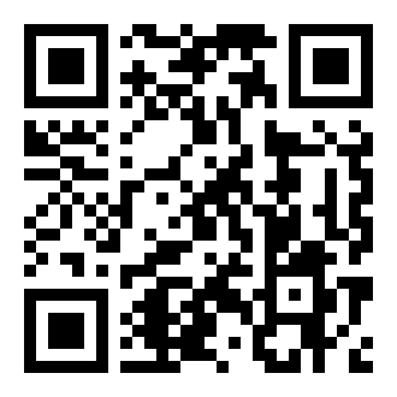

# Referências

**ASSOCIAÇÃO BRASILEIRA DE NORMAS TÉCNICAS (ABNT)**. *ABNT NBR ISO/IEC/IEEE 12207:2021: Engenharia de sistemas e software — Processos de ciclo de vida de software*. Rio de Janeiro: ABNT, 2021.

**ASSOCIAÇÃO PARA PROMOÇÃO DA EXCELÊNCIA DO SOFTWARE BRASILEIRO (SOFTEX)**. *MPS.BR — Guia Geral de Software: 2024 (MR-MPS-SW)*. Brasília: SOFTEX, 2024. Disponível em: <https://softex.br/download/guia-geral-mps-de-software2024/>. Acesso em: 09 nov. 2026.

**PRESSMAN, Roger S.; MAXIM, Bruce R.** *Engenharia de Software: uma abordagem profissional*. 9. ed. Porto Alegre: AMGH Editora, 2021.

**SOMMERVILLE, Ian**. *Engenharia de Software*. 10. ed. São Paulo: Pearson Education do Brasil, 2019.

**VERCEL INC.** *Next.js 14 Documentation: Full-stack Web Architecture*. San Francisco: Vercel, 2026. Disponível em: <https://nextjs.org/docs>. Acesso em: 09 nov. 2026.

### Normas e Documentos Técnicos

- **ISO/IEC/IEEE 15288:2015**. *Systems and software engineering — System life cycle processes*. Geneva: International Organization for Standardization, 2015.
- **ISO/IEC 25010:2011**. *Systems and software engineering — Systems and software Quality Requirements and Evaluation (SQuaRE) — System and software quality models*. Geneva: ISO, 2011.
- **BRASIL**. *Lei Geral de Proteção de Dados Pessoais (LGPD) — Lei nº 13.709, de 14 de agosto de 2018*. Brasília: Presidência da República, 2018.
- **CINESOFT SOLUTIONS**. *Catálogo Formal de Architecture Decision Records (ADRs: ADR-001 a ADR-012)*. Goiânia: CineSoft Solutions, 2026.

### Sites e Plataformas Técnicas

- **SUPABASE INC.** *Supabase Documentation: Postgres, Auth and Realtime*. Disponível em: <https://supabase.com/docs>. Acesso em: 09 nov. 2026.
- **RESEND INC.** *Email API for Developers and Transactional Workflows*. Disponível em: <https://resend.com>. Acesso em: 09 nov. 2026.
- **PRISMA DATA INC.** *Prisma ORM Schema Reference and Concurrency*. Disponível em: <https://prisma.io>. Acesso em: 09 nov. 2026.

---

   
  <strong>Acesse o CineDoom:</strong> <a href="https://cinedoom.vercel.app/">cinedoom.vercel.app</a>

