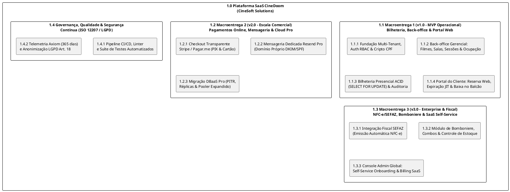
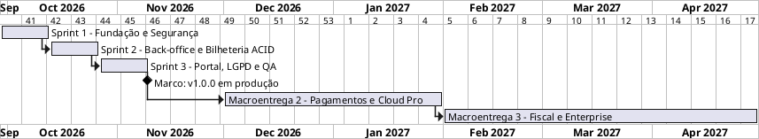
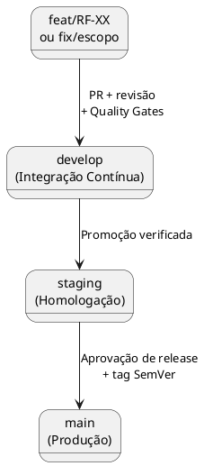
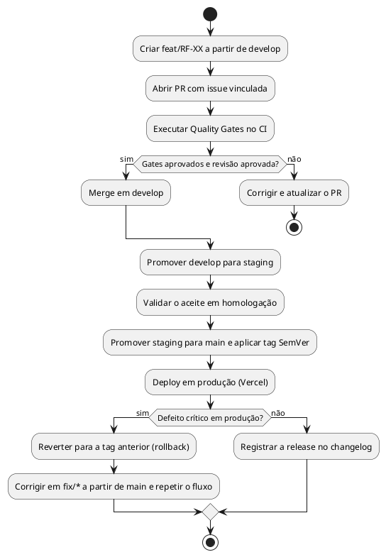
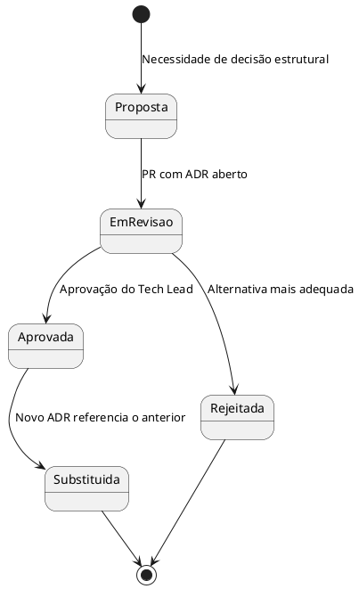
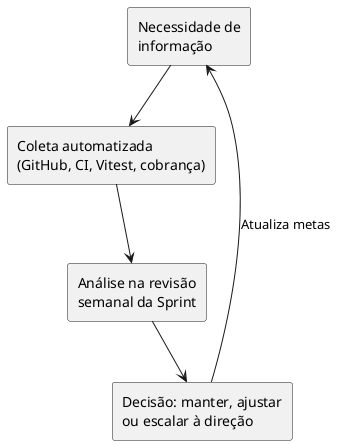
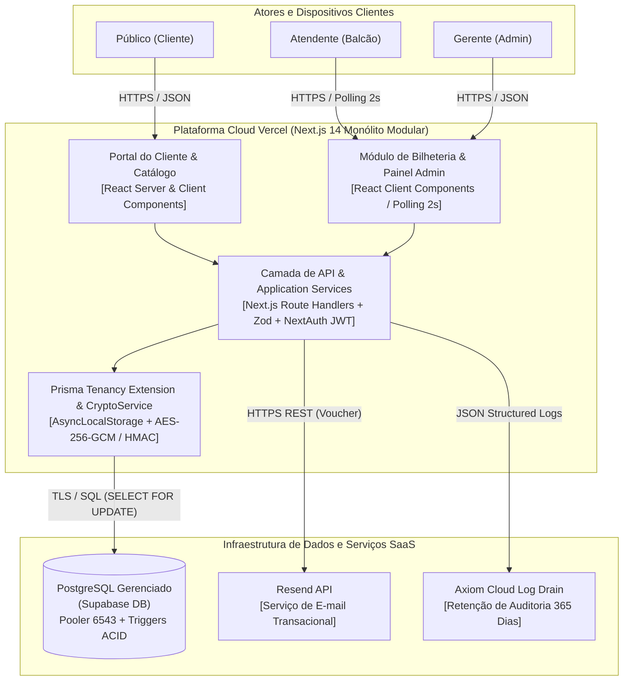
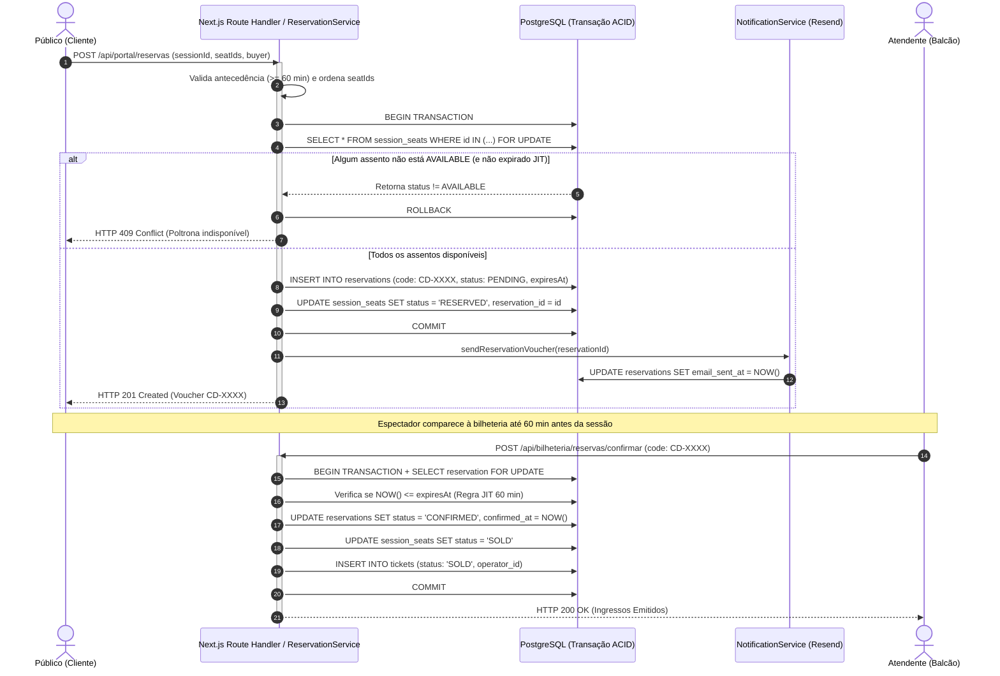
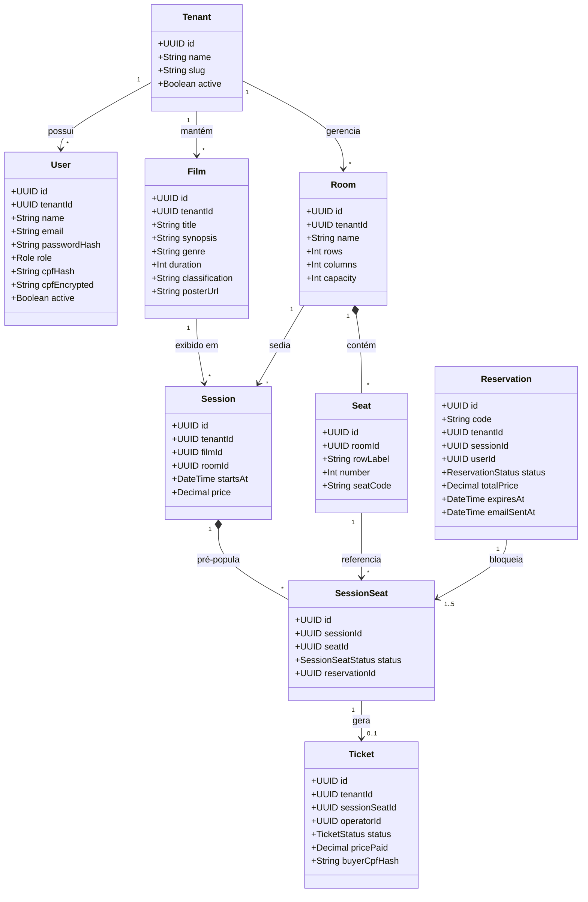

<!-- ===================================================================== -->
<!-- NOTICE: AUTO-GENERATED FILE FROM manual/capitulos/                    -->
<!-- DO NOT EDIT THIS FILE DIRECTLY. EDIT THE MODULES IN manual/capitulos/ -->
<!-- TO REBUILD: run ./scripts/compilar.sh or ./scripts/montar-manual.sh   -->
<!-- ===================================================================== -->

# Manual de Processos de Software

## Capa

**Manual de Processos de Software**

**Grupo:** Doomscoders

- Carlos Eduardo Freire da Silva
- Gabriel Henrique Lourenço Dias
- Kayque Vicente Silva
- Yury Nogueira de Oliveira Silva

**Orientadora:** Profa. Dra. Juliana Pereira de Souza Zinader  
**Referência:** ABNT NBR ISO/IEC/IEEE 12207:2021

---

<div style="page-break-after: always;"></div>

---

## Folha de Rosto

- Carlos Eduardo Freire da Silva
- Gabriel Henrique Lourenço Dias
- Kayque Vicente Silva
- Yury Nogueira de Oliveira Silva

**Manual de Processos de Software**

Manual de Processos de Software apresentado à disciplina de Processos de Engenharia de Software do curso de Bacharelado em Engenharia de Software da Universidade Federal de Goiás (UFG), como requisito de avaliação para a obtenção da nota final integral da disciplina, referente ao Projeto Integrador.

**Orientadora:** Profª. Dra. Juliana Pereira de Souza Zinader  
**Local e Ano:** Goiânia, 2026

---

<div style="page-break-after: always;"></div>

---

## Histórico de Versões do Documento

| Data | Versão | Descrição Sucinta da Alteração |
| :---: | :---: | :--- |
| 10/09/2026 | Versão 1.0 | Criação do documento, identificação da equipe e elaboração da capa. |
| 16/09/2026 | Versão 1.1 | Elaboração dos itens do Capítulo 1 (Apresentação do Software). |
| 24/09/2026 | Versão 1.2 | Alinhamento dos Capítulos 1, 2 e 3 à norma ISO/IEC/IEEE 12207:2021. |
| 24/09/2026 | Versão 1.3 | Revisão técnica: correção de contradições e justificativas de aquisição. |
| 08/10/2026 | Versão 1.4 | Incremento e estruturação dos processos do Capítulo 4 (Gerenciamento). |
| 17/10/2026 | Versão 1.5 | Reestruturação da capa e padronização do controle documental. |
| 22/10/2026 | Versão 1.6 | Padronização formal da estrutura editorial dos Capítulos 1 a 5. |
| 23/10/2026 | Versão 1.7 | Incorporação do Portal do Cliente, reserva ACID, e-mail e LGPD (ADR-012). |
| 09/11/2026 | Versão 2.0 | Consolidação em 3 Macroentregas, matrizes Make-or-Buy, Pugh, EAP e Cap. 6 (MPS.BR). |
| 11/11/2026 | Versão 2.1 | Revisão e sincronização dos Capítulos 1 a 5: perfis RBAC e princípios DDD/SOLID/TDD, cinco atividades dos processos de aquisição e fornecimento, restrições `RES` e síntese das regras de negócio, alinhamento dos critérios de aceite e ampliação da homologação UAT, além de padronização pré-textual/LaTeX. |

*Fonte: Elaborado pelos autores (2026).*

---

<div style="page-break-after: always;"></div>

---

## Lista de Figuras

| Identificador | Título da Figura |
| :---: | :--- |
| **Figura 1** | Portal do Cliente: catálogo de filmes e mapa interativo de assentos |
| **Figura 2** | Bilheteria presencial: mapa de assentos e operação de guichê |
| **Figura 3** | Back-office gerencial: programação de sessões e indicadores de ocupação |
| **Figura 4** | Diagrama de Classes do Domínio de Negócios CineDoom |
| **Figura 5** | Diagrama de Sequência UML: Reserva Web e Emissão de Voucher |
| **Figura 6** | Diagrama C4 Nível 2: Contêineres da Plataforma CineDoom |
| **Figura 7** | Diagrama de Máquina de Estados do Ciclo de Vida da Poltrona |
| **Figura 8** | Diagrama Entidade-Relacionamento (DER) do Banco PostgreSQL |

---

<div style="page-break-after: always;"></div>

---

## Lista de Tabelas

| Identificador | Título da Tabela |
| :---: | :--- |
| **Tabela 1** | Matriz de Perfis de Usuários e Permissões de Acesso |
| **Tabela 2** | Análise de Aquisição: Componentes de Software e Domínio (Make or Buy) |
| **Tabela 3** | Análise de Aquisição: Infraestrutura Cloud e Serviços Gerenciados (Make or Buy) |
| **Tabela 4** | Perspectiva de Fornecimento e Ativos Comercializáveis |
| **Tabela 5** | Acordo de Nível de Serviço (SLA) e Suporte Pós-Entrega |
| **Tabela 6** | Identificação dos Fornecedores e Parceiros Relevantes |
| **Tabela 7** | Inventário de Infraestrutura e Ferramentas |
| **Tabela 8** | Composição da Equipe e Competências Técnicas Requeridas |
| **Tabela 9** | Matriz RACI de Responsabilidades por Membro da Equipe |
| **Tabela 10** | Escopo e Marcos Comerciais por Macroentrega (Milestones) |
| **Tabela 11** | Cronograma Executivo e Pacotes de Trabalho por Sprint |
| **Tabela 12** | Plano de Recursos Humanos e Operacionais |
| **Tabela 13** | Matriz de Riscos do Produto e Ações Preventivas (Risk Register) |
| **Tabela 14** | Matriz de Decisão Ponderada (Pugh Matrix) — Arquitetura Base |
| **Tabela 15** | Quadro Sinóptico de Decisões de Arquitetura: Stack e Persistência (ADR-001 a ADR-006) |
| **Tabela 16** | Quadro Sinóptico de Decisões de Arquitetura: Concorrência e Resiliência (ADR-007 a ADR-012) |
| **Tabela 17** | Indicadores e Métricas de Monitoramento do Projeto |
| **Tabela 18** | Catálogo Formal de Requisitos Funcionais: Domínio e Bilheteria (RF-01 a RF-09) |
| **Tabela 19** | Catálogo Formal de Requisitos Funcionais: Governança, Portal e Notificações (RF-10 a RF-18) |
| **Tabela 20** | Catálogo Formal de Requisitos Não Funcionais (ISO/IEC 25010) |
| **Tabela 21** | Matriz de Rastreabilidade Bidirecional de Requisitos |
| **Tabela 22** | Mapeamento de Stakeholders e Técnicas de Elicitação |
| **Tabela 23** | Distinção Conceitual entre Verificação e Validação |
| **Tabela 24** | Critérios Formais de Entrada e Saída de V&V |
| **Tabela 25** | Relatório de Testes de Aceitação e Homologação em Produção |
| **Tabela 26** | Diagnóstico de Avaliação e Maturidade de Processo (Versão 1.7) |
| **Tabela 27** | Plano de Melhoria de Processo de Software (PMP) |
| **Tabela 28** | Quadro Comparativo: Antes vs. Depois da Revisão de Processos |
| **Tabela 29** | Reavaliação Pós-Melhoria da Conformidade do Manual (Versão 2.0) |

---

<div style="page-break-after: always;"></div>

---

## Lista de Abreviaturas e Siglas

| Sigla | Significado Completo | Sigla | Significado Completo |
| :---: | :--- | :---: | :--- |
| **ABNT** | Associação Brasileira de Normas Técnicas | **MPS.BR** | Melhoria de Processo do Software Brasileiro |
| **ADR** | *Architecture Decision Record* | **MTTR** | *Mean Time To Recovery* |
| **API** | *Application Programming Interface* | **MVP** | *Minimum Viable Product* |
| **B2B / B2C** | *Business-to-Business / Consumer* | **NFC-e** | Nota Fiscal de Consumidor Eletrônica |
| **CI / CD** | *Continuous Integration / Deployment* | **ORM** | *Object-Relational Mapping* |
| **DoD / DoR** | *Definition of Done / Definition of Ready* | **PaaS** | *Platform as a Service* |
| **GPP** | Gerência de Portfólio de Projetos | **PIX** | Pagamento Instantâneo Brasileiro |
| **GPR** | Gerência de Projetos (MPS.BR — Nível G) | **PMP** | Plano de Melhoria de Processo |
| **GQM** | *Goal-Question-Metric* | **PPR** | Processo Padrão de Requisitos |
| **GQA** | Garantia da Qualidade (MPS.BR — Nível F) | **QA** | *Quality Assurance* |
| **GCO** | Gerência de Configuração (MPS.BR — Nível F) | **RBAC** | *Role-Based Access Control* |
| **IEC** | *International Electrotechnical Commission* | **SaaS** | *Software as a Service* |
| **IEEE** | *Institute of Electrical and Electronics Engineers* | **SLA / SLO** | *Service Level Agreement / Objective* |
| **ISO** | *International Organization for Standardization* | **SPICE** | ISO/IEC 15504 Process Improvement |
| **JWT** | *JSON Web Token* (RFC 7519) | **UFG** | Universidade Federal de Goiás |
| **LGPD** | Lei Geral de Proteção de Dados (Lei 13.709/2018) | **UI / UX** | *User Interface / User Experience* |
| **MED** | Medição (MPS.BR — Nível F) | **V&V** | Verificação e Validação |
| **WBS / EAP** | *Work Breakdown Structure* (Estrutura Analítica do Projeto) | | |

---

<div style="page-break-after: always;"></div>

---

## Sumário

- [Capítulo 1 – Apresentação do software](#capítulo-1--apresentação-do-software)
  - [1.1 Nome e descrição do software](#11-nome-e-descrição-do-software)
  - [1.2 Qual é o software? O que ele faz? Qual problema resolve?](#12-qual-é-o-software-o-que-ele-faz-qual-problema-resolve)
    - [O que ele faz?](#o-que-ele-faz)
    - [Qual problema resolve?](#qual-problema-resolve)
    - [Proposta de valor](#proposta-de-valor)
  - [1.3 Público-alvo e contexto de uso](#13-público-alvo-e-contexto-de-uso)
  - [1.4 Quem vai usar? Em que situação? Qual o ambiente de operação esperado?](#14-quem-vai-usar-em-que-situação-qual-o-ambiente-de-operação-esperado)
    - [Perfis de Usuários](#perfis-de-usuários)
    - [Ambiente de Operação Esperado](#ambiente-de-operação-esperado)
  - [1.5 Escopo e principais funcionalidades](#15-escopo-e-principais-funcionalidades)
    - [Escopo Central e Módulos do Sistema](#escopo-central-e-módulos-do-sistema)
    - [Fora do escopo imediato da Macroentrega 1](#fora-do-escopo-imediato-da-macroentrega-1)
  - [1.6 Restrições e premissas](#16-restrições-e-premissas)
    - [Restrições](#restrições)
    - [Premissas](#premissas)
- [Capítulo 2 – Processos de Acordo](#capítulo-2--processos-de-acordo)
  - [2.1 Descrição do processo de aquisição](#21-descrição-do-processo-de-aquisição)
    - [Fronteira e Justificativa de Aquisição](#fronteira-e-justificativa-de-aquisição)
    - [Análise de Aquisição (Make or Buy)](#análise-de-aquisição-make-or-buy)
    - [As Cinco Atividades do Processo de Aquisição (ISO 12207)](#as-cinco-atividades-do-processo-de-aquisição-iso-12207)
  - [2.2 Descrição do processo de fornecimento](#22-descrição-do-processo-de-fornecimento)
    - [Perspectiva de Fornecimento e Ativos Comercializáveis](#perspectiva-de-fornecimento-e-ativos-comercializáveis)
    - [Termos do Acordo, Entregáveis e Evolução por Macroentregas](#termos-do-acordo-entregáveis-e-evolução-por-macroentregas)
    - [Critérios de Aceite Formal pelo Cliente Adquirente](#critérios-de-aceite-formal-pelo-cliente-adquirente)
    - [Acordo de Nível de Serviço (SLA) e Suporte Pós-Entrega](#acordo-de-nível-de-serviço-sla-e-suporte-pós-entrega)
  - [2.3 Identificação dos fornecedores e parceiros relevantes](#23-identificação-dos-fornecedores-e-parceiros-relevantes)
- [Capítulo 3 – Processos Organizacionais Habilitadores](#capítulo-3--processos-organizacionais-habilitadores)
  - [3.1 Modelo de ciclo de vida adotado e justificado](#31-modelo-de-ciclo-de-vida-adotado-e-justificado)
    - [Estrutura das Fases, Cerimônias e Macroentregas](#estrutura-das-fases-cerimônias-e-macroentregas)
    - [Justificativa da Escolha do Modelo](#justificativa-da-escolha-do-modelo)
  - [3.2 Inventário de infraestrutura e ferramentas necessárias](#32-inventário-de-infraestrutura-e-ferramentas-necessárias)
  - [3.3 Justificativa estratégica e viabilidade do projeto](#33-justificativa-estratégica-e-viabilidade-do-projeto)
  - [3.4 Papéis, competências e plano de capacitação (RACI)](#34-papéis-competências-e-plano-de-capacitação-raci)
    - [Composição da Equipe e Competências Requeridas](#composição-da-equipe-e-competências-requeridas)
    - [Matriz RACI Consolidada por Membro da Equipe](#matriz-raci-consolidada-por-membro-da-equipe)
    - [Plano de Capacitação Técnica Contínua](#plano-de-capacitação-técnica-contínua)
  - [3.5 Plano de qualidade com critérios e métricas](#35-plano-de-qualidade-com-critérios-e-métricas)
  - [3.6 Estratégia de gestão do conhecimento](#36-estratégia-de-gestão-do-conhecimento)
- [Capítulo 4 – Processos de Gerenciamento Técnico](#capítulo-4--processos-de-gerenciamento-técnico)
  - [4.1 Plano de projeto: escopo, cronograma, recursos e entregas](#41-plano-de-projeto-escopo-cronograma-recursos-e-entregas)
    - [Estrutura Analítica do Projeto (EAP / WBS em 3 Níveis)](#estrutura-analítica-do-projeto-eap--wbs-em-3-níveis)
    - [Escopo e Marcos Comerciais por Macroentrega (Milestones)](#escopo-e-marcos-comerciais-por-macroentrega-milestones)
    - [Cronograma Detalhado de Execução da Macroentrega 1 (v1.0.0)](#cronograma-detalhado-de-execução-da-macroentrega-1-v100)
    - [Recursos](#recursos)
    - [Rotina de Acompanhamento e Tratamento de Desvios e Atrasos](#rotina-de-acompanhamento-e-tratamento-de-desvios-e-atrasos)
  - [4.2 Plano de gestão de riscos: identificação, probabilidade, impacto e respostas](#42-plano-de-gestão-de-riscos-identificação-probabilidade-impacto-e-respostas)
    - [Critérios de Classificação e Reavaliação Contínua](#critérios-de-classificação-e-reavaliação-contínua)
    - [Matriz de Riscos do Produto (Risk Register)](#matriz-de-riscos-do-produto-risk-register)
  - [4.3 Plano de gestão de configuração: controle de versões, branches e releases](#43-plano-de-gestão-de-configuração-controle-de-versões-branches-e-releases)
  - [4.4 Registro de decisões técnicas relevantes (ADRs)](#44-registro-de-decisões-técnicas-relevantes-adrs)
    - [Contextualização e Padrão Adotado (MADR)](#contextualização-e-padrão-adotado-madr)
    - [Matriz de Decisão Ponderada (Pugh Matrix) — Escolha da Arquitetura Base (ADR-001)](#matriz-de-decisão-ponderada-pugh-matrix--escolha-da-arquitetura-base-adr-001)
    - [Fichas Estruturadas de Decisões Arquiteturais (ADR-001 a ADR-012)](#fichas-estruturadas-de-decisões-arquiteturais-adr-001-a-adr-012)
  - [4.5 Métricas de acompanhamento do projeto](#45-métricas-de-acompanhamento-do-projeto)
- [Capítulo 5 – Processos Técnicos](#capítulo-5--processos-técnicos)
  - [5.1 Requisitos](#51-requisitos)
    - [5.1.1 Catálogo formal de requisitos](#511-catálogo-formal-de-requisitos)
    - [5.1.2 Matriz de rastreabilidade bidirecional de requisitos](#512-matriz-de-rastreabilidade-bidirecional-de-requisitos)
    - [5.1.3 Critérios de aceitação (CA-01 a CA-14)](#513-critérios-de-aceitação-ca-01-a-ca-14)
    - [5.1.4 Mapeamento de partes interessadas e técnicas de elicitação](#514-mapeamento-de-partes-interessadas-e-técnicas-de-elicitação)
  - [5.2 Arquitetura e Design](#52-arquitetura-e-design)
    - [5.2.1 Visão Geral e Princípios Arquiteturais](#521-visão-geral-e-princípios-arquiteturais)
    - [5.2.2 Diagramas Arquiteturais e de Domínio](#522-diagramas-arquiteturais-e-de-domínio)
  - [5.3 Implementação e Integração](#53-implementação-e-integração)
  - [5.4 Verificação, Validação e Transição](#54-verificação-validação-e-transição)
    - [5.4.1 Distinção formal entre Verificação e Validação](#541-distinção-formal-entre-verificação-e-validação)
    - [5.4.2 Critérios de aceitação por stakeholder](#542-critérios-de-aceitação-por-stakeholder)
    - [5.4.3 Relatório de testes de aceitação (Homologação e Produção)](#543-relatório-de-testes-de-aceitação-homologação-e-produção)
  - [5.5 Operação, Manutenção e Descontinuação](#55-operação-manutenção-e-descontinuação)
- [Capítulo 6 – Avaliação e melhoria dos processos de software](#capítulo-6--avaliação-e-melhoria-dos-processos-de-software)
  - [6.1 Referencial e recorte](#61-referencial-e-recorte)
  - [6.2 Diagnóstico do manual](#62-diagnóstico-do-manual)
  - [6.3 Plano de uma melhoria](#63-plano-de-uma-melhoria)
  - [6.4 Atualização e verificação](#64-atualização-e-verificação)
  - [6.5 Acompanhamento da execução](#65-acompanhamento-da-execução)


# Capítulo 1 – Apresentação do Software

## 1.1 Nome e Descrição do Software

**Nome do Software:** CineDoom.  
**Organização desenvolvedora:** CineSoft Solutions.

O **CineDoom** é uma plataforma web de gerenciamento operacional e bilheteria para cinemas, desenvolvida no modelo **Software as a Service (SaaS) multi-tenant**. Sua arquitetura permite que diferentes cinemas utilizem o mesmo sistema em nuvem, mantendo os dados, configurações e operações de cada estabelecimento totalmente separados.

O produto é desenvolvido pela **CineSoft Solutions**, empresa de tecnologia focada em soluções para o mercado de exibição cinematográfica. O CineDoom foi concebido para atender cinemas de rua, circuitos independentes e redes de pequeno e médio porte, integrando a administração do estabelecimento, a bilheteria física e o atendimento digital aos espectadores em um sistema único.

## 1.2 Qual é o Software? O que ele faz? Qual problema resolve?

O **CineDoom** é uma plataforma SaaS multi-tenant que unifica a gestão operacional, o atendimento presencial e os serviços digitais de cinemas em uma única base transacional.

### O que ele faz?

A plataforma integra as três vertentes operacionais do cinema:

1. **Gestão e Back-office:** permite cadastrar filmes, configurar salas com layouts de assentos, programar sessões com preços específicos e acompanhar taxas de ocupação em tempo real.
2. **Bilheteria Presencial:** disponibiliza terminais de guichê para consulta de sessões, seleção de poltronas em mapa interativo, emissão de ingressos e baixa de reservas originadas na web.
3. **Portal do Espectador:** disponibiliza ao público a consulta da programação, escolha de assentos e aquisição ou reserva antecipada com emissão de comprovante digital.

O sistema mantém o mapa de assentos sincronizado entre a bilheteria e a web, garantindo que uma poltrona vendida ou reservada em um canal fique indisponível nos demais de forma imediata.

### Qual problema resolve?

Cinemas independentes frequentemente operam com sistemas de ponto de venda legados, planilhas ou controles em papel que não se comunicam com a internet. 

Essa fragmentação gera três problemas críticos:
1. **Conflito de assentos (*double-booking*):** risco permanente de vender a mesma poltrona no balcão e na web para a mesma sessão.
2. **Inacessibilidade para o público:** dependência exclusiva de filas físicas, impedindo o espectador de consultar horários e garantir lugares com antecedência.
3. **Decisões sem visibilidade de dados:** ausência de métricas consolidadas sobre ocupação real das salas e horários de maior demanda.

O CineDoom elimina esses problemas ao unificar o inventário de assentos e as vendas em um banco relacional compartilhado, substituindo controles paralelos por uma operação única e auditável.

### Proposta de valor

Para o cinema, o CineDoom entrega redução de custos operacionais, segurança contra vendas duplas e visibilidade da ocupação em tempo real. Para o espectador, proporciona comodidade na consulta da programação e autonomia para escolher suas poltronas com antecedência.

## 1.3 Público-alvo e Contexto de Uso

O público-alvo do CineDoom é estruturado em três segmentos principais:

* **Clientes Corporativos (B2B):** Cinemas de rua, circuitos independentes, cineclubes e redes exibidoras de pequeno e médio porte. São organizações que necessitam modernizar sua bilheteria e gestão operacional, mas que não dispõem de equipes internas de TI ou recursos para investir em soluções corporativas proprietárias de alto custo.
* **Consumidores Finais (B2C):** Espectadores de cinema que utilizam navegadores em smartphones, tablets ou computadores para consultar a programação em cartaz, verificar horários, escolher assentos em mapas visuais e garantir ingressos ou reservas com comodidade antes de se deslocarem ao local.
* **Usuários Operacionais Locais:** Funcionários do próprio cinema (gerentes e atendentes de guichê) responsáveis pela operação diária das salas, atendimento ao público presencial e administração das sessões.

### Contextos de uso típicos

O sistema opera de forma integrada em três cenários de uso distintos:

1. **Canal Web do Espectador (Acesso Remoto):** Utilizado pelo público externo em trânsito ou no domicílio, com foco em facilidade de navegação em telas móveis e desktop para tomada rápida de decisão e reserva antecipada de assentos.
2. **Ambiente de Bilheteria Presencial (Ponto de Venda Físico):** Terminais de guichê operados pelos atendentes no saguão do cinema. O contexto de uso exige interface ágil e tempo mínimo de resposta por transação para dar vazão rápida ao fluxo de clientes em horários de pico pré-sessão.
3. **Ambiente Administrativo de Back-office (Escritório do Cinema):** Utilizado pela gerência para o planejamento estratégico semanal, parametrização do catálogo de filmes, agendamento de horários na grade e monitoramento em tempo real dos indicadores de ocupação das salas.

A Figura 1 ilustra a interface do Portal do Cliente, apresentando o catálogo de filmes em cartaz e o mapa interativo de assentos disponível para o espectador.


*Figura 1 – Portal do Cliente: catálogo de filmes em cartaz e mapa interativo de assentos*

## 1.4 Quem vai usar? Em que situação? Qual o ambiente de operação esperado?

### Perfis de Usuários e Situações de Uso

* **Espectador (Cliente B2C):**
  * *Quem é:* O público consumidor que busca lazer e entretenimento cinematográfico.
  * *Em que situação atua:* Acessa o Portal do Cliente pelo smartphone ou computador pessoal em momentos de lazer para consultar filmes em cartaz, verificar horários, escolher assentos em mapas visuais, efetuar reservas antecipadas e consultar seus vouchers digitais ao comparecer ao cinema.
* **Atendente de Bilheteria (Operador de Guichê):**
  * *Quem é:* O funcionário responsável pela operação física de venda e recepção no cinema.
  * *Em que situação atua:* Atua nos pontos de venda presenciais do saguão durante os horários de funcionamento, especialmente nos momentos de pico pré-sessão, realizando vendas rápidas no balcão, localizando reservas digitais por código ou CPF para confirmação de pagamento e emitindo ingressos físicos.
* **Gerente do Cinema (Gestor Operacional):**
  * *Quem é:* O administrador local responsável pelas salas, programação e equipe.
  * *Em que situação atua:* Atua no back-office administrativo (rotina semanal e diária) para cadastrar acervo de filmes, configurar o layout de salas e poltronas, agendar a grade de sessões com seus respectivos valores, gerenciar as contas dos atendentes e analisar relatórios de ocupação das salas.
* **Administrador da Plataforma (Operação Técnica CineSoft):**
  * *Quem é:* A equipe técnica de sustentação da desenvolvedora.
  * *Em que situação atua:* Atua na ativação e configuração inicial de novos cinemas (*onboarding* de *tenants*), monitoramento de telemetria, análise de logs de auditoria e suporte aos gestores dos estabelecimentos.

A Tabela 1 sintetiza a matriz de perfis de usuários, seus respectivos canais de acesso, escopos de isolamento e permissões na plataforma:

**Tabela 1 – Matriz de Perfis de Usuários e Permissões de Acesso**

| Perfil (RBAC) | Canal de Acesso | Escopo de Dados | Permissões e Operações no Domínio |
| :--- | :--- | :--- | :--- |
| **Espectador** (`CLIENTE`) | Portal do Espectador *(Web Responsivo)* | Dados pessoais e reservas do titular *(LGPD Art. 18)* | Consultar catálogo e sessões; selecionar poltronas em mapa interativo; solicitar reserva com bloqueio atômico; emitir voucher transacional; cancelar reserva dentro do prazo. |
| **Atendente** (`ATENDENTE`) | Bilheteria Presencial *(PDV Guichê Físico)* | Sessões, assentos e vendas do cinema local (`tenant_id`) | Venda direta no balcão com trava anti-*double-booking*; busca de reservas web por CPF ou código; baixa presencial com emissão de ingressos; cancelamento assistido auditado. |
| **Gerente** (`GERENTE`) | Painel Gerencial *(Back-office Administrativo)* | Gestão operacional do cinema local (`tenant_id`) | Cadastrar filmes; configurar salas e matrizes de poltronas; agendar grade de sessões com valores de ingresso; gerenciar operadores de guichê; acompanhar relatórios de ocupação. |
| **Administrador** (`ADMIN`) | Console de Operações *(Plataforma CineSoft)* | Infraestrutura e cinemas clientes *(cross-tenant)* | Ativação de novos cinemas (*onboarding* de *tenants*); auditoria de segurança e integridade de dados; monitoramento de telemetria; suporte técnico à operação. |

*Fonte: CineSoft Solutions (2026).*

### Ambiente de Operação Esperado

O CineDoom é uma aplicação 100% web operada em nuvem, eliminando a necessidade de instalação de softwares locais:

* **Dispositivos de Hardware:**
  * *Bilheteria Física:* Computadores desktop, notebooks ou tablets com teclado, mouse ou tela sensível ao toque nos guichês de atendimento.
  * *Acesso do Espectador:* Smartphones (iOS e Android), tablets, notebooks e computadores pessoais.
  * *Administração:* Computadores de escritório convencionais.
* **Navegadores Homologados:** Principais navegadores web modernos com suporte a padrões ECMAScript atuais (Google Chrome, Mozilla Firefox, Safari e Microsoft Edge).
* **Conectividade:** Conexão estável com a internet (banda larga fixa ou rede móvel 4G/5G), necessária para a sincronização contínua dos assentos e processamento das transações em nuvem.
* **Responsividade e Telas:** Interface adaptativa homologada para operar desde telas móveis compactas (a partir de 320px de largura) até monitores desktop de alta resolução (Full HD e superiores).

A Figura 2 apresenta a interface da bilheteria presencial, utilizada pelo atendente para a venda direta de ingressos e a baixa de reservas originadas no portal.


*Figura 2 – Bilheteria presencial: mapa de assentos, venda direta e baixa de reservas pelo atendente.*

## 1.5 Escopo e principais funcionalidades

O CineDoom é desenvolvido em entregas incrementais. O escopo atual compreende o núcleo operacional do produto (**Macroentrega 1 — Release 1.0**), enquanto funcionalidades complementares estão alocadas no roadmap futuro.

### Funcionalidades Incluídas (Escopo Atual)

O núcleo operacional entregue pela equipe contempla quatro grupos de funcionalidades:

* **Gestão e Programação (Back-office):** Cadastro de filmes em cartaz, montagem de salas com layouts de assentos, agendamento de sessões com prevenção de choques de horário e painel com taxas de ocupação em tempo real.
* **Bilheteria Presencial (Ponto de Venda):** Consulta rápida de sessões, seleção visual de poltronas, venda de ingressos com trava contra assentos duplicados (*anti-double-booking*), baixa de reservas web e cancelamento auditado.
* **Portal do Espectador (Canal Digital):** Consulta da programação, seleção de assentos no mapa interativo, reserva antecipada, emissão de voucher por e-mail e cancelamento voluntário pelo cliente.
* **Segurança e Governança:** Controle de acesso por perfis (`GERENTE`, `ATENDENTE` e `CLIENTE`), isolamento multi-tenant de dados e proteção de CPF com suporte a anonimização (LGPD).

A Figura 3 apresenta a interface do back-office, utilizada pela gerência para acompanhar a programação e a ocupação das salas.


*Figura 3 – Back-office gerencial: programação de sessões e indicadores de ocupação das salas.*

### Fora do Escopo Imediato

Em conformidade com as boas práticas de engenharia de software e gestão de produto, delimita-se expressamente o que não faz parte da entrega atual:

#### A. Funcionalidades Planejadas no Roadmap Evolutivo (Macroentregas 2 e 3)
* **Macroentrega 2 (Escala e Pagamentos Digitais):** Integração de gateway de pagamento online para checkout web (PIX com QR Code dinâmico e cartão de crédito), serviço de mensageria em larga escala (`Resend Pro`) e migração para banco de dados dedicado com alta disponibilidade.
* **Macroentrega 3 (Enterprise e Fiscal):** Módulo de emissão fiscal automatizada de cupons (NFC-e / SAT integrada à SEFAZ), ponto de venda integrado para bomboniere (gestão de pipoca, bebidas e estoque), faturamento recorrente automatizado de assinaturas SaaS (*Billing*) e programas de fidelidade.

#### B. Funcionalidades Fora do Escopo Global da Plataforma
* **Aplicativos Móveis Nativos:** O CineDoom não prevê publicação de instaladores em lojas (App Store / Google Play); a experiência é provida integralmente por aplicação web responsiva moderna.
* **Streaming e Distribuição Audiovisual:** A plataforma destina-se exclusivamente à gestão de exibição cinematográfica física, não realizando transmissão ou streaming de arquivos de vídeo.

## 1.6 Restrições e premissas

### Restrições do Projeto

As seguintes imposições legais, regulatórias e arquiteturais delimitam o projeto global do CineDoom:

* **Conformidade com a LGPD (Lei 13.709/2018):** Exige consentimento explícito, proteção criptográfica de identificadores (CPF cifrado com `AES-256-GCM` e indexado via `HMAC-SHA256`) e mecanismos para anonimização irreversível dos dados a pedido do titular (Art. 18), preservando registros fiscais e contábeis do cinema.
* **Segurança em Pagamentos Digitais (PCI-DSS e Bacen):** O processamento de pagamentos online deve ser delegado a gateways homologados. É vedado à plataforma armazenar dados sensíveis de cartões (*PAN* e *CVV*), operando exclusivamente por tokenização e webhooks seguros.
* **Operação Exclusiva em Nuvem (Sem Modo Offline):** Para manter a sincronização dos assentos em tempo real e eliminar o risco de venda duplicada (*double-booking*), o sistema opera 100% em nuvem, exigindo conectividade contínua com a internet.
* **Isolamento de Dados em Arquitetura Multi-Tenant:** Em infraestrutura compartilhada, a camada de dados é estritamente condicionada à segregação lógica por cinema (`tenant_id`), sendo inadmissível qualquer vazamento de informações entre clientes.
* **Regulação Cinematográfica (Ancine):** A exibição de catálogo e sessões deve atender às normas regulatórias do setor, como a exibição obrigatória da classificação indicativa e o controle de cotas de tela nacionais.
* **Dependência de Serviços Gerenciados em Nuvem:** A disponibilidade da plataforma está sujeita aos acordos de nível de serviço (SLA) e limites de uso dos provedores de nuvem parceiros (banco gerenciado e serviço de mensageria).

### Premissas Adotadas

As seguintes condições foram assumidas como verdadeiras para viabilizar as regras e a operação da plataforma:

* **Infraestrutura Local nos Cinemas:** Assume-se que os estabelecimentos clientes dispõem de computadores ou tablets funcionais nos guichês e conexão estável à internet durante todo o horário de exibição.
* **Acesso Digital dos Espectadores:** Assume-se que o público-alvo possui dispositivos conectados (smartphones ou computadores) para consultar horários e garantir ingressos ou reservas pela web.
* **Atomicidade Transacional por Banco Relacional:** Assume-se que o mecanismo de bloqueio pessimista do banco relacional (PostgreSQL) é suficiente para serializar tentativas de compra simultânea, impedindo conflito de assentos em picos de demanda.
* **Política Operacional de Desistências (*No-Show*):** Assume-se que reservas web não confirmadas dentro do prazo limite programado configuram desistência, permitindo ao sistema liberar essas poltronas para nova comercialização.
* **Confiabilidade de Provedores Externos:** Assume-se que as APIs integradas de nuvem, mensageria e pagamentos manterão índices de disponibilidade superiores a 99% e contratos de integração estáveis.


# Capítulo 2 – Processos de Acordo

Este capítulo estabelece como a **CineSoft Solutions** gerencia suas relações comerciais e técnicas, fundamentando-se nas boas práticas da norma ABNT NBR ISO/IEC/IEEE 12207:2021 para os processos de **Aquisição** e **Fornecimento**. 

A abordagem adotada busca equilibrar rigor de engenharia e pragmatismo operacional: define claramente o que construir internamente versus o que contratar de terceiros (*Make or Buy*), estrutura a jornada de entrega e suporte da plataforma **CineDoom** para os cinemas clientes, e mapeia os parceiros de infraestrutura que viabilizam o sistema.

---

## 2.1 Processo de Aquisição: Decisões e Gestão de Provedores

No papel de adquirente, a CineSoft Solutions adota uma diretriz clara: **o esforço interno de desenvolvimento é concentrado no coração das regras de negócio do cinema e nos diferenciais competitivos do CineDoom**. Todo serviço em que o mercado já oferece soluções maduras, seguras e com economia de escala é contratado como serviço ou biblioteca, reduzindo tempo de desenvolvimento e custo operacional.

### O que construímos e o que contratamos (*Make or Buy*)

- **Desenvolvimento Interno (*Make*):** O motor de bilheteria e reservas atômicas com bloqueio pessimista (`SELECT FOR UPDATE`), a máquina de estados de assentos com liberação automática de ingressos expirados, o isolamento lógico multi-tenant entre diferentes redes de cinema e os mecanismos de anonimização exigidos pela LGPD. Esses itens compõem a propriedade intelectual e o diferencial de confiabilidade da CineSoft.
- **Soluções Prontas de Terceiros (*Buy*):** Infraestrutura de banco de dados gerenciado (PostgreSQL no Supabase), hospedagem serverless com distribuição global (Vercel), mensageria de e-mails transacionais (Resend), retenção de logs para auditoria (Axiom), processamento de pagamentos digitais (Stripe/Pagar.me na Macroentrega 2) e mensageria fiscal de notas (Focus NFe na Macroentrega 3).

As tabelas a seguir detalham a justificativa técnica e econômica de cada decisão:

**Tabela 2 – Análise de Aquisição: Componentes de Software e Domínio (Make or Buy)**

| Elemento do sistema | Adquirir pronto? | Justificativa | Possível fornecedor |
| :--- | :---: | :--- | :--- |
| **Motor de Bilheteria e Reserva Atômica ACID** | **Não** | Diferencial competitivo central. Exige controle estrito sobre locks pessimistas (`SELECT FOR UPDATE`) para impedir venda dupla entre web e guichê físico. | Desenvolvimento interno (CineSoft Solutions) |
| **Isolamento Multi-Tenant e Governança de Dados** | **Não** | Núcleo do modelo SaaS B2B. A injeção automática de `tenant_id` via Prisma Client Extensions garante isolamento seguro na mesma base relacional com baixo custo. | Desenvolvimento interno sobre Prisma Extensions |
| **Módulo de Criptografia e Anonimização LGPD** | **Não** | Requisito legal (LGPD Art. 18 e 46). Exige anonimização irreversível sob demanda sem corromper o histórico fiscal de ingressos vendidos pelo cinema. | Desenvolvimento interno (`Node.js crypto`) |
| **Autenticação, Sessão JWT e Controle RBAC** | **Parcial** | Adota biblioteca madura (`NextAuth.js`) para gerenciar sessões e cookies seguros, desenvolvendo internamente a matriz de perfis (`RBAC`) e o vínculo por cinema. | `NextAuth.js` + Middleware proprietário CineSoft |
| **Interface Gráfica e Mapa Interativo de Salas** | **Parcial** | Aproveita bibliotecas de mercado (`Tailwind`, `Lucide`) para primitivas visuais, desenvolvendo sob medida a matriz reativa de poltronas e o fluxo do guichê. | `Tailwind CSS`, `Lucide Icons` + Componentes CineSoft |
| **ORM e Validação de Schemas de Entrada** | **Sim** | Padrão de mercado que provê tipagem estrita (*type-safety*) e proteção nativa contra *SQL Injection*, sendo antieconômico construir do zero. | `Prisma ORM` e `Zod` (Open Source / MIT) |

*Fonte: CineSoft Solutions (2026).*

**Tabela 3 – Análise de Aquisição: Infraestrutura Cloud e Serviços Gerenciados (Make or Buy)**

| Elemento do sistema | Adquirir pronto? | Justificativa | Possível fornecedor |
| :--- | :---: | :--- | :--- |
| **Banco de Dados Relacional Gerenciado (DBaaS)** | **Sim** | Elimina custos de DBA, provendo restauração pontual automatizada (PITR), *connection pooling* para serverless e alta disponibilidade ($\ge 99,9\%$). | **Supabase Pro (PostgreSQL)** |
| **Plataforma de Hospedagem Serverless e CDN** | **Sim** | Elimina a manutenção de servidores dedicados, entregando deploys atômicos com reversão para a versão anterior, proteção DDoS e distribuição global na borda. | **Vercel Pro** (Cloud PaaS) |
| **Serviço de Disparo de E-mails Transacionais** | **Sim** | Evita que vouchers caiam em caixas de spam; a API especializada assegura entrega em milissegundos com autenticação SPF, DKIM e DMARC. | **Resend** (SaaS de E-mail Transacional) |
| **Observabilidade e Retenção Legal de Logs** | **Sim** | Cumpre a retenção legal de logs por 1 ano (Marco Civil e LGPD) sem sobrecarregar o armazenamento do banco relacional, com busca indexada rápida. | **Axiom Cloud** (Log Drain SaaS) |
| **Gateway de Pagamento Online (Macroentrega 2)** | **Sim** | Transfere a complexidade regulatória da certificação PCI-DSS Nível 1 e antifraude, automatizando a liquidação de PIX dinâmico e cartões. | **Stripe / Pagar.me** |
| **Motor de Mensageria Fiscal NFC-e (Macroentrega 3)** | **Sim** | Abstrai as constantes mudanças tributárias estaduais da SEFAZ, contingência offline e assinatura digital com certificado A1, evitando passivos fiscais. | **Focus NFe / PlugNotas** |

*Fonte: CineSoft Solutions (2026).*

### O Ciclo Prático de Aquisição de Provedores

Para selecionar e manter esses provedores em operação contínua, a CineSoft Solutions estrutura a contratação em cinco etapas práticas:

1. **Definição de Requisitos e Critérios:** O Arquiteto e os líderes técnicos mapeiam as restrições de cada necessidade — limites de latência (priorizando servidores na América do Sul), compatibilidade com Node.js/Next.js, conformidade com a LGPD e facilidade de integração local.
2. **Avaliação Técnica e Financeira:** São realizados testes práticos de integração (provas de conceito) entre alternativas de mercado (por exemplo, comparando Supabase versus PostgreSQL autogerenciado, ou Resend versus AWS SES), analisando a previsibilidade de custos à medida que o volume de bilheteria cresce.
3. **Contratação e Formalização:** Assinatura digital dos planos corporativos, formalização de Aditivos de Proteção de Dados (*Data Processing Agreements* – DPA) para garantir sigilo sob a LGPD e armazenamento seguro de chaves de API em gerenciadores de segredos com rotação periódica.
4. **Monitoramento e Acompanhamento de SLA:** A equipe monitora a disponibilidade real dos provedores via telemetria contínua, páginas de status e relatórios mensais de consumo, garantindo que o tempo de resposta e a taxa de erros permaneçam dentro dos padrões acordados.
5. **Homologação e Aceite Técnico:** Antes de qualquer serviço entrar em produção com clientes reais, o fluxo é validado em ambiente de testes (*sandbox*) na esteira de integração contínua (CI/CD), com procedimento de reversão (*rollback*) documentado caso ocorram falhas.

---

## 2.2 Processo de Fornecimento: Comercialização, Entrega e Operação

Como fornecedora de software, a CineSoft Solutions atende cinemas independentes, cinemas de rua e pequenas redes de exibição que buscam modernizar sua bilheteria física e expandir suas vendas online de forma integrada e sem riscos de sobreposição de assentos.

### Modelos de Negócio e Ativos Disponíveis

O principal produto fornecido é a plataforma **CineDoom** em modelo SaaS (*Software as a Service*), cobrada por assinatura mensal mais taxa por sala ativa. No entanto, sua arquitetura modular também permite licenciar componentes específicos para parceiros ou exibidores com sistemas legados:

**Tabela 4 – Perspectiva de Fornecimento e Ativos Comercializáveis**

| Ativo potencial                 | Possíveis adquirentes                                                                          | Modelo de fornecimento e preço estimado                                                                          |
| ------------------------------- | ---------------------------------------------------------------------------------------------- | ---------------------------------------------------------------------------------------------------------------- |
| Plataforma CineDoom (completa)  | Cinemas independentes, cinemas de rua e pequenas redes de exibição.                            | SaaS B2B: R$ 790/mês de assinatura-base, acrescidos de R$ 120/mês por sala ativa e R$ 1.500 de implantação (faixa efetiva de R$ 910 a R$ 1.270/mês para complexos de uma a quatro salas). |
| Engine de Trava Atômica (API)   | Plataformas de venda de ingressos, teatros e sistemas de reservas de eventos.                  | Licenciamento de API: R$ 0,08 por assento confirmado, com cobrança mínima de R$ 200/mês.                         |
| Módulo de Governança LGPD (SDK) | Empresas de desenvolvimento de software e plataformas de entretenimento.                       | Licenciamento de SDK: R$ 8.900/ano ou R$ 16.000 por licença perpétua, incluindo 10 horas de consultoria técnica. |
| Portal White-Label de Reservas  | Exibidores que utilizam sistemas administrativos próprios e desejam oferecer reservas on-line. | SaaS White-Label: R$ 490/mês por exibidor, com domínio próprio, SSL e taxa de implantação de R$ 800.             |

*Fonte: CineSoft Solutions (2026). Valores comerciais estimados para fins de planejamento.*

### Jornada do Cliente: Da Contratação ao Pós-Venda

A relação entre a CineSoft Solutions e o cinema contratante segue um ciclo transparente e estruturado em cinco etapas:

1. **Alinhamento e Diagnóstico Inicial:** A CineSoft compreende o perfil do cinema — quantidade de salas físicas, categorias de poltronas, volume médio de sessões semanais e necessidade de equipamentos físicos de guichê.
2. **Proposta e Escopo de Implantação:** Apresentação da proposta comercial contendo valores claros, cronograma de parametrização e requisitos mínimos de rede e navegadores para os computadores da bilheteria.
3. **Formalização Contratual:** Assinatura do Contrato de Licenciamento SaaS e do Termo de Tratamento de Dados (LGPD), definindo os níveis de serviço garantidos (SLA de 99,5%), a propriedade exclusiva dos dados pelo cinema e as regras de confidencialidade.
4. **Implantação e Treinamento:** Provisionamento do ambiente isolado do cinema (`tenant_id`), cadastro de salas e filmes, simulação de vendas com a equipe de atendentes e treinamento operacional dos gerentes de bilheteria.
5. **Entrada em Operação e Suporte Contínuo:** Liberação assistida do primeiro dia de operação em guichê (*go-live* assistido), assinatura do Termo de Aceite após comprovação prática de ausência de erros ou vendas duplicadas, e início do suporte técnico diário.

### Entregáveis da Implantação e Evolução Funcional

Cada cinema contratante recebe:
- **Tenant Exclusivo e Isolado:** Criação do identificador da organização (`tenant_id`) no banco de dados com isolamento lógico garantido em todas as consultas.
- **Configuração de Salas e Catálogo:** Montagem do mapa visual de poltronas de cada sala física (comun, VIP, acessibilidade) e treinamento prático para cadastro de sessões e preços.
- **Manual do Operador e Capacitação:** Guia rápido de utilização do ponto de venda no balcão e no portal web.
- **Evolução Contínua em Três Fases (Macroentregas):**
  - *Fase 1 (Atual):* Bilheteria presencial completa, controle de sessões, catálogo de filmes e portal web de reserva antecipada com pagamento no balcão.
  - *Fase 2 (Próxima):* Venda online direta com pagamento imediato via PIX dinâmico e cartão, com emissão de vouchers digitais no e-mail do cliente.
  - *Fase 3 (Futura):* Emissão integrada de notas fiscais (NFC-e na SEFAZ), controle de vendas de bomboniere/pipoca e relatórios consolidados de faturamento.

### Critérios de Aceite Formal

O cinema cliente formaliza a aceitação do sistema quando os seguintes requisitos são atendidos:
1. Aprovação de todos os testes da suíte automatizada do sistema (26 arquivos e 770 testes) e execução bem-sucedida dos testes práticos de balcão.
2. Inexistência de qualquer defeito impeditivo ou crítico em aberto.
3. Comprovação prática de que a trava atômica impede rigorosamente a venda simultânea da mesma poltrona entre a web e o guichê.
4. Assinatura do Termo de Aceite de Implantação (TAI) pelo responsável do cinema.

### Níveis de Serviço (SLA) e Atendimento

Para manter a bilheteria funcionando sem interrupções nas horas de pico (finais de semana e estreias), a CineSoft estabelece tempos máximos de resposta e resolução:

**Tabela 5 – Acordo de Nível de Serviço (SLA) e Suporte Pós-Entrega**

| Severidade / Modalidade | Descrição do Cenário | Tempo de 1ª Resposta | Meta de Resolução / Contorno |
| :--- | :--- | :---: | :---: |
| **Crítica (P1 — Corretiva Urgente)** | Indisponibilidade total da bilheteria ou falha na emissão de ingressos em horário de sessão. | Até **15 minutos** | Até **2 horas** (reversão documentada para a versão anterior) |
| **Alta (P2 — Corretiva Prioritária)** | Degradação no painel gerencial, falha no envio de voucher por e-mail ou lentidão acima do SLA. | Até **1 hora** | Até **8 horas** |
| **Normal (P3 — Adaptativa / Preventiva)** | Ajustes de compatibilidade de navegador, dúvidas operacionais ou otimização preventiva de índices. | Até **4 horas úteis** | Até **24 horas úteis** |
| **Evolutiva (P4 — Perfectiva)** | Solicitação de novos relatórios, filtros ou melhorias de usabilidade no Portal do Cliente. | Até **2 dias úteis** | Planejada na próxima *Sprint / Release* |

*Fonte: CineSoft Solutions (2026).*

---

## 2.3 Fornecedores e Parceiros de Tecnologia

Para manter a plataforma CineDoom estável, rápida e segura com custos proporcionais à escala dos cinemas, a CineSoft selecionou parceiros especializados para cada camada do sistema:

**Tabela 6 – Identificação dos Fornecedores e Parceiros Relevantes**

| Fornecedor | Categoria e serviço | Plano e custo comercial | Impacto e mitigação de riscos |
| :--- | :--- | :--- | :--- |
| **Vercel Inc.** | **PaaS & CDN Edge:** Next.js 14 e serverless | **US$ 20/mês** por dev (Vercel Pro; piloto Hobby grátis) | SLA 99,99% na borda. Mitigação: build determinístico e rollback instantâneo. |
| **Supabase** | **DBaaS PostgreSQL:** Persistência ACID e pooling | **US$ 25 a US$ 69/mês** (Plano Pro compute dedicado) | Crítico para locks `SELECT FOR UPDATE`. Mitigação: réplicas e migrações Prisma. |
| **Resend** | **E-mail transacional:** API de vouchers (DKIM/SPF) | **US$ 20/mês** (franquia de 50.000 e-mails/mês) | Impacta envio de voucher (`CA-11`). Mitigação: exibição imediata em tela. |
| **Axiom Inc.** | **Log drain:** Observabilidade e auditoria LGPD | **US$ 25/mês** (1 TB/mês; retenção de 365 dias) | Rastreabilidade legal (Marco Civil/LGPD). Mitigação: mascaramento de PII. |
| **GitHub Inc.** | **CI/CD & Git:** Repositórios e GitHub Actions | **US$ 4/usuário/mês** (Plano Team e branch rules) | Sustenta testes automatizados. Mitigação: bloqueio de merge sem testes. |
| **Stripe / Pagar.me** *(M2)* | **Gateway financeiro:** Checkout PIX e cartão | **0,99% PIX / 3,99% + R$ 0,39 Cartão** (sem mensalidade) | Certificação PCI-DSS. Mitigação: webhooks idempotentes e balcão físico. |
| **Focus NFe** *(M3)* | **Mensageria fiscal:** Emissão de NFC-e SEFAZ | **R$ 149/mês** (até 2.000 notas fiscais/mês) | Conformidade tributária. Mitigação: fila assíncrona com contingência offline. |

*Fonte: CineSoft Solutions (2026).*


# Capítulo 3 – Processos Organizacionais Habilitadores

Este capítulo apresenta a estrutura organizacional, as políticas de engenharia e os recursos que sustentam a operação da **CineSoft Solutions** no desenvolvimento contínuo da plataforma **CineDoom**. As práticas aqui descritas alinham-se aos processos organizacionais da norma ABNT NBR ISO/IEC/IEEE 12207:2021, demonstrando como a organização fornece governança, infraestrutura centralizada, equipe capacitada e controle de qualidade para que o projeto atinja seus objetivos com previsibilidade.

---

## 3.1 Modelo de Ciclo de Vida do Projeto

A CineSoft Solutions adota o modelo de ciclo de vida **Iterativo e Incremental**, com práticas ágeis de desenvolvimento. O trabalho é organizado em ciclos de duas semanas (*Sprints*), nos quais são planejadas, desenvolvidas e avaliadas partes funcionais do sistema. O acompanhamento das atividades ocorre por meio de um quadro Kanban, enquanto práticas de integração contínua (CI) e entrega contínua (CD) apoiam a integração, a verificação e a disponibilização das alterações.

### Fases de Engenharia e Evolução em Três Macroentregas

O desenvolvimento do CineDoom é conduzido por iterações sucessivas, nas quais as atividades de engenharia são realizadas conforme as necessidades de cada incremento. Essas atividades compreendem:

1. **Requisitos e planejamento:** refinamento das necessidades, priorização do backlog e definição dos critérios de aceitação.
2. **Arquitetura e design:** avaliação das soluções técnicas, definição de componentes e registro de decisões arquiteturais relevantes (ADRs), quando necessário.
3. **Implementação e revisão:** desenvolvimento das funcionalidades, integração do código e revisão por pares (*Code Review*).
4. **Verificação e testes:** execução de testes automatizados e verificações de qualidade para avaliar o comportamento das alterações.
5. **Publicação e acompanhamento:** disponibilização dos incrementos em ambiente apropriado e monitoramento de seu funcionamento.

As atividades não constituem fases sequenciais rígidas: podem ocorrer de maneira sobreposta e ser retomadas ao longo de uma mesma iteração, conforme a complexidade e as necessidades do desenvolvimento.

```plantuml
@startuml
skinparam monochrome true
skinparam shadowing false
skinparam defaultFontName Helvetica
skinparam packageStyle rectangle
skinparam roundcorner 8

left to right direction

package "Ciclo Iterativo de Desenvolvimento (Sprints de 2 semanas)" {
    rectangle "1. Requisitos\n& Planejamento" as R
    rectangle "2. Arquitetura\n& Design" as D
    rectangle "3. Implementação\n& Code Review" as I
    rectangle "4. Verificação\n& Testes" as T
    rectangle "5. Publicação\n& Acompanhamento" as P

    R --> D
    D --> I
    I --> T
    T --> P
    P ..> R : Feedback e refinamento
}

rectangle "Incrementos\nvalidados" as INC

package "Roadmap de Evolução do Produto" {
    rectangle "Macroentrega 1\nv1.0 – MVP\n\nBilheteria presencial\nMapa 2D\nReservas Web\nGovernança LGPD" as M1

    rectangle "Macroentrega 2\nv2.0 – Expansão Digital\n\nPagamento PIX/Cartão\nVouchers por e-mail\nVenda digital" as M2

    rectangle "Macroentrega 3\nv3.0 – Operação Fiscal\n\nNFC-e\nBomboniere\nPainel financeiro" as M3

    M1 ==> M2
    M2 ==> M3
}

P --> INC : Incrementos das iterações
INC --> M1 : Consolidação progressiva

note bottom of INC
  Cada macroentrega pode envolver
  múltiplas Sprints.
end note

@enduml
```



A evolução do produto está organizada em três macroentregas, que agrupam funcionalidades relacionadas e representam marcos de evolução da solução:

- **Macroentrega 1 (v1.0 – MVP):** bilheteria presencial, mapa de assentos 2D, reservas pela web e funcionalidades de governança e proteção de dados.
- **Macroentrega 2 (v2.0 – Expansão Digital):** pagamento on-line por PIX e cartão, emissão de vouchers por e-mail e ampliação das funcionalidades de venda digital.
- **Macroentrega 3 (v3.0 – Operação Fiscal e Financeira):** integração para emissão de NFC-e, módulo de bomboniere e painel financeiro.

Cada macroentrega pode envolver diversas Sprints, e os incrementos produzidos ao longo desses ciclos contribuem progressivamente para sua conclusão.

### Fluxo de Trabalho no Git (Política Corporativa de Branches)

Para garantir estabilidade em produção e permitir desenvolvimento paralelo sem conflitos, a organização adota um fluxo de ramificação estruturado no Git:

- **`main`:** ramo estável que reflete o código atualmente implantado em produção (`https://cinedoom.vercel.app/`). Commits diretos são bloqueados; apenas Pull Requests testados e aprovados vindos de `staging` são integrados.
- **`staging`:** ambiente de pré-produção e homologação, que recebe as versões consolidadas de `develop` para validação com usuários e testes de ponta a ponta.
- **`develop`:** ramo principal de integração contínua do dia a dia, onde as novas funcionalidades são unificadas e testadas pela esteira automática.
- **`feat/*` e `fix/*`:** ramos temporários criados a partir de `develop` para uma história específica ou correção de não conformidade, excluídos após o merge do Pull Request.

### Organização das Iterações e Práticas de Trabalho

Durante os ciclos de desenvolvimento, a equipe adota práticas de planejamento, acompanhamento, revisão e melhoria contínua:

1. **Planejamento da Sprint (*Sprint Planning*):** seleção e detalhamento dos itens priorizados do backlog, com definição dos objetivos do ciclo e dos critérios de aceitação.
2. **Alinhamento diário (*Daily Check-in*):** acompanhamento do progresso, predominantemente assíncrono pelos canais de comunicação da equipe, com reuniões síncronas quando necessário para discutir impedimentos.
3. **Revisão de código (*Code Review*):** análise das alterações por outro desenvolvedor antes da integração à base comum, utilizando Pull Requests.
4. **Revisão dos incrementos (*Sprint Review*):** demonstração e avaliação das funcionalidades desenvolvidas, com coleta de feedback e identificação de ajustes necessários.
5. **Retrospectiva (*Sprint Retrospective*):** avaliação das práticas de trabalho, identificação de dificuldades e definição de melhorias para os ciclos seguintes.

Essas práticas são complementadas pelo quadro Kanban, que permite visualizar o estado das atividades nas etapas de Backlog, Em progresso, Bloqueado, Em review e Feito.

### Governança, Avaliação e Melhoria Contínua do Ciclo de Vida

A governança do modelo adotado é sustentada por quatro diretrizes:

- **Padronização do processo:** as práticas de desenvolvimento, revisão e validação são documentadas para orientar a execução das atividades e manter a consistência entre os ciclos.
- **Responsabilidades:** o Gerente de Projeto e QA Lead, Kayque Vicente Silva, e o Tech Lead, Gabriel Henrique Lourenço Dias, acompanham a aplicação do processo em suas respectivas atribuições, apoiando sua manutenção e evolução.
- **Avaliação periódica:** ao término de cada Sprint e na conclusão das macroentregas, a equipe avalia a eficácia do processo por meio de indicadores de fluxo, como Lead Time, tempo de revisão e identificação de gargalos no GitHub Projects.
- **Melhoria contínua:** as oportunidades identificadas nas retrospectivas são avaliadas e, quando aprovadas, incorporadas à *Definition of Done* (DoD) e às práticas de desenvolvimento.

Entre os critérios de qualidade estabelecidos para as entregas, destacam-se a execução de testes automatizados de concorrência nas operações críticas de bilheteria e a verificação estática de dependências circulares no código, por meio de ferramentas de análise configuradas no projeto.

Dessa forma, o modelo adotado estabelece uma dinâmica de evolução progressiva do CineDoom, combinando planejamento, desenvolvimento, verificação e avaliação contínua, com mecanismos de acompanhamento e melhoria dos processos da CineSoft Solutions.

---

## 3.2 Infraestrutura e Ferramentas Organizacionais

A infraestrutura da CineSoft Solutions provê os recursos computacionais, serviços em nuvem e ferramentas necessários para desenvolver, testar, implantar e manter o **CineDoom** ao longo de todo o seu ciclo de vida.

### Critérios de Seleção e Requisitos

A infraestrutura foi desenhada para viabilizar um SaaS multi-tenant sem a sobrecarga de gerenciar servidores físicos dedicados. A escolha dos recursos guiou-se por três requisitos centrais:

- **Operação 100% em Nuvem:** Adoção de serviços gerenciados com alta disponibilidade e cobrança por uso, mantendo o custo fixo próximo de zero na fase inicial de validação.
- **Consistência Transacional Estrita:** Banco relacional com suporte a travas de concorrência (`SELECT FOR UPDATE`), essencial para impedir reserva duplicada da mesma poltrona entre web e guichê.
- **Segregação de Ambientes:** Isolamento rigoroso entre desenvolvimento local, homologação (*Preview*) e produção, com segredos protegidos fora do código-fonte.

### A Organização no GitHub (`CINESOFT-SOLUTIONS`)

Como base institucional de governança e trabalho colaborativo, a empresa estruturou a organização **`CINESOFT-SOLUTIONS`** no GitHub (`https://github.com/CINESOFT-SOLUTIONS`), centralizando:

1. **Repositórios Segregados:** Separação formal entre a aplicação (`cinedoom-app`) e a documentação de engenharia e requisitos (`manual-processos-software`), tratada como código (*Docs-as-Code*).
2. **Governança de Acessos:** Controle centralizado de permissões nominais da equipe com autenticação em dois fatores (2FA).
3. **Gestão Visual com GitHub Projects v2:** Quadro Kanban corporativo para planejamento das Sprints e acompanhamento contínuo do fluxo de trabalho.


*Figura: Organização corporativa CINESOFT-SOLUTIONS no GitHub e repositórios oficiais.*


*Figura: Quadro Kanban corporativo no GitHub Projects v2.*

### Inventário de Ferramentas Disponibilizadas

A tabela a seguir consolida os recursos selecionados para sustentar o ciclo de vida da plataforma:

**Tabela 7 – Inventário de infraestrutura e ferramentas organizacionais**

| Categoria | Recurso / Ferramenta | Papel e Justificativa no Projeto |
| :--- | :--- | :--- |
| **Código e Governança** | **Git e GitHub (`CINESOFT-SOLUTIONS`)** | Hospedagem dos repositórios, controle de versões e gestão centralizada de membros. |
| **Gestão do Trabalho** | **GitHub Projects v2** | Quadro Kanban para priorização do backlog, acompanhamento de Sprints e identificação de gargalos. |
| **Integração e Entrega (CI/CD)** | **GitHub Actions** | Pipelines automatizadas de compilação, validação de lint e execução de testes a cada Pull Request. |
| **Hospedagem e Servidores** | **Vercel** | Execução serverless do Next.js 14, distribuição em borda (CDN) e geração de ambientes de *Preview* e produção. |
| **Banco de Dados Relacional** | **PostgreSQL (Supabase) + Prisma ORM** | Persistência transacional ACID com bloqueio pessimista de assentos e migrações versionadas. |
| **Qualidade e Testes** | **Vitest + TypeScript 5** | Execução rápida de testes automatizados de unidade, concorrência e tipagem estática estrita. |
| **Observabilidade e Auditoria** | **Axiom Cloud (Log Drain)** | Ingestão e retenção de logs estruturados por 365 dias para auditoria e conformidade com a LGPD. |
| **E-mail Transacional** | **Resend API** | Disparo de vouchers e confirmações de reserva com autenticação SPF e DKIM. |
| **Design de Interface** | **Figma + Tailwind CSS + Lucide** | Prototipação de telas e padronização do Design System no tema escuro (*Dark Cinema UI*). |

*Fonte: CineSoft Solutions (2026).*

### Ambientes de Execução e Manutenção Contínua

O ciclo de vida do CineDoom opera em três ambientes segregados:
- **Desenvolvimento Local:** Onde os desenvolvedores escrevem código, executam migrações e rodam os testes automatizados.
- **Preview (Homologação):** Gerado automaticamente a cada Pull Request na Vercel para validação funcional e visual da equipe antes do merge.
- **Produção:** Instância estável (`https://cinedoom.vercel.app`) acessível pelos cinemas e clientes finais, atualizada exclusivamente após aprovação da esteira de CI/CD.

A sustentação dessa infraestrutura é mantida por três rotinas contínuas da liderança técnica:
1. **Segurança de Credenciais:** Tokens e chaves de API residem exclusivamente em cofres de variáveis protegidas (GitHub Secrets e painel da Vercel).
2. **Controle de Cotas e Consumo:** Monitoramento quinzenal do uso de banco, logs e e-mails para garantir previsibilidade de custos.
3. **Auditoria de Vulnerabilidades:** Execução frequente de `pnpm security:audit`, que bloqueia vulnerabilidades altas ou críticas fora do baseline documentado em `security/audit-baseline.json`.

---

## 3.3 Justificativa Estratégica e Viabilidade do Projeto

O investimento no desenvolvimento do CineDoom decorre de uma decisão estratégica da CineSoft Solutions para atender a um segmento de mercado historicamente desassistido por soluções tecnológicas acessíveis. Esta seção registra a justificativa do investimento, os critérios de autorização, a alocação de recursos e as regras de avaliação, continuidade e encerramento do projeto, conforme o Processo de Gerenciamento de Portfólio da ISO/IEC/IEEE 12207.

### Oportunidade e Alinhamento Estratégico

O mercado brasileiro de exibição cinematográfica conta com centenas de salas independentes, cinemas de rua, centros culturais e redes regionais que frequentemente operam com processos manuais (planilhas) ou dependem de sistemas legados de alto custo, que cobram taxas excessivas sobre cada ingresso emitido. 

O CineDoom posiciona a CineSoft Solutions como fornecedora de um SaaS moderno, cobrado por mensalidade fixa previsível, democratizando a tecnologia de reserva online e gestão de bilheteria para exibidores de pequeno e médio porte.

### Identificação e Autorização do Projeto

O CineDoom foi identificado como oportunidade prioritária por atender aos seguintes critérios:

- **Alinhamento estratégico:** atende ao objetivo de oferecer um SaaS acessível a exibidores de pequeno e médio porte.
- **Viabilidade:** apresenta viabilidade técnica, operacional e financeira, descrita a seguir.
- **Retorno esperado:** possui modelo de receita recorrente, com mensalidade fixa por cinema.

O início do projeto foi autorizado pela direção da CineSoft Solutions, que é responsável por decidir sobre sua continuidade, redirecionamento ou cancelamento. A gestão do projeto é atribuída ao gerente do projeto, que responde à direção pelo cumprimento de prazos, custos e requisitos.

### Dimensões de Viabilidade

- **Viabilidade Técnica:** A arquitetura adotada combina Next.js 14, TypeScript e PostgreSQL sobre Prisma ORM. A escolha de um monólito modular com isolamento lógico multi-tenant no banco relacional eliminou a alta complexidade e os custos de infraestrutura de microsserviços distribuídos, garantindo transações atômicas nativas e fácil manutenção.
- **Viabilidade Operacional:** Por ser uma aplicação que opera integralmente no navegador web (tanto nos computadores da bilheteria quanto nos smartphones dos clientes), não há necessidade de instalar ou atualizar programas nas máquinas físicas dos cinemas, o que reduz custos operacionais de implantação e simplifica o suporte.
- **Viabilidade Financeira:**
  - *Fase Inicial (Macroentrega 1):* Operação com custos de nuvem reduzidos para homologação e projetos-piloto.
  - *Fase de Escala Comercial (Macroentregas 2 e 3):* A infraestrutura de produção em nuvem, somando planos corporativos de banco de dados, hospedagem, e-mail transacional e auditoria, totaliza cerca de **US$ 90/mês (aproximadamente R$ 480/mês, conforme câmbio de referência)**. Considerando o ticket previsto de R$ 910 a R$ 1.270/mês por complexo (assinatura-base de R$ 790 mais R$ 120 por sala ativa), estima-se que esse custo seja coberto já com a mensalidade do **primeiro cinema contratante**, o que indica sustentabilidade financeira e margem operacional positiva.

### Alocação de Recursos

Os recursos do projeto são distribuídos por macroentrega:

- **Pessoas:** equipe de desenvolvimento da CineSoft Solutions, com papéis definidos no Capítulo 2.
- **Infraestrutura:** serviços em nuvem descritos na Seção 3.2, com custos reduzidos na fase inicial e plano de produção nas fases seguintes.
- **Prazo:** as macroentregas 1, 2 e 3 estabelecem o cronograma de referência.

### Avaliação, Sustentação e Encerramento

O portfólio é avaliado ao término de cada macroentrega, verificando se o projeto continua justificando o investimento. Os critérios de avaliação são:

- aderência aos requisitos dos stakeholders e do projeto;
- cumprimento de prazo e custo previstos;
- evolução do custo de infraestrutura em relação à receita prevista;
- resultado do projeto-piloto, incluindo a contratação de cinemas.

Com base nessa avaliação, a direção decide por uma das ações abaixo:

- **Sustentar:** o projeto atende ao acordo e aos requisitos e segue para a próxima macroentrega.
- **Redirecionar:** o projeto não atende parcialmente aos requisitos, e o escopo, o prazo ou os recursos são ajustados.
- **Cancelar:** os riscos superam os benefícios, por exemplo, se o projeto-piloto não resultar em cinema contratante ou se o custo de infraestrutura superar a receita prevista.
- **Encerrar:** o projeto atende integralmente ao acordo e a todos os requisitos, e as lições aprendidas são registradas para reutilização em projetos futuros.

---

## 3.4 Papéis, Competências e Plano de Capacitação (RACI)

A equipe da CineSoft Solutions é organizada de maneira multidisciplinar, distribuindo competências técnicas complementares para cobrir as necessidades do ciclo de vida da plataforma. Esta seção descreve os papéis, as responsabilidades, as competências requeridas e o plano de desenvolvimento da equipe, conforme o processo de Gerenciamento de Recursos Humanos da ISO/IEC/IEEE 12207.

### Composição da Equipe e Atribuição de Papéis

Os papéis foram atribuídos com base na formação e na experiência de cada integrante, validada pela direção da CineSoft Solutions no início do projeto.

**Tabela 8 – Composição da Equipe e Especialidades Técnicas**

| Integrante | Função Principal | Foco Técnico e Especialidades | Substituto |
| :--- | :--- | :--- | :--- |
| **Gabriel Henrique Lourenço Dias** | **Tech Lead & Arquiteto de Software** | Arquitetura Next.js 14, modelagem de banco relacional, transações concorrentes ACID (`SELECT FOR UPDATE`), multi-tenancy e testes de concorrência. | Carlos Eduardo |
| **Carlos Eduardo Freire da Silva** | **Engenheiro de Backend, Segurança & DevOps** | Criptografia aplicada e conformidade LGPD, APIs com validação estrita (Zod), CI/CD no GitHub Actions e monitoramento. | Gabriel Lourenço |
| **Kayque Vicente Silva** | **Engenheiro de Qualidade (QA) & Gerente de Projeto** | Gestão de cronograma e escopo, automação de testes no Vitest, métricas de qualidade e critérios de aceitação. | Yury Nogueira |
| **Yury Nogueira de Oliveira Silva** | **Engenheiro de Requisitos, UX & Compliance** | Elicitação de regras de negócio, casos de uso, diagramas de arquitetura, usabilidade (UI/UX) e conformidade normativa. | Kayque Vicente |

*Fonte: CineSoft Solutions (2026).*

A direção da CineSoft Solutions é responsável por autorizar o projeto e decidir sobre sua continuidade (Seção 3.3). O gerente do projeto responde à direção pelo cumprimento de prazos, custos e requisitos.

### Matriz de Responsabilidades (RACI)

A matriz abaixo estabelece a governança sobre as principais atividades do projeto. Cada atividade possui um único aprovador final (**A**).

**Tabela 9 – Matriz de Responsabilidades por Atividade (RACI)**

| Atividade do Ciclo de Vida | Gabriel Lourenço | Carlos Eduardo | Kayque Vicente | Yury Nogueira |
| :--- | :---: | :---: | :---: | :---: |
| Planejamento de Sprints, Cronograma e Riscos | C | C | **A / R** | C |
| Elicitação de Requisitos e Especificações Técnicas (SDD) | C | I | C | **A / R** |
| Arquitetura da Solução e Decisões Técnicas (ADRs) | **A / R** | C | I | C |
| Modelagem de Dados e Isolamento de Tenants | **A / R** | R | I | C |
| Criptografia de Dados Pessoais e Conformidade LGPD | C | **A / R** | C | R |
| Implementação do Motor de Reservas e Bilheteria | **A / R** | R | C | I |
| Automação de CI/CD e Infraestrutura de Nuvem | C | **A / R** | C | I |
| Criação e Execução de Testes Automatizados (Vitest) | R | C | **A / R** | C |
| Governança de Qualidade e Revisão de Processos | C | I | **A / R** | C |
| Documentação Técnica e de Processos | C | C | C | **A / R** |
| Gestão de Configuração (Git) e Revisão de Código | **A** | R | R | I |
| Suporte e Manutenção Pós-Implantação | C | **A / R** | R | I |

*Legenda:* **R** = Responsável pela execução (*Responsible*); **A** = Aprovador final (*Accountable*); **C** = Consultado (*Consulted*); **I** = Informado (*Informed*).

### Competências Requeridas e Lacunas

**Tabela 10 – Competências Requeridas, Lacunas e Ações**

| Competência requerida | Responsável | Nível atual | Lacuna | Ação |
| :--- | :--- | :---: | :--- | :--- |
| Transações concorrentes e prevenção de *deadlocks* | Gabriel, Carlos | Intermediário | Picos de acesso simultâneo | Workshop 1 |
| Criptografia e privacidade (LGPD) | Carlos, Yury | Intermediário | Anonimização sem corromper históricos | Workshop 2 |
| Testes de alta concorrência | Kayque, Gabriel | Básico | Cenários de estresse automatizados | Workshop 3 |
| Pagamentos e documentos fiscais | Carlos, Gabriel | Básico | Webhooks, PIX, cartão e NFC-e | Workshop 4 |

*Fonte: CineSoft Solutions (2026).*

### Plano de Capacitação Contínua

O desenvolvimento das competências ocorre por meio de workshops práticos internos, realizados antes da macroentrega em que a competência é necessária.

**Tabela 11 – Plano de Capacitação**

| Workshop | Conteúdo | Responsável | Prazo | Critério de eficácia |
| :--- | :--- | :--- | :--- | :--- |
| 1. Transações e Concorrência | Ordenação determinística de chaves contra *deadlocks* e travas pessimistas | Gabriel | Antes da Macroentrega 1 | Reservas simultâneas sem duplicidade de assento |
| 2. Privacidade e LGPD | Criptografia autenticada, índices de busca anônimos e anonimização irreversível | Carlos | Antes da Macroentrega 2 | Dados pessoais anonimizados sem perda de histórico de vendas |
| 3. Alta Concorrência com Vitest | Cenários de estresse com múltiplas requisições simultâneas ao motor de reservas | Kayque | Antes da Macroentrega 1 | Suíte de concorrência executada com zero falhas |
| 4. Pagamentos e Fiscais | Conciliação de webhooks (PIX e cartão) e contingência de NFC-e na SEFAZ | Carlos | Antes da Macroentrega 3 | Fluxo de pagamento conciliado em ambiente de homologação |

*Fonte: CineSoft Solutions (2026).*

### Avaliação, Registros e Riscos da Equipe

- **Avaliação da eficácia:** ao final de cada workshop, o critério de eficácia é verificado pelo gerente do projeto. Se não for atingido, a ação é repetida ou ajustada.
- **Registros de competência:** as lacunas, os workshops realizados e os resultados ficam registrados no repositório do projeto e são atualizados a cada macroentrega.
- **Dependência de pessoas-chave:** para reduzir o risco de concentração de conhecimento, adotam-se revisão cruzada de código, registro das decisões em ADRs e a designação de um substituto para cada papel (Tabela 8).
- **Acúmulo de papéis:** o integrante que atua como QA e gerente de projeto acumula funções. Para evitar conflito entre testar e cobrar prazos, os resultados dos testes são revisados por outro integrante da equipe.

---

## 3.5 Plano de Qualidade: Diretrizes, Critérios e Métricas

A política de qualidade da CineSoft Solutions estabelece barreiras automatizadas (*Quality Gates*) e princípios de desenvolvimento para garantir que nenhuma alteração degrade a segurança ou a estabilidade da plataforma em produção. Esta seção descreve a política, os objetivos, as responsabilidades, os critérios de controle, as métricas e o ciclo de melhoria, conforme o processo de Gerenciamento da Qualidade da ISO/IEC/IEEE 12207.

### Política e Objetivos de Qualidade

A direção da CineSoft Solutions aprova a política de qualidade, que consiste em entregar o CineDoom com integridade das reservas, isolamento entre cinemas e proteção de dados pessoais, verificados de forma automatizada antes de cada implantação.

Os objetivos de qualidade são:

- **Integridade das reservas:** nenhuma duplicidade de assento sob acesso concorrente.
- **Isolamento entre cinemas:** nenhum acesso a dados de outro cinema (*cross-tenant*).
- **Estabilidade:** nenhuma alteração integrada com falha nos gates.
- **Rastreabilidade:** toda funcionalidade vinculada a uma especificação documentada.

### Responsabilidades

Conforme o RACI (Seção 3.4), o Engenheiro de Qualidade (Kayque Vicente) é o aprovador final da governança de qualidade e dos testes automatizados. A revisão de cada *Pull Request* é feita por integrante diferente do autor, garantindo independência. Os resultados dos testes do próprio Engenheiro de Qualidade são revisados por outro integrante da equipe.

### Diretrizes e Princípios de Engenharia Adotados

Quatro pilares técnicos orientam a escrita de código em todos os repositórios. Cada pilar possui uma forma de verificação:

| Princípio | Descrição | Verificação |
| :--- | :--- | :--- |
| **Spec-Driven Development (SDD)** | Nenhuma funcionalidade é implementada sem especificação prévia em `specs/`, com schemas de entrada e saída validados por contratos formais (Zod). | O *Pull Request* deve referenciar a especificação correspondente; caso contrário, é recusado na revisão. |
| **Domain-Driven Design (DDD)** | Organização por contextos delimitados (*Bounded Contexts*), isolando a lógica de negócio (sessões, ingressos, bloqueios temporários) de infraestrutura e persistência. | Checklist de revisão e regra `eslint no-cycle` contra dependências circulares. |
| **Princípios SOLID** | Código modular com responsabilidade única, desacoplamento de serviços e injeção de dependências. | Checklist de revisão de código. |
| **TDD e Pirâmide de Testes** | Testes automatizados das regras críticas de domínio escritos antes ou junto da implementação. | Gate de testes e meta de cobertura (Tabela de métricas). |

### Critérios de Qualidade e Bloqueios Automatizados (*Quality Gates*)

Para que qualquer código seja integrado aos ramos principais (`develop`, `staging` e `main`), os critérios abaixo devem ser atendidos na esteira do GitHub Actions:

1. **Validação Estática e Compilação:** tipagem estrita sem erros (`tsc --noEmit`) e ausência de dependências circulares (`eslint no-cycle`).
2. **Suíte de Testes:** **100% de aprovação nos testes do Vitest**, incluindo testes unitários de regras de negócio, testes de concorrência com 50 threads simultâneas e 500 cenários de isolamento *cross-tenant*.
3. **Cobertura:** mínimo de 70% de *statements*, funções e linhas e 80% de *branches* nas regras de domínio (`src/modules/**` e `src/shared/**`).
4. **Segurança:** auditoria de dependências de produção (`pnpm security:audit`) sem vulnerabilidades altas ou críticas fora do baseline documentado, além de varredura de segredos no código sem ocorrências.
5. **Revisão Humana de Código:** pelo menos uma aprovação de outro desenvolvedor, com base em checklist (aderência à especificação, SOLID, tratamento de erros, proteção de dados pessoais e isolamento de cinemas).
6. **Verificação de Build:** compilação bem-sucedida do pacote de produção antes da autorização de deploy.

### Métricas e Indicadores de Qualidade

**Tabela 12 – Métricas de Qualidade**

| Métrica | Meta | Fonte de coleta | Frequência |
| :--- | :--- | :--- | :--- |
| Cobertura de testes nas regras de domínio | ≥ 70% (*statements*, funções e linhas) e ≥ 80% (*branches*) | Relatório do Vitest no CI | A cada *Pull Request* |
| Aprovação da suíte de testes | 100% | GitHub Actions | A cada *Pull Request* |
| Falhas de build no CI | Tendência decrescente | GitHub Actions | A cada macroentrega |
| Defeitos escapados para produção | 0 críticos | Registro de incidentes | A cada macroentrega |
| Tempo médio de correção de defeitos | Definido na primeira macroentrega e reavaliado depois | Quadro de tarefas (GitHub Projects) | A cada macroentrega |
| Aderência aos critérios de aceitação | 100% das funcionalidades entregues | Revisão do Engenheiro de Qualidade | A cada macroentrega |

*Fonte: CineSoft Solutions (2026).*

### Avaliação do Processo e Tratamento de Não Conformidades

Ao final de cada macroentrega, o Engenheiro de Qualidade realiza uma avaliação de conformidade com este manual, verificando se os gates foram respeitados e se as métricas atingiram as metas. As não conformidades são tratadas assim:

1. **Registro:** descrição, origem e gravidade, no quadro de tarefas.
2. **Ação corretiva:** definição de responsável e prazo.
3. **Verificação:** confirmação da correção pelo Engenheiro de Qualidade.

### Melhoria Contínua

Ao término de cada macroentrega, a equipe realiza uma retrospectiva para analisar as métricas, as não conformidades e as lições aprendidas. Com base nela, os gates, as metas e o checklist de revisão são atualizados, e as mudanças são registradas neste manual.

---

## 3.6 Estratégia de Gestão do Conhecimento

A organização assegura que todo o conhecimento técnico, arquitetural e processual do CineDoom seja documentado, versionado e facilmente acessível, reduzindo a dependência de pessoas isoladas e preservando o capital intelectual da empresa. Esta seção descreve os objetivos, os ativos, os mecanismos de registro e compartilhamento, a manutenção e a medição da eficácia, conforme o processo de Gerenciamento do Conhecimento da ISO/IEC/IEEE 12207.

### Objetivos

- Reduzir a dependência de integrantes específicos (risco registrado na Seção 3.4).
- Acelerar a integração de novos desenvolvedores.
- Preservar o histórico das decisões e a rastreabilidade entre requisitos, código e testes.

### Ativos de Conhecimento

**Tabela 13 – Ativos de Conhecimento**

| Ativo | Conteúdo | Local | Responsável |
| :--- | :--- | :--- | :--- |
| Especificações (SDD) | Requisitos funcionais, regras de negócio e contratos Zod | `specs/` | Engenheiro de Requisitos |
| ADRs | Decisões de arquitetura, `ADR-001` a `ADR-012` | Repositório Git | Tech Lead |
| Modelos de dados e planos de teste | Esquemas, cenários e critérios de aceitação | Repositório Git | Tech Lead e Engenheiro de Qualidade |
| Manual de processos | Processos, papéis e planos | Repositório Git | Gerente do Projeto |
| Guias técnicos e lições aprendidas | Soluções de problemas recorrentes | Repositório Git (guias internos) | Todos os integrantes |

*Fonte: CineSoft Solutions (2026).*

### Mecanismos de Registro e Preservação

- **Abordagem *Docs-as-Code*:** especificações, modelos de dados, planos de teste e manuais de processo residem no repositório Git e são atualizados e revisados no mesmo fluxo de *Pull Requests* do código.
- **Registro Formal de Decisões de Arquitetura (ADRs):** decisões estruturais, como o banco relacional gerenciado, os bloqueios pessimistas em vez de filas e a estratégia de multi-tenancy, são documentadas com contexto, opções avaliadas e consequências.
- **Rastreabilidade nos Artefatos de Código:** serviços, controladores e testes referenciam requisitos funcionais (`RF-XX`), regras de negócio (`RN-XX`) e critérios de aceitação (`CA-XX`), consolidados na matriz de rastreabilidade da Seção 5.1.2.
- **Lições Aprendidas e Guias Técnicos:** a solução de cada problema relevante, como limites de conexão no banco ou ajustes de concorrência, é registrada em guia interno ao final da correção.

### Compartilhamento do Conhecimento

- **Revisão cruzada de código:** todo *Pull Request* é revisado por outro integrante (Seção 3.5).
- **Workshops internos:** o plano de capacitação (Seção 3.4) dissemina as competências críticas.
- **Integração de novos integrantes:** a leitura do manual, dos ADRs e das especificações compõe o roteiro de entrada.
- **Substitutos por papel:** cada papel crítico possui um substituto designado (Tabela 8).

### Manutenção e Controle

- **Atualização:** alterações de código que afetem um ativo exigem a atualização do documento no mesmo *Pull Request*.
- **Revisão periódica:** ao final de cada macroentrega, os ativos são revisados quanto à atualidade.
- **Obsolescência:** documentos substituídos são marcados como obsoletos, e os ADRs são mantidos com o status "substituído" para preservar o histórico.
- **Controle de acesso:** o acesso ao repositório segue o controle descrito na Seção 3.2, e credenciais não são registradas na documentação.

### Medição da Eficácia

- Proporção de *Pull Requests* com referência a `RF-XX` ou `RN-XX`.
- Proporção de decisões estruturais registradas em ADR.
- Tempo para um novo integrante realizar sua primeira contribuição.
- Resultado da revisão dos ativos ao final de cada macroentrega, avaliado na retrospectiva (Seção 3.5).


# Capítulo 4 – Processos de Gerenciamento Técnico

## 4.1 Plano de projeto: escopo, cronograma, recursos e entregas

O planejamento do projeto (ABNT NBR ISO/IEC/IEEE 12207:2021 – cláusula 6.3.1) define o escopo, as macroentregas, o cronograma, os recursos, as premissas e a rotina de acompanhamento do CineDoom. A baseline do plano é aprovada pela direção da CineSoft Solutions (Seção 3.3). Alterações de escopo, prazo ou recursos são propostas pelo Gerente de Projeto (Kayque Vicente), aprovadas pela direção e registradas na ata de revisão da Sprint.

### Estrutura Analítica do Projeto (EAP)

A Figura 4 decompõe o produto em três níveis: Nível 1 (produto), Nível 2 (macroentregas e governança) e Nível 3 (pacotes de trabalho verificáveis).



*Figura 4 – Estrutura Analítica do Projeto (EAP) do CineDoom. Fonte: CineSoft Solutions (2026).*

### Escopo e Marcos por Macroentrega

O ciclo de vida do CineDoom é dividido em três macroentregas, cada uma com critério de aceite verificável.

**Tabela 14 – Macroentregas, escopo e critérios de aceite**

| Marco | Versão | Escopo | Critério de aceite | Responsável técnico | Janela | Status |
| :--- | :---: | :--- | :--- | :---: | :---: | :---: |
| **Macroentrega 1** (MVP Operacional) | `v1.0.0` | Multi-tenant, RBAC, criptografia de CPF, CRUDs de filmes, salas e sessões, bilheteria atômica, portal de reservas com expiração JIT, painel de ocupação, anonimização LGPD e deploy (`RF-01` a `RF-18`). | `RF-01` a `RF-18` entregues e suíte de testes 100% aprovada. | Gabriel Lourenço | 29/09/2026 a 09/11/2026 | Concluído |
| **Macroentrega 2** (Escala e Pagamentos) | `v2.0.0` | Gateway de pagamento (PIX e cartão), Resend Pro com domínio próprio, planos Pro de banco de dados e hospedagem. | Pagamento conciliado em homologação e e-mails com DKIM/SPF validados. | Carlos Eduardo | Dez/2026 a Jan/2027 | Planejado |
| **Macroentrega 3** (Enterprise e Fiscal) | `v3.0.0` | NFC-e via Focus NFe/SEFAZ, bomboniere e estoque, fidelidade e console global de tenants. | Emissão fiscal validada em homologação e *onboarding* de tenant sem intervenção manual. | Kayque Vicente e Yury Nogueira | Fev/2027 a Abr/2027 | Backlog |

*Fonte: CineSoft Solutions (2026).*

A M2 depende da conclusão da M1 e da definição do gateway de pagamento. A M3 depende da M2, pois a emissão fiscal exige o fluxo de pagamento consolidado. Essas dependências compõem o caminho crítico do projeto.

### Cronograma

A Figura 5 apresenta o cronograma macro. A M1 foi executada em três Sprints de duas semanas.



*Figura 5 – Cronograma macro das macroentregas. Fonte: CineSoft Solutions (2026).*

**Tabela 15 – Execução das Sprints da Macroentrega 1**

| Sprint | Pacotes de trabalho entregues | Responsáveis | Início | Término | Status |
| :--- | :--- | :--- | :---: | :---: | :---: |
| **Sprint 1** – Fundação, arquitetura e segurança | Setup Next.js 14/TypeScript (`#1`), modelagem Prisma/PostgreSQL e trigger append-only (`#2`), multi-tenant (`#3`), autenticação e RBAC (`#4`), criptografia de CPF (`#5`), *log drain* (`#16`) e pipeline CI/CD (`#17`). | Gabriel Lourenço e Carlos Eduardo (apoio: Yury Nogueira) | 29/09/2026 | 12/10/2026 | Concluído |
| **Sprint 2** – Back-office, salas e bilheteria ACID | Design System e mapa 2D (`#9`), CRUDs de filmes, salas e sessões (`#6`, `#7`, `#8`), *polling* de 2s (`#10`), venda atômica (`#11`) e atendentes (`#14`). | Gabriel Lourenço e Carlos Eduardo (QA: Kayque Vicente) | 13/10/2026 | 26/10/2026 | Concluído |
| **Sprint 3** – Portal do cliente, LGPD e QA | Portal e reserva web com expiração JIT (`#21`), "Minhas Reservas" (`#22`), notificações e baixa no balcão (`#23`), cancelamento auditado (`#12`), painel de ocupação (`#13`), anonimização (`#15`), *seed* (`#20`) e suíte de testes com 500 cenários *cross-tenant* (`#18`, `#19`). | Toda a equipe | 27/10/2026 | 09/11/2026 | Concluído |

*Fonte: CineSoft Solutions (2026).*

### Recursos

A equipe é composta por quatro engenheiros (Seção 3.4). A infraestrutura é *serverless*, com planos gratuitos na M1 e planos pagos a partir da M2.

**Tabela 16 – Recursos de infraestrutura e custo estimado**

| Recurso | Plano na M1 | Plano na M2 e M3 | Finalidade | Custo estimado |
| :--- | :--- | :--- | :--- | ---: |
| **Vercel** | Hobby (gratuito) | Pro | Hospedagem, CDN e ambientes de *Preview* e Produção | US$ 20/mês |
| **Supabase DBaaS PostgreSQL** | Gratuito | Pro (PITR e réplicas) | Persistência ACID, *pooler* e migrações Prisma | US$ 25/mês |
| **Resend** | Gratuito | Pro | Vouchers e confirmações com DKIM/SPF | US$ 20/mês |
| **Axiom** | Gratuito | Cloud (retenção de 365 dias) | *Log drain* e retenção legal | US$ 25/mês |
| **Subtotal dos serviços base** | – | – | Vercel, banco, Resend e Axiom | **US$ 90/mês** |
| **GitHub** | Gratuito | Team (4 assentos) | Repositórios, Projects e Actions | US$ 4/usuário |
| **Focus NFe** | Não utilizado | Somente M3 | Emissão de NFC-e | R$ 149/mês |
| **Gateway de pagamento** | Não utilizado | Somente M2 | PIX e cartão | 3,99% + R$ 0,39 por transação |

*Fonte: CineSoft Solutions (2026).*

Os itens GitHub, Focus NFe e gateway têm base de cobrança distinta (assento, emissão e transação) e por isso ficam fora do subtotal.

### Premissas e Restrições

- **Premissas:** equipe de quatro engenheiros disponível durante todo o projeto; primeiro cinema contratante até a M2; câmbio de referência para a conversão de US\$ 90/mês em cerca de R\$ 480/mês.
- **Restrições:** os limites dos planos gratuitos na M1; a dependência de serviços de terceiros (gateway, SEFAZ); o prazo fixo das macroentregas.
- **Viabilidade:** com essas premissas, estima-se que o custo dos serviços base seja coberto pela mensalidade do primeiro cinema contratante, de R$ 910 a R$ 1.270/mês (Seção 3.3).

### Rotina de Acompanhamento e Tratamento de Desvios

1. **Monitoramento diário:** todo cartão no GitHub Projects possui responsável nominal, data-limite, estimativa e critério de aceite. Tarefa parada em *In Progress* por mais de 48 horas sem atualização é sinalizada como impedimento.
2. **Revisão semanal:** o Gerente de Projeto e o Tech Lead comparam os pacotes concluídos com os planejados.
3. **Tratamento de desvios:** conforme a Tabela 17.

**Tabela 17 – Protocolo de tratamento de desvios**

| Tipo de desvio | Critério | Ação | Registro |
| :--- | :--- | :--- | :--- |
| Leve | Atraso de até 24h em tarefa fora do caminho crítico | Pareamento técnico (*pair programming*) dentro da mesma Sprint | Quadro Kanban |
| Moderado ou crítico | Bloqueio no caminho crítico ou dependência externa | Repriorização MoSCoW, protegendo os requisitos *Must Have* de integridade transacional e LGPD, e adiamento do item secundário | Ata de revisão da Sprint, com ciência da direção |

*Fonte: CineSoft Solutions (2026).*

 

*Figura 6 – Quadro Kanban do projeto no GitHub Projects. Fonte: CineSoft Solutions (2026).*

---

## 4.2 Plano de gestão de riscos: identificação, probabilidade, impacto e respostas

A gestão de riscos (cláusula 6.3.4) identifica, analisa, trata e monitora as ameaças técnicas, operacionais, de segurança e de fornecedores que afetem a disponibilidade, a integridade financeira ou a conformidade legal do CineDoom. O Gerente de Projeto mantém o registro de riscos (*Risk Register*), que é revisado ao final de cada Sprint e antes de cada macroentrega. Riscos críticos são comunicados à direção.

### Critérios de Classificação

**Tabela 18 – Escalas de probabilidade e impacto**

| Nível | Probabilidade | Impacto |
| :--- | :--- | :--- |
| **Alta / Alto** | Tende a ocorrer em operação normal ou em picos de estreia | Indisponibilidade da bilheteria, venda dupla de assentos, perda financeira ou violação da LGPD |
| **Média / Médio** | Pode ocorrer sob condições específicas de carga ou falha de terceiros | Degradação parcial de funcionalidade secundária, com contorno disponível |
| **Baixa / Baixo** | Evento raro ou já contido por barreiras nativas | Inconveniência sem bloqueio operacional |

*Fonte: CineSoft Solutions (2026).*

**Tabela 19 – Matriz de prioridade (probabilidade × impacto)**

| Probabilidade \ Impacto | Baixo | Médio | Alto |
| :--- | :---: | :---: | :---: |
| **Alta** | Médio | Alto | **Crítico** |
| **Média** | Baixo | Médio | **Crítico** |
| **Baixa** | Baixo | Baixo | **Alto** |

*Fonte: CineSoft Solutions (2026).*

Riscos **Críticos** exigem barreira arquitetural e teste automatizado obrigatório. Riscos **Altos** exigem mitigação ativa e monitoramento. Riscos **Médios** e **Baixos** são monitorados, com plano de contingência.

### Registro de Riscos

**Tabela 20 – Identificação e análise dos riscos**

| ID | Risco | Categoria | Prob. | Impacto | Prioridade |
| :---: | :--- | :--- | :---: | :---: | :---: |
| **R-01** | Venda dupla de assento (*double-booking*) por compras simultâneas no portal e no guichê em estreias | Técnico | Média | Alto | **Crítico** |
| **R-02** | Exaustão do pool de conexões ou indisponibilidade do banco por instâncias *serverless* em picos | Infraestrutura | Média | Alto | **Crítico** |
| **R-03** | Exposição de CPF ou vazamento de dados entre cinemas (*cross-tenant*) | Segurança e LGPD | Baixa | Alto | **Alto** |
| **R-04** | Retenção ociosa de poltronas (*no-show*) em reservas web | Negócio | Alta | Médio | **Alto** |
| **R-05** | Falha na entrega de e-mails de vouchers ou bloqueio por filtros anti-spam | Dependência externa | Média | Médio | **Médio** |
| **R-06** | Atraso por dependência entre módulos (UI responsiva e contratos de API) | Projeto | Média | Médio | **Médio** |
| **R-07** | Instabilidade da SEFAZ ou do gateway de pagamento no horário de pico (M2 e M3) | Dependência externa | Média | Alto | **Crítico** |
| **R-08** | Concentração de conhecimento em pessoas-chave (Seção 3.4) | Organizacional | Média | Médio | **Médio** |
| **R-09** | Estouro dos limites dos planos gratuitos ou pagos, elevando o custo acima do previsto | Financeiro | Média | Médio | **Médio** |
| **R-10** | Vulnerabilidade em dependências de terceiros | Segurança | Baixa | Alto | **Alto** |
| **R-11** | Lacuna de competência em pagamentos e NFC-e atrasar a M2 e a M3 | Projeto | Média | Médio | **Médio** |

*Fonte: CineSoft Solutions (2026).*

**Tabela 21 – Tratamento e monitoramento dos riscos**

| ID | Resposta e mitigação | Gatilho de alerta | Responsável | Monitoramento |
| :---: | :--- | :--- | :---: | :--- |
| **R-01** | Pré-população de `SessionSeat`, ordenação de IDs contra *deadlock* e `SELECT ... FOR UPDATE` em transação ACID, validados por teste de concorrência com 50 threads (ADR-007) | Falha no teste de concorrência | Gabriel Lourenço | CI a cada PR |
| **R-02** | *Connection pooler* transacional (porta `6543`), índices por `tenant_id` e migração para plano Pro com réplicas e PITR na M2 (ADR-005) | Erros de conexão na telemetria | Carlos Eduardo | Telemetria e revisão por Sprint |
| **R-03** | CPF nunca em texto puro (`HMAC-SHA256` e `AES-256-GCM`), extensão Prisma com `tenant_id` automático e 500 cenários *cross-tenant* (ADR-008) | Falha em cenário *cross-tenant* | Carlos Eduardo e Yury Nogueira | CI a cada PR |
| **R-04** | Bloqueio de reservas web a menos de 60 minutos da sessão e expiração *Just-in-Time* (ADR-012) | Taxa alta de reservas expiradas | Gabriel Lourenço | Painel de ocupação |
| **R-05** | Interface `EmailProvider` desacoplada, voucher exibido na confirmação e em "Minhas Reservas", e Resend Pro com domínio próprio na M2 | Falhas de entrega nos logs | Carlos Eduardo | Telemetria |
| **R-06** | Contratos `Zod`, CI bloqueante por PR e pareamento quando a tarefa excede 48h | Tarefa parada há mais de 48h | Kayque Vicente | Quadro Kanban |
| **R-07** | Fila assíncrona com contingência offline (Focus NFe) e recebimento presencial como alternativa ao gateway | Falhas de transmissão fiscal ou de pagamento | Gabriel Lourenço e Kayque Vicente | Telemetria (M2 e M3) |
| **R-08** | Revisão cruzada, ADRs e substituto por papel (Tabela 8) | Tarefa crítica dependente de uma só pessoa | Kayque Vicente | Revisão por macroentrega |
| **R-09** | Acompanhamento mensal do consumo e revisão de planos | Custo acima de 10% do teto | Carlos Eduardo | Painéis de cobrança |
| **R-10** | Auditoria de dependências e varredura de segredos no CI (Seção 3.5) | Vulnerabilidade alta/crítica fora do baseline documentado | Carlos Eduardo | CI a cada PR |
| **R-11** | Workshops 3 e 4 antes das macroentregas (Tabela 11) | Critério de eficácia do workshop não atingido | Kayque Vicente | Revisão do plano de capacitação |

*Fonte: CineSoft Solutions (2026).*

O risco residual é avaliado a cada revisão. Um risco é encerrado quando a barreira correspondente passa a ser verificada automaticamente e o gatilho não ocorre ao longo de uma macroentrega.

---

## 4.3 Plano de gestão de configuração: controle de versões, branches e releases

A gestão de configuração (cláusula 6.3.5) assegura a integridade, o rastreamento e a reprodutibilidade dos ativos de software. O Tech Lead (Gabriel Lourenço) é o aprovador do controle de configuração, e o Engenheiro de DevOps (Carlos Eduardo) executa os processos de release (Seção 3.4).

### Itens de Configuração

**Tabela 22 – Itens de configuração controlados**

| Item | Localização | Controle |
| :--- | :--- | :--- |
| Código-fonte da aplicação e APIs | `src/` | Git, via Pull Request |
| Esquema, *seed* e *triggers* do banco | `prisma/schema.prisma`, `prisma/seed.ts` e `prisma/triggers.sql` | Git, via Pull Request |
| Testes automatizados | `tests/` | Git, via Pull Request |
| Pipelines e configuração de deploy | `.github/workflows/` e `vercel.json` | Git, via Pull Request |
| Especificações, ADRs e manual | `specs/` e `manual/` | Git, via Pull Request |
| Segredos e variáveis de ambiente | Variáveis dos serviços (Seção 3.2) | Fora do repositório; acesso restrito |

*Fonte: CineSoft Solutions (2026).*

### Estratégia de Branches

O fluxo usa três branches permanentes e branches efêmeras por funcionalidade (Figura 7).



*Figura 7 – Estratégia de branches. Fonte: CineSoft Solutions (2026).*

**Tabela 23 – Branches e regras de proteção**

| Branch | Função | Regras |
| :--- | :--- | :--- |
| `main` | Produção (`https://cinedoom.vercel.app/`) | Proibido *force push*; somente código aprovado pelo CI; cada release recebe tag |
| `staging` | Homologação e aceite | Espelha a produção; promoção somente após validação |
| `develop` | Integração das entregas da Sprint | Recebe somente Pull Requests aprovados |
| `feat/*` e `fix/*` | Trabalho por requisito ou correção (ex.: `feat/RF-06-venda-atomica`) | Criadas a partir de `develop`; vinculadas a uma issue |

*Fonte: CineSoft Solutions (2026).*

Todo Pull Request deve passar pelos *Quality Gates* da Seção 3.5 (compilação, testes, cobertura, segurança, revisão por outro integrante e build). Toda mudança em item de configuração entra por Pull Request vinculado a uma issue.

### Baselines, Versionamento e Releases

Cada tag `vMAJOR.MINOR.PATCH` aplicada a `main` constitui uma **baseline** de release.

**Tabela 24 – Versionamento semântico e convenção de commits**

| Elemento | Regra |
| :--- | :--- |
| `MAJOR` (`v1.0.0`, `v2.0.0`, `v3.0.0`) | Transição entre macroentregas ou mudança estrutural de arquitetura |
| `MINOR` (`v1.1.0`) | Funcionalidade retrocompatível dentro de uma macroentrega |
| `PATCH` (`v1.0.1`) | Correção de defeito ou ajuste sem quebra de contrato |
| Conventional Commits | `<tipo>(<escopo>): <descrição>`, com tipos `feat`, `fix`, `refactor`, `test`, `docs`, `chore` e `ci`, para gerar o *changelog* e rastrear as issues |

*Fonte: CineSoft Solutions (2026).*

O fluxo de release, incluindo a reversão e a correção urgente, segue a Figura 8.



*Figura 8 – Fluxo de release, reversão e correção urgente. Fonte: CineSoft Solutions (2026).*

### Auditoria e Registro de Status

- **Auditoria:** antes de cada release, o Engenheiro de Qualidade verifica se a tag corresponde ao código aprovado e se os gates passaram.
- **Registro de status:** o *changelog*, as tags e o histórico de Pull Requests informam o estado de cada item de configuração.
- **Reversão:** a reversão consiste em publicar novamente a tag anterior no ambiente de produção.


 
*Figura 9 – Execução do pipeline de integração contínua. Fonte: CineSoft Solutions (2026).*

 
> *Figura 10 – Baseline da versão `v1.0.0` no GitHub. Fonte: CineSoft Solutions (2026).*

---

## 4.4 Registro de decisões técnicas relevantes (ADRs)

A gestão de decisões (cláusula 6.3.3) fundamenta as escolhas de alto impacto em análise multicritério e em fichas estruturadas de *Architecture Decision Records* (ADRs), mantidas em `specs/adrs/`.

### Processo de Decisão

- **Quando registrar:** toda decisão que afete a arquitetura, a segurança, o banco de dados, a infraestrutura ou o custo exige um ADR.
- **Quem decide:** o Tech Lead aprova, e o ADR é revisado em Pull Request por outro integrante.
- **Conteúdo mínimo:** contexto, alternativas consideradas, decisão, justificativa e consequências.
- **Ciclo de vida:** o ADR passa pelos estados da Figura 11. Uma decisão substituída é mantida no histórico, com referência ao ADR que a substituiu.



*Figura 11 – Ciclo de vida de um ADR. Fonte: CineSoft Solutions (2026).*

### Matriz de Decisão Ponderada: Arquitetura Base (ADR-001)

A arquitetura central foi escolhida entre três alternativas, avaliadas em cinco critérios ponderados (nota de 1 a 5, sendo 5 a melhor aderência).

**Tabela 25 – Matriz de decisão ponderada da arquitetura base**

| Critério | Peso | A: Monólito modular (Next.js 14 e Prisma) | B: Microsserviços (Node/Go e Kafka) | C: SPA separada e backend em VM |
| :--- | :---: | :---: | :---: | :---: |
| Atomicidade transacional (anti-*double-booking*) | 30% | 5 | 2 | 5 |
| Produtividade da equipe de 4 engenheiros | 25% | 5 | 1 | 3 |
| Custo operacional (TCO inicial e escala) | 20% | 5 | 2 | 3 |
| Isolamento multi-tenant e segurança LGPD | 15% | 5 | 3 | 4 |
| Desempenho de borda e SEO do catálogo | 10% | 5 | 4 | 2 |
| **Pontuação ponderada** | **100%** | **5,00 (adotada)** | **2,10** | **3,65** |

*Fonte: CineSoft Solutions (2026).*

**Tabela 26 – Ficha do ADR-001**

| Elemento | Descrição |
| :--- | :--- |
| **Título e status** | Arquitetura de monólito modular em Next.js 14 – Aprovada |
| **Contexto** | Integrar Portal do Cliente, Bilheteria e Back-office sob o mesmo motor transacional, com equipe enxuta |
| **Alternativas** | (1) Monólito modular Next.js; (2) Microsserviços; (3) SPA e API separadas |
| **Decisão** | Monólito modular com módulos de domínio verticais (`src/modules/*`) e regra ESLint `import/no-cycle` |
| **Consequências** | (+) Transações ACID simples e tipagem unificada; (-) exige disciplina do *linter* para manter as fronteiras entre módulos |

*Fonte: CineSoft Solutions (2026).*

### Índice de Decisões (ADR-001 a ADR-012)

As fichas completas dos 12 ADRs, com data e autor, estão em `specs/adrs/`. A tabela abaixo as relaciona aos riscos e requisitos que sustentam.

**Tabela 27 – Índice dos ADRs**

| ADR | Título | Decisão resumida | Status | Relacionado a |
| :---: | :--- | :--- | :---: | :--- |
| 001 | Monólito modular em Next.js 14 | Módulos verticais e `import/no-cycle` | Aprovada | R-06 |
| 002 | Interface com Tailwind CSS | Tema escuro, sem CSS em tempo de execução | Aprovada | Usabilidade |
| 003 | Backend em TypeScript com Route Handlers | API REST tipada com validação `Zod` | Aprovada | R-06 |
| 004 | PostgreSQL com Prisma ORM | Banco relacional ACID com transações interativas | Aprovada | R-01 |
| 005 | Nuvem *serverless* (Vercel, DBaaS e CI) | Hospedagem na borda, *pooler* na porta `6543` e CI/CD no GitHub Actions | Aprovada | R-02 |
| 006 | API REST e *polling* de 2s no mapa de sala | Atualização periódica sem conexões persistentes | Aprovada | `RF` de bilheteria |
| 007 | Pré-população de `SessionSeat` e `SELECT FOR UPDATE` | Lock pessimista ordenado por ID | Aprovada | R-01 |
| 008 | Criptografia de CPF | `HMAC-SHA256` (busca) e `AES-256-GCM` (confidencialidade) | Aprovada | R-03 |
| 009 | Anonimização *in-place* (LGPD Art. 18) | Sobrescrita irreversível, preservando `Ticket` | Aprovada | R-03 |
| 010 | Auditoria *append-only* por *trigger* | `trg_protect_cancellation_audits` impede `UPDATE` e `DELETE` | Aprovada | Auditoria |
| 011 | *Log drain* gerenciado (Axiom, 365 dias) | Logs estruturados com PII mascarado | Aprovada | LGPD |
| 012 | Expiração *Just-in-Time* de reservas | Avaliação de `expiresAt` na leitura e na escrita | Aprovada | R-04 |

*Fonte: CineSoft Solutions (2026).*


 
*Figura 12 – Registro dos ADRs no repositório. Fonte: CineSoft Solutions (2026).*

---

## 4.5 Métricas de acompanhamento do projeto

O processo de medição (cláusula 6.3.7), junto com a avaliação e o controle do projeto (cláusula 6.3.2), usa indicadores coletados do GitHub, do CI, do Vitest e dos painéis de cobrança para responder a quatro necessidades de informação: o fluxo está saudável? A qualidade é mantida? O escopo avança conforme o plano? O custo está sob controle? A Figura 13 resume o ciclo de medição.



*Figura 13 – Ciclo de medição e decisão. Fonte: CineSoft Solutions (2026).*

**Tabela 28 – Plano de medição**

| Indicador | Necessidade atendida | Meta | Fonte e frequência | Responsável |
| :--- | :--- | :---: | :--- | :---: |
| **Lead time** (da abertura da issue ao merge em `develop`) | Fluxo | ≤ 48h por pacote | GitHub Projects, semanal | Kayque Vicente |
| **WIP por engenheiro** | Fluxo | ≤ 2 tarefas | Quadro Kanban, diária | Kayque Vicente |
| **Aprovação da suíte de testes** | Qualidade | 100% | GitHub Actions, a cada PR | Kayque Vicente |
| **Cobertura nas regras de domínio** | Qualidade | ≥ 70% (*statements*, funções e linhas) e ≥ 80% (*branches*) (Seção 3.5) | Relatório do Vitest, a cada PR | Kayque Vicente |
| **Defeitos críticos em produção** | Qualidade | 0 | Telemetria e registro de incidentes, por macroentrega | Carlos Eduardo |
| **Cumprimento do escopo** | Progresso | 100% dos requisitos do marco | Matriz de rastreabilidade (Seção 5.1.2), por Sprint | Kayque Vicente |
| **Riscos críticos sem mitigação ativa** | Risco | 0 | Registro de riscos (Tabela 21), por Sprint | Kayque Vicente |
| **Custo mensal dos serviços base** | Custo | ≤ US$ 90/mês na M2 e na M3 | Painéis de cobrança, mensal | Carlos Eduardo |
| **Rollbacks por release** | Configuração | Tendência decrescente | Tags e histórico de deploy, por release | Carlos Eduardo |

*Fonte: CineSoft Solutions (2026).*

**Tabela 29 – Resultados na Macroentrega 1 (`v1.0.0`) e ação em caso de desvio**

| Indicador | Resultado aferido | Ação em caso de desvio |
| :--- | :--- | :--- |
| Lead time | Média de 18 a 32 horas por issue | Acima de 48h, o Gerente de Projeto aciona pareamento técnico |
| WIP por engenheiro | Limite respeitado | Revisão do quadro na reunião diária |
| Suíte de testes | 26 arquivos e 770 testes aprovados (100%) | O PR com teste falho não é integrado |
| Cobertura nas regras de domínio | 71,2% de *statements*, 83,4% de *branches* e 76,3% de funções (gate: 70/80/70) | Abrir ação corretiva no registro de não conformidades (Seção 3.5) |
| Defeitos críticos em produção | 0 (apenas ajustes cosméticos e de responsividade) | Defeito crítico aciona a reversão para a versão anterior e correção urgente (Figura 8) |
| Cumprimento do escopo | 18 de 18 requisitos e 15 de 15 critérios de aceite | Ajuste de escopo conforme a Tabela 17 |
| Riscos críticos sem mitigação | Medição iniciada a partir deste plano | Escalar à direção |
| Custo mensal | US$ 0 (planos gratuitos) | Desvio acima de 10% do teto aciona revisão de planos |
| Rollbacks por release | Medição iniciada a partir deste plano | Análise de causa na retrospectiva |

*Fonte: CineSoft Solutions (2026).*

Os valores da Tabela 29 referem-se à entrega da `v1.0.0` e são atualizados a cada macroentrega.


*Figura 14 – Evidência do fluxo de trabalho. Fonte: CineSoft Solutions (2026).*

---


# Capítulo 5 – Processos Técnicos

## 5.1 Requisitos

### 5.1.1 Documento de requisitos do sistema

A especificação formal de requisitos da plataforma **CineDoom** estrutura os requisitos funcionais (`RF`), não funcionais (`RNF`, segundo a norma ISO/IEC 25010) e restrições arquiteturais (`RES`), priorizados pelo método **MoSCoW**.

#### Catálogo Formal de Requisitos Funcionais (`RF-01` a `RF-18`)

| ID | Módulo | Requisito Funcional | Prioridade | Macroentrega |
| :---: | :---: | :--- | :---: | :---: |
| **RF-01** | Identidade & RBAC | Autenticar usuários via credenciais seguras (`bcrypt` cost 12) e sessão JWT contendo `userId`, `role` (`GERENTE`, `ATENDENTE`, `CLIENTE`) e `tenantId`. | *Must Have* | Macroentrega 1 (`v1.0`) |
| **RF-02** | Gestão de Operadores | Permitir ao `GERENTE` criar, listar, atualizar e inativar operadores com perfil `ATENDENTE` vinculados ao seu cinema (*tenant*), revogando sessões ativas. | *Must Have* | Macroentrega 1 (`v1.0`) |
| **RF-03** | Catálogo de Filmes | Permitir ao `GERENTE` manter o acervo de filmes (título, sinopse, gênero, duração em minutos, classificação indicativa e pôster). | *Must Have* | Macroentrega 1 (`v1.0`) |
| **RF-04** | Salas e Assentos | Permitir ao `GERENTE` cadastrar salas de exibição (Clássica, IMAX, VIP) e gerar automaticamente a matriz 2D de poltronas (fileiras A–Z e colunas numeradas). | *Must Have* | Macroentrega 1 (`v1.0`) |
| **RF-05** | Sessões | Permitir ao `GERENTE` agendar sessões (Filme + Sala + Data/Hora + Preço), validando choques de horário na mesma sala e pré-populando `SessionSeat`. | *Must Have* | Macroentrega 1 (`v1.0`) |
| **RF-06** | Bilheteria ACID | Disponibilizar mapa interativo da sessão com atualização por polling a cada 2 segundos. | *Must Have* | Macroentrega 1 (`v1.0`) |
| **RF-07** | Bilheteria ACID | Processar a venda presencial de múltiplos assentos em transação atômica ACID com bloqueio pessimista (`SELECT ... FOR UPDATE`), impedindo *double-booking*. | *Must Have* | Macroentrega 1 (`v1.0`) |
| **RF-08** | Bilheteria ACID | Emitir comprovante operacional de ingresso contendo código identificador único, filme, sala, horário, poltronas e valor pago. | *Must Have* | Macroentrega 1 (`v1.0`) |
| **RF-09** | Auditoria & Guichê | Realizar o cancelamento síncrono de ingresso vendido na bilheteria mediante justificativa obrigatória, gravando trilha *append-only* protegida por trigger SQL. | *Must Have* | Macroentrega 1 (`v1.0`) |
| **RF-10** | Governança LGPD | Proteger o CPF de compradores e clientes por indexação cega `HMAC-SHA256` e criptografia autenticada `AES-256-GCM`, permitindo anonimização *in-place* (Art. 18). | *Must Have* | Macroentrega 1 (`v1.0`) |
| **RF-11** | Ocupação & Logs | Apresentar painel gerencial com cálculo em tempo real da taxa de ocupação (vendidos, reservados e livres) por sessão/sala e exportar logs para o Axiom. | *Must Have* | Macroentrega 1 (`v1.0`) |
| **RF-12** | Portal do Cliente | Exibir catálogo público responsivo de filmes em cartaz com busca por título/sinopse, filtro por gênero e exibição da sinopse. | *Must Have* | Macroentrega 1 (`v1.0`) |
| **RF-13** | Portal do Cliente | Permitir ao espectador selecionar poltronas no mapa interativo e confirmar reserva online com status `PENDING` e bloqueio dos assentos como `RESERVED`, exclusivamente quando faltarem 60 minutos ou mais para o início da sessão. | *Must Have* | Macroentrega 1 (`v1.0`) |
| **RF-14** | Portal do Cliente | Permitir o cadastro e login de espectadores (`CLIENTE`) com validação matemática de CPF (Módulo 11) e termo explícito de consentimento LGPD. | *Must Have* | Macroentrega 1 (`v1.0`) |
| **RF-15** | Notificações | Emitir voucher digital com localizador único (`CD-XXXX`) e acionar o `NotificationService` (`ResendProvider` / `ConsoleLogger`), registrando `email_sent_at`. | *Must Have* | Macroentrega 1 (`v1.0`) |
| **RF-16** | Portal do Cliente | Disponibilizar área autenticada *"Minhas Reservas"* permitindo ao espectador consultar seus vouchers e realizar o cancelamento voluntário de reservas pendentes. | *Must Have* | Macroentrega 1 (`v1.0`) |
| **RF-17** | Bilheteria Híbrida | Permitir ao `ATENDENTE` localizar reservas web no balcão pelo código localizador (`CD-XXXX`) e confirmar o pagamento presencial, convertendo em `SOLD`. | *Must Have* | Macroentrega 1 (`v1.0`) |
| **RF-18** | Expiração JIT | Invalidar automaticamente reservas pendentes não pagas quando faltarem menos de 60 minutos para o início da sessão, liberando os assentos em tempo real. | *Must Have* | Macroentrega 1 (`v1.0`) |

#### Catálogo Formal de Requisitos Não Funcionais (`RNF-01` a `RNF-06` — ISO/IEC 25010)

| ID | Característica ISO 25010 | Especificação e Métrica Objetiva |
| :---: | :--- | :--- |
| **RNF-01** | **Eficiência de Desempenho** | Latência HTTP p95 $< 800\text{ ms}$ e p99 $< 1.500\text{ ms}$ nas transações de venda e reserva; sincronização visual do mapa de assentos por polling a cada $2\text{ s}$. |
| **RNF-02** | **Confiabilidade e Atomicidade** | Zero ocorrências de venda ou reserva dupla (*double-booking*) sob carga concorrente de 50 threads simultâneas disputando a mesma poltrona. |
| **RNF-03** | **Segurança e Isolamento** | Isolamento multi-tenant absoluto validado por 500 cenários automatizados de intrusão *cross-tenant* e criptografia de CPF com `HMAC-SHA256` + `AES-256-GCM`. |
| **RNF-04** | **Usabilidade e Responsividade** | Interface adaptativa para smartphones (a partir de `320px`) e terminais desktop de bilheteria (`1024x768+`), aderente às diretrizes WCAG 2.1 Nível AA. |
| **RNF-05** | **Compatibilidade** | Operação integral via navegadores modernos (Chrome, Safari, Edge, Firefox) sem exigência de plugins locais ou aplicativos nativos. |
| **RNF-06** | **Manutenibilidade** | Arquitetura limpa orientada a módulos com tipagem estática estrita (`tsc --noEmit`) e zero dependências circulares (`ESLint import/no-cycle`). |

---

#### Restrições Técnicas e Limites de Escopo (`RES-01` a `RES-06`)

Restrições arquiteturais e itens explicitamente fora do escopo da **Macroentrega 1 (MVP)**. As entregas previstas para as Macroentregas 2 e 3 (gateway de pagamento online, emissão fiscal NFC-e/SAT e bomboniere) são evoluções planejadas no roadmap e **não contradizem** estas restrições, que delimitam exclusivamente o MVP:

* **`RES-01` — Pagamento Presencial Exclusivo no MVP (Sem Gateway Online):** No escopo da Macroentrega 1, o sistema não processa pagamentos eletrônicos online (cartão de crédito/débito ou checkout PIX web no portal); a liquidação financeira das reservas ocorre exclusivamente no balcão físico da bilheteria até 60 minutos antes da sessão. O gateway online (PIX/Stripe) está planejado para a Macroentrega 2.
* **`RES-02` — Sem Integração de Hardware Fiscal no MVP (NFC-e / SAT):** No escopo da Macroentrega 1, o sistema emite comprovantes operacionais e *vouchers* de reserva/ingresso, não integrando módulos de comunicação direta com SEFAZ para emissão de nota fiscal eletrônica ao consumidor. A emissão fiscal automatizada está planejada para a Macroentrega 3.
* **`RES-03` — Aplicação Web Responsiva (Sem App Nativo Mobile):** O acesso de espectadores, atendentes e gerentes ocorre integralmente via navegadores web (desktop e mobile responsivo), sem distribuição de aplicativos nativos nas lojas Google Play ou Apple App Store.
* **`RES-04` — Exclusão de Bomboniere e Estoque de Alimentos no MVP:** No escopo da Macroentrega 1, o escopo restringe-se à gestão de catálogo cinematográfico, salas, sessões, reservas e bilheteria de ingressos, não abrangendo controle de estoque de pipoca, bebidas ou combos. O módulo de bomboniere está planejado para a Macroentrega 3.
* **`RES-05` — Sem Distribuição de Mídia Digital ou DRM:** O sistema gerencia metadados e cartazes dos filmes, não realizando *streaming* de vídeo nem gerenciamento de chaves digitais de projetores (KDM/DCP).
* **`RES-06` — Idioma e Localização Única (`pt-BR`):** A plataforma é projetada e localizada exclusivamente em português brasileiro, operando segundo o fuso horário e a legislação nacional (LGPD e CDC).

---

#### Regras de Negócio Estruturantes (`RN-01` a `RN-12`)

As políticas de domínio que atravessam os requisitos estão consolidadas nas regras de negócio: exclusividade atômica do assento e máquina de estados (`RN-01`, `RN-02`); antecedência mínima de 60 minutos e expiração *Just-in-Time* (`RN-03`, `RN-04`); integridade do catálogo e anti-choque de sessões (`RN-05`, `RN-06`); auditoria imutável de cancelamento (`RN-07`); RBAC e segurança de credenciais (`RN-08`, `RN-09`); criptografia, consentimento e anonimização LGPD com retenção fiscal (`RN-10`, `RN-11`); e isolamento multi-tenant (`RN-12`).

---

### 5.1.2 Rastreabilidade de requisitos

A integridade da engenharia de software da CineSoft Solutions é garantida por uma matriz de rastreabilidade **bidirecional**: cada linha parte da necessidade do stakeholder (`STK`/`NEC`), passa pelo requisito (`RF`/`RNF`/`RES`) e pelo critério de aceite (`CA`), chega ao código-fonte e retorna pelo caso de teste, que declara explicitamente qual requisito e critério verifica.

| Necessidade / Stakeholder | Requisito(s) | Critério de Aceite | Código-Fonte (`cinedoom-app/`) | Caso de Teste (`tests/`) |
| :--- | :---: | :---: | :--- | :--- |
| `STK-02` / `NEC-02` (Controle de Acesso e Equipe) | `RF-01`, `RF-02` | `CA-05` | `src/modules/auth/`, `src/middleware.ts`, `src/app/api/backoffice/usuarios/` | `tests/unit/auth-rbac.test.ts` (→ `RF-01`, `CA-05`); `tests/unit/users-management.test.ts` (→ `RF-02`, `CA-05`) |
| `STK-02` / `NEC-02` (Gestão de Acervo e Salas) | `RF-03`, `RF-04`, `RF-05`, `RES-05` | `CA-08` | `src/modules/backoffice/` (film-service, room-service, session-service), `src/app/api/{filmes,salas,sessoes}/` | `tests/unit/catalog-filmes.test.ts` (→ `RF-03`, `CA-08`); `tests/unit/rooms-layout.test.ts` (→ `RF-04`, `CA-08`); `tests/unit/sessions-prepopulation.test.ts` (→ `RF-05`, `CA-08`) |
| `STK-03`, `STK-04` / `NEC-03`, `NEC-06` (Mapa Reativo e Guichê) | `RF-06`, `RNF-01`, `RNF-04` | `CA-02` | `src/modules/bilheteria/components/seating-grid.tsx`, `src/modules/bilheteria/hooks/use-session-seats.ts`, `src/app/api/sessoes/[id]/assentos/` | `tests/unit/seating-grid.test.ts` (→ `RF-06`, `RNF-04`, `CA-02`); `tests/unit/session-seats-polling.test.ts` (→ `RF-06`, `RNF-01`, `CA-02`) |
| `STK-01`, `STK-03` / `NEC-01`, `NEC-03` (Venda Atômica ACID) | `RF-07`, `RF-08`, `RNF-02`, `RES-01`, `RES-02`, `RES-04` | `CA-01`, `CA-15` | `src/modules/bilheteria/sale-service.ts`, `src/modules/bilheteria/counter-service.ts`, `src/app/api/vendas/`, `src/app/api/ingressos/`, `prisma/schema.prisma` | `tests/unit/venda-atomica.test.ts` (→ `RF-07`, `RNF-02`, `CA-01`); `tests/unit/concurrency-acid-50-threads.test.ts` (→ `RF-07`, `RNF-02`, `CA-01`); `tests/unit/cancelamento-auditavel.test.ts` (→ `RF-08`, `CA-15`) |
| `STK-03`, `STK-05` / `NEC-04`, `NEC-08` (Cancelamento Imutável) | `RF-09` | `CA-03` | `src/modules/bilheteria/cancellation-service.ts`, `src/app/api/ingressos/[id]/cancelar/`, `prisma/triggers.sql`, `prisma/schema.prisma` | `tests/unit/cancelamento-auditavel.test.ts` (→ `RF-09`, `CA-03`); `tests/unit/database-schema.test.ts` (→ `RF-09`, `CA-03`) |
| `STK-05` / `NEC-04` (Privacidade e LGPD Art. 18) | `RF-10`, `RNF-03` | `CA-06` | `src/modules/crypto/crypto-service.ts`, `src/modules/compliance/`, `src/modules/compradores/buyer-service.ts` | `tests/unit/cryptoservice.test.ts` (→ `RF-10`, `RNF-03`, `CA-06`); `tests/unit/compliance-anonymization.test.ts` (→ `RF-10`, `CA-06`) |
| `STK-01` / `NEC-01` (Isolamento Multi-Tenant SaaS) | `RNF-03`, `RNF-06` | `CA-04` | `src/modules/tenancy/prisma-tenancy-extension.ts`, `src/modules/tenancy/tenancy-context.ts`, `src/shared/db/prisma.ts` | `tests/unit/tenancy-isolation.test.ts` (→ `RNF-03`, `CA-04`); `tests/unit/security-cross-tenant-suite.test.ts` (→ `RNF-03`, `CA-04`); `tests/unit/modules.test.ts` (→ `RNF-06`); `tests/unit/ci-workflow.test.ts` (→ `RNF-06`) |
| `STK-02`, `STK-05` / `NEC-02`, `NEC-04` (Painel de Ocupação e Logs) | `RF-11` | `CA-07` | `src/app/api/ocupacao/painel/`, `src/modules/ocupacao/ocupacao-service.ts`, `src/shared/logger/index.ts` | `tests/unit/observability-logger.test.ts` (→ `RF-11`, `CA-07`); `tests/unit/security-cross-tenant-suite.test.ts` (→ `RF-11`, `CA-07`) |
| `STK-04` / `NEC-05`, `NEC-06` (Portal e Reserva Web) | `RF-12`, `RF-13`, `RF-14`, `RNF-04`, `RNF-05`, `RES-01`, `RES-03`, `RES-06` | `CA-09`, `CA-10`, `CA-15` | `src/modules/portal/portal-service.ts`, `src/app/portal/`, `src/app/api/portal/`, `src/app/layout.tsx` | `tests/integration/reserva-atomica.test.ts` (→ `RF-13`, `CA-09`); `tests/unit/cryptoservice.test.ts` (→ `RF-14`, `CA-10`); `tests/unit/auth-rbac.test.ts` (→ `RF-14`, `CA-10`); `tests/unit/seating-grid.test.ts` (→ `RNF-04`) |
| `STK-04`, `STK-03` / `NEC-07`, `NEC-08` (Voucher, Cancelamento Web, Baixa e JIT) | `RF-15`, `RF-16`, `RF-17`, `RF-18`, `RES-01`, `RES-02` | `CA-11` a `CA-14` | `src/modules/notificacoes/notification-service.ts`, `src/app/api/portal/reservas/`, `src/app/api/bilheteria/reservas/`, `src/modules/bilheteria/counter-service.ts` | `tests/integration/reserva-atomica.test.ts` (→ `RF-15` voucher, `RF-16` consulta, `RF-18`, `CA-11`, `CA-14`); `não automatizado: RF-15` (e-mail/`email_sent_at`), `RF-16`/`CA-12` (cancelamento web), `RF-17`/`CA-13` (baixa presencial) |

**`RNF-05` e `RES-01` a `RES-06` não têm linha própria porque não pertencem a uma única tela ou módulo**: são regras e qualidades que valem para várias partes do sistema ao mesmo tempo.

**Evidência das restrições no repositório:** `RES-01`/`RES-02` — não existem rotas de gateway de pagamento nem modelos fiscais em `src/app/api/` e `prisma/schema.prisma`; `RES-03` — a aplicação é web (`src/app/`), sem projeto mobile nativo; `RES-04` — não há módulo de bomboniere/estoque; `RES-05` — não há *streaming* ou DRM; `RES-06` — `src/app/layout.tsx` declara `lang="pt-BR"`.

---

### 5.1.3 Critérios de aceitação (`CA-01` a `CA-15`)

Os 15 critérios de aceitação foram definidos em formato comportamental BDD (*Dado que / Quando / Então*):

1. **`CA-01` (Venda Presencial Atômica Anti-Double-Booking):** *Dado que* dois operadores ou clientes tentam adquirir a mesma poltrona `AVAILABLE` simultaneamente, *quando* as transações concorrentes são submetidas, *então* o banco deve serializar o acesso via `SELECT FOR UPDATE`, aprovar apenas a primeira (`HTTP 201`) e rejeitar a segunda com `HTTP 409 Conflict`.
2. **`CA-02` (Sincronização do Mapa por Polling a Cada 2 s):** *Dado que* o mapa de assentos de uma sessão está aberto, *quando* o status de um assento muda para `RESERVED`, `SOLD` ou `AVAILABLE`, *então* o sistema deve consultar `GET /api/sessoes/{id}/assentos` a cada 2.000 ms e a resposta da consulta seguinte deve refletir o novo status em até 2 segundos.
3. **`CA-03` (Auditoria Imutável de Cancelamento):** *Dado que* um ingresso vendido é cancelado na bilheteria, *quando* a operação é executada, *então* um registro imutável deve ser gravado em `cancellation_audits` (protegido por trigger PostgreSQL contra `UPDATE/DELETE`) antes de liberar o assento.
4. **`CA-04` (Isolamento Estrito Multi-Tenant):** *Dado que* um operador do *Tenant A* está autenticado, *quando* tenta ler ou modificar filmes, salas, sessões ou reservas do *Tenant B*, *então* a extensão de tenancy deve bloquear o acesso em 100% dos 500 cenários de teste.
5. **`CA-05` (Controle de Acesso RBAC e Gestão de Operadores):** *Dado que* um usuário autenticado possui perfil `ATENDENTE` ou `CLIENTE`, *quando* tenta acessar rotas administrativas (`/admin/*` ou `/api/admin/*`), *então* o sistema deve responder `HTTP 403 Forbidden`; *dado que* o `GERENTE` gerencia operadores do próprio cinema, *quando* cria, lista, atualiza ou inativa um atendente, *então* a operação deve ser persistida e a inativação deve revogar o acesso do operador, retornando `HTTP 403` nas APIs e redirecionando ao login nas páginas.
6. **`CA-06` (Criptografia de CPF e Anonimização LGPD):** *Dado que* um CPF é fornecido na compra ou cadastro, *quando* o registro é persistido, *então* o CPF não deve ser armazenado em texto puro, sendo gravado como `HMAC-SHA256` (`cpf_hash`) e `AES-256-GCM` (`cpf_encrypted`); *quando* a anonimização é solicitada pelo titular, *então* nome, e-mail e CPF cifrado devem ser sobrescritos *in-place*, `anonymized_at` preenchido, os vínculos com os ingressos preservados e uma segunda solicitação rejeitada.
7. **`CA-07` (Painel de Ocupação e Trilha de Logs Estruturados):** *Dado que* uma sessão possui assentos vendidos, reservados, bloqueados e livres e que operações críticas são executadas, *quando* o `GERENTE` consulta o painel de ocupação, *então* o sistema deve exibir as contagens por status e o percentual de ocupação calculado como `(vendidos ÷ capacidade) × 100`, arredondado a uma casa decimal; e, para cada operação crítica efetivamente executada (venda, cancelamento, conflito ACID, violação de segurança, autenticação e anonimização), emitir log estruturado em JSON contendo `tenant_id`, `user_id`, timestamp UTC e identificador do recurso, com retenção de 365 dias no Axiom.
8. **`CA-08` (Gestão Validada de Catálogo, Salas e Sessões):** *Dado que* o `GERENTE` gerencia a programação, *quando* cria, edita ou lista filmes, salas com layout de assentos e sessões cinematográficas, *então* o sistema deve rejeitar com `HTTP 422` qualquer campo obrigatório ausente, rejeitar com `HTTP 409` sessões com sobreposição de horário na mesma sala e pré-popular os assentos da sessão (`SessionSeat`) com status inicial `AVAILABLE`.
9. **`CA-09` (Reserva Online com Antecedência de 60 min):** *Dado que* faltam 60 minutos ou mais para o início da sessão, *quando* o espectador seleciona assentos livres no portal, *então* o sistema deve criar a reserva com status `PENDING` e bloquear os assentos como `RESERVED`.
10. **`CA-10` (Cadastro e Login de Espectador com LGPD):** *Dado que* um espectador preenche nome, e-mail, senha, CPF válido (Módulo 11) e aceita o termo de consentimento LGPD, *quando* conclui o cadastro e efetua login, *então* o sistema deve persistir o CPF como `HMAC-SHA256` + `AES-256-GCM`, gravar `lgpd_consent_at` e autenticar a sessão com perfil `CLIENTE`.
11. **`CA-11` (Voucher Digital com Localizador Único):** *Dado que* uma reserva web é concluída, *então* o sistema deve gerar o voucher digital com código localizador `CD-XXXX` e disponibilizá-lo em `GET /api/portal/reservas/{id}` e na página `/portal/reservas/{id}/comprovante`, contendo filme, sala, data e horário da sessão, assentos e valor total, com instruções para pagamento presencial.
12. **`CA-12` (Cancelamento Voluntário pelo Espectador):** *Dado que* o cliente possui uma reserva com status `PENDING` e `reservation_expires_at` futuro, *quando* solicita o cancelamento em *"Minhas Reservas"*, *então* o status deve mudar para `CANCELLED` e os assentos devem voltar imediatamente para `AVAILABLE`; reservas não pendentes ou expiradas devem ser rejeitadas com `HTTP 400`.
13. **`CA-13` (Baixa Presencial de Reserva no Balcão):** *Dado que* o cliente apresenta o código localizador `CD-XXXX` na bilheteria, *quando* o atendente consulta a reserva e confirma o pagamento enquanto `reservation_expires_at` for futuro, *então* a reserva deve mudar para `CONFIRMED` e os assentos para `SOLD`; reservas não pendentes ou expiradas devem ser rejeitadas com `HTTP 400`.
14. **`CA-14` (Expiração Just-in-Time a 60 min da Sessão):** *Dado que* uma reserva `PENDING` possui `reservation_expires_at` igual ou anterior ao instante atual, *quando* o atendente tenta confirmar o pagamento ou o mapa de assentos é consultado, *então* a baixa presencial deve ser rejeitada com `HTTP 400` e o assento deve ser retornado como `AVAILABLE`, podendo ser reservado ou vendido para outro cliente.
15. **`CA-15` (Catálogo Público e Comprovante de Ingresso):** *Dado que* existem filmes em cartaz com sessões futuras e ingressos vendidos, *quando* o espectador acessa o catálogo público ou o operador consulta um ingresso pelo identificador único, *então* (a) o catálogo deve listar os filmes em cartaz, permitir busca por título ou sinopse e filtro por gênero, exibindo a sinopse do filme; e (b) o comprovante deve retornar o identificador único do ingresso, o filme, a sala, o horário da sessão, a poltrona e o valor pago.

---

### 5.1.4 Registro de stakeholders e necessidades elicitadas

O levantamento de requisitos combinou quatro técnicas complementares de engenharia de requisitos: (1) **Entrevistas estruturadas** com gestores de salas independentes, (2) **Observação de campo** do fluxo de fila em bilheterias físicas, (3) **Prototipação iterativa de alta fidelidade** para validação da experiência mobile/desktop e (4) **Análise regulatória** do texto da LGPD e do Código de Defesa do Consumidor.

| Código | Stakeholder (Parte Interessada) | Técnica de Elicitação Aplicada | Necessidades Capturadas (`NEC`) |
| :---: | :--- | :--- | :--- |
| **STK-01** | **Proprietários e Diretores de Redes de Cinema (Clientes B2B)** | Entrevistas de negócio e análise de TCO | `NEC-01`: Eliminar vendas duplas de poltronas, reduzir ociosidade por *no-show* e operar em modelo SaaS com isolamento total dos dados da empresa. |
| **STK-02** | **Gerentes Operacionais de Cinema (`GERENTE`)** | Entrevistas e workshops de fluxo administrativo | `NEC-02`: Configurar facilmente salas (Clássica, IMAX, VIP), grade de filmes/sessões, equipe de atendentes e acompanhar a lotação em tempo real. |
| **STK-03** | **Atendentes de Bilheteria Física (`ATENDENTE`)** | Observação de operação de guichê e prototipação | `NEC-03` e `NEC-08`: Vender ingressos em poucos cliques no mapa visual, localizar reservas web pelo código localizador rapidamente e cancelar com segurança. |
| **STK-04** | **Espectadores / Clientes Finais (`CLIENTE` B2C)** | Prototipação mobile/desktop e testes de usabilidade | `NEC-05`, `NEC-06` e `NEC-07`: Consultar horários pelo celular ou computador, escolher poltronas exatas no mapa da sala, receber voucher e cancelar online se necessário. |
| **STK-05** | **Encarregado de Dados (DPO) e Auditoria Jurídica** | Análise normativa (LGPD Lei 13.709/2018 e ISO 27701) | `NEC-04`: Garantir criptografia forte de CPF, consentimento explícito, direito à anonimização (Art. 18) e trilha de auditoria imutável por 365 dias. |

---

## 5.2 Arquitetura e Design

### 5.2.1 Documento de arquitetura do sistema

#### Identificação e escopo

| Campo | Definição |
| :--- | :--- |
| **Sistema** | CineDoom — plataforma SaaS de bilheteria, back-office e portal do cliente para cinemas independentes e redes regionais |
| **Repositório de referência** | `cinedoom-app/` — Next.js 14.2.35 (App Router), React 18.3, TypeScript 5.6, Prisma 5.21, PostgreSQL/Supabase |
| **Norma de processo** | ABNT NBR ISO/IEC/IEEE 12207:2021, §6.4.4 e §6.4.5 |
| **Stakeholders** | Gerente de cinema, atendente de bilheteria, espectador (cliente final) e equipe de operação/segurança |
| **Fronteira do sistema** | Aplicação web responsiva (desktop e mobile). O MVP **não** processa pagamento online, emissão fiscal, bomboniere ou *streaming* de mídia |
| **Fora do escopo deste documento** | Detalhamento de telas (`specs/architecture/ui-mockups.md`), modelo de dados completo (`specs/data-model/data-model.md`) e plano de testes (§5.3) |

#### Visão geral da arquitetura

O CineDoom é um **monólito modular** (`ADR-001`) implantado como aplicação Next.js 14 com *App Router*. A fronteira externa é composta por três atores (gerente, atendente e espectador) e quatro sistemas externos (Supabase PostgreSQL, Axiom, serviço de e-mail transacional e Vercel). Internamente, o código organiza-se em quatro zonas com dependência unidirecional:

| Zona | Responsabilidade | Regra de dependência |
| :--- | :--- | :--- |
| **Interface** | Renderização (RSC/Client Components), navegação, modais, cabeçalho autenticado e Route Handlers | Depende de `modules` e `shared` |
| **Aplicação** | Casos de uso, validação Zod, orquestração transacional e tradução de erros de domínio | Depende de `shared/db` e de outros módulos apenas via `index.ts` |
| **Domínio e segurança** | Invariantes (antecedência de 60 min, expiração JIT, CPF Módulo 11), RBAC e criptografia | Não depende de `next/*` nem de componentes React |
| **Infraestrutura transversal** | Conexão Prisma, contexto de tenant via `AsyncLocalStorage`, logging estruturado e guarda de rotas | É dependida pelas demais zonas; não depende de UI |

#### Catálogo de componentes

O sistema é composto pelos **11 módulos de domínio** de `src/modules/`. Cada um expõe um contrato público em `index.ts`, e a rastreabilidade entre módulos e requisitos está no §5.1.2.

| Componente | Função |
| :--- | :--- |
| `auth` | Autenticação por credenciais, RBAC e gestão de operadores |
| `backoffice` | Cadastro de filmes, salas (com matriz de assentos) e sessões |
| `bilheteria` | Venda presencial, cancelamento com auditoria, baixa de reserva web e mapa de assentos |
| `portal` | Catálogo público, cadastro do cliente, reserva online e cancelamento voluntário |
| `compradores` | Cadastro e busca de comprador presencial por CPF |
| `compliance` | Localização e anonimização de titulares (LGPD Art. 18) |
| `crypto` | Criptografia, hash e validação de CPF |
| `notificacoes` | Voucher de reserva com provedor de e-mail plugável |
| `observability` | Log estruturado e rastreabilidade por requisição |
| `ocupacao` | Indicadores de ocupação por sessão e por sala |
| `tenancy` | Contexto de tenant e injeção do filtro `tenant_id` no Prisma |

Além dos módulos, `src/shared/` concentra as peças transversais (cliente Prisma, logger e utilitários) e `src/app/` abriga a camada de interface.

#### Interfaces

**a) Interface HTTP.** O sistema expõe **31 Route Handlers** em `src/app/api/`, agrupados por perfil de acesso: rotas públicas (login e catálogo), `CLIENTE` (portal e mapa de assentos), `ATENDENTE` e `GERENTE` (bilheteria) e `GERENTE` (back-office, ocupação e LGPD). A autorização ocorre em `middleware.ts` e é reconfirmada no handler.

**b) Interface entre módulos.** Cada módulo exporta funções e objetos de serviço, com entrada validada por schema Zod e erros de domínio tipados. Nenhum módulo acessa a implementação interna de outro, o que permite testar os casos de uso sem subir o servidor Next.js.

**c) Interface de persistência.** Acesso por Prisma sobre PostgreSQL, com 11 modelos e 6 enums. Todo serviço recebe o `tenantId` e o aplica explicitamente nas consultas; transações e a trava `SELECT ... FOR UPDATE` garantem a exclusividade do assento.

**d) Interfaces externas.** NextAuth (sessão JWT com `userId`, `role` e `tenantId`), Supabase (banco), Axiom (logs), Resend (e-mail, simulado no MVP) e Vercel com GitHub Actions (deploy e CI).

**e) Interface de erros.** O serviço lança erro tipado e o Route Handler o traduz em status HTTP: `400` para JSON malformado, `401` sem sessão, `403` para RBAC ou conta inativa, `404` para recurso inexistente, `409` para assento ocupado, e-mail duplicado ou choque de grade, `422` para falha de validação, CPF inválido ou antecedência inferior a 60 minutos e `500` para erro inesperado.

#### Decisões arquiteturais (ADRs)

As decisões abaixo estão registradas e aprovadas em `specs/adrs/`; a coluna “Efeito verificável” indica onde a decisão aparece no código ou nos critérios de aceite.

| ADR | Decisão | Efeito verificável |
| :---: | :--- | :--- |
| **ADR-001** | Monólito modular em Next.js 14 com módulos verticais | `src/modules/*` e `src/shared/*`; lint `import/no-cycle` |
| **ADR-002** | Interface reativa com Tailwind CSS e React Server/Client Components | `src/app/`, `src/components/`, `SeatingGrid` como Client Component |
| **ADR-003** | Backend em TypeScript com Route Handlers | 31 `route.ts`, validação Zod e erros de domínio |
| **ADR-004** | PostgreSQL com Prisma ORM | `prisma/schema.prisma`; 11 modelos e 6 enums |
| **ADR-005** | Vercel + Supabase + GitHub Actions | `next.config.mjs`, `ci.yml`, `deploy.yml` |
| **ADR-006** | API RESTful com polling de 2 s no mapa de assentos | `useSessionSeats` e índice `(session_id, status)` |
| **ADR-007** | Pré-população de `SessionSeat` e trava `SELECT FOR UPDATE` | `session-service.ts` e `sale-service.ts`/`portal-service.ts` |
| **ADR-008** | CPF com HMAC-SHA256 (busca) e AES-256-GCM (repouso) | `crypto-service.ts`; `cpf_hash` e `cpf_encrypted` |
| **ADR-009** | Anonimização *in-place* para LGPD Art. 18 | `anonymization-service.ts` e `/api/titulares/anonimizar` |
| **ADR-010** | Auditoria de cancelamentos *append-only* com trigger | `cancellation-service.ts`, modelo `CancellationAudit` e trigger em `prisma/triggers.sql` |
| **ADR-011** | Log estruturado no Axiom com retenção de 365 dias | `src/shared/logger/`, `x-request-id` e `CA-03`/`CA-07` |
| **ADR-012** | Portal do cliente com reserva JIT e notificação desacoplada | `portal-service.ts`, `notification-service.ts` e `CA-11`/`CA-14` |

#### Princípios de modelagem: Domain-Driven Design (DDD)

O domínio do cinema foi modelado segundo o **Domain-Driven Design**, o que se reflete em três propriedades do projeto:

- **Linguagem Ubíqua:** o mesmo vocabulário é usado por desenvolvedores, stakeholders, especificações e código. Termos como *Tenant* (cinema cliente), *SessionSeat* (poltrona de uma sessão), *Reservation* e *Ticket* têm o mesmo significado no schema Prisma, no TypeScript e nas regras de negócio.
- **Contextos Delimitados:** cada contexto de negócio corresponde a um módulo real — bilheteria e ocupação, portal e notificações, catálogo e programação, privacidade, identidade e acesso, observabilidade.
- **Invariantes de domínio:** as regras críticas ficam nos serviços, não na interface. A antecedência de 60 minutos, a exclusividade do assento e a auditoria do cancelamento não podem ser contornadas pela UI.

#### Princípios de design de software: SOLID

O projeto aplica os cinco princípios **SOLID**, com evidência verificável no código:

- **S — Single Responsibility Principle:** cada arquivo de serviço tem um papel delimitado. `sale-service.ts` (`SaleService.processSale`) trata exclusivamente a venda presencial e a emissão de ingressos; `portal-service.ts` (`createReservation`, `cancelMyReservation`) trata a reserva web; `crypto-service.ts` isola as operações criptográficas (`AES-256-GCM` e `HMAC-SHA256`); `ocupacao-service.ts` apenas calcula indicadores.
- **O — Open/Closed Principle:** o subsistema de notificações é aberto para extensão e fechado para modificação por meio da interface `EmailProvider`, implementada por `ConsoleLoggerProvider` e `ResendProvider` e selecionada por `getProvider()`. Trocar o provedor não altera o caso de uso de reserva.
- **L — Liskov Substitution Principle:** as implementações respeitam os contratos que declaram. `withTenancy` devolve um `TenantPrismaClient` compatível com `PrismaClient`, e os dublês de teste substituem os serviços reais sem alterar os casos de uso.
- **I — Interface Segregation Principle:** não há interfaces genéricas infladas. Cada operação tem um schema Zod específico — `createSaleSchema`, `createReservationSchema`, `registerClientSchema`, `createFilmSchema`, `createRoomSchema`, `createSessionSchema`, `createUserSchema`, `cancelTicketSchema`, `anonymizeTitularSchema` — e os serviços recebem apenas os campos de que precisam.
- **D — Dependency Inversion Principle:** as regras de negócio não dependem de `next/*`. Os Route Handlers apenas orquestram sessão, validação e tradução de erros; os serviços dependem de `prisma`/`rawPrisma` e de contratos internos, o que permite testá-los sem o framework web.

---

### 5.2.2 Diagramas de design

Para documentar integralmente a estrutura estática e o comportamento dinâmico do sistema, apresentam-se a seguir os **três diagramas formais de arquitetura e design** do CineDoom.

#### 1. Diagrama C4 - Nível 2 (Diagrama de Contêineres)

O Diagrama de Contêineres ilustra a interação entre os três perfis de usuários (Espectador, Atendente e Gerente), a aplicação web e API serverless hospedada na Vercel, o banco de dados relacional PostgreSQL e os serviços externos de e-mail transacional (Resend) e observabilidade (Axiom):



> **Diagrama vetorial (PDF):** [c4-containers.pdf](../../assets/capitulo-05/diagramas/c4-containers.pdf) — Fonte PlantUML: [c4-containers.puml](../../assets/capitulo-05/diagramas/c4-containers.puml)

#### 2. Diagrama de Sequência UML (Reserva Online Atômica e Baixa Presencial no Balcão)

O Diagrama de Sequência detalha o comportamento temporal da transação crítica que une o Portal do Cliente e a Bilheteria Presencial: o bloqueio pessimista ordenado (`SELECT FOR UPDATE`), a emissão do voucher transacional e a posterior conversão em ingresso vendido (`SOLD`) no guichê físico:



> **Diagrama vetorial (PDF):** [diagrama-sequencia.pdf](../../assets/capitulo-05/diagramas/diagrama-sequencia.pdf) - Fonte PlantUML: [diagrama-sequencia.puml](../../assets/capitulo-05/diagramas/diagrama-sequencia.puml)

#### 3. Diagrama de Classes UML (Modelo de Domínio)

O Diagrama de Classes representa as entidades nucleares do domínio do CineDoom, seus atributos tipados, métodos de negócio e multiplicidades de associação sob isolamento multi-tenant (`Tenant`):



> **Diagrama vetorial (PDF):** [diagrama-classes-dominio.pdf](../../assets/capitulo-05/diagramas/diagrama-classes-dominio.pdf) - Fonte PlantUML: [diagrama-classes-dominio.puml](../../assets/capitulo-05/diagramas/diagrama-classes-dominio.puml)

---

### 5.2.3 Justificativa das escolhas tecnológicas

O stack tecnológico foi selecionado para maximizar a segurança transacional, a ergonomia de desenvolvimento e a eficiência operacional em nuvem:
- **Next.js 14 (App Router) + React 18 + Tailwind CSS:** Permite renderizar o catálogo público na borda com baixíssima latência e manter componentes clientes altamente reativos para o mapa de poltronas em smartphones e terminais de guichê.
- **TypeScript Estrito + Zod:** Garante contratos estáticos fim a fim e validação determinística na fronteira HTTP, eliminando classes inteiras de erros de runtime.
- **PostgreSQL + Prisma ORM:** Bancos NoSQL não oferecem a semântica de bloqueio pessimista de linha (`SELECT ... FOR UPDATE`) indispensável para impedir vendas duplas em bilheterias de alta concorrência. O PostgreSQL aliado ao Prisma entrega migrações seguras, triggers nativas de auditoria e performance relacional superior.

### 5.2.4 Estratégia de gestão de mídias e desacoplamento de storage

O banco relacional armazena exclusivamente a referência textual (`poster_url VARCHAR(500)`), mantendo os backups leves e as queries rápidas. Na Macroentrega 1, os pôsteres são servidos via CDN global da Vercel; nas Macroentregas 2 e 3, o upload gerencial utiliza o padrão *Direct-to-Storage* com *Pre-signed URLs* (Vercel Blob / Cloudflare R2).

---

## 5.3 Implementação e Integração

### 5.3.1 Padrões de codificação e engenharia adotados
- **Estruturação Modular:** Organização em fatias de domínio (`src/modules/{auth,backoffice,bilheteria,compradores,compliance,crypto,notificacoes,observability,ocupacao,portal,tenancy}`) e utilitários compartilhados (`src/shared/`).
- **Convenções de Nomenclatura:** Os arquivos seguem convenções específicas por tipo:
  - Arquivos de serviço, componentes, *hooks* e utilitários: `kebab-case` (ex.: `sale-service.ts`, `seating-grid.tsx`)
  - Arquivos de schema: `kebab-case` (ex.: `sale-schema.ts`, `anonymization-schema.ts`)
  - Métodos, variáveis e parâmetros: `camelCase`
  - Componentes React e tipos: `PascalCase` (ex.: `SeatingGrid`, `SessionSeat`)
- **Qualidade Estática:** `strict: true` no `tsconfig.json` e proibição de ciclos de dependência via ESLint (`import/no-cycle` com `maxDepth: 5`).
- **Metodologia Test-Driven Development (TDD):** A equipe adotou a disciplina do desenvolvimento orientado a testes (*Test-Driven Development*), seguindo o ciclo iterativo **Red $\to$ Green $\to$ Refactor**, com ênfase prioritária nas regras de negócio críticas e transações de alta concorrência:
  1. *Fase Red (Teste de Falha Inicial):* Antes de implementar as rotas e regras finais de negócio, os testes automatizados foram construídos para falhar intencionalmente, espelhando os critérios de aceite (`CA-01` a `CA-15`). Foram antecipadamente criados os testes de corrida concorrente com 50 threads disputando o mesmo assento e os 500 cenários de invasão *cross-tenant*.
  2. *Fase Green (Implementação da Solução Mínima):* Desenvolveu-se a lógica de bloqueio pessimista (`SELECT FOR UPDATE`), ordenação determinística de chaves para prevenção de deadlocks e extensão multi-tenant no Prisma até atingir aprovação plena com sinal verde.
  3. *Fase Refactor (Otimização e Limpeza):* O código aprovado foi refatorado aplicando os princípios SOLID, eliminando duplicações e assegurando tipagem estrita sem introduzir regressões na suíte.
  Essa prática resultou em uma base consolidada de **26 arquivos e 770 testes automatizados no Vitest**, permitindo refatorações contínuas com garantia estrita de integridade.

### 5.3.2 Plano de integração entre componentes (CI/CD)
A integração contínua é executada automaticamente pelo **GitHub Actions** (`.github/workflows/ci.yml` e `deploy.yml`) a cada push ou Pull Request:
1. Instalação determinística de dependências com `pnpm install --frozen-lockfile`.
2. Geração do cliente tipado do ORM (`pnpm prisma generate`).
3. Verificação estática de tipos (`pnpm tsc --noEmit`) e regras de arquitetura (`pnpm eslint`).
4. Execução da suíte com gate de cobertura (`pnpm vitest run --coverage`): mínimo de 70% de *statements*, funções e linhas e 80% de *branches* em `src/modules/**` e `src/shared/**`.
5. Auditoria de dependências de produção (`pnpm security:audit`), que bloqueia vulnerabilidades altas ou críticas fora do baseline documentado.
6. Compilação de produção (`pnpm build`) e publicação na Vercel após o merge.

### 5.3.3 Registro de testes unitários e de integração
A aplicação conta com uma suíte robusta executada pelo **Vitest**, totalizando **26 arquivos de teste e 770 testes automatizados passando com 100% de sucesso** em cerca de 9 segundos:
- **Segurança e Isolamento Multi-Tenant (`security-cross-tenant-suite.test.ts` e `tenancy-isolation.test.ts`):** 509 testes verificando que nenhum tenant consegue ler, alterar ou apagar registros de outro cinema.
- **Concorrência ACID com 50 Threads (`concurrency-acid-50-threads.test.ts`, `venda-atomica.test.ts` e `reserva-atomica.test.ts`):** Simulação de 50 requisições paralelas disputando o mesmo assento entre portal web e balcão, comprovando exatamente 1 aprovação e 49 rejeições `HTTP 409`.
- **Criptografia e Conformidade LGPD (`cryptoservice.test.ts` e `compliance-anonymization.test.ts`):** 40 testes validando cifragem `AES-256-GCM`, busca `HMAC-SHA256`, validação Módulo 11 de CPF e expurgo irreversível *in-place*.
- **Fluxos de Negócio e Interface (`reserva-atomica.test.ts`, `seating-grid.test.ts`, `users-management.test.ts`, `cancelamento-auditavel.test.ts`):** Validação completa de reservas, mapa 2D de poltronas, RBAC e triggers de auditoria.

---

## 5.4 Verificação, Validação e Transição

### 5.4.1 Plano de verificação e validação

A verificação é feita no pipeline de CI (GitHub Actions) a cada commit e Pull Request, com compilação TypeScript, linter, 770 testes automatizados e gate de cobertura. A validação é feita na homologação em staging e na produção, com fluxos ponta a ponta e testes de aceitação (UAT) por usuários reais.

#### Critérios Formais de Entrada e Saída de V&V (*Entry & Exit Criteria*)

| Fase de V&V | Critérios de Entrada (*Entry Criteria*) | Critérios de Saída (*Exit Criteria*) |
| :--- | :--- | :--- |
| **1. Testes Unitários e de Integração (CI)** | Código implementado em branch de feature e schema Prisma atualizado. | 100% dos 770 testes passando, zero erros de linter/tipagem e cobertura mínima de 70% de *statements*, funções e linhas e 80% de *branches* no domínio. |
| **2. Homologação em Staging** | Pull Request aprovado em Code Review e build concluído com sucesso na Vercel. | Fluxos ponta a ponta (cadastro $\to$ reserva $\to$ baixa no balcão $\to$ painel gerencial) executados sem falhas. |
| **3. Validação e Aceite em Produção (*UAT*)** | Ambiente de produção sincronizado na branch `main` com banco PostgreSQL ativo. | Operação validada por usuários externos reais sem ocorrência de *double-booking* ou erros HTTP 500. |

### 5.4.2 Critérios de aceitação por stakeholder
- **Proprietário / Gerente (`STK-01`, `STK-02`):** Precisão matemática no painel de ocupação, bloqueio de sessões conflitantes e isolamento multi-tenant comprovado.
- **Atendente de Bilheteria (`STK-03`):** Venda direta ou localização/baixa de reserva web pelo código localizador concluída em menos de 15 segundos de operação no guichê.
- **Espectador (`STK-04`):** Experiência fluida em dispositivos móveis e desktop para filtrar filmes, visualizar todas as colunas do mapa da sala, reservar poltronas e consultar o voucher em *"Minhas Reservas"*.
- **Encarregado de Dados / DPO (`STK-05`):** Criptografia de CPF (`HMAC-SHA256` + `AES-256-GCM`), consentimento LGPD com *timestamp*, anonimização *in-place* (Art. 18) e retenção da trilha de auditoria por 365 dias comprovadas em produção.

> **Nota:** As funcionalidades administrativas (configuração de salas, gestão de equipe) e os fluxos de exceção (cancelamento de ingresso, cancelamento online) são cobertas pelos critérios de aceite `CA-03`, `CA-08`, `CA-12` e `CA-14`, mantendo a rastreabilidade completa na matriz do item 5.1.2.

### 5.4.3 Relatório de testes de aceitação (Homologação e Produção)

A validação do CineDoom seguiu duas fases de testes com usuários reais, conforme o contexto de uso:

- **Teste Alfa:** ambiente controlado com usuários selecionados (equipe interna e parceiros).
- **Teste Beta:** ambiente real de produção com grupo ampliado antes do lançamento oficial.

Os resultados confirmam que o sistema atende às necessidades reais dos stakeholders no seu contexto de uso — não apenas ao que foi especificado. Os cenários abaixo representam o **critério final de aprovação** da Macroentrega 1 (`v1.0.0`):

| ID Cenário | Critério(s) | Descrição do Cenário Homologado | Evidência Observada em Produção | Status |
| :---: | :---: | :--- | :--- | :---: |
| **UAT-01** | `CA-10` | Cadastro de novos espectadores com validação de CPF (Módulo 11) e aceite LGPD. | 13 usuários reais cadastrados com sucesso e CPFs cifrados no banco PostgreSQL gerenciado. | **Aprovado** |
| **UAT-02** | `CA-09`, `CA-11` | Seleção de poltronas no mapa 2D (mobile e desktop), reserva atômica e geração de voucher. | 11 reservas confirmadas (múltiplos ingressos de R$ 30 a R$ 75) sem falhas de layout. | **Aprovado** |
| **UAT-03** | `CA-01`, `CA-02` | Disputa simultânea de assentos e atualização do mapa por polling a cada 2 s. | 20 assentos vendidos (`SOLD`) e 10 reservados (`RESERVED`) com zero venda dupla. | **Aprovado** |
| **UAT-04** | `CA-12` | Consulta de histórico em *"Minhas Reservas"* e cancelamento voluntário pelo cliente. | Liberação imediata das poltronas para `AVAILABLE` após cancelamento web. | **Aprovado** |
| **UAT-05** | `CA-13`, `CA-14` | Busca de reserva no balcão por código localizador, baixa para `SOLD` e expiração JIT a 60 min. | Conversão instantânea de reserva em ingresso emitido e liberação de vencidas. | **Aprovado** |
| **UAT-06** | `CA-03`, `CA-06` | Cancelamento de ingresso no guichê com justificativa e anonimização LGPD Art. 18. | Trigger PostgreSQL bloqueando deleção da auditoria e PII anonimizado *in-place*. | **Aprovado** |
| **UAT-07** | `CA-04` | Tentativa de acesso *cross-tenant* a filmes, salas, sessões e reservas de outro cinema com operador autenticado no *Tenant A*. | Extensão de tenancy bloqueando 100% dos 500 cenários de intrusão, sem vazamento entre *tenants*. | **Aprovado** |
| **UAT-08** | `CA-05` | Acesso de `ATENDENTE` e `CLIENTE` a rotas administrativas (`/admin/*` e `/api/admin/*`). | Middleware retornando `HTTP 403 Forbidden` em todas as tentativas, sem exposição de dados. | **Aprovado** |
| **UAT-09** | `CA-07` | Consulta ao painel de ocupação por sessão e verificação da trilha de logs das operações críticas. | Percentuais de vendidos/reservados/livres corretos e logs JSON no Axiom com `tenant_id`, `user_id`, timestamp UTC e retenção de 365 dias. | **Aprovado** |
| **UAT-10** | `CA-08` | Cadastro e edição de filmes, salas com layout de assentos e sessões com sobreposição de horário e campos ausentes. | Rejeição com `HTTP 422`, bloqueio do choque de horário na mesma sala e assentos pré-populados como `AVAILABLE`. | **Aprovado** |

### 5.4.4 Plano de transição/implantação do sistema

A transição do CineDoom para o ambiente operacional segue as seis etapas do *Software Transition Process* da ISO 12207 (Seção 6.4.10), encadeadas de forma controlada a partir das branches do repositório.

#### Etapa 1 — Planejamento da transição

Cada destino de implantação está amarrado a uma branch e a um ambiente próprio, de forma que a publicação só ocorre após o merge aprovado:

| Branch | Ambiente | URL | Critério de sucesso da publicação |
| :--- | :--- | :--- | :--- |
| `develop` | Desenvolvimento | `https://dev.cinedoom.com` | Validação automatizada verde e catálogo consultável |
| `staging` | Homologação | `https://hml.cinedoom.com` | UAT-01 a UAT-10 homologados (item 5.4.3) |
| `main` | Produção | `https://cinedoom.com` | Aceite formal dos stakeholders (etapa 6) |

- **Responsáveis:** o Tech Lead (Gabriel Lourenço) responde pela revisão de código e pelo merge; o Engenheiro de Backend, Segurança & DevOps (Carlos Eduardo) responde pela publicação e pelo monitoramento dos ambientes; no aceite, participam o gerente (`STK-01`/`STK-02`) e o encarregado de dados (`STK-05`).
- **Cronograma:** a publicação é sequencial, ao final de cada Sprint de 2 semanas, com uma única versão em trânsito por ambiente.
- **Critérios de sucesso (*Release Gate*):** todos os testes automatizados verdes (770 testes), build de produção concluído sem erros, smoke test sem falhas e aceite formal registrado.

#### Etapa 2 — Preparação do ambiente

O ambiente de destino é preparado **antes** de qualquer publicação, seguindo quatro cuidados:

- **Compilação reprodutível:** a versão entregue em cada ambiente é sempre reconstruída a partir do mesmo código versionado e do mesmo conjunto de dependências travadas. Assim, o que foi homologado é exatamente o que vai para produção.
- **Configuração por ambiente:** cada ambiente recebe suas próprias credenciais e chaves (banco de dados, autenticação, criptografia de CPF, e-mail e observabilidade), injetadas de forma segura pelo repositório e nunca gravadas no código. A versão publicada é ainda rotulada com o ambiente de destino, o que permite identificar a origem de qualquer alerta.
- **Banco de dados sob controle:** o modelo de dados e a trigger de auditoria imutável (`prisma/triggers.sql`, ADR-010) são aplicados **manualmente e com revisão**, antes da abertura de tráfego. A esteira de publicação não altera o banco por conta própria — nenhum deploy muda o banco sem aprovação humana.
- **Paridade entre ambientes:** a aplicação é empacotada em contêineres e o banco local é provisionado com a mesma versão usada em produção, com verificação automática de disponibilidade e dados persistidos em disco. Assim, o ambiente local e o de homologação reproduzem fielmente o ambiente de produção.

Além disso, cada Pull Request é publicado em um ambiente de prévia temporário, com credenciais e base de dados isoladas, sem reutilizar a conexão de produção, de modo que nenhuma alteração em avaliação alcance a produção.

#### Etapa 3 — Treinamento dos usuários

- **Gestores e atendentes (`STK-02`, `STK-03`):** a capacitação é conduzida a partir do roteiro de demonstração do produto, que percorre o painel de ocupação do gerente, a venda no balcão e a baixa de reserva por código localizador com os usuários de demonstração semeados por `prisma/seed.ts` (`gerente@cinedoom.com` e `atendente@cinedoom.com`).
- **Espectadores (`STK-04`):** dispensam treinamento formal — o portal é autosserviço (cadastro com CPF, mapa de poltronas e voucher em *"Minhas Reservas"*), e o próprio portal funciona como material de apoio.
- **Encarregado de dados (`STK-05`):** briefing sobre consentimento LGPD, cifragem de CPF, auditoria imutável e anonimização do Art. 18 antes da abertura do ambiente.

#### Etapa 4 — Implantação controlada

- **Estratégia faseada (não *big bang*):** a publicação percorre os três ambientes na ordem `develop` $\to$ `staging` $\to$ `main`; nenhum ambiente avança sem o *Release Gate* aprovado.
- **Publicação automatizada por branch:** cada branch tem seu próprio ambiente e sua própria URL, e a esteira publica sozinha assim que o merge é aceito. Como uma publicação em andamento não é interrompida por um novo *push*, o ambiente nunca fica pela metade.
- **Proteção da produção:** a branch de produção é bloqueada contra reescrita de histórico e só recebe merge com revisão técnica aprovada e marcação de versão (SemVer), conforme a estratégia de versionamento do capítulo 4.
- **Ensaio antes da homologação:** cada Pull Request é exercitado em ambiente isolado, com dados de teste próprios, funcionando como prévia da próxima publicação.

#### Etapa 5 — Verificação pós-implantação

- **Smoke test logo após a publicação:** são verificados o catálogo público, o painel de ocupação e o login com usuário real, na URL do ambiente recém-publicado.
- **Monitoramento:** os logs estruturados da aplicação são centralizados no Axiom e alertam o Engenheiro de Backend, Segurança & DevOps (Carlos Eduardo) sobre erros e indisponibilidades.
- **Validação funcional:** é reexecutado o fluxo ponta a ponta $\text{cadastro} \to \text{reserva} \to \text{baixa no balcão} \to \text{painel gerencial}$ no ambiente publicado.

#### Etapa 6 — Aceite formal

O aceite exige UAT-01 a UAT-10 **aprovados** (item 5.4.3), smoke test sem falhas, nenhum alerta crítico em aberto e o registro do aceite por `STK-01`/`STK-02` (operação), `STK-03` (atendente), `STK-04` (espectador) e `STK-05` (LGPD). Assinado o aceite, a versão recebe a marcação SemVer (`v1.0.0` da Macroentrega 1) e a fase de desenvolvimento é encerrada, abrindo a Macroentrega 2.

---

## 5.5 Operação, Manutenção e Descontinuação

### 5.5.1 Procedimentos de operação e monitoramento

A operação em produção é contínua e cobre três frentes simultâneas: o suporte aos usuários dos cinemas, o acompanhamento do desempenho do serviço e o tratamento de incidentes operacionais (Seção 6.4.12 da ISO 12207:2021).

- **Suporte contínuo ao usuário:** canal único de abertura de chamados pelo gerente do cinema, com triagem pela criticidade e pelos prazos da Tabela 5 do capítulo 2 (P1: resposta em até 15 minutos e resolução em até 2 horas). Nos casos críticos o escalonamento ao Tech Lead é imediato.
- **Coleta de logs e correlação:** o logger estruturado registra em JSON as vendas, os cancelamentos auditados, os conflitos de concorrência ACID, as tentativas de acesso entre cinemas, as falhas de autenticação, os acessos negados por perfil e as anonimizações LGPD. Cada requisição recebe um identificador único (`x-request-id`) que permite rastrear o incidente de ponta a ponta, e o mascaramento automático remove dados sensíveis. A retenção é de 365 dias (ADR-011).
- **Monitoramento de desempenho:** latência e código de retorno de cada requisição, com alerta automático para erro 5xx, além da saúde do pooler transacional do PostgreSQL gerenciado (porta `6543`) e dos índices compostos por `tenant_id` (R-02).
- **Tratamento de incidentes operacionais:** o alerta centralizado dispara a triagem; nos incidentes críticos a versão anterior do sistema é promovida em menos de 5 minutos, o cinema é comunicado e o incidente é registrado para análise posterior.
- **Garantia dos parâmetros e requisitos:** o serviço é acompanhado contra a latência máxima de venda e reserva do `RNF-01` (p95 < 800 ms e p99 < 1.500 ms), a meta de disponibilidade de 99,5% pactuada no contrato (capítulo 2) e a exigência de zero venda duplicada do `RNF-02`, com verificação consolidada no relatório mensal de acompanhamento de SLA.

### 5.5.2 Plano de manutenção

Após a entrega, o sistema continua sendo alterado. A CineSoft Solutions organiza essas alterações nas quatro modalidades da ISO 12207:2021 (Seção 6.4.13), sempre pelo mesmo fluxo: a alteração entra como *branch* `fix/*` ou `feat/*`, passa pelo Pull Request com a validação automatizada do capítulo 4 e só é promovida depois de homologada em `staging`.

| Modalidade | Quando é acionada | Como é feita | Responsável |
| :--- | :--- | :--- | :--- |
| **Corretiva** | Defeito apontado pelo cinema ou identificado nos logs (conflito de venda, e-mail de voucher que não chega) | *Branch* `fix/*` → Pull Request → promoção faseada | Desenvolvedor do módulo, com revisão do Tech Lead |
| **Adaptativa** | Mudança fora do controle da equipe: nova versão do Node.js ou do Next.js, alteração nas regras fiscais estaduais (R-07), instabilidade do provedor de e-mail (R-05) ou do banco de dados (R-02) | Atualização da versão e ajuste do ponto afetado, com a suíte de testes completa | Desenvolvedor do módulo e Engenheiro de Backend, Segurança & DevOps |
| **Perfectiva** | Evolução prevista no roadmap: emissão fiscal, portal gerencial e armazenamento de mídias das Macroentregas 2 e 3 | *Branch* `feat/*` ligada ao requisito correspondente | Gerente de Projeto (Kayque Vicente) e equipe |
| **Preventiva** | Revisão mensal do registro de riscos do capítulo 4 | *Pull Request* de manutenção versionada: índices do banco por `tenant_id` (R-02), revisão de dependências e ajuste de acessibilidade | Tech Lead |

- **Prioridade e registro:** toda manutenção é classificada pela criticidade do capítulo 2 (P1 a P4) e registrada no *changelog*, gerado a partir das mensagens padronizadas de commit (capítulo 4). Defeitos P1 acionam a reversão da versão em menos de 5 minutos.
- **Limite conhecido:** a rotação da chave de sessão pode ser feita a qualquer momento. Já a rotação da chave que cifra o CPF dos compradores **não pode** — como os valores já gravados não são versionados por chave, a troca deixaria os CPF antigos ilegíveis. Esse procedimento está previsto para a Macroentrega 2, junto da re-criptografia dos dados.

### 5.5.3 Estratégia de descontinuação e migração de dados

O encerramento do CineDoom — seja o fim do contrato de um cinema, seja a descontinuação do produto — segue quatro etapas planejadas (Seção 6.4.14 da ISO 12207:2021). A regra que orienta todo o processo é simples: **o histórico do cinema é preservado e os dados pessoais são apagados, nunca o contrário**.

| Etapa | O que acontece | Como é feita |
| :--- | :--- | :--- |
| **1. Planejamento e aviso** | Decisão de encerrar, definição do prazo e comunicação oficial | Notificação formal ao cinema e aos atendentes, aviso de desligamento do serviço, encerramento do contrato e da taxa de suporte |
| **2. Arquivamento dos dados** | Guardar o que precisa ser guardado e apagar o que é pessoal | Extração do histórico do cinema e anonimização, um a um, dos dados dos espectadores |
| **3. Desativação controlada** | Cortar o acesso sem destruir nada | Inativação das contas dos atendentes, desativação da instância do cinema e do portal |
| **4. Encerramento da infraestrutura** | Desligar o que estiver ligado | Desativação do ambiente e do banco após o prazo legal, com o arquivo de auditoria preservado |

- **Como os dados pessoais são apagados:** a anonimização substitui nome, e-mail e CPF por valores fictícios, mas mantém o registro do espectador e todos os ingressos vinculados. É o que permite ao cinema guardar o histórico fiscal exigido pelo Código de Defesa do Consumidor mesmo depois do encerramento. Os cancelamentos são imutáveis por definição: o banco recusa qualquer alteração ou apagamento nessa trilha.
- **A extração é rotina do time de DevOps:** o produto não oferece tela de exportação, então o histórico do cinema é extraído diretamente do banco, filtrado pelo cinema, e entregue em arquivo cifrado.
- **O que nunca é feito:** apagar o cinema do banco. O próprio modelo de dados impede a exclusão de um cinema que tenha espectadores, reservas ou ingressos — a garantia está nas regras de integridade do banco. O encerramento é sempre desativação, não exclusão.
- **Quem executa:** o gerente do cinema solicita o encerramento; o encarregado de dados (`STK-05`, DPO) conduz a anonimização e valida a guarda legal; o Engenheiro de Backend, Segurança & DevOps realiza a extração do histórico e a desativação do ambiente; a direção da CineSoft Solutions formaliza o aviso e o encerramento do contrato.
- **Prazos:** o acesso ao sistema cessa no fim do contrato, e a infraestrutura só é desligada depois de cumprido o prazo legal de guarda — 5 anos para os dados fiscais e contábeis e 365 dias para os logs de auditoria.

---


# Capítulo 6 – Avaliação e melhoria dos processos de software

## 6.1 Referencial e recorte

Para avaliar e aprimorar continuamente a qualidade de sua governança de engenharia, a **CineSoft Solutions** adota o modelo **MPS.BR** como referência conceitual, com foco específico no processo de **Gerência de Projetos (`GPR`)** definido no *Guia Geral MPS de Software (MR-MPS-SW:2024)*. A análise conduzida neste capítulo fica estritamente delimitada ao planejamento, à gestão de riscos e ao acompanhamento do projeto documentados nas seções **4.1** (*Plano de projeto: escopo, cronograma, recursos e entregas*), **4.2** (*Plano de gestão de riscos: riscos identificados, probabilidade, impacto e respostas*) e **4.5** (*Métricas de acompanhamento do projeto*) deste Manual de Processos de Software. As questões avaliadas a seguir constituem adaptações didáticas orientadas à melhoria contínua do processo da equipe, não atribuindo nível formal de maturidade MPS.BR nem atestando conformidade integral com todos os resultados esperados do modelo.

---

## 6.2 Diagnóstico do manual

Antes da execução do ciclo de melhoria (sobre a linha de base documental da versão `1.7` do manual), a equipe realizou uma auditoria interna examinando as seções **4.1, 4.2 e 4.5** frente às quatro questões de diagnóstico. Cada item foi classificado como **Descrito** (informação explícita e suficiente), **Parcialmente Descrito** (informação existente, porém incompleta) ou **Não Descrito** (informação ausente):

| Pergunta de avaliação | Seção | Situação e evidência (Diagnóstico Inicial — Versão 1.7) |
| :--- | :---: | :--- |
| **1. O escopo e as entregas do projeto estão claros?** | `4.1` | **Parcialmente Descrito.** A seção 4.1 listava uma tabela resumida de 5 incrementos internos, mas não apresentava a Estrutura Analítica do Projeto (EAP/WBS) nem estruturava o ciclo de evolução comercial do produto nas **3 Macroentregas** (`v1.0` MVP, `v2.0` Escala/Pagamentos e `v3.0` Enterprise/Fiscal). |
| **2. As atividades possuem responsáveis e prazos?** | `4.1` | **Parcialmente Descrito.** O cronograma da seção 4.1 apresentava janelas de datas gerais (ex.: *"25/10 a 31/10"*), mas **não atribuía nominalmente os responsáveis diretos** por cada pacote de trabalho/Sprint dentro da própria tabela do plano de projeto, além de misturar tarefas acadêmicas externas ao produto. |
| **3. Os riscos e suas respostas estão definidos?** | `4.2` | **Parcialmente Descrito.** A tabela da seção 4.2 continha 5 itens, porém **não possuía a coluna de Prioridade** (Crítico / Alto / Médio), não explicitava os critérios de classificação/reavaliação e misturava riscos escolares (*"falha de rede na apresentação"*) em vez de focar integralmente nos riscos reais de engenharia e operação do SaaS. |
| **4. Está definido como acompanhar o andamento e tratar atrasos?** | `4.5` e `4.1` | **Não Descrito.** A seção 4.5 listava três indicadores conceituais sem metas numéricas nem valores aferidos, e a seção 4.1 **não definia a rotina de acompanhamento diário/semanal nem o protocolo de ação corretiva** para destravar tarefas atrasadas ou bloqueadas. |

---

## 6.3 Plano de uma melhoria

Com base nas lacunas identificadas no diagnóstico da seção 6.2 — especialmente a ausência de atribuição nominal de responsáveis por entrega/Sprint, a falta de um protocolo claro para monitoramento e tratamento de atrasos e a incompletude da matriz de riscos —, a equipe estruturou e executou o seguinte plano de ação:

| Campo do plano | Resposta da equipe (CineSoft Solutions) |
| :--- | :--- |
| **Lacuna e justificativa** | As seções `4.1`, `4.2` e `4.5` careciam de atribuição nominal de responsáveis nos pacotes do cronograma, não definiam a rotina prática para detectar e tratar desvios/atrasos (com metas e limites objetivos) e não classificavam a prioridade dos riscos reais do produto. Isso gerava ambiguidade sobre quem deveria agir quando uma tarefa atrasava no quadro Kanban. |
| **Ação** | Reestruturar integralmente as seções `4.1`, `4.2` e `4.5` para: (1) incorporar a EAP de 3 níveis e o roadmap corporativo nas **3 Macroentregas** com responsáveis nominais e prazos por Sprint; (2) instituir o protocolo formal de acompanhamento e tratamento de desvios (alerta de bloqueio em 48h, limite WIP $\le 2$ e pareamento técnico); (3) adicionar a coluna **Prioridade** e critérios de reavaliação no *Risk Register*; e (4) estabelecer metas quantitativas e resultados aferidos nas métricas de acompanhamento. |
| **Responsável e prazo** | **Responsável:** Kayque Vicente Silva (Gerente de Projeto & QA Lead), com revisão de Gabriel Henrique Lourenço Dias (Tech Lead). **Prazo de conclusão:** 09/11/2026. |
| **Evidência da revisão** | Atualização documental das seções `4.1`, `4.2` e `4.5` no arquivo `manual/capitulos/04-gerenciamento-tecnico.md` (registrada na versão `2.0` do Histórico de Versões) e sincronização dos cards no quadro GitHub Projects v2 (`CINESOFT-SOLUTIONS`). |
| **Resultado esperado** | Eliminar dúvidas sobre a responsabilidade de cada pacote de trabalho, detectar gargalos em menos de 48 horas e garantir 100% de previsibilidade na entrega dos 18 requisitos funcionais da Macroentrega 1 (`v1.0.0`). |

---

## 6.4 Atualização e verificação

A melhoria planejada foi efetivamente aplicada no Capítulo 4 deste manual. O quadro comparativo a seguir confronta diretamente o trecho que constava antes (Versão `1.7`) com a nova redação implementada (Versão `2.0`):

### Quadro Comparativo: Antes vs. Depois da Revisão (Seções 4.1, 4.2 e 4.5)

```diff
--- a/manual/capitulos/04-gerenciamento-tecnico.md (Versão 1.7 - Antes da Melhoria)
+++ b/manual/capitulos/04-gerenciamento-tecnico.md (Versão 2.0 - Após a Melhoria)
@@ Seção 4.1: Escopo, Cronograma e Rotina de Acompanhamento @@
- ### Cronograma de Execução
- - 22/10 a 24/10: Congelamento do escopo do MVP, modelagem do Prisma e configuração do CI.
- - 25/10 a 31/10: Implementação das rotas de filmes, salas, sessões e do mapa de assentos.
- - 05/11 a 08/11: Integração total na Vercel e congelamento da release v1.0.0-mvp.
- (Sem EAP, sem divisão em Macroentregas, sem responsáveis nominais nas entregas e sem rotina de tratamento de atrasos)
+ ### Estrutura Analítica do Projeto (EAP / WBS em 3 Níveis) e Roadmap em 3 Macroentregas
+ - Macroentrega 1 (v1.0.0 - MVP Operacional): Gabriel Lourenço | Out–Nov/2026 | Concluído
+ - Macroentrega 2 (v2.0.0 - Escala & Pagamentos Stripe/Resend Pro): Carlos Eduardo | Dez/2026–Jan/2027
+ - Macroentrega 3 (v3.0.0 - Enterprise, Fiscal NFC-e & Billing SaaS): Kayque Vicente & Yury Nogueira | Fev–Abr/2027
+ - Cronograma por Sprint (Sprints 1, 2 e 3) com Responsáveis Diretos nominais e datas de início/término.
+ ### Rotina de Acompanhamento e Tratamento de Desvios e Atrasos
+ - Monitoramento diário no GitHub Projects (responsável, deadline e critério de aceite obrigatórios).
+ - Gatilho de 48h para tarefas sem avanço: realocação em Pair Programming (desvio leve <= 24h)
+   ou fatiamento MoSCoW protegendo os requisitos Must Have (desvio crítico).

@@ Seção 4.2 e 4.5: Risk Register e Métricas Quantitativas @@
- | ID | Risco Identificado | Categoria | Prob. | Impacto | Estratégia de Mitigação | Responsável |
- (Sem coluna Prioridade, sem critérios de reavaliação e sem metas nas métricas da Seção 4.5)
+ | ID | Risco identificado | Categoria | Probabilidade | Impacto | Prioridade | Resposta / Mitigação | Responsável |
+ (Incluídos 7 riscos reais de produto/engenharia classificados em Crítico/Alto/Médio + critérios formais)
+ (Seção 4.5 atualizada com metas numéricas: Lead Time <= 48h, WIP <= 2, 770 testes verdes e 18/18 RFs entregues)
```

### Reavaliação Pós-Melhoria (Verificação da Eficácia Documental)

Reavaliando as seções **4.1, 4.2 e 4.5** sob as mesmas quatro questões do diagnóstico inicial, comprova-se a superação integral das lacunas:

| Pergunta de avaliação | Seção Revisada | Nova Situação e Evidência Verificável (Versão 2.0) |
| :--- | :---: | :--- |
| **1. O escopo e as entregas do projeto estão claros?** | `4.1` | **Descrito.** A seção 4.1 agora inclui o diagrama da EAP em 3 níveis e a tabela das **3 Macroentregas** (`v1.0.0`, `v2.0.0` e `v3.0.0`), detalhando exatamente os pacotes entregues em produção e a evolução comercial. |
| **2. As atividades possuem responsáveis e prazos?** | `4.1` | **Descrito.** Tanto a tabela de Marcos Comerciais quanto a tabela das 3 Sprints de execução especificam nominalmente os engenheiros responsáveis (`Gabriel Lourenço`, `Carlos Eduardo`, `Kayque Vicente`, `Yury Nogueira`) e as datas de início e término. |
| **3. Os riscos e suas respostas estão definidos?** | `4.2` | **Descrito.** A seção 4.2 explicita os critérios de Probabilidade, Impacto e Prioridade, o ciclo de reavaliação por Sprint e a matriz com 7 riscos reais de engenharia/negócio, respostas técnicas e responsáveis nominais. |
| **4. Está definido como acompanhar o andamento e tratar atrasos?** | `4.1` e `4.5` | **Descrito.** A seção 4.1 formaliza a subseção *"Rotina de Acompanhamento e Tratamento de Desvios e Atrasos"* (gatilho de 48h e pareamento técnico), complementada na seção 4.5 por métricas com metas objetivas e resultados aferidos (`Lead Time <= 48h`, `WIP <= 2`, `770 testes`). |

---

## 6.5 Acompanhamento da execução

Para assegurar que a melhoria incorporada ao manual continue sendo praticada de forma sustentável nas próximas iterações e ao longo das Macroentregas 2 e 3, a CineSoft Solutions estabeleceu a seguinte sistemática de verificação operacional:

1. **Quem realiza a conferência:** **Kayque Vicente Silva** (Gerente de Projeto & QA Lead), em conjunto com **Gabriel Henrique Lourenço Dias** (Tech Lead).
2. **Quando ocorre a verificação:** Semanalmente, durante a cerimônia de *Sprint Planning / Review*, e continuamente a cada abertura de Pull Request no repositório do GitHub.
3. **Qual registro e medida são observados:**
   - **Indicador de Conformidade do Quadro Kanban:** Percentual de cartões ativos nas colunas *Sprint Backlog* e *In Progress* do GitHub Projects que possuem simultaneamente **responsável atribuído (`Assignee`)**, **prazo estipulado (`Iteration / Milestone`)** e **requisitos vinculados** (Meta: **100% dos cartões conformes**).
   - **Registro de Auditoria:** Caso seja identificado qualquer cartão sem responsável ou acima do limite de 48h sem atualização, a pendência é registrada e corrigida imediatamente na abertura da reunião semanal, acionando o protocolo de pareamento descrito na seção 4.1.

---

### Referências Normativas do Capítulo

- **SOFTEX.** *Guia Geral MPS de Software: 2024 (MR-MPS-SW)*. Associação para Promoção da Excelência do Software Brasileiro. Disponível em: https://softex.br/download/guia-geral-mps-de-software2024/.
- **ABNT.** *NBR ISO/IEC/IEEE 12207:2021 — Engenharia de sistemas e software — Processos de ciclo de vida de software*. Rio de Janeiro: ABNT, 2021.


# Referências

**ASSOCIAÇÃO BRASILEIRA DE NORMAS TÉCNICAS (ABNT)**. *ABNT NBR ISO/IEC/IEEE 12207:2021: Engenharia de sistemas e software — Processos de ciclo de vida de software*. Rio de Janeiro: ABNT, 2021.

**ASSOCIAÇÃO PARA PROMOÇÃO DA EXCELÊNCIA DO SOFTWARE BRASILEIRO (SOFTEX)**. *MPS.BR — Guia Geral de Software: 2024 (MR-MPS-SW)*. Brasília: SOFTEX, 2024. Disponível em: <https://softex.br/download/guia-geral-mps-de-software2024/>. Acesso em: 09 nov. 2026.

**PRESSMAN, Roger S.; MAXIM, Bruce R.** *Engenharia de Software: uma abordagem profissional*. 9. ed. Porto Alegre: AMGH Editora, 2021.

**SOMMERVILLE, Ian**. *Engenharia de Software*. 10. ed. São Paulo: Pearson Education do Brasil, 2019.

**VERCEL INC.** *Next.js 14 Documentation: Full-stack Web Architecture*. San Francisco: Vercel, 2026. Disponível em: <https://nextjs.org/docs>. Acesso em: 09 nov. 2026.

### Normas e Documentos Técnicos

- **ISO/IEC/IEEE 15288:2015**. *Systems and software engineering — System life cycle processes*. Geneva: International Organization for Standardization, 2015.
- **ISO/IEC 25010:2011**. *Systems and software engineering — Systems and software Quality Requirements and Evaluation (SQuaRE) — System and software quality models*. Geneva: ISO, 2011.
- **BRASIL**. *Lei Geral de Proteção de Dados Pessoais (LGPD) — Lei nº 13.709, de 14 de agosto de 2018*. Brasília: Presidência da República, 2018.
- **CINESOFT SOLUTIONS**. *Catálogo Formal de Architecture Decision Records (ADRs: ADR-001 a ADR-012)*. Goiânia: CineSoft Solutions, 2026.

### Sites e Plataformas Técnicas

- **SUPABASE INC.** *Supabase Documentation: Postgres, Auth and Realtime*. Disponível em: <https://supabase.com/docs>. Acesso em: 09 nov. 2026.
- **RESEND INC.** *Email API for Developers and Transactional Workflows*. Disponível em: <https://resend.com>. Acesso em: 09 nov. 2026.
- **PRISMA DATA INC.** *Prisma ORM Schema Reference and Concurrency*. Disponível em: <https://prisma.io>. Acesso em: 09 nov. 2026.

