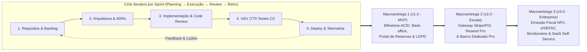
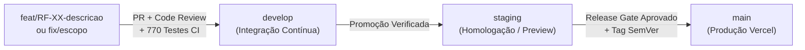
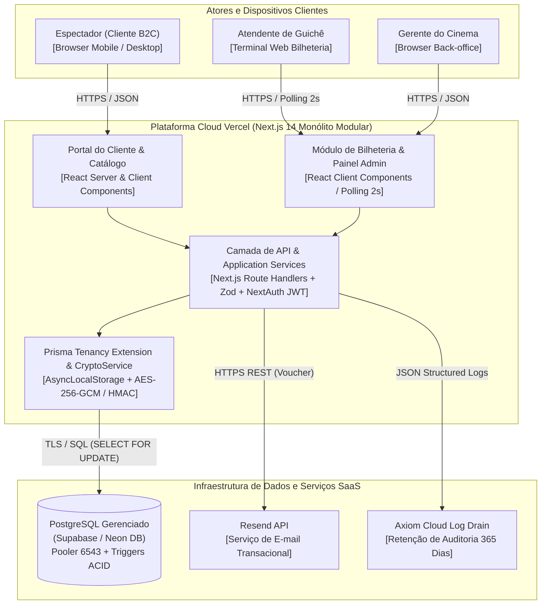
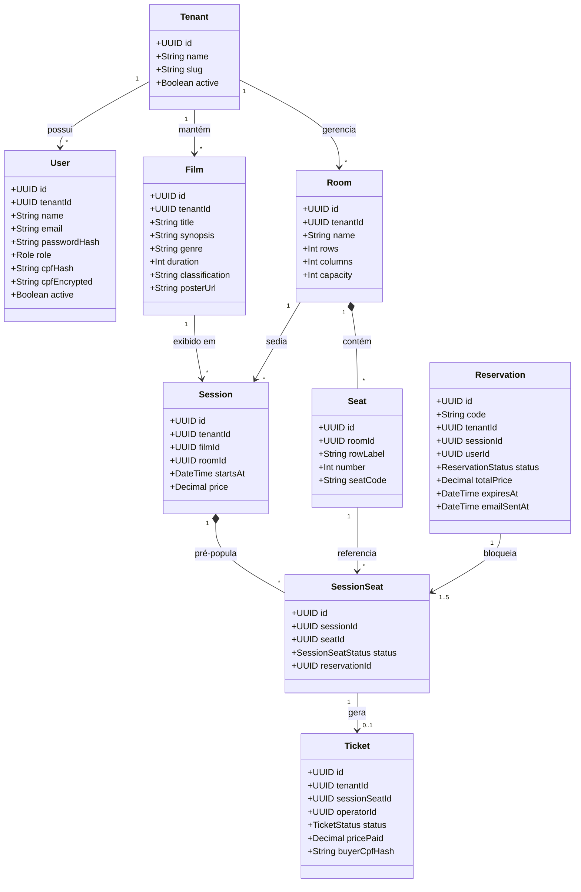
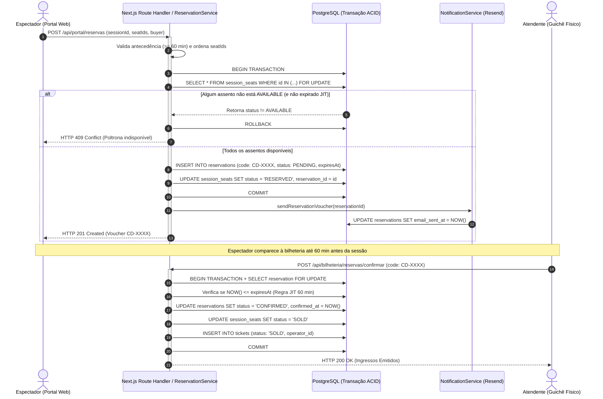
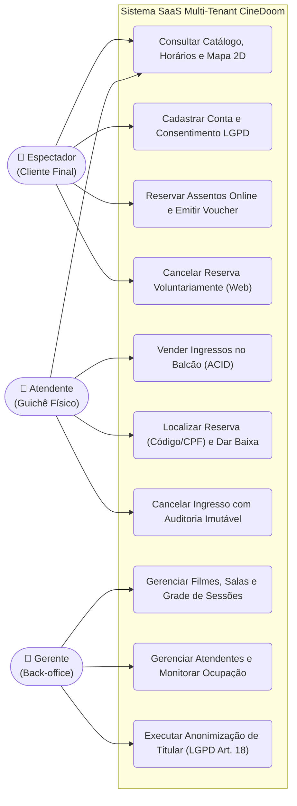
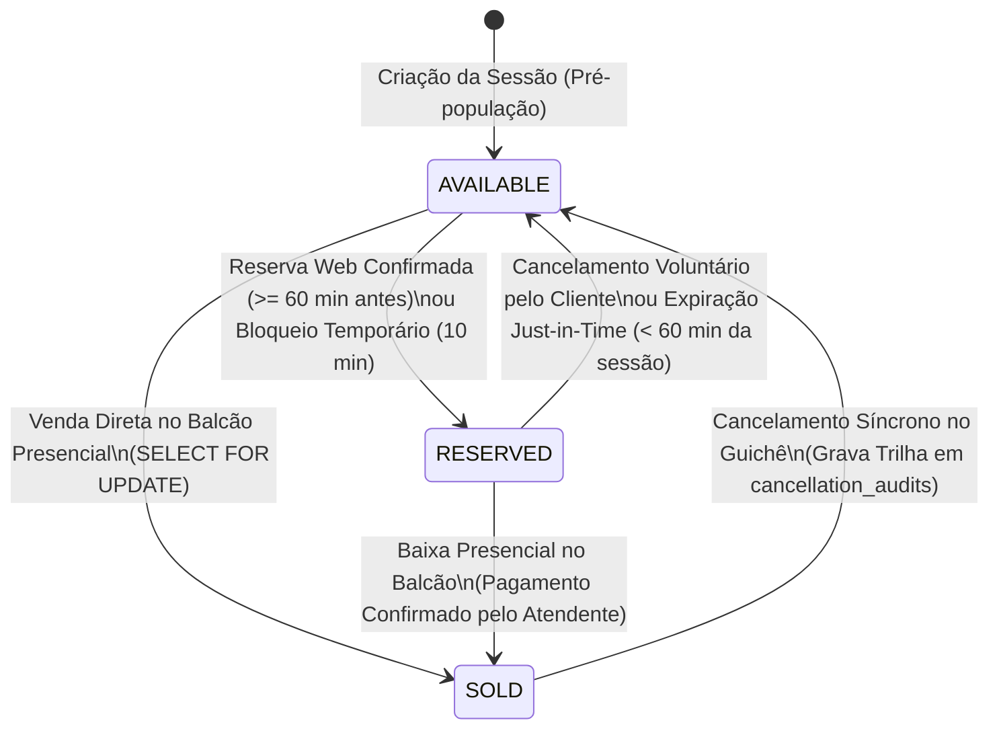
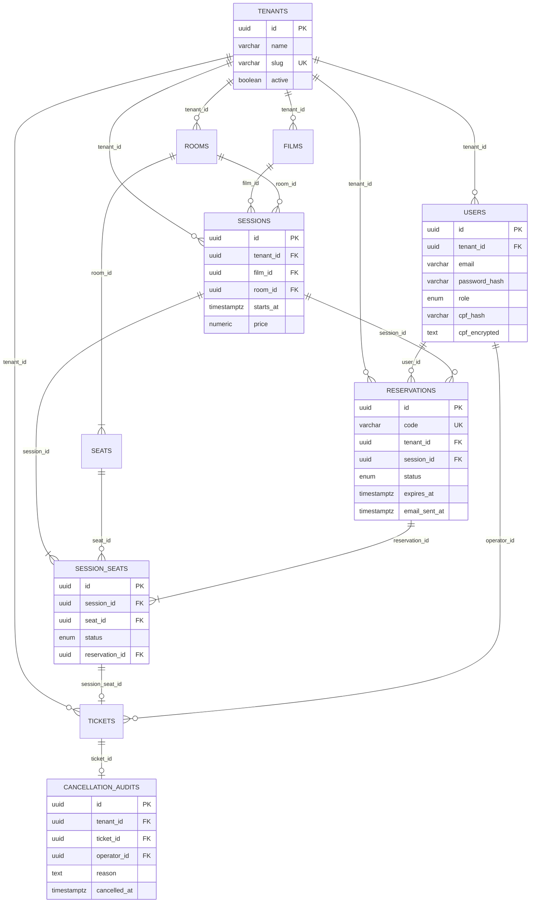

<!-- ===================================================================== -->
<!-- NOTICE: AUTO-GENERATED FILE FROM manual/capitulos/                    -->
<!-- DO NOT EDIT THIS FILE DIRECTLY. EDIT THE MODULES IN manual/capitulos/ -->
<!-- TO REBUILD: run ./scripts/compilar.sh or ./scripts/montar-manual.sh   -->
<!-- ===================================================================== -->

# Manual de Processos de Software

### Estudo de Caso: Sistema CineDoom (Plataforma de Gestão Operacional de Cinemas)

---

## 1. Identificação da Equipe e Instituição (Capa e Folha de Rosto)

**Empresa / Equipe:** CineSoft Solutions  
**Produto:** CineDoom — Plataforma de Gestão Operacional e Bilheteria de Cinemas  

**Membros da Equipe (Engenheiros de Software):**
- **Carlos Eduardo Freire da Silva** — Engenheiro de Backend, Segurança & DevOps
- **Gabriel Henrique Lourenço Dias** — Tech Lead & Arquiteto de Software
- **Kayque Vicente Silva** — Engenheiro de Qualidade (QA) & Gerente de Projetos
- **Yury Nogueira de Oliveira Silva** — Engenheiro de Requisitos, UX & Compliance

**Identificação Acadêmica e Institucional:**
- **Instituição:** Universidade Federal de Goiás (UFG) — Instituto de Informática (INF)
- **Curso:** Bacharelado em Engenharia de Software
- **Disciplina:** Processos de Engenharia de Software
- **Docente Orientadora:** Profa. Dra. Juliana Pereira de Souza Zinader
- **Período Letivo:** 2026/2
- **Local e Data:** Goiânia, Novembro de 2026

**Natureza do Trabalho Acadêmico:**  
*Manual de Processos de Software apresentado à disciplina de Processos de Engenharia de Software do curso de Bacharelado em Engenharia de Software da Universidade Federal de Goiás (UFG), como requisito de avaliação para a obtenção da nota final integral da disciplina, referente ao Projeto Integrador.*

---

<div style="page-break-after: always;"></div>

---

## 2. Histórico de Versões do Documento

> **Documento Controlado:** Qualquer alteração neste manual deve ser formalmente registrada nesta tabela e, quando impactar definições de negócio, arquitetura ou escopo, refletida no catálogo de decisões de arquitetura e especificações do projeto (`specs/`).

| Data | Versão | Descrição Sucinta da Alteração |
| :---: | :---: | :--- |
| 10/09/2026 | Versão 1.0 | Criação do documento, identificação da equipe e elaboração da capa. |
| 16/09/2026 | Versão 1.1 | Elaboração dos itens do Capítulo 1 (Apresentação do Software). |
| 24/09/2026 | Versão 1.2 | Alinhamento dos Capítulos 1, 2 e 3 à norma ISO/IEC/IEEE 12207:2021. |
| 24/09/2026 | Versão 1.3 | Revisão técnica: correção de contradições e justificativas de aquisição. |
| 08/10/2026 | Versão 1.4 | Incremento e estruturação dos processos do Capítulo 4 (Gerenciamento Técnico). |
| 17/10/2026 | Versão 1.5 | Reestruturação da capa e padronização do controle documental. |
| 22/10/2026 | Versão 1.6 | Padronização formal da estrutura editorial dos Capítulos 1 a 5. |
| 23/10/2026 | Versão 1.7 | Incorporação do Portal do Cliente, reserva ACID, e-mail e LGPD (ADR-012). |
| 09/11/2026 | Versão 2.0 | Consolidação em 3 Macroentregas, matrizes Make-or-Buy, Pugh, EAP e Cap. 6 (MPS.BR). |

*Fonte: Elaborado pelos autores (2026).*

---

<div style="page-break-after: always;"></div>

---

## 3. Lista de Figuras

| Identificador | Título da Figura |
| :---: | :--- |
| **Figura 1** | Portal do Cliente: catálogo de filmes e mapa interativo de assentos |
| **Figura 2** | Bilheteria presencial: mapa de assentos e operação de guichê |
| **Figura 3** | Back-office gerencial: programação de sessões e indicadores de ocupação |
| **Figura 4** | Diagrama de Classes do Domínio de Negócios CineDoom |
| **Figura 5** | Diagrama de Sequência UML: Reserva Web e Emissão de Voucher |
| **Figura 6** | Diagrama C4 Nível 2: Contêineres da Plataforma CineDoom |
| **Figura 7** | Diagrama de Máquina de Estados do Ciclo de Vida da Poltrona |
| **Figura 8** | Diagrama Entidade-Relacionamento (DER) do Banco PostgreSQL |

---

<div style="page-break-after: always;"></div>

---

## 4. Lista de Tabelas

| Identificador | Título da Tabela |
| :---: | :--- |
| **Tabela 1** | Matriz de Perfis de Usuários e Permissões de Acesso |
| **Tabela 2** | Análise de Aquisição: Componentes de Software e Domínio (Make or Buy) |
| **Tabela 3** | Análise de Aquisição: Infraestrutura Cloud e Serviços Gerenciados (Make or Buy) |
| **Tabela 4** | Perspectiva de Fornecimento e Ativos Comercializáveis |
| **Tabela 5** | Acordo de Nível de Serviço (SLA) e Suporte Pós-Entrega |
| **Tabela 6** | Identificação dos Fornecedores e Parceiros Relevantes |
| **Tabela 7** | Inventário de Infraestrutura e Ferramentas |
| **Tabela 8** | Composição da Equipe e Competências Técnicas Requeridas |
| **Tabela 9** | Matriz RACI de Responsabilidades por Membro da Equipe |
| **Tabela 10** | Escopo e Marcos Comerciais por Macroentrega (Milestones) |
| **Tabela 11** | Cronograma Executivo e Pacotes de Trabalho por Sprint |
| **Tabela 12** | Plano de Recursos Humanos e Operacionais |
| **Tabela 13** | Matriz de Riscos do Produto e Ações Preventivas (Risk Register) |
| **Tabela 14** | Matriz de Decisão Ponderada (Pugh Matrix) — Arquitetura Base |
| **Tabela 15** | Quadro Sinóptico de Decisões de Arquitetura: Stack e Persistência (ADR-001 a ADR-006) |
| **Tabela 16** | Quadro Sinóptico de Decisões de Arquitetura: Concorrência e Resiliência (ADR-007 a ADR-012) |
| **Tabela 17** | Indicadores e Métricas de Monitoramento do Projeto |
| **Tabela 18** | Catálogo Formal de Requisitos Funcionais: Domínio e Bilheteria (RF-01 a RF-09) |
| **Tabela 19** | Catálogo Formal de Requisitos Funcionais: Governança, Portal e Notificações (RF-10 a RF-18) |
| **Tabela 20** | Catálogo Formal de Requisitos Não Funcionais (ISO/IEC 25010) |
| **Tabela 21** | Matriz de Rastreabilidade Bidirecional de Requisitos |
| **Tabela 22** | Mapeamento de Stakeholders e Técnicas de Elicitação |
| **Tabela 23** | Distinção Conceitual entre Verificação e Validação |
| **Tabela 24** | Critérios Formais de Entrada e Saída de V&V |
| **Tabela 25** | Relatório de Testes de Aceitação e Homologação em Produção |
| **Tabela 26** | Diagnóstico de Avaliação e Maturidade de Processo (Versão 1.7) |
| **Tabela 27** | Plano de Melhoria de Processo de Software (PMP) |
| **Tabela 28** | Quadro Comparativo: Antes vs. Depois da Revisão de Processos |
| **Tabela 29** | Reavaliação Pós-Melhoria da Conformidade do Manual (Versão 2.0) |

---

<div style="page-break-after: always;"></div>

---

## 5. Lista de Abreviaturas e Siglas

| Sigla | Significado Completo | Sigla | Significado Completo |
| :---: | :--- | :---: | :--- |
| **ABNT** | Associação Brasileira de Normas Técnicas | **MPS.BR** | Melhoria de Processo do Software Brasileiro |
| **ADR** | *Architecture Decision Record* | **MTTR** | *Mean Time To Recovery* |
| **API** | *Application Programming Interface* | **MVP** | *Minimum Viable Product* |
| **B2B / B2C** | *Business-to-Business / Consumer* | **NFC-e** | Nota Fiscal de Consumidor Eletrônica |
| **CI / CD** | *Continuous Integration / Deployment* | **ORM** | *Object-Relational Mapping* |
| **DoD / DoR** | *Definition of Done / Definition of Ready* | **PaaS** | *Platform as a Service* |
| **GPP** | Gerência de Portfólio de Projetos | **PIX** | Pagamento Instantâneo Brasileiro |
| **GPR** | Gerência de Projetos (MPS.BR — Nível G) | **PMP** | Plano de Melhoria de Processo |
| **GQM** | *Goal-Question-Metric* | **PPR** | Processo Padrão de Requisitos |
| **GQA** | Garantia da Qualidade (MPS.BR — Nível F) | **QA** | *Quality Assurance* |
| **GCO** | Gerência de Configuração (MPS.BR — Nível F) | **RBAC** | *Role-Based Access Control* |
| **IEC** | *International Electrotechnical Commission* | **SaaS** | *Software as a Service* |
| **IEEE** | *Institute of Electrical and Electronics Engineers* | **SLA / SLO** | *Service Level Agreement / Objective* |
| **ISO** | *International Organization for Standardization* | **SPICE** | ISO/IEC 15504 Process Improvement |
| **JWT** | *JSON Web Token* (RFC 7519) | **UFG** | Universidade Federal de Goiás |
| **LGPD** | Lei Geral de Proteção de Dados (Lei 13.709/2018) | **UI / UX** | *User Interface / User Experience* |
| **MED** | Medição (MPS.BR — Nível F) | **V&V** | Verificação e Validação |
| **WBS / EAP** | *Work Breakdown Structure* (Estrutura Analítica do Projeto) | | |

---

<div style="page-break-after: always;"></div>

---

## 6. Sumário

- [Capítulo 1 – Apresentação do software](#capítulo-1--apresentação-do-software)
  - [1.1 Nome e descrição do software](#11-nome-e-descrição-do-software)
  - [1.2 Qual é o software? O que ele faz? Qual problema resolve?](#12-qual-é-o-software-o-que-ele-faz-qual-problema-resolve)
    - [O que ele faz?](#o-que-ele-faz)
    - [Qual problema resolve?](#qual-problema-resolve)
    - [Proposta de valor](#proposta-de-valor)
  - [1.3 Público-alvo e contexto de uso](#13-público-alvo-e-contexto-de-uso)
  - [1.4 Quem vai usar? Em que situação? Qual o ambiente de operação esperado?](#14-quem-vai-usar-em-que-situação-qual-o-ambiente-de-operação-esperado)
    - [Perfis de Usuários](#perfis-de-usuários)
    - [Ambiente de Operação Esperado](#ambiente-de-operação-esperado)
  - [1.5 Escopo e principais funcionalidades](#15-escopo-e-principais-funcionalidades)
    - [Escopo Central e Módulos do Sistema](#escopo-central-e-módulos-do-sistema)
    - [Fora do escopo imediato da Macroentrega 1](#fora-do-escopo-imediato-da-macroentrega-1)
  - [1.6 Restrições e premissas](#16-restrições-e-premissas)
    - [Restrições](#restrições)
    - [Premissas](#premissas)
- [Capítulo 2 – Processos de Acordo](#capítulo-2--processos-de-acordo)
  - [2.1 Descrição do processo de aquisição](#21-descrição-do-processo-de-aquisição)
    - [Fronteira e Justificativa de Aquisição](#fronteira-e-justificativa-de-aquisição)
    - [Análise de Aquisição (Make or Buy)](#análise-de-aquisição-make-or-buy)
    - [As Cinco Atividades do Processo de Aquisição (ISO 12207)](#as-cinco-atividades-do-processo-de-aquisição-iso-12207)
  - [2.2 Descrição do processo de fornecimento](#22-descrição-do-processo-de-fornecimento)
    - [Perspectiva de Fornecimento e Ativos Comercializáveis](#perspectiva-de-fornecimento-e-ativos-comercializáveis)
    - [Termos do Acordo, Entregáveis e Evolução por Macroentregas](#termos-do-acordo-entregáveis-e-evolução-por-macroentregas)
    - [Critérios de Aceite Formal pelo Cliente Adquirente](#critérios-de-aceite-formal-pelo-cliente-adquirente)
    - [Acordo de Nível de Serviço (SLA) e Suporte Pós-Entrega](#acordo-de-nível-de-serviço-sla-e-suporte-pós-entrega)
  - [2.3 Identificação dos fornecedores e parceiros relevantes](#23-identificação-dos-fornecedores-e-parceiros-relevantes)
- [Capítulo 3 – Processos Organizacionais Habilitadores](#capítulo-3--processos-organizacionais-habilitadores)
  - [3.1 Modelo de ciclo de vida adotado e justificado](#31-modelo-de-ciclo-de-vida-adotado-e-justificado)
    - [Estrutura das Fases, Cerimônias e Macroentregas](#estrutura-das-fases-cerimônias-e-macroentregas)
    - [Justificativa da Escolha do Modelo](#justificativa-da-escolha-do-modelo)
  - [3.2 Inventário de infraestrutura e ferramentas necessárias](#32-inventário-de-infraestrutura-e-ferramentas-necessárias)
  - [3.3 Justificativa estratégica e viabilidade do projeto](#33-justificativa-estratégica-e-viabilidade-do-projeto)
  - [3.4 Papéis, competências e plano de capacitação (RACI)](#34-papéis-competências-e-plano-de-capacitação-raci)
    - [Composição da Equipe e Competências Requeridas](#composição-da-equipe-e-competências-requeridas)
    - [Matriz RACI Consolidada por Membro da Equipe](#matriz-raci-consolidada-por-membro-da-equipe)
    - [Plano de Capacitação Técnica Contínua](#plano-de-capacitação-técnica-contínua)
  - [3.5 Plano de qualidade com critérios e métricas](#35-plano-de-qualidade-com-critérios-e-métricas)
  - [3.6 Estratégia de gestão do conhecimento](#36-estratégia-de-gestão-do-conhecimento)
- [Capítulo 4 – Processos de Gerenciamento Técnico](#capítulo-4--processos-de-gerenciamento-técnico)
  - [4.1 Plano de projeto: escopo, cronograma, recursos e entregas](#41-plano-de-projeto-escopo-cronograma-recursos-e-entregas)
    - [Estrutura Analítica do Projeto (EAP / WBS em 3 Níveis)](#estrutura-analítica-do-projeto-eap--wbs-em-3-níveis)
    - [Escopo e Marcos Comerciais por Macroentrega (Milestones)](#escopo-e-marcos-comerciais-por-macroentrega-milestones)
    - [Cronograma Detalhado de Execução da Macroentrega 1 (v1.0.0)](#cronograma-detalhado-de-execução-da-macroentrega-1-v100)
    - [Recursos](#recursos)
    - [Rotina de Acompanhamento e Tratamento de Desvios e Atrasos](#rotina-de-acompanhamento-e-tratamento-de-desvios-e-atrasos)
  - [4.2 Plano de gestão de riscos: identificação, probabilidade, impacto e respostas](#42-plano-de-gestão-de-riscos-identificação-probabilidade-impacto-e-respostas)
    - [Critérios de Classificação e Reavaliação Contínua](#critérios-de-classificação-e-reavaliação-contínua)
    - [Matriz de Riscos do Produto (Risk Register)](#matriz-de-riscos-do-produto-risk-register)
  - [4.3 Plano de gestão de configuração: controle de versões, branches e releases](#43-plano-de-gestão-de-configuração-controle-de-versões-branches-e-releases)
  - [4.4 Registro de decisões técnicas relevantes (ADRs)](#44-registro-de-decisões-técnicas-relevantes-adrs)
    - [Contextualização e Padrão Adotado (MADR)](#contextualização-e-padrão-adotado-madr)
    - [Matriz de Decisão Ponderada (Pugh Matrix) — Escolha da Arquitetura Base (ADR-001)](#matriz-de-decisão-ponderada-pugh-matrix--escolha-da-arquitetura-base-adr-001)
    - [Fichas Estruturadas de Decisões Arquiteturais (ADR-001 a ADR-012)](#fichas-estruturadas-de-decisões-arquiteturais-adr-001-a-adr-012)
  - [4.5 Métricas de acompanhamento do projeto](#45-métricas-de-acompanhamento-do-projeto)
- [Capítulo 5 – Processos Técnicos](#capítulo-5--processos-técnicos)
  - [5.1 Requisitos](#51-requisitos)
    - [5.1.1 Catálogo formal de requisitos](#511-catálogo-formal-de-requisitos)
    - [5.1.2 Matriz de rastreabilidade bidirecional de requisitos](#512-matriz-de-rastreabilidade-bidirecional-de-requisitos)
    - [5.1.3 Critérios de aceitação (CA-01 a CA-14)](#513-critérios-de-aceitação-ca-01-a-ca-14)
    - [5.1.4 Mapeamento de partes interessadas e técnicas de elicitação](#514-mapeamento-de-partes-interessadas-e-técnicas-de-elicitação)
  - [5.2 Arquitetura e Design](#52-arquitetura-e-design)
    - [5.2.1 Visão Geral e Princípios Arquiteturais](#521-visão-geral-e-princípios-arquiteturais)
    - [5.2.2 Diagramas Arquiteturais e de Domínio](#522-diagramas-arquiteturais-e-de-domínio)
  - [5.3 Implementação e Integração](#53-implementação-e-integração)
  - [5.4 Verificação, Validação e Transição](#54-verificação-validação-e-transição)
    - [5.4.1 Distinção formal entre Verificação e Validação](#541-distinção-formal-entre-verificação-e-validação)
    - [5.4.2 Critérios de aceitação por stakeholder](#542-critérios-de-aceitação-por-stakeholder)
    - [5.4.3 Relatório de testes de aceitação (Homologação e Produção)](#543-relatório-de-testes-de-aceitação-homologação-e-produção)
  - [5.5 Operação, Manutenção e Descontinuação](#55-operação-manutenção-e-descontinuação)
- [Capítulo 6 – Avaliação e melhoria dos processos de software](#capítulo-6--avaliação-e-melhoria-dos-processos-de-software)
  - [6.1 Referencial e recorte](#61-referencial-e-recorte)
  - [6.2 Diagnóstico do manual](#62-diagnóstico-do-manual)
  - [6.3 Plano de uma melhoria](#63-plano-de-uma-melhoria)
  - [6.4 Atualização e verificação](#64-atualização-e-verificação)
  - [6.5 Acompanhamento da execução](#65-acompanhamento-da-execução)


# Capítulo 1 – Apresentação do software

## 1.1 Nome e descrição do software

**Nome do software:** CineDoom.

O CineDoom é uma plataforma web integrada, no modelo **SaaS multi-tenant**, de gerenciamento operacional, bilheteria presencial e portal do cliente, voltada para **cinemas de rua, circuitos independentes e redes de pequeno e médio porte**. O sistema permite que os cinemas informatizem seus processos com três módulos centrais:

1. **Módulo do Atendente (Bilheteria Presencial):** Operação ágil de guichê físico, emissão direta de ingressos com trava atômica anti-double-booking e baixa presencial de reservas originadas na web.
2. **Módulo do Gerente (Back-office e Gestão):** Configuração de salas, catálogo de filmes, agendamento de sessões, gestão de operadores e acompanhamento de indicadores de ocupação.
3. **Portal do Cliente (Espectador Final Web):** Canal público e autenticado no qual o público consulta a programação, cadastra-se com proteção de dados LGPD, seleciona assentos no mapa interativo, solicita reservas com emissão de voucher transacional e gerencia suas reservas via web.

A **CineSoft Solutions** é uma empresa de engenharia de software B2B especializada em soluções transacionais para o setor de entretenimento e exibição cinematográfica. O **CineDoom** posiciona-se como seu produto principal para unificar o atendimento digital (B2C) e a operação física de bilheteria (B2B) sob um único motor relacional, com isolamento multi-tenant estrito e conformidade nativa com a LGPD. O ciclo de evolução comercial do produto é organizado em **três Macroentregas** (Macroentrega 1: MVP Operacional implantado; Macroentrega 2: Pagamentos Online, Mensageria Dedicada e Escala Cloud; Macroentrega 3: Emissão Fiscal NFC-e, Bomboniere e Billing Self-Service), regido pelos processos da norma ABNT NBR ISO/IEC/IEEE 12207:2021.

## 1.2 Qual é o software? O que ele faz? Qual problema resolve?

O CineDoom é um sistema SaaS multi-tenant que integra a operação de bilheteria, o back-office do cinema e o portal do espectador em uma única plataforma transacional.

### O que ele faz?

O CineDoom centraliza e sincroniza todas as etapas da cadeia de atendimento cinematográfico em uma interface web moderna e unificada:

- Mantém o catálogo de filmes em cartaz e suas especificações técnicas.
- Controla a infraestrutura física de salas e layouts bidimensionais de assentos.
- Agenda e disponibiliza sessões cinematográficas com prevenção automática de choques de grade.
- Garante reservas online no Portal do Cliente com bloqueio atômico de assento e expiração lógica Just-in-Time (JIT).
- Despacha vouchers transacionais de reserva por e-mail com instruções para pagamento presencial.
- Permite o cancelamento voluntário de reservas pendentes pelo próprio cliente via web antes do limite de tolerância.
- Opera a venda e a baixa presencial de ingressos na bilheteria com trava atômica ACID (*SELECT FOR UPDATE*), eliminando riscos de venda dupla (*double-booking*).
- Apresenta métricas gerenciais consolidadas sob demanda sobre a taxa de ocupação das salas e a distribuição de assentos vendidos e reservados.

### Qual problema resolve?

Cinemas independentes frequentemente operam com sistemas legados fragmentados ou controles manuais, resultando em:

1. **Conflito de assentos:** Risco crítico de venda simultânea da mesma poltrona em sessões concorridas.
2. **Inacessibilidade para o público:** Dificuldade do espectador em consultar a grade de horários e planejar sua ida ao cinema com antecedência.
3. **Assentos ociosos por no-show:** Falta de regras claras para liberação de lugares não confirmados.
4. **Ausência de rastreabilidade e compliance:** Descumprimento das exigências da LGPD no manuseio de dados de compradores e ausência de trilha auditável de cancelamentos.

O CineDoom elimina esses problemas ao unificar o canal digital do cliente e a bilheteria presencial sob o mesmo motor relacional transacional e auditável.

### Proposta de valor

O CineDoom entrega um único motor transacional e auditável para os canais físico e digital. Na prática, isso reduz o risco de venda dupla, libera assentos não confirmados para reaproveitamento, diminui a dependência de controles manuais e trata os dados pessoais dos compradores conforme a LGPD.

## 1.3 Público-alvo e contexto de uso

O público-alvo é composto por:

- **Público de negócio (B2B):** cinemas de rua, circuitos independentes e redes de pequeno e médio porte que precisam informatizar a bilheteria, a programação e a gestão de salas.
- **Público final (B2C):** espectadores que utilizam o Portal do Cliente para consultar filmes, reservar seus assentos preferidos e gerenciar seus comprovantes antes de comparecer à sessão.
- **Público operacional (usuários diretos):** gerentes e atendentes que operam o back-office e a bilheteria no dia a dia do cinema.
- **Público indireto:** equipe de suporte e operação da CineSoft Solutions e provedores de infraestrutura que sustentam a plataforma.

O contexto de uso abrange:

- **Portal do Cliente (web desktop e mobile):** acesso pelo espectador para consulta de horários, cadastro pessoal e reserva antecipada com voucher digital.
- **Ambiente de bilheteria física:** atendimento presencial ágil para venda direta ou localização e baixa de reservas prévias pelo atendente. Os indicadores de desempenho desse ambiente são definidos e verificados no Capítulo 5.
- **Ambiente administrativo:** planejamento semanal de exibições, cadastro de acervo e monitoramento de lotação pela gerência.

A Figura 1 ilustra a interface do Portal do Cliente, com o catálogo de filmes em cartaz e o mapa interativo de assentos utilizado pelo espectador.


*Figura 1 – Portal do Cliente: catálogo de filmes em cartaz e mapa interativo de assentos*

## 1.4 Quem vai usar? Em que situação? Qual o ambiente de operação esperado?

### Perfis de Usuários

- **Espectador / Cliente Final:** Acessa o Portal do Cliente para consultar a programação, efetuar cadastro/login com credenciais seguras, selecionar assentos no mapa interativo, reservar ingressos com expiração Just-in-Time, receber comprovante por e-mail transacional, acompanhar seu histórico pessoal em "Minhas Reservas" e cancelar reservas antes do prazo limite.
- **Atendente:** Opera o guichê presencial. Consulta sessões, seleciona assentos, localiza reservas web por código ou CPF, confirma o recebimento presencial, emite ingressos e executa cancelamentos justificados.
- **Gerente:** Administra o back-office (salas, acervo de filmes, sessões de exibição), acompanha os painéis de ocupação e gerencia os usuários com perfil ATENDENTE.
- **Administrador da plataforma (perfil previsto, não disponível no MVP):** Responsável pela parametrização global, auditoria de logs e gestão de tenants. Na versão atual, essas atividades são conduzidas pela operação técnica da CineSoft Solutions; o produto entregue contempla os perfis Gerente, Atendente e Cliente.

### Ambiente de Operação Esperado

- **Hardware:** Computadores e tablets nos pontos de venda físicos; smartphones, notebooks e desktops pessoais para os espectadores no Portal do Cliente.
- **Software:** Navegadores web modernos com suporte a ECMAScript atual (Google Chrome, Mozilla Firefox, Safari, Microsoft Edge).
- **Conectividade:** Conexão estável com a internet, uma vez que a operação é realizada em navegador e o processamento ocorre em nuvem.
- **Pagamento das Reservas:** O pagamento de ingressos reservados via web é concluído exclusivamente de forma presencial no balcão da bilheteria até 1 hora antes da sessão, eliminando a dependência de gateway financeiro online e reduzindo a superfície de fraude em transações digitais.

A Figura 2 apresenta a interface da bilheteria presencial, utilizada pelo atendente para a venda direta de ingressos e a baixa de reservas originadas no portal.


*Figura 2 – Bilheteria presencial: mapa de assentos, venda direta e baixa de reservas pelo atendente.*

## 1.5 Escopo e principais funcionalidades

### Escopo Central e Módulos do Sistema

1. **Módulo de Filmes:** Acervo com título, sinopse, classificação indicativa, duração e material promocional.
2. **Módulo de Salas e Assentos:** Mapeamento bidimensional flexível (fileiras e colunas) e controle de capacidade física.
3. **Módulo de Sessões:** Composição de Filme + Sala + Horário + Preço, com validação de conflitos de horário.
4. **Módulo de Bilheteria Presencial:** Venda atômica direta, cancelamento auditável com trilha append-only protegida por trigger PostgreSQL e baixa presencial de reservas.
5. **Portal do Cliente:** Consulta de sessões, autenticação com proteção de dados LGPD, mapa interativo de assentos com reserva temporária, despacho de e-mail transacional, painel de reservas e cancelamento voluntário web.
6. **Módulo de Ocupação:** Painel consolidado sob demanda da taxa de lotação por sessão.
7. **Módulo de Autenticação e Controle de Acesso:** Login com sessão JWT de 8 horas, RBAC para os perfis Gerente, Atendente e Cliente e revogação imediata do acesso de usuário inativado.
8. **Módulo de Gestão de Usuários:** Criação, atualização e inativação de atendentes pelo gerente, com e-mail único por tenant.
9. **Módulo de Conformidade e Privacidade (LGPD):** Consentimento explícito, criptografia de CPF, anonimização do titular e auditoria de cancelamentos.
10. **Módulo de Notificações Transacionais:** Envio de voucher de reserva por e-mail, com provedor configurável conforme o ambiente.

A Figura 3 apresenta o painel gerencial do back-office, com a programação de sessões e os indicadores de ocupação acompanhados pela gerência.


*Figura 3 – Back-office gerencial: programação de sessões e indicadores de ocupação das salas*

### Fora do escopo imediato da Macroentrega 1 (Planejados nas Macroentregas 2 e 3)

Os seguintes módulos não compõem o escopo da **Macroentrega 1 (`Release 1.0 — MVP Operacional`)**, estando formalmente alocados no roadmap comercial subsequente da CineSoft Solutions:

- **Macroentrega 2 (`Release 2.0`):** Gateway de pagamento online (PIX com QR Code dinâmico e cartão de crédito via Stripe/Pagar.me), despacho de e-mails transacionais em larga escala com domínio corporativo próprio (`Resend Pro`) e escalonamento para banco de dados dedicado com alta disponibilidade (`Supabase/Neon Pro`).
- **Macroentrega 3 (`Release 3.0`):** Emissão fiscal automatizada (NFC-e / SAT integrada à SEFAZ), gestão de bomboniere e estoque, programa de fidelidade/cupons, console administrativo global de tenants com faturamento SaaS recorrente (*Self-Service Billing*) e BI financeiro avançado.
- **Fora do escopo global do produto web:** Aplicativos nativos nas lojas iOS/Android (o acesso ocorre integralmente via aplicação web responsiva) e produção ou streaming de conteúdo audiovisual.

## 1.6 Restrições e premissas

### Restrições

- **Pagamento Presencial Exclusivo:** O sistema não integra gateway de pagamento online (cartão/PIX web); as reservas efetuadas no portal são pagas presencialmente no guichê do cinema até 1 hora antes do início da sessão.
- **Operação Conectada:** O sistema opera na nuvem sob arquitetura serverless (Vercel + Neon PostgreSQL), exigindo conectividade ativa.
- **Isolamento Multi-tenant Lógico:** O compartilhamento de infraestrutura é controlado por meio do `tenant_id`, aplicado por uma extensão de tenancy do Prisma Client com `AsyncLocalStorage`. O produto não utiliza `ROW LEVEL SECURITY` nativo do PostgreSQL.
- **Sem Aplicativo Nativo:** Acesso via navegador web desktop e mobile responsivo, sem empacotamento para lojas de aplicativos.
- **Conformidade LGPD:** O tratamento de dados pessoais exige consentimento explícito, criptografia de CPF (AES-256-GCM + HMAC-SHA256), minimização, anonimização do titular (Art. 18) e retenção de trilha de auditoria. O CPF não é armazenado em texto puro.
- **Limites de Layout Físico:** As salas suportam até 26 fileiras (A–Z) e 50 assentos por fileira.
- **Trilha de Auditoria Imutável:** Os registros de cancelamento são append-only; a proteção depende da aplicação da trigger `trg_protect_cancellation_audits` no PostgreSQL.
- **Dependência de Provedor de E-mail:** O envio do voucher transacional depende de um provedor configurado; em desenvolvimento, o envio é registrado no console.
- **Funcionalidades Descartadas do MVP:** Streaming de vídeo, emissão fiscal externa (NFC-e), fidelidade por pontos e gestão de bomboniere, conforme detalhado na seção 1.5.

### Premissas

- **Concorrência de Assentos:** A trava pessimista `SELECT FOR UPDATE`, a ordenação prévia dos IDs de assento e a checagem Just-in-Time impedem, por design, conflitos de assentos entre clientes web e atendentes físicos.
- **Antecedência Mínima:** As reservas online realizadas com menos de 1 hora de antecedência em relação ao início da sessão são bloqueadas pelo sistema, reservando o inventário restante para o balcão.
- **Expiração Lógica:** As reservas não quitadas presencialmente até 60 minutos antes do início do filme deixam de ser confirmáveis e seus assentos passam a ser elegíveis para reaproveitamento. A expiração é lógica/Just-in-Time, sem job de varredura automática.
- **Contexto de Tenant:** O tenant é resolvido a partir da sessão autenticada e todas as operações de dados são filtradas por `tenant_id`.


# Capítulo 2 – Processos de Acordo

## 2.1 Descrição do processo de aquisição

O processo de aquisição (ABNT NBR ISO/IEC/IEEE 12207:2021 – Cláusula 6.1.1) estabelece a governança da **CineSoft Solutions** para decidir entre desenvolver internamente ou contratar/adquirir de terceiros os componentes, bibliotecas, APIs e serviços de infraestrutura que sustentam o produto **CineDoom** ao longo de suas três Macroentregas.

### Fronteira e Justificativa de Aquisição

A estratégia de engenharia da CineSoft Solutions concentra o esforço de desenvolvimento interno estritamente nos ativos que constituem o **núcleo de valor e diferencial competitivo** do CineDoom: o motor transacional de bilheteria e reservas com bloqueio pessimista ACID (*SELECT FOR UPDATE*), a máquina de estados de assentos com expiração *Just-in-Time*, o isolamento lógico multi-tenant e a camada de conformidade e anonimização da LGPD.

Em contrapartida, serviços de infraestrutura em nuvem, bancos de dados gerenciados, entrega de e-mails transacionais, retenção externa de logs, processamento financeiro PCI-DSS e mensageria fiscal SEFAZ são adquiridos de provedores especializados para reduzir o *time-to-market*, otimizar o Custo Total de Propriedade (TCO) e garantir Acordos de Nível de Serviço (SLA $\ge 99,9\%$).

### Tabela de Análise de Aquisição (*Make or Buy*)

A tabela a seguir consolida a decisão formal para cada elemento arquitetural do sistema, classificando a aquisição em **Sim** (solução madura/commodity adquirida pronta), **Não** (regra de negócio central desenvolvida internamente) ou **Parcial** (engine ou biblioteca externa combinada com regras de domínio proprietárias da CineSoft):

| Elemento do sistema | Adquirir pronto? | Justificativa | Possível fornecedor |
| :--- | :---: | :--- | :--- |
| **Motor de Bilheteria e Reserva Atômica ACID** | **Não** | Regra de negócio central e diferencial competitivo; exige controle estrito sobre locks de linha (`SELECT FOR UPDATE`), ordenação anti-deadlock e expiração *Just-in-Time*. | Desenvolvimento interno (CineSoft Solutions) |
| **Isolamento Multi-Tenant e Governança de Dados** | **Não** | Núcleo arquitetural do modelo SaaS B2B; requer injeção determinística de `tenant_id` em todas as queries e proteção contra vazamento *cross-tenant*. | Desenvolvimento interno sobre Prisma Client Extensions |
| **Módulo de Criptografia e Anonimização LGPD** | **Não** | Requisito legal crítico (Art. 18 e Art. 46 da LGPD) acoplado ao domínio fiscal de ingressos; combina `HMAC-SHA256` e `AES-256-GCM` nativos. | Desenvolvimento interno (`Node.js crypto`) |
| **Autenticação, Sessão JWT e Controle RBAC** | **Parcial** | A gestão de tokens criptográficos e cookies HTTP-only utiliza biblioteca consolidada, mas a política RBAC (`GERENTE`, `ATENDENTE`, `CLIENTE`), escopo por tenant e revogação são próprios. | `NextAuth.js` + Middleware proprietário CineSoft |
| **Interface Gráfica e Mapa Interativo de Salas** | **Parcial** | Primitivas estilísticas e ícones são acelerados por bibliotecas de mercado, porém a matriz bidimensional reativa de poltronas e o fluxo de guichê são proprietários. | `Tailwind CSS`, `Lucide Icons` + Componentes CineSoft |
| **ORM e Validação de Schemas de Entrada** | **Sim** | Bibliotecas de padrão industrial com alta segurança de tipos e prevenção nativa de *SQL Injection*, cujo desenvolvimento próprio seria antieconômico. | `Prisma ORM` e `Zod` (Open Source / MIT) |
| **Banco de Dados Relacional Gerenciado (DBaaS)** | **Sim** | Commodity de infraestrutura crítica; contratar DBaaS garante backups automatizados *Point-in-Time (PITR)*, connection pooling (`Supavisor`/`PgBouncer`) e alta disponibilidade. | **Supabase Pro / Neon PostgreSQL** |
| **Plataforma de Hospedagem Serverless e CDN** | **Sim** | Elimina custos de administração de servidores Linux, provendo deploy atômico, proteção DDoS, SSL automático e distribuição global na borda (*Edge Network*). | **Vercel Pro** (Cloud PaaS) |
| **Serviço de Disparo de E-mails Transacionais** | **Sim** | Manter servidores SMTP próprios acarreta alto risco de bloqueio em listas de spam; API especializada assegura entregabilidade (DKIM/SPF) para os vouchers de reserva. | **Resend** (SaaS de E-mail Transacional) |
| **Observabilidade e Retenção Legal de Logs** | **Sim** | A retenção imutável de telemetria por 365 dias (Marco Civil e LGPD) exige armazenamento colunar externo de baixo custo e busca rápida. | **Axiom Cloud** (Log Drain SaaS) |
| **Gateway de Pagamento Online (Macroentrega 2)** | **Sim** | Processar cartões e PIX exige certificação internacional PCI-DSS Nível 1 e antifraude dedicado, inviáveis para internalização em uma software house B2B. | **Stripe / Pagar.me** |
| **Motor de Mensageria Fiscal NFC-e (Macroentrega 3)** | **Sim** | A comunicação direta com webservices estaduais da SEFAZ sofre constantes mudanças normativas e tributárias; API terceirizada abstrai contingência e assinatura A1. | **Focus NFe / PlugNotas** |

### As Cinco Atividades do Processo de Aquisição (ISO 12207)

A CineSoft Solutions executa a contratação e governança de fornecedores externos por meio das cinco atividades normativas:

1. **Preparação da Aquisição:** O Arquiteto de Software especifica os requisitos técnicos, operacionais, de segurança (conformidade LGPD, criptografia em trânsito TLS 1.3 e em repouso AES-256) e de capacidade para o componente a ser adquirido.
2. **Divulgação e Seleção de Fornecedores:** Levantamento de pelo menos duas alternativas de mercado para cada categoria (ex.: Supabase vs. Neon; Resend vs. AWS SES; Vercel vs. AWS Amplify), avaliadas segundo custo escalonado, SLA ($\ge 99,9\%$), latência na região das Américas e maturidade do SDK TypeScript.
3. **Estabelecimento do Acordo:** Formalização da assinatura comercial (Termos de Serviço Corporativos e *Data Processing Addendum — DPA* para proteção de dados pessoais), configuração de cotas de faturamento e provisionamento de chaves de API em cofre seguro.
4. **Monitoramento do Acordo:** Acompanhamento contínuo pelo líder de DevOps por meio de páginas de status dos provedores, alertas de latência p95/p99, consumo de conexões do pooler e auditoria mensal de faturas frente ao volume de ingressos emitidos.
5. **Aceitação do Serviço/Produto Adquirido:** Execução de testes de integração automatizados na pipeline de CI/CD e validação de homologação (*smoke tests*) antes da liberação do componente para o tráfego de produção.

---

## 2.2 Descrição do processo de fornecimento

O processo de fornecimento (ABNT NBR ISO/IEC/IEEE 12207:2021 – Cláusula 6.1.2) regulamenta como a **CineSoft Solutions** comercializa, implanta, licencia, mantém e suporta a plataforma **CineDoom** junto aos cinemas clientes e parceiros de negócio.

### Perspectiva de Fornecimento e Ativos Comercializáveis

Além da oferta integral da plataforma, a arquitetura modular da CineSoft Solutions permite o fornecimento autônomo de subsistemas de alto valor agregado para diferentes perfis de adquirentes:

| Elemento com potencial | Possível adquirente | Modelo de acordo |
| :--- | :--- | :--- |
| **Plataforma Integrada CineDoom (Bilheteria + Back-office + Portal Web)** | Cinemas de rua, circuitos independentes, centros culturais e redes exibidoras de pequeno e médio porte | **Assinatura SaaS B2B** (mensalidade base por complexo + faixa variável por sala ativa, incluindo hospedagem e suporte) |
| **Engine de Mapa Bidimensional e Trava Atômica de Assentos (API)** | Produtoras de teatro, casas de espetáculos, auditórios universitários e plataformas regionais de eventos | **Licenciamento de API Transacional** (cobrança *pay-as-you-go* por assento reservado/emitido via REST) |
| **Módulo de Governança, Criptografia de CPF e Anonimização LGPD** | Software houses parceiras de varejo e entretenimento que necessitam adequar sistemas legados ao Art. 18 da LGPD | **Licenciamento de Biblioteca / SDK Corporativo** (taxa anual de licença + consultoria de integração) |
| **Portal White-Label de Reserva Antecipada com Expiração JIT** | Redes de cinemas que já possuem ERP fiscal próprio de balcão, mas carecem de canal digital moderno para espectadores | **Fornecimento de Módulo SaaS Integrado** (mensalidade fixa com customização de identidade visual *white-label*) |

### Termos do Acordo, Entregáveis e Evolução por Macroentregas

O fornecimento comercial aos cinemas adquirentes contempla os seguintes entregáveis contratuais e evolução funcional:

- **Provisionamento de Tenant Isolado:** Criação da organização no banco de dados de produção com isolamento lógico garantido por `tenant_id`, configuração de domínio/acesso e credenciais iniciais de gerência.
- **Carga de Dados e Parametrização Inicial:** Mapeamento das salas físicas do cinema (fileiras, colunas e categorias Clássica, IMAX ou VIP) e importação da grade inicial de filmes.
- **Documentação Operacional e Capacitação:** Entrega do Manual de Operação de Guichê e sessão de treinamento remoto ou presencial para atendentes e gerentes.
- **Roadmap Contratual em 3 Macroentregas:**
  - *Macroentrega 1 (`Release 1.0` — Implantação Imediata):* Operação completa de back-office, bilheteria física atômica e portal web de reservas com pagamento presencial no balcão.
  - *Macroentrega 2 (`Release 2.0` — Expansão Digital):* Habilitação de checkout online (PIX e cartão) e disparo de e-mails transacionais com domínio dedicado do exibidor.
  - *Macroentrega 3 (`Release 3.0` — Automação Fiscal e Varejo):* Integração com SEFAZ para emissão automática de NFC-e, módulo de bomboniere e painel self-service de faturamento.

### Critérios de Aceite Formal pelo Cliente Adquirente

A entrega de cada implantação ou macroentrega é considerada formalmente aceita mediante:
1. Aprovação integral da bateria de testes automatizados (770 cenários unitários, de integração e isolamento *cross-tenant*) e homologação assistida (*UAT*).
2. Inexistência de defeitos abertos de severidade **Crítica** (bloqueio de venda ou corrupção de dados) ou **Alta**.
3. Comprovação prática de zero ocorrência de venda dupla (*double-booking*) sob disputa simultânea entre portal web e balcão físico.
4. Assinatura digital do **Termo de Aceite de Implantação (TAI)** pelo representante legal do cinema contratante.

### Acordo de Nível de Serviço (SLA) e Suporte Pós-Entrega

A CineSoft Solutions assegura disponibilidade mensal mínima de **99,9%** da plataforma e provê suporte contínuo estruturado em quatro modalidades de manutenção:

| Severidade / Modalidade | Descrição do Cenário | Tempo de 1ª Resposta | Meta de Resolução / Contorno |
| :--- | :--- | :---: | :---: |
| **Crítica (P1 — Corretiva Urgente)** | Indisponibilidade total da bilheteria ou falha na emissão de ingressos em horário de sessão. | Até **15 minutos** | Até **2 horas** (rollback imediato em < 5 min) |
| **Alta (P2 — Corretiva Prioritária)** | Degradação no painel gerencial, falha no envio de voucher por e-mail ou lentidão acima do SLA. | Até **1 hora** | Até **8 horas** |
| **Normal (P3 — Adaptativa / Preventiva)** | Ajustes de compatibilidade de navegador, dúvidas operacionais ou otimização preventiva de índices. | Até **4 horas úteis** | Até **24 horas úteis** |
| **Evolutiva (P4 — Perfectiva)** | Solicitação de novos relatórios, filtros ou melhorias de usabilidade no Portal do Cliente. | Até **2 dias úteis** | Planejada na próxima *Sprint / Release* |

---

## 2.3 Identificação dos fornecedores e parceiros relevantes

A operação contínua e comercial da plataforma CineDoom apoia-se em provedores de tecnologia de primeira linha. A tabela abaixo detalha cada fornecedor crítico, seu papel arquitetural, a estrutura de contratação escalonada entre a validação inicial (Macroentrega 1) e a operação comercial plena (Macroentregas 2 e 3), bem como os impactos em disponibilidade, custo e segurança:

| Fornecedor / Parceiro | Categoria e Serviço Prestado | Plano e Estrutura de Custo Comercial | Impacto Operacional, Disponibilidade e Mitigação de Riscos |
| :--- | :--- | :--- | :--- |
| **Vercel Inc.** | **PaaS & Edge CDN:** Hospedagem da aplicação Next.js 14, execução de funções serverless e distribuição global de ativos estáticos. | **Vercel Pro** (`US$ 20/mês` por membro de engenharia; 1 TB de banda e execução concorrente expandida). *Piloto inicial em Hobby Tier.* | **Disponibilidade e Performance:** SLA de 99,99% na borda. Impacta diretamente o acesso ao portal e à bilheteria. Mitigação: build determinístico e rollback instantâneo de release em 1 clique. |
| **Supabase Inc. / Neon Tech** | **DBaaS PostgreSQL:** Persistência relacional ACID, gerenciamento de conexões via *Supavisor* (porta `6543`) e triggers de auditoria. | **Plano Pro Comercial** (`US$ 25 a US$ 69/mês`; compute dedicado, 8 GB+ de disco SSD, backups diários e *Point-in-Time Recovery — PITR*). | **Segurança e Integridade:** Crítico para evitar perda de vendas e garantir locks `SELECT FOR UPDATE`. Mitigação: replicação automática, conexões TLS obrigatórias e scripts de migração versionados no Prisma. |
| **Resend Technologies** | **Comunicação Transacional (SaaS):** API REST para entrega de vouchers de reserva e confirmações de ingresso com autenticação DKIM/SPF. | **Resend Pro** (`US$ 20/mês` para 50.000 e-mails/mês, domínios corporativos verificados `@cinedoom.com.br` e sem limite diário). | **Experiência do Cliente:** Impacta o recebimento do comprovante por e-mail (`CA-11`). Mitigação: desacoplamento via interface `EmailProvider` e exibição imediata do voucher na tela e na área *"Minhas Reservas"*. |
| **Axiom Inc.** | **Observabilidade e Log Drain:** Ingestão contínua de logs estruturados JSON e retenção de longo prazo para auditoria. | **Axiom Cloud Plan** (`US$ 25/mês` com ingestão de até 1 TB/mês e retenção estendida de 365 dias). | **Conformidade Legal (LGPD):** Essencial para rastreabilidade forense e retenção de 1 ano sem onerar o banco transacional. Mitigação: mascaramento prévio de PII antes do envio do log. |
| **GitHub Inc.** | **Engenharia e CI/CD:** Repositórios Git privados, gestão de backlog (GitHub Projects) e esteira automatizada (GitHub Actions). | **GitHub Team** (`US$ 4/usuário/mês`; 3.000 minutos de Actions, branches protegidas e *Codeowners*). | **Qualidade e Governança:** Sustenta a integração contínua e o bloqueio de código defeituoso. Baixo impacto em tempo de execução de produção. |
| **Stripe Inc. / Pagar.me** *(Macroentrega 2)* | **Gateway Financeiro PCI-DSS:** Processamento de pagamentos online via PIX dinâmico e cartões de crédito no Portal do Cliente. | **Taxa Variável Transacional** (`3,99% + R$ 0,39` por cartão aprovado; `0,99%` no PIX, sem mensalidade fixa). | **Segurança Financeira:** Elimina o tráfego de dados sensíveis de cartão nos servidores da CineSoft. Mitigação: webhooks idempotentes e fallback de pagamento presencial no balcão. |
| **Focus NFe / PlugNotas** *(Macroentrega 3)* | **Mensageria Fiscal (SaaS):** Emissão, assinatura digital e transmissão de NFC-e junto às SEFAZ estaduais. | **Plano Empresarial** (`R$ 149/mês` por CNPJ emissor para até 2.000 notas fiscais, com fila de contingência offline). | **Conformidade Tributária:** Desacopla a CineSoft das variações técnicas de cada estado brasileiro, garantindo emissão assíncrona sem travar a fila física da bilheteria. |

---


# Capítulo 3 – Processos Organizacionais Habilitadores

## 3.1 Modelo de ciclo de vida adotado e justificado

A **CineSoft Solutions** adota o modelo de ciclo de vida **Iterativo e Incremental Ágil** (ABNT NBR ISO/IEC/IEEE 12207:2021 – Cláusula 6.2.1), combinando Sprints de desenvolvimento com fluxo contínuo no quadro Kanban e integração/entrega contínua (CI/CD).

### Estrutura das Fases, Cerimônias e Macroentregas

O ciclo de vida do produto **CineDoom** é organizado em **três Macroentregas evolutivas (Releases Comerciais)**, cada qual subdividida em iterações (Sprints) que percorrem obrigatoriamente cinco etapas de engenharia: **Elicitação e Refinamento de Requisitos $\to$ Arquitetura e Design $\to$ Implementação e Integração $\to$ Verificação e Validação Automatizada $\to$ Implantação em Produção (Release)**.



As cerimônias operacionais da equipe compreendem:
1. **Sprint Planning:** Seleção e quebra das tarefas no GitHub Projects, estimativa de esforço e atribuição de responsáveis e prazos.
2. **Daily Check-in Assíncrono/Síncrono:** Alinhamento diário sobre o avanço das branches, identificação de impedimentos técnicos e revisão de métricas da pipeline.
3. **Code Review & Quality Gate:** Revisão por pares obrigatória em cada Pull Request antes da mesclagem em `develop`, `staging` e `main`.
4. **Sprint Review & Homologação:** Demonstração do incremento funcional em ambiente de staging/produção e coleta de feedback com usuários reais e stakeholders.
5. **Sprint Retrospective:** Avaliação contínua do processo e registro de ações de melhoria (conforme documentado no Capítulo 6).

### Justificativa da Escolha do Modelo
1. **Decomposição Modular de Risco:** O domínio de exibição cinematográfica permite desacoplar o núcleo transacional crítico (motor ACID de assentos e multi-tenancy) de integrações externas evolutivas (gateways de pagamento e mensageria fiscal).
2. **Time-to-Market e Validação Antecipada:** A entrega da **Macroentrega 1 (`v1.0.0 — MVP Operacional`)** coloca o sistema em operação real em cinemas-piloto rapidamente, gerando valor imediato na bilheteria presencial e no portal de reservas enquanto financia a evolução das Macroentregas 2 e 3.
3. **Adaptabilidade a Mudanças Regulatórias e de Mercado:** A abordagem iterativa permite incorporar ajustes de usabilidade mobile, políticas de privacidade da LGPD e novos modelos de salas (IMAX, VIP) sem retrabalho arquitetural.

---

## 3.2 Inventário de infraestrutura e ferramentas necessárias

A gestão de infraestrutura (Cláusula 6.2.2) assegura que a CineSoft Solutions disponha de ferramentas padronizadas e ambientes resilientes para desenvolver, testar, implantar e operar o CineDoom:

| Categoria | Ferramenta / Infraestrutura | Finalidade no Projeto |
| :--- | :--- | :--- |
| **Gestão e Código** | **GitHub & GitHub Projects v2** | Hospedagem do código-fonte (Git), controle de branches protegidas, gestão do quadro Kanban, issues, milestones e revisão de Pull Requests. |
| **CI/CD e Automação** | **GitHub Actions** | Pipeline automatizada de integração e entrega contínua (validação de schema Prisma, TypeScript `tsc`, ESLint `no-cycle`, 770 testes e build). |
| **Hospedagem e Computação** | **Vercel Serverless & Edge Network** | Execução das rotas de API e Server Components do Next.js 14, distribuição global de assets na borda (CDN) e ambientes isolados de *Preview* e *Production*. |
| **Banco de Dados e ORM** | **Supabase / Neon PostgreSQL + Prisma ORM** | Persistência relacional ACID em nuvem, pooler de conexões transacional (*Supavisor* porta `6543`), migrações versionadas e triggers de auditoria imutável. |
| **Design e Prototipação** | **Figma + Tailwind CSS + Lucide** | Prototipação de alta fidelidade, construção do Design System escuro (*Dark Cinema UI*) e componentes responsivos acessíveis (WCAG 2.1 AA). |
| **Testes e Qualidade** | **Vitest + ESLint + TypeScript 5** | Execução rápida de testes unitários, de integração e de concorrência (50 threads simultâneas), análise estática de código e prevenção de dependências circulares. |
| **Observabilidade e Mensageria** | **Axiom Cloud + Resend API** | Ingestão contínua de logs estruturados com retenção legal de 365 dias (LGPD) e despacho transacional de vouchers de reserva por e-mail. |

---

## 3.3 Justificativa estratégica e viabilidade do projeto

A gestão de portfólio (Cláusula 6.2.3) avalia o alinhamento do **CineDoom** aos objetivos estratégicos da **CineSoft Solutions** sob quatro dimensões de viabilidade:

- **Alinhamento Estratégico e de Mercado:** O mercado brasileiro de exibição conta com centenas de cinemas independentes, salas de rua, centros culturais e redes regionais de pequeno e médio porte que sofrem com sistemas legados caros (cobrados por participação pesada na bilheteria) ou controles manuais em planilhas. O CineDoom posiciona a CineSoft Solutions como fornecedora de um SaaS moderno, leve e acessível para esse segmento.
- **Viabilidade Técnica:** A stack selecionada (Next.js 14 App Router, TypeScript estrito, Prisma ORM e PostgreSQL) possui maturidade industrial comprovada. A arquitetura de Monólito Modular com extensão de tenancy no Prisma elimina a sobrecarga operacional de microsserviços mantendo isolamento lógico rigoroso e garantia ACID nativa.
- **Viabilidade Operacional:** A operação 100% baseada em navegador web (desktop nos guichês físicos e mobile responsivo para espectadores) dispensa instalação de executáveis locais nas bilheterias dos cinemas clientes, reduzindo drasticamente o custo de suporte e implantação (*onboarding*).
- **Viabilidade Econômica e Financeira (TCO vs. Receita SaaS):**
  - **Fase de Validação e Homologação (Macroentrega 1):** A arquitetura *serverless* permite operar ambientes de piloto e homologação com custo fixo inicial próximo de zero, pagando apenas conforme o crescimento da demanda.
  - **Fase de Escala Comercial (Macroentregas 2 e 3):** A estrutura de custos fixos da infraestrutura comercial paga — somando **Supabase/Neon Pro** (~US$ 25/mês), **Vercel Pro** (~US$ 20/mês), **Resend Pro** (~US$ 20/mês) e **Axiom Cloud** (~US$ 25/mês), totalizando cerca de **US$ 90/mês (~R$ 480/mês)** para sustentar dezenas de cinemas simultaneamente — é integralmente coberta já pela assinatura mensal do **primeiro cliente B2B contratante** (ticket médio estimado de R$ 590 a R$ 1.290/mês por complexo exibidor), proporcionando margem bruta recorrente superior a **80%**.

---

## 3.4 Papéis, competências e plano de capacitação (RACI)

A gestão de recursos humanos (Cláusula 6.2.4) estrutura os papéis técnicos da equipe da CineSoft Solutions, mapeia as competências requeridas para a stack tecnológica e define a matriz formal de responsabilidades.

### Composição da Equipe e Competências Requeridas

| Integrante | Cargo na CineSoft Solutions | Competências Técnicas Exigidas no Stack |
| :--- | :--- | :--- |
| **Gabriel Henrique Lourenço Dias** | **Tech Lead & Arquiteto de Software** | Arquitetura Next.js 14, modelagem PostgreSQL avançada, transações ACID (`SELECT FOR UPDATE`), isolamento multi-tenant, segurança RBAC e testes de concorrência. |
| **Carlos Eduardo Freire da Silva** | **Engenheiro de Backend, Segurança & DevOps** | Criptografia aplicada (`HMAC-SHA256`, `AES-256-GCM`), conformidade LGPD, APIs RESTful com Zod, pipelines GitHub Actions, integração Resend/Axiom e deploy Vercel. |
| **Kayque Vicente Silva** | **Engenheiro de Qualidade (QA) & Gerente de Projeto** | Gestão ágil de projetos (ISO 12207 / MPS.BR), análise de riscos, automação de testes no Vitest, verificação e validação (V&V) e métricas de fluxo. |
| **Yury Nogueira de Oliveira Silva** | **Engenheiro de Requisitos, UX & Compliance** | Engenharia de requisitos (MoSCoW, BDD), modelagem arquitetural C4 e UML, modelagem de ameaças STRIDE, experiência do usuário (UI/UX) e auditoria de processos. |

### Matriz RACI Consolidada por Membro da Equipe

Conforme as diretrizes de governança organizacional, a tabela abaixo relaciona diretamente cada membro da CineSoft Solutions às macroatividades do ciclo de vida do CineDoom:

| Macroatividade / Entregável do Ciclo de Vida | Gabriel Lourenço (Tech Lead / Arquiteto) | Carlos Eduardo (Backend / DevOps) | Kayque Vicente (GP / QA Lead) | Yury Nogueira (Requisitos / Compliance) |
| :--- | :---: | :---: | :---: | :---: |
| **1. Planejamento do Projeto, Cronograma e Gestão de Riscos** | C | C | **A / R** | C |
| **2. Elicitação de Requisitos, Histórias e Matriz de Rastreabilidade** | C | I | C | **A / R** |
| **3. Arquitetura de Software, Modelagem C4/UML e ADRs** | **A / R** | C | I | R |
| **4. Modelagem de Banco de Dados, Multi-Tenancy e Triggers SQL** | **A / R** | R | I | C |
| **5. Criptografia PII (CPF), Anonimização LGPD e Threat Modeling** | A | **R** | C | **R** |
| **6. Implementação do Motor ACID de Bilheteria, Salas e Portal Web** | **A / R** | R | C | I |
| **7. Integração de Notificações (Resend), Observabilidade e CI/CD** | A | **R** | C | I |
| **8. Suíte de Testes Automatizados (Vitest), Concorrência e V&V** | R | C | **A / R** | C |
| **9. Auditoria de Qualidade do Processo e Melhoria Contínua (MPS.BR)** | C | I | **A / R** | R |

*Legenda:* **R** = Responsável pela execução (*Responsible*); **A** = Aprovador final / Dono da conta (*Accountable*); **C** = Consultado (*Consulted*); **I** = Informado (*Informed*).

### Plano de Capacitação Técnica Contínua

Para suprir lacunas técnicas e manter a alta produtividade ao longo das três Macroentregas, a CineSoft Solutions executa trilhas internas de capacitação prática (*hands-on workshops*):
1. **Concorrência e Isolamento em Bancos Relacionais:** Treinamento em bloqueios pessimistas (`SELECT ... FOR UPDATE`), prevenção de *deadlocks* por ordenação determinística de chaves e configuração de *connection pooling* com Supavisor/PgBouncer.
2. **Segurança Aplicada e Engenharia de Privacidade (LGPD):** Capacitação em criptografia simétrica autenticada (`AES-256-GCM`), indexação cega por `HMAC-SHA256` e técnicas de anonimização irreversível *in-place*.
3. **Arquitetura Serverless e Testes Automatizados de Alta Carga:** Práticas de desenvolvimento em Next.js App Router, isolamento de contexto com `AsyncLocalStorage` e simulação de baterias de estresse concorrente no Vitest.
4. **Integrações Financeiras e Fiscais (Preparação Macroentregas 2 e 3):** Estudo técnico de webhooks idempotentes do Stripe (PCI-DSS) e mensageria assíncrona de notas fiscais eletrônicas (NFC-e/SEFAZ).

---

## 3.5 Plano de qualidade com critérios e métricas

A gestão da qualidade organizacional (Cláusula 6.2.5) define padrões objetivos e bloqueios automatizados (*Quality Gates*) para assegurar que nenhuma alteração degrade a estabilidade do CineDoom em produção:

1. **Padronização Estática e Arquitetural:**
   - Tipagem estrita obrigatória (`TypeScript strict: true`) sem erros de compilação (`npm run typecheck`).
   - Proibição de dependências circulares entre módulos validada automaticamente via regra `import/no-cycle` do ESLint.
2. **Cobertura e Aprovação de Testes Automatizados:**
   - **100% de aprovação obrigatória** nas **26 suítes de teste (770 testes automatizados)** cobrindo regras de domínio, criptografia, reserva atômica, expiração JIT e 500 cenários de isolamento *cross-tenant*.
   - Cobertura mínima de **100% nas funções críticas de negócio** (emissão de ingressos, bloqueio de assentos, cancelamento auditado e anonimização LGPD).
3. **Política de Revisão de Código (*Code Review*):**
   - Nenhuma alteração é enviada diretamente para a branch `main`. Todo código deve passar por validação da esteira do GitHub Actions e revisão técnica antes da promoção entre `develop`, `staging` e `main`.
4. **Critérios de Estabilidade Pré-Deploy:**
   - Zero vulnerabilidades críticas abertas, zero erros de build e validação de *smoke test* no ambiente de *Preview/Staging* antes da liberação para os cinemas clientes.

---

## 3.6 Estratégia de gestão do conhecimento

A gestão do conhecimento (Cláusula 6.2.6) garante que o capital intelectual da CineSoft Solutions seja documentado, versionado e acessível a toda a organização, prevenindo dependência de indivíduos isolados (*bus factor*):

- **Abordagem *Docs-as-Code* (Fonte Única da Verdade):** Todas as especificações de requisitos, modelos de dados, planos de testes, manuais operacionais e diretrizes residem no controle de versão Git (`specs/` e `manual/`), evoluindo no mesmo ritmo do código-fonte.
- **Registro Formal de Decisões de Arquitetura (ADRs):** Qualquer decisão estrutural (escolha de banco, estratégia de lock, criptografia de CPF, modelo de polling ou provedor de e-mail) é imortalizada em fichas padronizadas (`ADR-001` a `ADR-012`), contendo contexto, alternativas descartadas, decisão e trade-offs.
- **Rastreabilidade viva no Código:** Os arquivos de serviço, rotas de API e suítes de teste contêm cabeçalhos padronizados referenciando os requisitos (`RF-XX`), regras de negócio (`RN-XX`) e ADRs correspondentes.
- **Base de Lições Aprendidas e Runbooks Operacionais:** Ao término de cada Sprint e Macroentrega, incidentes técnicos resolvidos (como ajustes de connection pooling, alinhamento responsivo de mapas de sala e otimizações de queries) são documentados em *runbooks* para acelerar diagnósticos futuros pela equipe de suporte.

---


# Capítulo 4 – Processos de Gerenciamento Técnico

## 4.1 Plano de projeto: escopo, cronograma, recursos e entregas

O processo de planejamento do projeto (ABNT NBR ISO/IEC/IEEE 12207:2021 – Cláusula 6.3.1) estabelece a Estrutura Analítica do Projeto (EAP/WBS), o roadmap comercial em **três Macroentregas**, o cronograma detalhado de Sprints, a alocação nominal de responsáveis e a rotina formal para monitorar o progresso e corrigir eventuais desvios.

### Estrutura Analítica do Projeto (EAP / WBS em 3 Níveis)

O diagrama abaixo decompõe o produto **CineDoom** em três níveis hierárquicos (Nível 1: Produto; Nível 2: Macroentregas e Governança; Nível 3: Pacotes de Trabalho e Entregáveis verificáveis):

```mermaid
flowchart TD
    Root["1.0 Plataforma SaaS CineDoom\n(CineSoft Solutions)"]

    Root --> M1["1.1 Macroentrega 1 (v1.0 - MVP Operacional)\nBilheteria, Back-office & Portal Web"]
    Root --> M2["1.2 Macroentrega 2 (v2.0 - Escala Comercial)\nPagamentos Online, Mensageria & Cloud Pro"]
    Root --> M3["1.3 Macroentrega 3 (v3.0 - Enterprise & Fiscal)\nNFC-e/SEFAZ, Bomboniere & SaaS Self-Service"]
    Root --> GOV["1.4 Governança, Qualidade & Segurança\nContínua (ISO 12207 / LGPD)"]

    M1 --> M1_1["1.1.1 Fundação Multi-Tenant,\nAuth RBAC & Criptografia CPF"]
    M1 --> M1_2["1.1.2 Back-office Gerencial:\nFilmes, Salas, Sessões & Ocupação"]
    M1 --> M1_3["1.1.3 Bilheteria Presencial ACID\n(SELECT FOR UPDATE) & Auditoria"]
    M1 --> M1_4["1.1.4 Portal do Cliente: Reserva Web,\nExpiração JIT & Baixa no Balcão"]

    M2 --> M2_1["1.2.1 Checkout Transparente\nStripe / Pagar.me (PIX & Cartão)"]
    M2 --> M2_2["1.2.2 Mensageria Dedicada Resend Pro\n(Domínio Próprio DKIM/SPF)"]
    M2 --> M2_3["1.2.3 Migração DBaaS Pro (PITR,\nRéplicas & Pooler Expandido)"]

    M3 --> M3_1["1.3.1 Integração Fiscal SEFAZ\n(Emissão Automática NFC-e)"]
    M3 --> M3_2["1.3.2 Módulo de Bomboniere,\nCombos & Controle de Estoque"]
    M3 --> M3_3["1.3.3 Console Admin Global:\nSelf-Service Onboarding & Billing SaaS"]

    GOV --> GOV_1["1.4.1 Pipeline CI/CD, Linter\ne 770 Testes Automatizados"]
    GOV --> GOV_2["1.4.2 Telemetria Axiom (365 dias)\ne Anonimização LGPD Art. 18"]
```



### Escopo e Marcos Comerciais por Macroentrega (Milestones)

A estratégia de produto da CineSoft Solutions divide o ciclo de vida do CineDoom em três grandes marcos contratuais de entrega:

| Marco (Milestone) | Versão Alvo | Escopo Funcional e Infraestrutura Associada | Responsável Geral | Prazo / Janela | Status |
| :--- | :---: | :--- | :---: | :---: | :---: |
| **Macroentrega 1 (MVP Operacional)** | `v1.0.0` | Núcleo Multi-tenant, RBAC (`GERENTE`, `ATENDENTE`, `CLIENTE`), criptografia CPF (`HMAC-SHA256` + `AES-256-GCM`), CRUDs de filmes/salas/sessões, bilheteria presencial atômica, portal de reservas web com expiração JIT, painel de ocupação, anonimização LGPD e deploy em produção (`RF-01` a `RF-18`). | **Gabriel Lourenço** | Out/2026 – Nov/2026 | **Concluído (Em Produção)** |
| **Macroentrega 2 (Escala & Pagamentos)** | `v2.0.0` | Integração de gateway financeiro online (PIX QR Code dinâmico e cartão de crédito via Stripe PCI-DSS), ativação do **Resend Pro** com domínio corporativo próprio (`@cinedoom.com.br`), upgrade para **Supabase/Neon Pro** (backups PITR e réplicas) e **Vercel Pro**. | **Carlos Eduardo** | Dez/2026 – Jan/2027 | **Planejado (Próxima Fase)** |
| **Macroentrega 3 (Enterprise & Fiscal)** | `v3.0.0` | Emissão fiscal eletrônica automatizada (**NFC-e / SAT** via API Focus NFe integrada à SEFAZ), módulo de bomboniere e estoque, programa de fidelidade, **Console Global de Administração de Tenants** (*Self-Service Billing*) e BI financeiro avançado. | **Kayque Vicente & Yury Nogueira** | Fev/2027 – Abr/2027 | **Backlog Evolutivo** |

### Cronograma Detalhado de Execução da Macroentrega 1 (`v1.0.0`)

A construção da Macroentrega 1 foi executada em 3 Sprints intensivas de engenharia com pacotes de trabalho atribuídos nominalmente aos engenheiros da CineSoft Solutions:

| Sprint / Iteração | Pacotes de Trabalho e Requisitos Entregues | Responsáveis Diretos | Início | Término | Status |
| :--- | :--- | :--- | :---: | :---: | :---: |
| **Sprint 1 — Fundação, Arquitetura e Segurança** | Setup Next.js 14/TypeScript (`#1`), modelagem Prisma/PostgreSQL e trigger append-only (`#2`), extensão Multi-tenant (`#3`), autenticação NextAuth/RBAC (`#4`), criptografia PII de CPF (`#5`), Log Drain Axiom (`#15`) e pipeline CI/CD (`#16`). | **Gabriel Lourenço** & **Carlos Eduardo** (Apoio: **Yury Nogueira**) | 23/10/2026 | 29/10/2026 | **100% Concluído** |
| **Sprint 2 — Back-office, Salas e Bilheteria ACID** | Design System e mapa interativo 2D (`#17`), CRUDs de filmes, salas e sessões com pré-população (`#6`, `#7`, `#8`), polling a 2s (`#9`), venda atômica com `SELECT FOR UPDATE` (`#10`) e gestão de atendentes (`#13`). | **Gabriel Lourenço** & **Carlos Eduardo** (QA: **Kayque Vicente**) | 30/10/2026 | 04/11/2026 | **100% Concluído** |
| **Sprint 3 — Portal do Cliente, Governança LGPD e QA** | Portal público e reserva web com expiração JIT (`#21`), autenticação de espectador e *"Minhas Reservas"* (`#22`), `NotificationService` e baixa de reserva no balcão (`#23`), cancelamento auditado (`#11`), painel de ocupação (`#12`), anonimização Art. 18 (`#14`) e suíte de 770 testes / 500 cenários *cross-tenant* (`#18`, `#19`). | **Gabriel Lourenço**, **Carlos Eduardo**, **Kayque Vicente** & **Yury Nogueira** | 05/11/2026 | 09/11/2026 | **100% Concluído** |

### Recursos

| Recurso / Serviço | Plano na Macroentrega 1 | Plano nas Macroentregas 2 e 3 | Finalidade no Projeto | Custo Estimado |
| :--- | :--- | :--- | :--- | ---: |
| **Vercel** (PaaS / Edge CDN) | Hobby (*free tier*) | Pro (1 assento de *deploy*) | Hospedagem do Next.js 14, CDN e ambientes de *Preview* e Produção | US$ 20/mês |
| **Neon / Supabase** (DBaaS PostgreSQL) | Free | Pro (PITR e réplicas) | Persistência ACID, *connection pooler* e migrações Prisma | US$ 25/mês |
| **Resend** (e-mail transacional) | Free (console de teste) | Pro (50 mil e-mails/mês) | Envio de vouchers e confirmações com DKIM/SPF | US$ 20/mês |
| **Axiom** (observabilidade) | Free | Cloud (1 TB/mês, 365 dias) | *Log drain* estruturado e retenção legal (LGPD) | US$ 25/mês |
| **GitHub** (código e CI/CD) | Free | Team (4 assentos) | Repositórios, Projects, Actions e branches protegidas | US$ 4/usuário |
| **Focus NFe** (mensageria fiscal) | Não utilizado | Empresarial (somente M3) | Emissão e transmissão de NFC-e à SEFAZ | R$ 149/mês |
| **Stripe / Pagar.me** (gateway financeiro) | Não utilizado | Taxa transacional (somente M2) | Checkout PIX e cartão no Portal do Cliente | 3,99% + R$ 0,39 |
| **Total estimado dos serviços base (M2 e M3)** | — | — | Vercel + Neon + Resend + Axiom | **US$ 90/mês** |

O plano é viável com os recursos disponíveis: a equipe de **4 engenheiros** atua em dedicação integral, a infraestrutura é *serverless* com cobrança *pay-as-you-go* (planos gratuitos na Macroentrega 1, com **US$ 0 de custo fixo** e cobrança apenas por uso excedente) e o custo operacional estimado dos serviços base — **US$ 90/mês** (≈ R$ 480/mês) nas Macroentregas 2 e 3 — é integralmente coberto pela receita do primeiro contrato B2B, cujo ticket médio estimado é de **R$ 590 a R$ 1.290/mês** por complexo exibidor (Cap. 3.3, Viabilidade Econômica e Financeira).

### Rotina de Acompanhamento e Tratamento de Desvios e Atrasos

Para garantir o cumprimento dos prazos e a previsibilidade das entregas, a CineSoft Solutions aplica a seguinte rotina de controle:
1. **Monitoramento Diário no Quadro Kanban (GitHub Projects):** Todo cartão de tarefa deve conter obrigatoriamente **responsável nominal**, **data-limite (deadline)**, **estimativa** e **critério de aceite**. Tarefas paradas na coluna *In Progress* por mais de **48 horas** sem commits ou atualização de status acionam um alerta automático de impedimento (*blocker*).
2. **Revisão Semanal de Sprint e Burndown:** Ao final de cada semana, o Gerente de Projeto (**Kayque Vicente**) e o Tech Lead (**Gabriel Lourenço**) auditam o percentual de pacotes concluídos versus planejados.
3. **Protocolo de Tratamento de Desvios e Atrasos:**
   - **Desvio Leve (atraso $\le 24\text{h}$ em tarefa não crítica):** Realocação de par técnico (*pair programming*) entre os desenvolvedores de backend e frontend para destravar a entrega dentro da mesma Sprint.
   - **Desvio Moderado/Crítico (bloqueio em caminho crítico ou dependência externa):** Aplicação imediata de re-priorização MoSCoW (protegendo os requisitos *Must Have* de integridade transacional e segurança LGPD) e fatiamento da funcionalidade secundária para a iteração seguinte, registrando a decisão em ata de revisão.

---

## 4.2 Plano de gestão de riscos: identificação, probabilidade, impacto e respostas

O processo de gestão de riscos (Cláusula 6.3.4) identifica continuamente ameaças técnicas, operacionais, de segurança e de fornecedores externos que possam afetar a disponibilidade ou a integridade financeira e legal do CineDoom.

### Critérios de Classificação e Reavaliação Contínua

- **Probabilidade de Ocorrência:** **Alta** (forte tendência de ocorrer em operação normal ou picos de estreia), **Média** (pode ocorrer sob condições específicas de carga ou falha de terceiros) ou **Baixa** (evento raro ou já contido por barreiras nativas).
- **Impacto no Negócio:** **Alto** (indisponibilidade da bilheteria, venda dupla de poltronas, perda financeira ou violação da LGPD), **Médio** (degradação parcial de funcionalidade secundária com contorno disponível) ou **Baixo** (inconveniência visual sem bloqueio operacional).
- **Matriz de Prioridade:** A combinação de Probabilidade $\times$ Impacto define a prioridade de tratamento como **Crítico** (exige barreira arquitetural imediata e teste automatizado obrigatório), **Alto** (exige mitigação ativa e monitoramento) ou **Médio** (monitorado com plano de contingência).
- **Ciclo de Reavaliação:** O *Risk Register* é revisado formalmente ao final de cada Sprint e antes do início de cada nova Macroentrega.

### Matriz de Riscos do Produto (*Risk Register*)

| ID | Risco identificado | Categoria | Probabilidade | Impacto | Prioridade | Resposta / Mitigação | Responsável |
| :---: | :--- | :---: | :---: | :---: | :---: | :--- | :---: |
| **R-01** | **Conflito de concorrência (*double-booking*)** entre compras simultâneas no portal web e nos guichês físicos em estreias de alta demanda. | Técnico / Core | Média | Alto | **Crítico** | Pré-população determinística de `SessionSeat`, ordenação de IDs anti-deadlock e bloqueio pessimista `SELECT ... FOR UPDATE` em transação ACID, validado por teste automatizado com 50 threads simultâneas. | **Gabriel Lourenço** |
| **R-02** | **Exaustão do pool de conexões ou indisponibilidade do banco PostgreSQL** devido à criação efêmera de instâncias serverless em picos de acesso. | Infraestrutura / Externa | Média | Alto | **Crítico** | Uso obrigatório de *Connection Pooler* transacional (*Supavisor* porta `6543` com `pgbouncer=true`), índices compostos por `tenant_id` e migração para plano **Pro com réplicas e PITR** na Macroentrega 2. | **Carlos Eduardo** |
| **R-03** | **Exposição de dados pessoais (CPF) ou vazamento de dados entre cinemas concorrentes (*cross-tenant leak*)**. | Segurança / Legal (LGPD) | Baixa | Alto | **Crítico** | Proibição de CPF em texto puro (uso de `HMAC-SHA256` + `AES-256-GCM`), extensão Prisma que injeta `WHERE tenant_id` automaticamente e suíte automatizada com **500 cenários de ataque cross-tenant**. | **Carlos Eduardo & Yury Nogueira** |
| **R-04** | **Retenção ociosa de poltronas (*no-show*)** por espectadores que reservam online e não comparecem para pagar no balcão. | Negócio / Operacional | Alta | Médio | **Alto** | Bloqueio de novas reservas web a menos de 60 minutos da sessão e **Expiração Just-in-Time (JIT)** automática, liberando os assentos instantaneamente para venda presencial na bilheteria (`ADR-012`). | **Gabriel Lourenço** |
| **R-05** | **Falha na entrega de e-mails transacionais de vouchers** ou retenção em filtros anti-spam sem domínio próprio verificado. | Dependência Externa | Média | Médio | **Alto** | Desacoplamento via interface `EmailProvider`, exibição imediata do voucher com código localizador na tela de confirmação e na área *"Minhas Reservas"*, e contratação do **Resend Pro com domínio DKIM/SPF** na Macroentrega 2. | **Carlos Eduardo** |
| **R-06** | **Atraso na integração de dependências entre módulos** (ex.: acoplamento entre refatorações de UI responsiva e contratos de API). | Organizacional / Projeto | Média | Médio | **Médio** | Contratos de validação estritos via schemas `Zod`, esteira de CI bloqueante a cada Pull Request e protocolo de realocação em pares (*pair programming*) quando uma tarefa excede 48h. | **Kayque Vicente** |
| **R-07** | **Instabilidade nos webservices estaduais da SEFAZ ou gateway de pagamento** durante o horário de pico noturno dos cinemas (Macroentregas 2 e 3). | Dependência Externa | Média | Alto | **Alto** | Processamento fiscal em fila assíncrona com emissão em contingência offline (Focus NFe) e fallback imediato para recebimento presencial no guichê caso o gateway online oscile. | **Gabriel Lourenço & Kayque Vicente** |

---

## 4.3 Plano de gestão de configuração: controle de versões, branches e releases

O processo de gestão de configuração (Cláusula 6.3.5) assegura a integridade, o rastreamento e a reprodutibilidade de todos os ativos de software da CineSoft Solutions.

### Itens de Configuração (CIs) Controlados
São submetidos a controle formal de versão no GitHub:
1. Código-fonte da aplicação web e APIs (`src/`).
2. Esquema relacional e migrações determinísticas do banco de dados (`prisma/schema.prisma` e `prisma/migrations/`).
3. Suíte de testes unitários, de integração e de segurança (`tests/`).
4. Pipelines de automação e configuração de deploy (`.github/workflows/ci.yml`, `.github/workflows/deploy.yml` e `vercel.json`).
5. Especificações técnicas, ADRs e Manual de Processos (`specs/` e `manual/`).

### Estratégia de Branches e Regras de Pull Request

A CineSoft Solutions adota um fluxo estruturado em três branches permanentes (`develop`, `staging` e `main`) aliado a branches efêmeras por funcionalidade:



- **`main` (Produção Protegida):** Reflete exclusivamente o código estável em execução para os cinemas clientes (`https://cinedoom.vercel.app/`). Proíbe *force push* e exige que toda alteração tenha passado pela validação completa da esteira de CI.
- **`staging` (Homologação e Pré-Produção):** Ambiente espelhado para validação integrada e testes de aceitação antes da promoção para produção.
- **`develop` (Integração de Engenharia):** Branch base para consolidação diária das entregas aprovadas da Sprint.
- **`feat/*` e `fix/*` (Branches de Trabalho):** Criadas a partir de `develop` para cada requisito ou correção (ex.: `feat/RF-06-venda-atomica`).
- **Regras Obrigatórias de Pull Request:** Todo PR requer (1) compilação TypeScript limpa (`tsc --noEmit`), (2) zero erros de ESLint (`import/no-cycle`), (3) **100% dos 770 testes passando no Vitest** e (4) revisão técnica aprovada por outro engenheiro da equipe.

### Versionamento Semântico (SemVer) e Convenção de Commits
- **Padrão SemVer (`MAJOR.MINOR.PATCH`):**
  - `MAJOR` (`v1.0.0`, `v2.0.0`, `v3.0.0`): Transição entre as **3 Macroentregas** ou mudanças estruturais de arquitetura.
  - `MINOR` (`v1.1.0`, `v1.2.0`): Adição de novas funcionalidades retrocompatíveis dentro de uma Macroentrega.
  - `PATCH` (`v1.0.1`, `v1.0.2`): Correções de bugs, ajustes de responsividade ou melhorias de performance sem quebra de contrato.
- **Conventional Commits:** Mensagens padronizadas no formato `<tipo>(<escopo>): <descrição concisa>` (tipos permitidos: `feat`, `fix`, `refactor`, `test`, `docs`, `chore`, `ci`), garantindo geração automatizada de *changelogs* e rastreabilidade direta com as issues.

---

## 4.4 Registro de decisões técnicas relevantes (ADRs)

O processo de gestão de decisões (Cláusula 6.3.3) fundamenta as escolhas arquiteturais de alto impacto por meio de análise multicritério e fichas estruturadas de *Architecture Decision Records (ADRs)*.

### Matriz de Decisão Ponderada (*Pugh Matrix*) — Escolha da Arquitetura Base (`ADR-001`)

Para definir a arquitetura central da plataforma CineDoom, a CineSoft Solutions avaliou três alternativas tecnológicas contra cinco critérios ponderados de negócio e engenharia (escala de `1` a `5`, onde `5` é a melhor aderência):

| Critério de Avaliação | Peso | Alt. A: Monólito Modular (Next.js 14 Fullstack + Prisma ACID) | Alt. B: Microsserviços Distribuídos (Node/Go + Mensageria Kafka) | Alt. C: SPA React Separada + Backend Tradicional em VM Dedicada |
| :--- | :---: | :---: | :---: | :---: |
| **1. Garantia de Atomicidade Transacional (Anti-Double-Booking)** | **30%** | **5** *(Transação ACID única no banco relacional sem sagas distribuídas)* | **2** *(Consistência eventual complexa; alto risco de race condition)* | **5** *(Transação ACID direta em banco relacional único)* |
| **2. Velocidade de Entrega e Produtividade da Equipe (4 Engenheiros)** | **25%** | **5** *(Repositório único, tipagem TypeScript ponta a ponta e deploy unificado)* | **1** *(Alta sobrecarga de orquestração, múltiplos deploys e contratos)* | **3** *(Duplicação de DTOs/tipagens e manutenção de dois pipelines)* |
| **3. Eficiência de Custo Operacional (TCO Inicial e Escala SaaS)** | **20%** | **5** *(Serverless pay-as-you-go; escala do piloto ao Pro sem ociosidade)* | **2** *(Custo fixo elevado de clusters Kubernetes e brokers ativos 24/7)* | **3** *(Custo fixo de servidores ligados mesmo fora de horário de sessão)* |
| **4. Isolamento Lógico Multi-Tenant e Segurança LGPD** | **15%** | **5** *(Middleware unificado + Prisma Extension centralizada no mesmo runtime)* | **3** *(Necessidade de propagar e auditar contexto de tenant em N serviços)* | **4** *(Isolamento centralizado no backend, mas exige gestão de CORS/Auth)* |
| **5. Desempenho de Borda e SEO para o Catálogo Público** | **10%** | **5** *(Server Components + Edge CDN nativos para carregamento instantâneo)* | **4** *(Requer BFF / API Gateway adicional para agregação na borda)* | **2** *(CSR puro prejudica indexação e tempo de primeira renderização)* |
| **Pontuação Final Ponderada ($\sum \text{Peso} \times \text{Nota}$)** | **100%** | **5,00 (Vencedora — Adotada)** | **2,10 (Descartada)** | **3,65 (Descartada)** |

### Fichas Estruturadas de Decisões Arquiteturais (`ADR-001` a `ADR-012`)

Todas as 12 decisões arquiteturais do CineDoom estão documentadas integralmente em `specs/adrs/` e sintetizadas abaixo com seus cinco elementos formais:

| Código e Título | Status | Contexto do Problema | Alternativas Consideradas | Decisão e Justificativa | Consequências e Trade-offs |
| :--- | :---: | :--- | :--- | :--- | :--- |
| **ADR-001:** Arquitetura Monólito Modular em Next.js 14 | **Aprovada** | Necessidade de integrar Portal do Cliente, Bilheteria e Back-office sob o mesmo motor transacional com equipe enxuta. | (1) Monólito Modular Next.js; (2) Microsserviços; (3) SPA + API separada. | Adotar Monólito Modular com fatias verticais (`src/features/*`) e regra ESLint `import/no-cycle`. | (+) Transações ACID simples e tipagem unificada; (-) Exige disciplina de linter para manter fronteiras modulares. |
| **ADR-002:** Interface Reativa com Tailwind CSS | **Aprovada** | Construção de mapa 2D de assentos e painéis responsivos para desktop (guichê) e mobile (espectador). | (1) Tailwind CSS + Componentes próprios; (2) Material UI / Chakra; (3) CSS-in-JS. | Adotar Tailwind CSS com tema escuro cinematográfico (*Dark UI*) e zero runtime JS de estilos. | (+) Bundle leve, alta performance mobile e identidade visual própria; (-) Classes utilitárias extensas no JSX. |
| **ADR-003:** Backend em TypeScript com Route Handlers | **Aprovada** | Exigência de validação rigorosa de payloads e contratos seguros entre frontend e API. | (1) Next.js Route Handlers + Zod; (2) Express/NestJS separado; (3) GraphQL. | Utilizar Route Handlers RESTful tipados em TypeScript estrito combinados com schemas `Zod`. | (+) Zero incompatibilidade de tipos cliente-servidor e deploy serverless nativo; (-) Acoplado às convenções do Next.js. |
| **ADR-004:** Banco PostgreSQL com Prisma ORM | **Aprovada** | Venda e reserva de poltronas exigem integridade relacional absoluta e bloqueio pessimista de linha. | (1) PostgreSQL + Prisma; (2) MongoDB (NoSQL); (3) MySQL + TypeORM. | Adotar PostgreSQL gerenciado com Prisma ORM e suporte a transações interativas e SQL bruto para locks. | (+) Conformidade ACID plena e migrações seguras; (-) Requer `queryRaw` pontual para `SELECT FOR UPDATE`. |
| **ADR-005:** Cloud Serverless (Vercel + Supabase/Neon + CI) | **Aprovada** | Viabilizar operação altamente disponível desde a validação piloto (Macroentrega 1) até a escala comercial (Macroentrega 2). | (1) Vercel + DBaaS PostgreSQL + GitHub Actions; (2) AWS EC2/RDS manual; (3) Heroku/Render. | Adotar Vercel na borda, DBaaS PostgreSQL com pooler na porta `6543` e CI/CD no GitHub Actions, escalando para planos Pro. | (+) Deploy atômico, zero manutenção de SO e TCO enxuto; (-) Exige *connection pooling* para funções serverless. |
| **ADR-006:** API RESTful e Polling de 2s no Mapa de Sala | **Aprovada** | Manter o mapa de assentos atualizado entre múltiplos clientes e guichês em arquitetura serverless. | (1) HTTP Polling leve a cada 2s; (2) WebSockets dedicados; (3) Server-Sent Events (SSE). | Implementar polling RESTful otimizado a cada 2s na rota `/api/sessoes/[id]/assentos`. | (+) Compatibilidade total com serverless sem conexões ociosas; (-) Latência máxima de até 2s na visualização passiva. |
| **ADR-007:** Pré-população de `SessionSeat` e `SELECT FOR UPDATE` | **Aprovada** | Impedir *phantom reads* e *double-booking* quando dois usuários tentam comprar a mesma poltrona vazia simultaneamente. | (1) Pré-popular `SessionSeat` no agendamento + Lock pessimista; (2) Inserção sob demanda; (3) Lock otimista por versão. | Criar todas as linhas de `SessionSeat` (`AVAILABLE`) na criação da sessão e aplicar `SELECT ... FOR UPDATE` ordenado por ID. | (+) Elimina *phantom reads* e *deadlocks* com garantia matemática anti-venda dupla; (-) Mais linhas armazenadas por sessão. |
| **ADR-008:** Criptografia de CPF (`HMAC-SHA256` + `AES-256-GCM`) | **Aprovada** | Proteger o CPF do comprador (LGPD Art. 46) permitindo ao mesmo tempo busca exata no balcão da bilheteria. | (1) Hash simples SHA-256 (vulnerável a *rainbow table*); (2) Cifra determinística; (3) `HMAC-SHA256` + `AES-256-GCM`. | Armazenar `cpf_hash` (`HMAC-SHA256` com chave secreta para busca indexada $O(1)$) e `cpf_encrypted` (`AES-256-GCM` com IV aleatório). | (+) Resistente a *rainbow tables* no universo finito de $10^{11}$ CPFs e confidencialidade total; (-) Não permite busca parcial (`LIKE`). |
| **ADR-009:** Anonimização *In-Place* para LGPD Art. 18 | **Aprovada** | Atender ao direito de eliminação de dados pessoais do titular sem destruir o histórico contábil e fiscal de vendas do cinema. | (1) Deleção física (`DELETE CASCADE`); (2) Tabela paralela de expurgo; (3) Sobrescrita *in-place* irreversível. | Sobrescrever nome, e-mail e hashes de CPF do comprador por valores anonimizados irreversíveis, preservando os registros de `Ticket`. | (+) Concilia perfeitamente a LGPD (Art. 18) com a integridade financeira/fiscal; (-) Operação irreversível para o titular. |
| **ADR-010:** Auditoria *Append-Only* via Trigger PostgreSQL | **Aprovada** | Garantir que registros de cancelamento de ingressos jamais sejam adulterados ou apagados, mesmo por credenciais de aplicação. | (1) Controle apenas no código TypeScript; (2) Trigger PostgreSQL `BEFORE UPDATE OR DELETE`; (3) Bucket S3 WORM externo. | Criar a trigger `trg_protect_cancellation_audits` no PostgreSQL que aborta qualquer `UPDATE` ou `DELETE` na tabela de auditoria. | (+) Imutabilidade garantida no nível do SGBD a custo zero; (-) Exige migração SQL customizada. |
| **ADR-011:** Log Drain Gerenciado (Axiom) por 365 Dias | **Aprovada** | Cumprir a exigência legal de retenção de registros de acesso e auditoria por 1 ano fora do limite efêmero da plataforma serverless. | (1) Gravar logs no próprio PostgreSQL; (2) Axiom Log Drain SaaS; (3) Datadog Enterprise. | Exportar logs estruturados em JSON (com PII mascarado) para o Axiom Cloud com política de retenção de 365 dias. | (+) Conformidade legal sem inflar o armazenamento do banco transacional; (-) Dependência de conector externo de telemetria. |
| **ADR-012:** Portal do Cliente com Expiração *Just-in-Time* | **Aprovada** | Permitir reserva online na Macroentrega 1 sem depender de gateway financeiro, evitando que reservas abandonadas bloqueiem a sessão. | (1) Cronjob de varredura a cada minuto; (2) Expiração *Just-in-Time (JIT)* na leitura/escrita; (3) Fila Redis com TTL. | Avaliar dinamicamente `expiresAt` (60 min antes da sessão) em toda consulta ao mapa e transação de balcão, liberando assentos vencidos na hora. | (+) Precisão de milissegundos sem depender de *workers* ou cronjobs externos; (-) Lógica de verificação embutida nas queries de sessão. |

---

## 4.5 Métricas de acompanhamento do projeto

O processo de medição e avaliação (Cláusula 6.3.2) utiliza indicadores quantitativos coletados do GitHub, da pipeline de CI, do Vitest e dos painéis de *billing* dos provedores de nuvem para monitorar a saúde técnica e financeira da entrega:

| Categoria de Métrica | Indicador Objetivo | Meta Organizacional | Resultado Aferido na Macroentrega 1 (`v1.0.0`) | Como é Monitorado e Ação em Caso de Desvio |
| :--- | :--- | :---: | :---: | :--- |
| **Métrica de Fluxo** | **Lead Time de Issues e PRs** (tempo entre abertura da tarefa e merge em `main`) | $\le 48\text{ horas}$ por pacote de trabalho | Média de **18 a 32 horas** por issue | Monitorado via GitHub Projects. Se exceder 48h, o GP aciona pareamento técnico imediato. |
| **Métrica de Fluxo** | **Work in Progress (WIP Limit)** por engenheiro | Máximo de **2 tarefas** simultâneas em *In Progress* | Respeitado ($\le 2$ por membro) | Conferido na revisão diária do quadro Kanban para evitar gargalos de troca de contexto. |
| **Métrica de Qualidade** | **Suíte de Testes Automatizados e Cobertura Crítica** | **100% de aprovação** e 100% nos serviços críticos | **26 suítes / 770 testes passando (100%)** em ~4,9s | Bloqueio automático no GitHub Actions; PRs com qualquer teste quebrado são impedidos de merge. |
| **Métrica de Qualidade** | **Densidade de Defeitos em Produção** (bugs críticos pós-deploy) | **0 defeitos críticos** (venda dupla ou perda de dados) | **0 defeitos críticos** (ajustes apenas cosméticos/mobile) | Monitorado via telemetria e testes de usuários reais; defeitos P1 acionam rollback em < 5 min. |
| **Métrica de Progresso** | **Cumprimento do Escopo da Macroentrega (Throughput)** | **100% dos requisitos `RF-01` a `RF-18`** entregues no marco | **18/18 RFs (100%)** e **14/14 Critérios de Aceite** concluídos | Auditado ao final de cada Sprint na Matriz de Rastreabilidade (Capítulo 5.1.2). |
| **Métrica de Custo** | **Custo Operacional dos Serviços Base (OPEX mensal)** | **$\le$ US$ 90/mês nas Macroentregas 2 e 3** (US$ 0 na M1 em *free tier*) | **US$ 0 na Macroentrega 1** (planos gratuitos/Hobby) | Monitorado nos painéis de *billing* de Vercel, Neon, Resend e Axiom, com revisão mensal do líder de DevOps; GitHub Team (US$ 4/usuário × 4 assentos) e Focus NFe (R$ 149/mês, somente M3) são controlados à parte, por terem base de cobrança distinta (assento e emissão). Desvio acima de 10% sobre o teto aciona revisão de planos e otimização de recursos. |

---


# Capítulo 5 – Processos Técnicos

## 5.1 Requisitos

### 5.1.1 Documento de requisitos do sistema

A especificação formal de requisitos da plataforma **CineDoom** ([`specs/cinedoom-spec.md`](../../specs/cinedoom-spec.md)) estrutura os requisitos funcionais (`RF`), não funcionais (`RNF`, segundo a norma ISO/IEC 25010), regras de negócio (`RN`) e restrições arquiteturais (`RES`), priorizados pelo método **MoSCoW**.

#### Catálogo Formal de Requisitos Funcionais (`RF-01` a `RF-18`)

| ID | Módulo | Requisito Funcional | Prioridade | Macroentrega |
| :---: | :---: | :--- | :---: | :---: |
| **RF-01** | Identidade & RBAC | Autenticar usuários via credenciais seguras (`bcrypt` cost 12) e sessão JWT contendo `userId`, `role` (`GERENTE`, `ATENDENTE`, `CLIENTE`) e `tenantId`. | *Must Have* | Macroentrega 1 (`v1.0`) |
| **RF-02** | Gestão de Operadores | Permitir ao `GERENTE` criar, listar, atualizar e inativar operadores com perfil `ATENDENTE` vinculados ao seu cinema (*tenant*), revogando sessões ativas. | *Must Have* | Macroentrega 1 (`v1.0`) |
| **RF-03** | Catálogo de Filmes | Permitir ao `GERENTE` manter o acervo de filmes (título, sinopse, gênero, duração em minutos, classificação indicativa e pôster). | *Must Have* | Macroentrega 1 (`v1.0`) |
| **RF-04** | Salas e Assentos | Permitir ao `GERENTE` cadastrar salas de exibição (Clássica, IMAX, VIP) e gerar automaticamente a matriz 2D de poltronas (fileiras A–Z e colunas numeradas). | *Must Have* | Macroentrega 1 (`v1.0`) |
| **RF-05** | Sessões | Permitir ao `GERENTE` agendar sessões (Filme + Sala + Data/Hora + Preço), validando choques de horário na mesma sala e pré-populando `SessionSeat`. | *Must Have* | Macroentrega 1 (`v1.0`) |
| **RF-06** | Bilheteria ACID | Disponibilizar mapa interativo da sessão com atualização por polling a cada 2 segundos e expiração *Just-in-Time* de reservas vencidas. | *Must Have* | Macroentrega 1 (`v1.0`) |
| **RF-07** | Bilheteria ACID | Processar a venda presencial de múltiplos assentos em transação atômica ACID com bloqueio pessimista (`SELECT ... FOR UPDATE`), impedindo *double-booking*. | *Must Have* | Macroentrega 1 (`v1.0`) |
| **RF-08** | Bilheteria ACID | Emitir comprovante operacional de ingresso contendo código identificador único, filme, sala, horário, poltronas e valor pago. | *Must Have* | Macroentrega 1 (`v1.0`) |
| **RF-09** | Auditoria & Guichê | Realizar o cancelamento síncrono de ingresso vendido na bilheteria mediante justificativa obrigatória, gravando trilha *append-only* protegida por trigger SQL. | *Must Have* | Macroentrega 1 (`v1.0`) |
| **RF-10** | Governança LGPD | Proteger o CPF de compradores e clientes por indexação cega `HMAC-SHA256` e criptografia autenticada `AES-256-GCM`, permitindo anonimização *in-place* (Art. 18). | *Must Have* | Macroentrega 1 (`v1.0`) |
| **RF-11** | Ocupação & Logs | Apresentar painel gerencial com cálculo em tempo real da taxa de ocupação (vendidos, reservados e livres) por sessão/sala e exportar logs para o Axiom. | *Must Have* | Macroentrega 1 (`v1.0`) |
| **RF-12** | Portal do Cliente | Exibir catálogo público responsivo de filmes em cartaz com filtros por data, busca por título/gênero e modal de detalhes/sinopse. | *Must Have* | Macroentrega 1 (`v1.0`) |
| **RF-13** | Portal do Cliente | Permitir ao espectador selecionar até 5 poltronas no mapa interativo com bloqueio temporário de 10 minutos e confirmar reserva online (`RESERVED`). | *Must Have* | Macroentrega 1 (`v1.0`) |
| **RF-14** | Portal do Cliente | Permitir o cadastro e login de espectadores (`CLIENTE`) com validação matemática de CPF (Módulo 11) e termo explícito de consentimento LGPD. | *Must Have* | Macroentrega 1 (`v1.0`) |
| **RF-15** | Notificações | Emitir voucher digital com localizador único (`CD-XXXX`) e acionar o `NotificationService` (`ResendProvider` / `ConsoleLogger`), registrando `email_sent_at`. | *Should Have* | Macroentrega 1 (`v1.0`) |
| **RF-16** | Portal do Cliente | Disponibilizar área autenticada *"Minhas Reservas"* permitindo ao espectador consultar seus vouchers e realizar o cancelamento voluntário de reservas pendentes. | *Must Have* | Macroentrega 1 (`v1.0`) |
| **RF-17** | Bilheteria Híbrida | Permitir ao `ATENDENTE` localizar reservas web no balcão por código localizador (`CD-XXXX`) ou CPF e confirmar o pagamento presencial, convertendo em `SOLD`. | *Must Have* | Macroentrega 1 (`v1.0`) |
| **RF-18** | Expiração JIT | Invalidar automaticamente reservas pendentes não pagas quando faltarem menos de 60 minutos para o início da sessão, liberando os assentos em tempo real. | *Must Have* | Macroentrega 1 (`v1.0`) |

#### Catálogo Formal de Requisitos Não Funcionais (`RNF-01` a `RNF-06` — ISO/IEC 25010)

| ID | Característica ISO 25010 | Especificação e Métrica Objetiva |
| :---: | :--- | :--- |
| **RNF-01** | **Eficiência de Desempenho** | Latência HTTP p95 $< 800\text{ ms}$ e p99 $< 1.500\text{ ms}$ nas transações de venda e reserva; sincronização visual do mapa de assentos por polling a cada $2\text{ s}$. |
| **RNF-02** | **Confiabilidade e Atomicidade** | Zero ocorrências de venda ou reserva dupla (*double-booking*) sob carga concorrente de 50 threads simultâneas disputando a mesma poltrona. |
| **RNF-03** | **Segurança e Isolamento** | Isolamento multi-tenant absoluto validado por 500 cenários automatizados de intrusão *cross-tenant* e criptografia de CPF com `HMAC-SHA256` + `AES-256-GCM`. |
| **RNF-04** | **Usabilidade e Responsividade** | Interface adaptativa para smartphones (a partir de `320px`) e terminais desktop de bilheteria (`1024x768+`), aderente às diretrizes WCAG 2.1 Nível AA. |
| **RNF-05** | **Compatibilidade** | Operação integral via navegadores modernos (Chrome, Safari, Edge, Firefox) sem exigência de plugins locais ou aplicativos nativos. |
| **RNF-06** | **Manutenibilidade** | Arquitetura limpa orientada a módulos com tipagem estática estrita (`tsc --noEmit`) e zero dependências circulares (`ESLint import/no-cycle`). |

---

### 5.1.2 Rastreabilidade de requisitos

A integridade da engenharia de software da CineSoft Solutions é garantida por uma matriz de rastreabilidade bidirecional que conecta cada stakeholder e requisito de negócio diretamente à implementação no código-fonte e à suíte de testes automatizados:

| Necessidade / Stakeholder | Requisito(s) | Critério de Aceite | Caso de Uso / Módulo no Código-Fonte (`src/`) | Suíte de Teste Automatizado (`tests/`) |
| :--- | :---: | :---: | :--- | :--- |
| `STK-02` / `NEC-02` (Controle de Acesso e Equipe) | `RF-01`, `RF-02`, `RNF-03` | `CA-05` (`AC-5`) | `src/lib/auth.ts`, `src/middleware.ts`, `src/features/identidade/` | `tests/unit/auth-rbac.test.ts`, `tests/unit/users-management.test.ts` |
| `STK-02` / `NEC-02` (Gestão de Acervo e Salas) | `RF-03`, `RF-04`, `RF-05` | `CA-08` (`AC-8`) | `src/features/catalogo/`, `src/features/salas/`, `src/features/sessoes/` | `tests/unit/catalog-filmes.test.ts`, `tests/unit/rooms-layout.test.ts`, `tests/unit/sessions-prepopulation.test.ts` |
| `STK-03` / `NEC-03` (Mapa Reativo e Guichê) | `RF-06`, `RNF-01`, `RNF-04` | `CA-02` (`AC-2`) | `src/modules/bilheteria/components/seating-grid.tsx`, `src/app/api/sessoes/[id]/assentos/` | `tests/unit/seating-grid.test.ts`, `tests/unit/session-seats-polling.test.ts` |
| `STK-01`, `STK-03` / `NEC-01` (Venda Atômica ACID) | `RF-07`, `RF-08`, `RNF-02` | `CA-01` (`AC-1`) | `src/features/bilheteria/application/sale.service.ts`, `src/modules/bilheteria/counter-service.ts` | `tests/unit/venda-atomica.test.ts`, `tests/unit/concurrency-acid-50-threads.test.ts` |
| `STK-01`, `STK-05` / `NEC-04` (Cancelamento Imutável) | `RF-09` | `CA-03` (`AC-3`) | `src/features/bilheteria/application/cancellation.service.ts`, `prisma/migrations/` | `tests/unit/cancelamento-auditavel.test.ts`, `tests/unit/database-schema.test.ts` |
| `STK-05` / `NEC-04` (Privacidade e LGPD Art. 18) | `RF-10`, `RNF-03` | `CA-06` (`AC-6`) | `src/shared/security/crypto.service.ts`, `src/features/governanca-lgpd/` | `tests/unit/cryptoservice.test.ts`, `tests/unit/compliance-anonymization.test.ts` |
| `STK-01` / `NEC-01` (Isolamento Multi-Tenant SaaS) | `RNF-03`, `RNF-06` | `CA-04` (`AC-4`) | `src/shared/db/prisma.ts` (Tenancy Extension + `AsyncLocalStorage`) | `tests/unit/tenancy-isolation.test.ts`, `tests/unit/security-cross-tenant-suite.test.ts` |
| `STK-02` / `NEC-02` (Painel de Ocupação e Logs) | `RF-11` | `CA-07` (`AC-7`) | `src/app/admin/ocupacao/`, `src/shared/observability/logger.ts` | `tests/unit/observability-logger.test.ts`, `tests/unit/attendant-sales-counter.test.ts` |
| `STK-04` / `NEC-05`, `NEC-06` (Portal e Reserva Web) | `RF-12`, `RF-13`, `RF-14` | `CA-09`, `CA-10` | `src/components/booking/booking-flow.tsx`, `src/features/reserva/` | `tests/unit/booking-flow.test.ts`, `tests/integration/reserva-atomica.test.ts` |
| `STK-04`, `STK-03` / `NEC-07`, `NEC-08` (Voucher, Cancelamento Web, Baixa e JIT) | `RF-15`, `RF-16`, `RF-17`, `RF-18` | `CA-11` a `CA-14` | `src/modules/notificacoes/notification-service.ts`, `src/app/api/portal/reservas/`, `src/app/api/bilheteria/reservas/` | `tests/integration/reserva-atomica.test.ts`, `tests/unit/film-modal-sessions.test.ts` |

---

### 5.1.3 Critérios de aceitação (`CA-01` a `CA-14`)

Os 14 critérios de aceitação foram definidos em formato comportamental BDD (*Dado que / Quando / Então*):

1. **`CA-01` (Venda Presencial Atômica Anti-Double-Booking):** *Dado que* dois operadores ou clientes tentam adquirir a mesma poltrona `AVAILABLE` simultaneamente, *quando* as transações concorrentes são submetidas, *então* o banco deve serializar o acesso via `SELECT FOR UPDATE`, aprovar apenas a primeira (`HTTP 201`) e rejeitar a segunda com `HTTP 409 Conflict`.
2. **`CA-02` (Sincronização do Mapa em até 2s):** *Dado que* o mapa de uma sessão está aberto, *quando* o status de um assento muda para `RESERVED` ou `SOLD`, *então* o polling HTTP deve refletir a mudança visualmente em até 2 segundos.
3. **`CA-03` (Auditoria Imutável de Cancelamento):** *Dado que* um ingresso vendido é cancelado na bilheteria, *quando* a operação é executada, *então* um registro imutável deve ser gravado em `cancellation_audits` (protegido por trigger PostgreSQL contra `UPDATE/DELETE`) antes de liberar o assento.
4. **`CA-04` (Isolamento Estrito Multi-Tenant):** *Dado que* um operador do *Tenant A* está autenticado, *quando* tenta ler ou modificar filmes, salas, sessões ou reservas do *Tenant B*, *então* a extensão de tenancy deve bloquear o acesso em 100% dos 500 cenários de teste.
5. **`CA-05` (Controle de Acesso RBAC):** *Dado que* um usuário com perfil `ATENDENTE` ou `CLIENTE` tenta acessar rotas administrativas (`/admin/*` ou `/api/admin/*`), *então* o middleware deve interceptar e retornar `HTTP 403 Forbidden`.
6. **`CA-06` (Criptografia de CPF e Anonimização LGPD):** *Dado que* um CPF é fornecido na compra ou cadastro, *então* jamais deve ser salvo em texto puro, sendo persistido como `HMAC-SHA256` e `AES-256-GCM`, permitindo anonimização irreversível *in-place* (Art. 18 da LGPD) sem apagar o registro contábil do ingresso.
7. **`CA-07` (Cálculo Preciso de Taxa de Ocupação):** *Dado que* uma sessão possui assentos vendidos e reservados, *quando* o `GERENTE` consulta o painel de ocupação, *então* o sistema deve exibir os percentuais exatos sobre a capacidade total da sala.
8. **`CA-08` (Validação Descritiva e Anti-Choque de Sessões):** *Dado que* o `GERENTE` tenta agendar uma sessão em horário sobreposto na mesma sala, *então* o sistema deve rejeitar com erro descritivo (`HTTP 422`).
9. **`CA-09` (Reserva Online com Antecedência de 60 min):** *Dado que* faltam mais de 60 minutos para a sessão, *quando* o espectador seleciona até 5 assentos livres no portal, *então* o sistema deve criar a reserva com status `PENDING` e bloquear os assentos como `RESERVED`.
10. **`CA-10` (Cadastro e Login de Espectador com LGPD):** *Dado que* um espectador preenche nome, e-mail, senha, CPF válido (Módulo 11) e aceite LGPD, *então* o sistema deve autenticar sua sessão com perfil `CLIENTE`.
11. **`CA-11` (Emissão de Voucher e Disparo de E-mail Transacional):** *Dado que* uma reserva web é concluída, *então* o sistema deve gerar o código localizador (`CD-XXXX`), acionar o serviço de notificação e gravar o timestamp `email_sent_at`.
12. **`CA-12` (Cancelamento Voluntário pelo Espectador):** *Dado que* o cliente possui uma reserva `PENDING` dentro do prazo, *quando* solicita o cancelamento em *"Minhas Reservas"*, *então* o status muda para `CANCELLED` e os assentos voltam imediatamente para `AVAILABLE`.
13. **`CA-13` (Baixa Presencial de Reserva no Balcão):** *Dado que* o cliente apresenta o código localizador ou CPF na bilheteria até 60 min antes da sessão, *quando* o atendente confirma o pagamento, *então* a reserva muda para `CONFIRMED` e os assentos para `SOLD`.
14. **`CA-14` (Expiração Just-in-Time a 60 min da Sessão):** *Dado que* uma reserva `PENDING` não foi paga e faltam menos de 60 minutos para o início do filme, *quando* a sessão é consultada, *então* a reserva expira dinamicamente (`EXPIRED`) e as poltronas são liberadas para venda imediata no balcão.

---

### 5.1.4 Registro de stakeholders e necessidades elicitadas

O levantamento de requisitos combinou quatro técnicas complementares de engenharia de requisitos: (1) **Entrevistas estruturadas** com gestores de salas independentes, (2) **Observação de campo** do fluxo de fila em bilheterias físicas, (3) **Prototipação iterativa de alta fidelidade** para validação da experiência mobile/desktop e (4) **Análise regulatória** do texto da LGPD e do Código de Defesa do Consumidor.

| Código | Stakeholder (Parte Interessada) | Técnica de Elicitação Aplicada | Necessidades Capturadas (`NEC`) |
| :---: | :--- | :--- | :--- |
| **STK-01** | **Proprietários e Diretores de Redes de Cinema (Clientes B2B)** | Entrevistas de negócio e análise de TCO | `NEC-01`: Eliminar vendas duplas de poltronas, reduzir ociosidade por *no-show* e operar em modelo SaaS com isolamento total dos dados da empresa. |
| **STK-02** | **Gerentes Operacionais de Cinema (`GERENTE`)** | Entrevistas e workshops de fluxo administrativo | `NEC-02`: Configurar facilmente salas (Clássica, IMAX, VIP), grade de filmes/sessões, equipe de atendentes e acompanhar a lotação em tempo real. |
| **STK-03** | **Atendentes de Bilheteria Física (`ATENDENTE`)** | Observação de operação de guichê e prototipação | `NEC-03` e `NEC-08`: Vender ingressos em poucos cliques no mapa visual, localizar reservas web pelo código ou CPF rapidamente e cancelar com segurança. |
| **STK-04** | **Espectadores / Clientes Finais (`CLIENTE` B2C)** | Prototipação mobile/desktop e testes de usabilidade | `NEC-05`, `NEC-06` e `NEC-07`: Consultar horários pelo celular ou computador, escolher poltronas exatas no mapa da sala, receber voucher e cancelar online se necessário. |
| **STK-05** | **Encarregado de Dados (DPO) e Auditoria Jurídica** | Análise normativa (LGPD Lei 13.709/2018 e ISO 27701) | `NEC-04`: Garantir criptografia forte de CPF, consentimento explícito, direito à anonimização (Art. 18) e trilha de auditoria imutável por 365 dias. |

---

## 5.2 Arquitetura e Design

### 5.2.1 Documento de arquitetura do sistema

O **CineDoom** adota a arquitetura de **Monólito Modular em Next.js 14 (App Router)** fundamentada nos princípios de *Clean Architecture* (`ADR-001`), estruturada em cinco camadas lógicas com inversão de dependência e isolamento vertical por domínio (`src/features/*` e `src/modules/*`):

1. **Camada de Apresentação e UI Reativa (`src/app/`, `src/components/`):** Combina *React Server Components* para carregamento rápido do catálogo e *Client Components* interativos para o fluxo de reserva em 4 etapas, mapa bidimensional de poltronas (`SeatingGrid` com polling de 2s) e painéis administrativos.
2. **Camada de Controladores HTTP (`src/app/api/**/route.ts`):** Route Handlers tipados que extraem o contexto de sessão/tenant, validam payloads de entrada com schemas `Zod` e traduzem exceções de domínio em códigos HTTP semânticos (`200`, `201`, `400`, `401`, `403`, `404`, `409`, `422`).
3. **Camada de Serviços de Aplicação (`Application Services`):** Orquestra os casos de uso e transações de negócio (`SaleService`, `CancellationService`, `ReservationService`, `TemporaryHoldService`, `CounterService`, `UserService`, `AnonymizationService`, `NotificationService`).
4. **Camada de Domínio e Segurança (`Domain & Security`):** Contém as entidades, invariantes de negócio (antecedência de 60 min, expiração JIT, validação Módulo 11 de CPF) e o `CryptoService` (`HMAC-SHA256` e `AES-256-GCM`).
5. **Camada de Infraestrutura e Persistência Multi-Tenant (`src/shared/db/prisma.ts`):** Implementa os repositórios Prisma sobre PostgreSQL com extensão automática de contexto (`AsyncLocalStorage`) que injeta a cláusula `WHERE tenant_id` em todas as consultas e gerencia a conexão via pooler transacional.

---

### 5.2.2 Diagramas de design

Para documentar integralmente a estrutura estática e o comportamento dinâmico do sistema, apresentam-se a seguir os **seis diagramas formais de arquitetura e design** do CineDoom.

#### 1. Diagrama C4 — Nível 2 (Diagrama de Contêineres)

O Diagrama de Contêineres ilustra a interação entre os três perfis de usuários (Espectador, Atendente e Gerente), a aplicação web e API serverless hospedada na Vercel, o banco de dados relacional PostgreSQL e os serviços externos de e-mail transacional (Resend) e observabilidade (Axiom):



#### 2. Diagrama de Classes UML (Modelo de Domínio)

O Diagrama de Classes representa as entidades nucleares do domínio do CineDoom, seus atributos tipados, métodos de negócio e multiplicidades de associação sob isolamento multi-tenant (`Tenant`):



#### 3. Diagrama de Sequência UML (Reserva Online Atômica e Baixa Presencial no Balcão)

O Diagrama de Sequência detalha o comportamento temporal da transação crítica que une o Portal do Cliente e a Bilheteria Presencial: o bloqueio pessimista ordenado (`SELECT FOR UPDATE`), a emissão do voucher transacional e a posterior conversão em ingresso vendido (`SOLD`) no guichê físico:



#### 4. Diagrama de Casos de Uso UML

O Diagrama de Casos de Uso mapeia as fronteiras de interação dos três atores humanos com os módulos da plataforma:



#### 5. Diagrama de Máquina de Estados UML (Ciclo de Vida do Assento na Sessão)

O Diagrama de Estados formaliza todas as transições válidas de uma poltrona (`SessionSeat`) desde a criação da sessão até o encerramento:



#### 6. Diagrama Entidade-Relacionamento (DER — Modelo Relacional PostgreSQL)

O DER especifica a estrutura física das tabelas relacionais, chaves primárias (`PK`), chaves estrangeiras (`FK`) e restrições de unicidade no PostgreSQL:



---

### 5.2.3 Justificativa das escolhas tecnológicas

O stack tecnológico foi selecionado para maximizar a segurança transacional, a ergonomia de desenvolvimento e a eficiência operacional em nuvem:
- **Next.js 14 (App Router) + React 18 + Tailwind CSS:** Permite renderizar o catálogo público na borda com baixíssima latência e manter componentes clientes altamente reativos para o mapa de poltronas em smartphones e terminais de guichê.
- **TypeScript Estrito + Zod:** Garante contratos estáticos fim a fim e validação determinística na fronteira HTTP, eliminando classes inteiras de erros de runtime.
- **PostgreSQL + Prisma ORM:** Bancos NoSQL não oferecem a semântica de bloqueio pessimista de linha (`SELECT ... FOR UPDATE`) indispensável para impedir vendas duplas em bilheterias de alta concorrência. O PostgreSQL aliado ao Prisma entrega migrações seguras, triggers nativas de auditoria e performance relacional superior.

### 5.2.4 Estratégia de gestão de mídias e desacoplamento de storage

O banco relacional armazena exclusivamente a referência textual (`poster_url VARCHAR(500)`), mantendo os backups leves e as queries rápidas. Na Macroentrega 1, os pôsteres são servidos via CDN global da Vercel; nas Macroentregas 2 e 3, o upload gerencial utiliza o padrão *Direct-to-Storage* com *Pre-signed URLs* (Vercel Blob / Cloudflare R2).

---

## 5.3 Implementação e Integração

### 5.3.1 Padrões de codificação adotados
- **Estruturação Modular:** Organização em fatias de domínio (`src/features/{bilheteria,catalogo,governanca-lgpd,identidade,reserva,salas,sessoes}`) e utilitários compartilhados (`src/shared/`).
- **Convenções de Nomenclatura:** Arquivos em `kebab-case.ts`, componentes e classes em `PascalCase`, métodos e variáveis em `camelCase` e constantes globais em `UPPER_SNAKE_CASE`.
- **Qualidade Estática:** `strict: true` no `tsconfig.json` e proibição de ciclos de dependência via ESLint (`import/no-cycle: error`).

### 5.3.2 Plano de integração entre componentes (CI/CD)
A integração contínua é executada automaticamente pelo **GitHub Actions** (`.github/workflows/ci.yml` e `deploy.yml`) a cada push ou Pull Request:
1. Instalação determinística de dependências com `pnpm install --frozen-lockfile`.
2. Geração do cliente tipado do ORM (`pnpm prisma generate`).
3. Verificação estática de tipos (`pnpm tsc --noEmit`) e regras de arquitetura (`pnpm eslint`).
4. Execução integral da bateria de testes automatizados (`pnpm test`).
5. Compilação de produção (`pnpm build`) e promoção automática para a Vercel.

### 5.3.3 Registro de testes unitários e de integração
A aplicação conta com uma suíte robusta executada pelo **Vitest**, totalizando **26 arquivos de teste e 770 testes automatizados passando com 100% de sucesso** em ~4,9 segundos:
- **Segurança e Isolamento Multi-Tenant (`security-cross-tenant-suite.test.ts` e `tenancy-isolation.test.ts`):** 509 testes verificando que nenhum tenant consegue ler, alterar ou apagar registros de outro cinema.
- **Concorrência ACID com 50 Threads (`concurrency-acid-50-threads.test.ts`, `venda-atomica.test.ts` e `reserva-atomica.test.ts`):** Simulação de 50 requisições paralelas disputando o mesmo assento entre portal web e balcão, comprovando exatamente 1 aprovação e 49 rejeições `HTTP 409`.
- **Criptografia e Conformidade LGPD (`cryptoservice.test.ts` e `compliance-anonymization.test.ts`):** 40 testes validando cifragem `AES-256-GCM`, busca `HMAC-SHA256`, validação Módulo 11 de CPF e expurgo irreversível *in-place*.
- **Fluxos de Negócio e Interface (`booking-flow.test.ts`, `seating-grid.test.ts`, `users-management.test.ts`, `cancelamento-auditavel.test.ts`):** Validação completa de reservas, mapa 2D de poltronas, RBAC e triggers de auditoria.

### 5.3.4 Rastreabilidade entre código e requisitos
Branches, commits e cabeçalhos de arquivos referenciam diretamente os artefatos normativos (ex.: `feat(auth): adicionar gerador aleatorio de CPF valido (Modulo 11)` e comentários `// Requisito: RF-07 | CA-01 | ADR-007`), permitindo auditoria imediata no histórico do Git.

---

## 5.4 Verificação, Validação e Transição

### 5.4.1 Plano de verificação e validação

A CineSoft Solutions distingue e aplica complementarmente as atividades de **Verificação** e **Validação** (Cláusulas 6.4.9 e 6.4.11 da ISO 12207):

| Critério de Comparação | Verificação (*Verification*) | Validação (*Validation*) |
| :--- | :--- | :--- |
| **Pergunta Central** | *"Estamos construindo o produto corretamente?"* | *"Estamos construindo o produto certo?"* |
| **Foco Principal** | Conformidade técnica com as especificações, ADRs e regras de código | Adequação funcional e de usabilidade às reais necessidades dos cinemas e espectadores |
| **Quando Ocorre** | Continuamente em cada commit e Pull Request | Ao final de cada Sprint e na homologação em produção com usuários reais |
| **Quem Realiza** | Equipe de engenharia da CineSoft e pipeline automatizado (GitHub Actions) | Stakeholders, operadores de cinema-piloto e espectadores finais reais |
| **Exemplos Aplicados no CineDoom** | Compilação TypeScript (`tsc`), linter `no-cycle` e execução dos **770 testes no Vitest** | Testes de aceitação (*UAT*) no ambiente `cinedoom.vercel.app` com cadastros e reservas reais |

#### Critérios Formais de Entrada e Saída de V&V (*Entry & Exit Criteria*)

| Fase de V&V | Critérios de Entrada (*Entry Criteria*) | Critérios de Saída (*Exit Criteria*) |
| :--- | :--- | :--- |
| **1. Testes Unitários e de Integração (CI)** | Código implementado em branch de feature e schema Prisma atualizado. | 100% dos 770 testes passando, zero erros de linter/tipagem e cobertura de 100% nas regras críticas. |
| **2. Homologação em Staging** | Pull Request aprovado em Code Review e build concluído com sucesso na Vercel. | Fluxos ponta a ponta (cadastro $\to$ reserva $\to$ baixa no balcão $\to$ painel gerencial) executados sem falhas. |
| **3. Validação e Aceite em Produção (*UAT*)** | Ambiente de produção sincronizado na branch `main` com banco PostgreSQL ativo. | Operação validada por usuários externos reais sem ocorrência de *double-booking* ou erros HTTP 500. |

### 5.4.2 Critérios de aceitação por stakeholder
- **Proprietário / Gerente (`STK-01`, `STK-02`):** Precisão matemática no painel de ocupação, bloqueio de sessões conflitantes e isolamento multi-tenant comprovado.
- **Atendente de Bilheteria (`STK-03`):** Venda direta ou localização/baixa de reserva web por código ou CPF concluída em menos de 15 segundos de operação no guichê.
- **Espectador (`STK-04`):** Experiência fluida em dispositivos móveis e desktop para filtrar filmes, visualizar todas as colunas do mapa da sala, reservar poltronas e consultar o voucher em *"Minhas Reservas"*.

### 5.4.3 Relatório de testes de aceitação (Homologação e Produção)

Todos os cenários de aceitação da Macroentrega 1 (`v1.0.0`) foram executados e homologados com usuários reais no ambiente de produção (`https://cinedoom.vercel.app/`):

| ID Cenário | Critério(s) | Descrição do Cenário Homologado | Evidência Observada em Produção | Status |
| :---: | :---: | :--- | :--- | :---: |
| **UAT-01** | `CA-10` | Cadastro de novos espectadores com validação de CPF (Módulo 11) e aceite LGPD. | 13 usuários reais cadastrados com sucesso e CPFs cifrados no banco Supabase. | **Aprovado** |
| **UAT-02** | `CA-09`, `CA-11` | Seleção de poltronas no mapa 2D (mobile e desktop), reserva atômica e geração de voucher. | 11 reservas confirmadas (múltiplos ingressos de R$ 30 a R$ 75) sem falhas de layout. | **Aprovado** |
| **UAT-03** | `CA-01`, `CA-02` | Disputa simultânea de assentos e atualização visual do mapa por polling. | 20 assentos vendidos (`SOLD`) e 10 reservados (`RESERVED`) com zero venda dupla. | **Aprovado** |
| **UAT-04** | `CA-12` | Consulta de histórico em *"Minhas Reservas"* e cancelamento voluntário pelo cliente. | Liberação imediata das poltronas para `AVAILABLE` após cancelamento web. | **Aprovado** |
| **UAT-05** | `CA-13`, `CA-14` | Busca de reserva no balcão por código/CPF, baixa para `SOLD` e expiração JIT a 60 min. | Conversão instantânea de reserva em ingresso emitido e liberação de vencidas. | **Aprovado** |
| **UAT-06** | `CA-03`, `CA-06` | Cancelamento de ingresso no guichê com justificativa e anonimização LGPD Art. 18. | Trigger PostgreSQL bloqueando deleção da auditoria e PII anonimizado *in-place*. | **Aprovado** |

### 5.4.4 Plano de transição/implantação do sistema e procedimento de rollback

A transição para produção segue um protocolo automatizado e seguro:
1. **Pré-Deploy e Migração:** Execução da pipeline no GitHub Actions validando `prisma migrate deploy` e os 770 testes antes de autorizar o build na Vercel.
2. **Smoke Test Pós-Implantação:** Verificação imediata da rota de saúde (`/api/health`), carregamento do catálogo público e teste de autenticação em produção.
3. **Procedimento Formal de Rollback (Tempo de Recuperação $< 5\text{ min}$):**
   - *Camada de Aplicação:* Caso qualquer anomalia P1 seja detectada após o deploy, o líder de DevOps aciona o recurso **Instant Rollback** no painel da Vercel (ou reverte o commit em `main`), restaurando o build imutável anterior em menos de 30 segundos sem tempo de inatividade (*zero-downtime*).
   - *Camada de Banco de Dados:* Todas as migrações da Macroentrega 1 são retrocompatíveis (*expand-and-contract*). Em caso de corrupção crítica, aciona-se a restauração *Point-in-Time (PITR)* do PostgreSQL gerenciado.

---

## 5.5 Operação, Manutenção e Descontinuação

### 5.5.1 Procedimentos de operação e monitoramento
A operação em produção é monitorada continuamente por meio de:
- **Telemetria e Logs Estruturados (Axiom):** Registro em JSON de todas as vendas, reservas, cancelamentos e falhas de autenticação, com mascaramento automático de dados sensíveis e retenção de 365 dias.
- **Monitoramento de Banco e Conexões:** Acompanhamento da saúde do pooler transacional (`porta 6543`), uso de memória e latência de queries no painel do Supabase/Neon.

### 5.5.2 Plano de manutenção
A CineSoft Solutions classifica e executa a manutenção contínua da plataforma nas quatro categorias normativas da ISO 12207:
1. **Manutenção Corretiva:** Correção prioritária de defeitos reportados por usuários ou detectados via logs (ex.: ajuste de alinhamento horizontal da coluna 1 no mapa de assentos em telas estreitas).
2. **Manutenção Adaptativa:** Adequação do sistema a atualizações de navegadores, novas versões do Node.js/Next.js ou mudanças nas regras estaduais de emissão fiscal.
3. **Manutenção Perfectiva (Evolutiva):** Implementação de melhorias de usabilidade, performance e entrega dos novos módulos planejados nas **Macroentregas 2 e 3**.
4. **Manutenção Preventiva:** Otimização periódica de índices SQL, rotação programada de chaves criptográficas (`NEXTAUTH_SECRET`, `CINEDOOM_CPF_KEY`) e atualização de dependências de segurança.

### 5.5.3 Estratégia de descontinuação e migração de dados
Caso um cinema cliente encerre seu contrato SaaS ou o produto seja descontinuado no futuro, o processo de encerramento (Cláusula 6.4.14) assegura conformidade legal estrita:
1. **Notificação Prévia e Exportação Portável:** Comunicação formal com 60 dias de antecedência e entrega de arquivo criptografado (JSON/CSV e dump SQL filtrado por `tenant_id`) contendo todo o histórico operacional e contábil do cinema.
2. **Expurgo e Anonimização LGPD:** Execução em lote do `AnonymizationService` para expurgar permanentemente todos os dados pessoais identificáveis (nomes, e-mails e CPFs cifrados) dos espectadores daquele tenant, preservando apenas estatísticas agregadas não identificáveis até a desativação definitiva da instância.

---


# Capítulo 6 – Avaliação e melhoria dos processos de software

## 6.1 Referencial e recorte

Para avaliar e aprimorar continuamente a qualidade de sua governança de engenharia, a **CineSoft Solutions** adota o modelo **MPS.BR** como referência conceitual, com foco específico no processo de **Gerência de Projetos (`GPR`)** definido no *Guia Geral MPS de Software (MR-MPS-SW:2024)*. A análise conduzida neste capítulo fica estritamente delimitada ao planejamento, à gestão de riscos e ao acompanhamento do projeto documentados nas seções **4.1** (*Plano de projeto: escopo, cronograma, recursos e entregas*), **4.2** (*Plano de gestão de riscos: riscos identificados, probabilidade, impacto e respostas*) e **4.5** (*Métricas de acompanhamento do projeto*) deste Manual de Processos de Software. As questões avaliadas a seguir constituem adaptações didáticas orientadas à melhoria contínua do processo da equipe, não atribuindo nível formal de maturidade MPS.BR nem atestando conformidade integral com todos os resultados esperados do modelo.

---

## 6.2 Diagnóstico do manual

Antes da execução do ciclo de melhoria (sobre a linha de base documental da versão `1.7` do manual), a equipe realizou uma auditoria interna examinando as seções **4.1, 4.2 e 4.5** frente às quatro questões de diagnóstico. Cada item foi classificado como **Descrito** (informação explícita e suficiente), **Parcialmente Descrito** (informação existente, porém incompleta) ou **Não Descrito** (informação ausente):

| Pergunta de avaliação | Seção | Situação e evidência (Diagnóstico Inicial — Versão 1.7) |
| :--- | :---: | :--- |
| **1. O escopo e as entregas do projeto estão claros?** | `4.1` | **Parcialmente Descrito.** A seção 4.1 listava uma tabela resumida de 5 incrementos internos, mas não apresentava a Estrutura Analítica do Projeto (EAP/WBS) nem estruturava o ciclo de evolução comercial do produto nas **3 Macroentregas** (`v1.0` MVP, `v2.0` Escala/Pagamentos e `v3.0` Enterprise/Fiscal). |
| **2. As atividades possuem responsáveis e prazos?** | `4.1` | **Parcialmente Descrito.** O cronograma da seção 4.1 apresentava janelas de datas gerais (ex.: *"25/10 a 31/10"*), mas **não atribuía nominalmente os responsáveis diretos** por cada pacote de trabalho/Sprint dentro da própria tabela do plano de projeto, além de misturar tarefas acadêmicas externas ao produto. |
| **3. Os riscos e suas respostas estão definidos?** | `4.2` | **Parcialmente Descrito.** A tabela da seção 4.2 continha 5 itens, porém **não possuía a coluna de Prioridade** (Crítico / Alto / Médio), não explicitava os critérios de classificação/reavaliação e misturava riscos escolares (*"falha de rede na apresentação"*) em vez de focar integralmente nos riscos reais de engenharia e operação do SaaS. |
| **4. Está definido como acompanhar o andamento e tratar atrasos?** | `4.5` e `4.1` | **Não Descrito.** A seção 4.5 listava três indicadores conceituais sem metas numéricas nem valores aferidos, e a seção 4.1 **não definia a rotina de acompanhamento diário/semanal nem o protocolo de ação corretiva** para destravar tarefas atrasadas ou bloqueadas. |

---

## 6.3 Plano de uma melhoria

Com base nas lacunas identificadas no diagnóstico da seção 6.2 — especialmente a ausência de atribuição nominal de responsáveis por entrega/Sprint, a falta de um protocolo claro para monitoramento e tratamento de atrasos e a incompletude da matriz de riscos —, a equipe estruturou e executou o seguinte plano de ação:

| Campo do plano | Resposta da equipe (CineSoft Solutions) |
| :--- | :--- |
| **Lacuna e justificativa** | As seções `4.1`, `4.2` e `4.5` careciam de atribuição nominal de responsáveis nos pacotes do cronograma, não definiam a rotina prática para detectar e tratar desvios/atrasos (com metas e limites objetivos) e não classificavam a prioridade dos riscos reais do produto. Isso gerava ambiguidade sobre quem deveria agir quando uma tarefa atrasava no quadro Kanban. |
| **Ação** | Reestruturar integralmente as seções `4.1`, `4.2` e `4.5` para: (1) incorporar a EAP de 3 níveis e o roadmap corporativo nas **3 Macroentregas** com responsáveis nominais e prazos por Sprint; (2) instituir o protocolo formal de acompanhamento e tratamento de desvios (alerta de bloqueio em 48h, limite WIP $\le 2$ e pareamento técnico); (3) adicionar a coluna **Prioridade** e critérios de reavaliação no *Risk Register*; e (4) estabelecer metas quantitativas e resultados aferidos nas métricas de acompanhamento. |
| **Responsável e prazo** | **Responsável:** Kayque Vicente Silva (Gerente de Projeto & QA Lead), com revisão de Gabriel Henrique Lourenço Dias (Tech Lead). **Prazo de conclusão:** 09/11/2026. |
| **Evidência da revisão** | Atualização documental das seções `4.1`, `4.2` e `4.5` no arquivo `manual/capitulos/04-gerenciamento-tecnico.md` (registrada na versão `2.0` do Histórico de Versões) e sincronização dos cards no quadro GitHub Projects v2 (`CINESOFT-SOLUTIONS`). |
| **Resultado esperado** | Eliminar dúvidas sobre a responsabilidade de cada pacote de trabalho, detectar gargalos em menos de 48 horas e garantir 100% de previsibilidade na entrega dos 18 requisitos funcionais da Macroentrega 1 (`v1.0.0`). |

---

## 6.4 Atualização e verificação

A melhoria planejada foi efetivamente aplicada no Capítulo 4 deste manual. O quadro comparativo a seguir confronta diretamente o trecho que constava antes (Versão `1.7`) com a nova redação implementada (Versão `2.0`):

### Quadro Comparativo: Antes vs. Depois da Revisão (Seções 4.1, 4.2 e 4.5)

```diff
--- a/manual/capitulos/04-gerenciamento-tecnico.md (Versão 1.7 - Antes da Melhoria)
+++ b/manual/capitulos/04-gerenciamento-tecnico.md (Versão 2.0 - Após a Melhoria)
@@ Seção 4.1: Escopo, Cronograma e Rotina de Acompanhamento @@
- ### Cronograma de Execução
- - 22/10 a 24/10: Congelamento do escopo do MVP, modelagem do Prisma e configuração do CI.
- - 25/10 a 31/10: Implementação das rotas de filmes, salas, sessões e do mapa de assentos.
- - 05/11 a 08/11: Integração total na Vercel e congelamento da release v1.0.0-mvp.
- (Sem EAP, sem divisão em Macroentregas, sem responsáveis nominais nas entregas e sem rotina de tratamento de atrasos)
+ ### Estrutura Analítica do Projeto (EAP / WBS em 3 Níveis) e Roadmap em 3 Macroentregas
+ - Macroentrega 1 (v1.0.0 - MVP Operacional): Gabriel Lourenço | Out–Nov/2026 | Concluído
+ - Macroentrega 2 (v2.0.0 - Escala & Pagamentos Stripe/Resend Pro): Carlos Eduardo | Dez/2026–Jan/2027
+ - Macroentrega 3 (v3.0.0 - Enterprise, Fiscal NFC-e & Billing SaaS): Kayque Vicente & Yury Nogueira | Fev–Abr/2027
+ - Cronograma por Sprint (Sprints 1, 2 e 3) com Responsáveis Diretos nominais e datas de início/término.
+ ### Rotina de Acompanhamento e Tratamento de Desvios e Atrasos
+ - Monitoramento diário no GitHub Projects (responsável, deadline e critério de aceite obrigatórios).
+ - Gatilho de 48h para tarefas sem avanço: realocação em Pair Programming (desvio leve <= 24h)
+   ou fatiamento MoSCoW protegendo os requisitos Must Have (desvio crítico).

@@ Seção 4.2 e 4.5: Risk Register e Métricas Quantitativas @@
- | ID | Risco Identificado | Categoria | Prob. | Impacto | Estratégia de Mitigação | Responsável |
- (Sem coluna Prioridade, sem critérios de reavaliação e sem metas nas métricas da Seção 4.5)
+ | ID | Risco identificado | Categoria | Probabilidade | Impacto | Prioridade | Resposta / Mitigação | Responsável |
+ (Incluídos 7 riscos reais de produto/engenharia classificados em Crítico/Alto/Médio + critérios formais)
+ (Seção 4.5 atualizada com metas numéricas: Lead Time <= 48h, WIP <= 2, 770 testes verdes e 18/18 RFs entregues)
```

### Reavaliação Pós-Melhoria (Verificação da Eficácia Documental)

Reavaliando as seções **4.1, 4.2 e 4.5** sob as mesmas quatro questões do diagnóstico inicial, comprova-se a superação integral das lacunas:

| Pergunta de avaliação | Seção Revisada | Nova Situação e Evidência Verificável (Versão 2.0) |
| :--- | :---: | :--- |
| **1. O escopo e as entregas do projeto estão claros?** | `4.1` | **Descrito.** A seção 4.1 agora inclui o diagrama da EAP em 3 níveis e a tabela das **3 Macroentregas** (`v1.0.0`, `v2.0.0` e `v3.0.0`), detalhando exatamente os pacotes entregues em produção e a evolução comercial. |
| **2. As atividades possuem responsáveis e prazos?** | `4.1` | **Descrito.** Tanto a tabela de Marcos Comerciais quanto a tabela das 3 Sprints de execução especificam nominalmente os engenheiros responsáveis (`Gabriel Lourenço`, `Carlos Eduardo`, `Kayque Vicente`, `Yury Nogueira`) e as datas de início e término. |
| **3. Os riscos e suas respostas estão definidos?** | `4.2` | **Descrito.** A seção 4.2 explicita os critérios de Probabilidade, Impacto e Prioridade, o ciclo de reavaliação por Sprint e a matriz com 7 riscos reais de engenharia/negócio, respostas técnicas e responsáveis nominais. |
| **4. Está definido como acompanhar o andamento e tratar atrasos?** | `4.1` e `4.5` | **Descrito.** A seção 4.1 formaliza a subseção *"Rotina de Acompanhamento e Tratamento de Desvios e Atrasos"* (gatilho de 48h e pareamento técnico), complementada na seção 4.5 por métricas com metas objetivas e resultados aferidos (`Lead Time <= 48h`, `WIP <= 2`, `770 testes`). |

---

## 6.5 Acompanhamento da execução

Para assegurar que a melhoria incorporada ao manual continue sendo praticada de forma sustentável nas próximas iterações e ao longo das Macroentregas 2 e 3, a CineSoft Solutions estabeleceu a seguinte sistemática de verificação operacional:

1. **Quem realiza a conferência:** **Kayque Vicente Silva** (Gerente de Projeto & QA Lead), em conjunto com **Gabriel Henrique Lourenço Dias** (Tech Lead).
2. **Quando ocorre a verificação:** Semanalmente, durante a cerimônia de *Sprint Planning / Review*, e continuamente a cada abertura de Pull Request no repositório do GitHub.
3. **Qual registro e medida são observados:**
   - **Indicador de Conformidade do Quadro Kanban:** Percentual de cartões ativos nas colunas *Sprint Backlog* e *In Progress* do GitHub Projects que possuem simultaneamente **responsável atribuído (`Assignee`)**, **prazo estipulado (`Iteration / Milestone`)** e **requisitos vinculados** (Meta: **100% dos cartões conformes**).
   - **Registro de Auditoria:** Caso seja identificado qualquer cartão sem responsável ou acima do limite de 48h sem atualização, a pendência é registrada e corrigida imediatamente na abertura da reunião semanal, acionando o protocolo de pareamento descrito na seção 4.1.

---

### Referências Normativas do Capítulo

- **SOFTEX.** *Guia Geral MPS de Software: 2024 (MR-MPS-SW)*. Associação para Promoção da Excelência do Software Brasileiro. Disponível em: https://softex.br/download/guia-geral-mps-de-software2024/.
- **ABNT.** *NBR ISO/IEC/IEEE 12207:2021 — Engenharia de sistemas e software — Processos de ciclo de vida de software*. Rio de Janeiro: ABNT, 2021.


# Referências

**ASSOCIAÇÃO BRASILEIRA DE NORMAS TÉCNICAS (ABNT)**. *ABNT NBR ISO/IEC/IEEE 12207:2021: Engenharia de sistemas e software — Processos de ciclo de vida de software*. Rio de Janeiro: ABNT, 2021.

**ASSOCIAÇÃO PARA PROMOÇÃO DA EXCELÊNCIA DO SOFTWARE BRASILEIRO (SOFTEX)**. *MPS.BR — Guia Geral de Software: 2024 (MR-MPS-SW)*. Brasília: SOFTEX, 2024. Disponível em: <https://softex.br/download/guia-geral-mps-de-software2024/>. Acesso em: 09 nov. 2026.

**PRESSMAN, Roger S.; MAXIM, Bruce R.** *Engenharia de Software: uma abordagem profissional*. 9. ed. Porto Alegre: AMGH Editora, 2021.

**SOMMERVILLE, Ian**. *Engenharia de Software*. 10. ed. São Paulo: Pearson Education do Brasil, 2019.

**VERCEL INC.** *Next.js 16 Documentation: Full-stack Web Architecture*. San Francisco: Vercel, 2026. Disponível em: <https://nextjs.org/docs>. Acesso em: 09 nov. 2026.

### Normas e Documentos Técnicos

- **ISO/IEC/IEEE 15288:2015**. *Systems and software engineering — System life cycle processes*. Geneva: International Organization for Standardization, 2015.
- **ISO/IEC 25010:2011**. *Systems and software engineering — Systems and software Quality Requirements and Evaluation (SQuaRE) — System and software quality models*. Geneva: ISO, 2011.
- **BRASIL**. *Lei Geral de Proteção de Dados Pessoais (LGPD) — Lei nº 13.709, de 14 de agosto de 2018*. Brasília: Presidência da República, 2018.
- **CINESOFT SOLUTIONS**. *Catálogo Formal de Architecture Decision Records (ADRs: ADR-001 a ADR-012)*. Goiânia: CineSoft Solutions, 2026.

### Sites e Plataformas Técnicas

- **NEON INC.** *Database Architecture and Serverless Postgres*. Disponível em: <https://neon.tech>. Acesso em: 09 nov. 2026.
- **RESEND INC.** *Email API for Developers and Transactional Workflows*. Disponível em: <https://resend.com>. Acesso em: 09 nov. 2026.
- **PRISMA DATA INC.** *Prisma ORM Schema Reference and Concurrency*. Disponível em: <https://prisma.io>. Acesso em: 09 nov. 2026.
