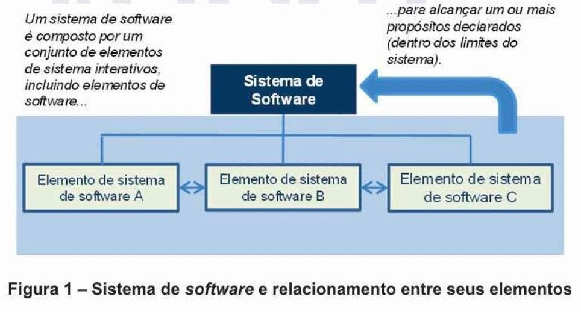
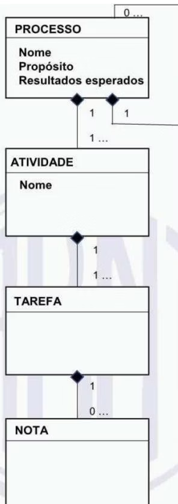
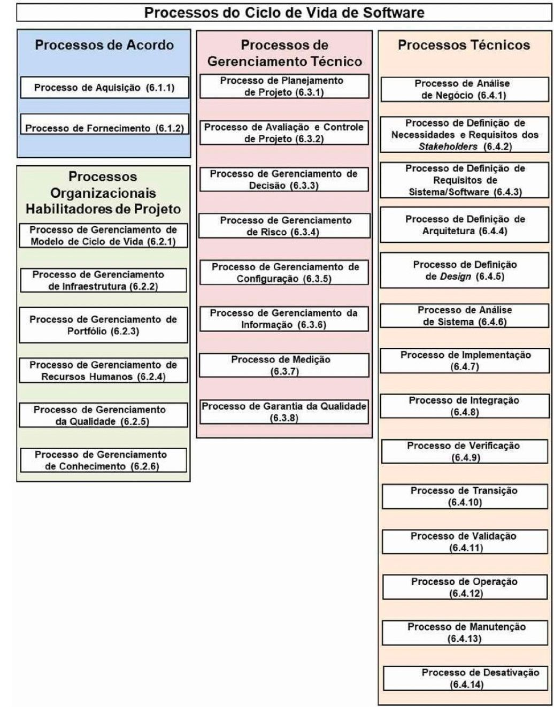

# Aula 02 Processos De Acordo

> **Documento de Origem:** `aula-02-processos-de-acordo.pdf`  
> **Total de Slides:** 29  
> **Disciplina:** Processos de Engenharia de Software (INF0449 - UFG)  

---

## Slide 01

PROCESSOS DE ENGENHARIA DE SOFTWARE

INF0449 — Bacharelado em Engenharia de Software · UFG

#### AULA 2

---

## Slide 02

### PARTE 1

NORMA ISO/IEC/IEEE 12207:2017 — O QUE É?

- ESTRUTURA COMUM PARA PROCESSOS DO CICLO DE VIDA

Fornece uma estrutura comum para processos do ciclo de vida de software, com terminologia bem definida (processos, atividades, tarefas, propósito, resultados esperados etc.) para facilitar a comunicação entre stakeholders.

---

## Slide 03

### ISO/IEC/IEEE 12207:2017

#### QUEM DEFINIU —> ISO/IEC/IEEE

ISO —> International Organization for Standardization / Organização Internacional para Padronização

IEC —> International Electrotechnical Commission / Comissão Eletrotécnica Internacional

IEEE —> Institute of Electrical and Electronics Engineers / Instituto de Engenheiros Elétricos e Eletrônicos

Adotada no Brasil como ABNT NBR ISO/IEC/IEEE 12207:2021, publicada em 24/08/2021

---

## Slide 04

### ISO/IEC/IEEE 12207:2017

ESCOPO DE APLICAÇÃO DA NORMA

- STAKEHOLDERS AO LONGO DO CICLO DE
- VIDA

Adquirente (ou comprador)

Fornecedor (ou contratado)

Desenvolvedor

Operador (ou usuário)

Mantenedor

Responsável pela descontinuação

#### ✓ REFERÊNCIA PARA A INDÚSTRIA
Pode ser referenciada pela indústria de software como base técnica para contratos, auditorias e melhorias de processo.

---

## Slide 05

### ISO/IEC/IEEE 12207:2017

### ESTRUTURA DE SISTEMA DE SOFTWARE

Sistema de software → é composto por um conjunto de elementos que interagem entre si para cumprir uma finalidade comum.

Ex: Sistema de comércio eletrônico —> formado por catálogo de produtos, carrinho de compras, controle de pagamento, consulta de CEP e envio de e-mails.

Cada elemento do sistema → pode ser desenvolvido pela própria organização ou adquirido de terceiros para atender a requisitos específicos.

Ex: A empresa pode contratar serviço externo para consultar CEPs, enviar e-mails de confirmação ou processar pagamentos.

Se a Implementação de um elemento for delegada a outra parte, um acordo entre o adquirente e o fornecedor deve ser estabelecido.

Ex: Contratar um serviço de envio de e-mails e estabelecer em contrato a quantidade mensal de mensagens e a proteção dos dados dos clientes.

ISO/IEC/IEEE 12207:2017 → define os processos envolvidos na produção/terceirização dos elementos do Sistema de Software

---

## Slide 06

### ISO/IEC/IEEE 12207:2017

CONSTRUTOS DE PROCESSO

1 PROCESSO

Nome, Propósito e Resultados esperados — define O QUÊ e POR QUÊ

2 ATIVIDADE

Agrupamento lógico de tarefas relacionadas dentro de um processo

3 TAREFA

Ação concreta a ser executada — define o COMO

4 NOTA

Orientações complementares opcionais associadas a tarefas

---

## Slide 07

### ISO/IEC/IEEE 12207:2017

### CONFORMIDADE COM A NORMA

#### ✓ TOTAL OU ADAPTADA
A conformidade de uma implementação de processo à norma pode ser total ou adaptada

#### ✓ CONFORMIDADE TOTAL
Conjunto de processos da norma com os quais a implementação alega ter "conformidade". Conformidade total pode ser de tarefas ou de resultados

#### ✓ CONFORMIDADE ADAPTADA
Adaptar os processos da norma para atender circunstâncias particulares (Anexo A). Novos processos do ciclo de vida são definidos para situações específicas.

---

## Slide 08

### ISO/IEC/IEEE 12207:2017

#### CARACTERÍSTICAS

- NÃO É PRESCRITIVA — É DESCRITIVA

Cada projeto ou organização seleciona apenas os processos que deseja aplicar

- NÃO ESPECIFICA COMO IMPLEMENTAR
- PROCESSOS

Fornece dicas e exemplos com propósito ilustrativo

#### ✓ NÃO DEFINE DOCUMENTAÇÃO
Nome, formato ou conteúdo de documentos cabe à ISO/IEC/IEEE 15289

#### ✓ NÃO DEFINE MODELO DE CICLO DE VIDA
Nem metodologia ou método de desenvolvimento

---

## Slide 09

### ISO/IEC/IEEE 12207:2017

### OS 4 GRUPOS DE PROCESSOS

**6. PROCESSOS ORGANIZACIONAIS**  
HABILITADORES DE PROJETO

**2. PROCESSOS DE ACORDO**  

**8. PROCESSOS DE GERENCIAMENTO TÉCNICO**  
CONTROLE DE PROJETOS

---

## Slide 10

### ISO/IEC/IEEE 12207:2017

PROCESSOS DO CICLO DE VIDA DE SOFTWARE

---

## Slide 11

### 💬 DISCUSSÃO — PARTE 1

#### 10 MINUTOS · EM EQUIPE

Questões para reflexão em sala:

#### QUESTÃO 1 — EXPERIÊNCIA PRÁTICA

Você já participou de um projeto de software? Quais processos da norma foram — ou deveriam ter sido — aplicados?

Processos de Acordo (Aquisição e Fornecimento)

Processos Habilitadores (Gerenciamento de Ciclo de Vida, Infraestrutura, Portfólio, RH, Qualidade, Conhecimento)

Processos de Gerenciamento Técnico (Planejamento, Avaliação/Controle, Decisão, Risco, Configuração, Informação, Medição, Garantia da Qualidade)

Processos Técnicos (Análise de Negócio, Requisitos, Arquitetura, Design, Implementação, Integração, Verificação, Validação, Transição, Operação, Manutenção, Desativação)

#### QUESTÃO 2 — DESCRITIVO VS. PRESCRITIVO
Por que uma norma descritiva pode ser mais útil do que uma prescritiva no contexto de desenvolvimento de software? Quais vantagens e desvantagens?

Ao final da discussão, um representante de cada grupo apresenta as principais conclusões para a turma.

---

## Slide 12

### ISO/IEC/IEEE 12207:2017

### OS 4 GRUPOS DE PROCESSOS

**2. PROCESSOS DE ACORDO**  
AQUISIÇÃO E FORNECIMENTO

**6. PROCESSOS ORGANIZACIONAIS**  
HABILITADORES DE PROJETO

---

## Slide 13

### PARTE 2

PROCESSOS DE ACORDO - AQUISIÇÃO

Usado para aquisição de um produto/serviço de software.

Executado pelo adquirente — organização que compra ou contrata o produto/serviço

---

## Slide 14

### PROCESSOS DE ACORDO - AQUISIÇÃO

### AS 5 ATIVIDADES

#### COMUNICAR

Divulgar requisitos e

selecionar fornecedor

#### PREPARAÇÃO

Definir estratégia

e solicitar fornecimento

#### ESTABELECER

Formalizar

acordo e condições contratuais

#### MONITORAR

Acompanhar desempenho e

conformidade

#### ACEITAR

Verificar e aprovar produto

ou serviço

#### 1. PREPARAÇÃO PARA A AQUISIÇÃO

cronograma de marcos

critérios de seleção

responsabilidades

propriedade intelectual

preço

#### 4. MONITORAR O ACORDO

custo

cronograma

qualidade

planejado X realizado

2. COMUNICAR E SELECIONAR FORNECEDOR

Divulgar a solicitação para potenciais fornecedores

comparar propostas com critérios pré- estabelecidos

comunicar resultado aos fornecedores candidatos

#### 5. ACEITAR O PRODUTO OU SERVIÇO

realizar testes de aceitação

verificar conformidade com o acordo

efetuar pagamento

encerrar o acordo formalmente.

A Atividade 4 é integrada ao Processo de Avaliação e Controle de Projeto — garantindo rastreabilidade entre o planejado e o realizado em custo, prazo e qualidade.

#### 3. ESTABELECER E MANTER O ACORDO

contrato com critérios de aceitação

cronograma

verificação/validação

propriedade intelectual

condições de rescisão

---

## Slide 15

### PROCESSOS DE ACORDO - AQUISIÇÃO

#### RESULTADOS

Solicitação de Fornecimento preparada

Fornecedores selecionados

Acordo estabelecido entre o adquirente e o fornecedor

Produtos em conformidade com o acordo aceitos

Obrigações definidas para o adquirente satisfeitas

Referência complementar: IEEE Std 1062-2015 — Recommended Practice for Software Acquisition — fornece listas de verificação detalhadas para aquisição de software sob medida, pacotes e SaaS.

---

## Slide 16

### PROCESSOS DE ACORDO - AQUISIÇÃO

### 🔍EXEMPLO DE SISTEMA DE GESTÃO DE SAÚDE

PERSPECTIVA: ADQUIRENTE SETOR: SAÚDE PÚBLICA

Cenário: Uma prefeitura precisa de um sistema de gestão de saúde pública (prontuário eletrônico) com integração ao SUS, conformidade com LGPD e suporte a acessibilidade.

1 1. PREPARAÇÃO

Secretaria de Saúde define requisitos (SUS,

LGPD, acessibilidade), critérios de seleção (experiência em saúde pública, suporte local)

e elabora o Edital de Licitação 2 2. SELEÇÃO

Publicação do edital; 3 empresas apresentam propostas; avaliação técnica e comercial; empresa X selecionada por melhor custo- benefício 3 3. ACORDO

Contrato assinado: prazo de 12 meses, marcos

de entrega por módulos, critérios de aceite (testes de carga, conformidade LGPD), multas

por atraso 4 4. MONITORAMENTO

Reuniões mensais de acompanhamento; relatórios de progresso; homologação de cada módulo entregue conforme critérios 5 5. ACEITE

Testes de aceitação com usuários finais; treinamento; assinatura do Termo de Aceite;

pagamento final

#### 📄 DOCUMENTOS GERADOS
Edital · Proposta Técnica · Contrato · Atas de Reunião · Relatórios de Teste · Termo de Aceite

---

## Slide 17

### PROCESSOS DE ACORDO - AQUISIÇÃO

### 🔍 EXEMPLO DE SERVIÇO DE PAGAMENTO

### PERSPECTIVA: ADQUIRENTE

SETOR: E-COMMERCE / FINTECH

Cenário: Um sistema de e-commerce precisa integrar um gateway de pagamento para processar transações de cartão de crédito/débito e pix, com conformidade com LGPD.

1 1. PREPARAÇÃO

Equipe do SGP define requisitos de

integração: suporte a Pix, cartão de crédito/débito, antifraude, conformidade

2 2. SELEÇÃO

LGPD; elabora RFP técnica comparando

gateways disponíveis (Cielo, PagSeguro,

Avaliação técnica das APIs (documentação, SDKs, sandbox), análise de custos (taxa por transação, mensalidade), suporte técnico e histórico de disponibilidade; PagSeguro selecionado por melhor API e suporte 3 3. ACORDO

Stripe)

Contrato de uso da API: limites de requisições,

SLA de disponibilidade (99,9%), taxas por transação, cláusulas de confidencialidade de

dados de pagamento, conformidade LGPD,

4 4. MONITORAMENTO

condições de rescisão e portabilidade de

Dashboards de monitoramento de transações, alertas de falha, relatórios mensais de disponibilidade e taxa de sucesso de pagamentos; reuniões trimestrais de revisão de SLA 5 5. ACEITE

dados

Testes de integração em ambiente de homologação (sandbox); testes de carga

(1.000 transações/min); validação de conformidade LGPD; go-live em produção

com rollback plan

#### 📄 DOCUMENTOS GERADOS

RFP Técnica · Contrato de API · Plano de Integração · Relatórios de SLA · Logs de Teste · Termo de Go-Live

---

## Slide 18

### PARTE 3

PROCESSO DE ACORDO - FORNECIMENTO

Fornecer a um adquirente um produto/serviço que satisfaça os requisitos acordados.

Executado pelo fornecedor — organização ou indivíduo que celebra acordo com o adquirente.

Também chamado de: contratado, produtor, vendedor ou representante.

---

## Slide 19

### PROCESSO DE ACORDO - DE FORNECIMENTO

### AS 5 ATIVIDADES

#### PREPARAÇÃO

Definir estratégia, cronograma e responsabilidad

es pela entrega

#### RESPONDER

Responder à solicitação do

adquirente

#### ESTABELECER

#### E MANTER

Formalizar o

acordo e negociações

#### EXECUTAR
Seguir o acordo e conformidade

#### ENTREGAR

Realizar entregas e prestar suporte

conforme o

acordo

#### 1. PREPARAR O FORNECIMENTO
Identificar o adquirente com necessidade (via Processo de Análise de Negócio); definir estratégia: cronograma em etapas com marcos de entregas, responsabilidades, preço.

#### 4. EXECUTAR O ACORDO
Executar conforme planos de projeto; monitorar custo, cronograma e qualidade (planejado X realizado); aplicar Processo de Gerenciamento de Configuração para controle de mudanças.

#### 2. RESPONDER À SOLICITAÇÃO
Avaliar viabilidade técnica e comercial da solicitação; preparar proposta técnica e proposta comercial que atendam aos requisitos do adquirente.

#### 5. ENTREGAR E PRESTAR SUPORTE
Entregar produto/serviço conforme critérios de aceite; prestar suporte pós-entrega; receber pagamento; transferir responsabilidade; encerrar o acordo formalmente.

#### 3. ESTABELECER E MANTER O ACORDO
Negociar contrato: critérios de aceitação, cronograma, verificação/validação, propriedade intelectual, datas de pagamento, subcontratados. Identificar e avaliar impacto de mudanças.

A Atividade 4 integra o Gerenciamento de Configuração — essencial para rastreabilidade de versões e controle de mudanças ao longo da execução do acordo.

---

## Slide 20

### PROCESSO DE ACORDO - DE FORNECIMENTO

#### RESULTADOS

Adquirente identificado

Resposta à solicitação do adquirente produzida

Acordo estabelecido entre o adquirente e o fornecedor

Produto/serviço fornecido

Obrigações do fornecedor definidas no acordo satisfeitas

Transferência de responsabilidade pelo produto/serviço adquirido

---

## Slide 21

### PROCESSOS DE ACORDO - FORNECIMENTO

### 🔍 EXEMPLO DE SISTEMA DE GESTÃO DE SAÚDE

### PERSPECTIVA: FORNECEDOR

SETOR: SAÚDE PÚBLICA

Cenário: Uma Empresa foi selecionada pela Prefeitura para desenvolver o sistema de prontuário eletrônico integrado ao SUS. Agora, sob a perspectiva do Processo de Fornecimento, veja como a Empresa conduz suas atividades.

1 1. PREPARAÇÃO

Empresa analisa o Edital da Prefeitura; avalia capacidade técnica (equipe de saúde digital, integradores SUS, especialistas LGPD); define estratégia: 4 módulos ao longo de 12 meses,

2 2. RESPOSTA

com marcos mensais e equipe dedicada de

Elabora proposta técnica (arquitetura do sistema, stack tecnológico, plano de integração com SUS, cronograma de módulos) e proposta comercial; apresenta ao comitê de avaliação da Prefeitura 3 3. ACORDO

suporte local

Negocia contrato: escopo (módulos de prontuário, agendamento, farmácia, relatórios

SUS), prazo (12 meses), critérios de aceite

(testes de carga, conformidade LGPD, acessibilidade), SLA de suporte (4h para incidentes críticos), propriedade do código-

4 4. EXECUÇÃO

Desenvolvimento iterativo por módulo; demos mensais à Secretaria de Saúde; relatórios de progresso (planejado X realizado); gestão de mudanças via controle de versão e registro formal de alterações; homologação de cada módulo entregue 5 5. ENTREGA E SUPORTE

fonte, multas por atraso

Deploy nos servidores da Prefeitura; treinamento de 200 profissionais de saúde; suporte técnico por 12 meses; transferência da

documentação técnica e código-fonte;

assinatura do Termo de Transferência;

recebimento do pagamento final

#### 📄 DOCUMENTOS GERADOS

Proposta Técnica · Contrato · Plano de Projeto · Relatórios de Sprint · Plano de Testes · Manual de Implantação · Termo de Transferência

---

## Slide 22

### PROCESSOS DE ACORDO - FORNECIMENTO

### 🔍 EXEMPLO DE SERVIÇO DE PAGAMENTO

### PERSPECTIVA: FORNECEDOR

SETOR: E-COMMERCE / FINTECH

Cenário: O PagSeguro identificou o SGP (Sistema de Gestão de Pedidos) como adquirente com necessidade de integração de pagamentos. Sob a perspectiva do Processo de Fornecimento, veja como o PagSeguro conduz suas atividades para atender à RFP técnica recebida.

1 1. PREPARAÇÃO

PagSeguro identifica o SGP como adquirente com necessidade de gateway de pagamento;

avalia capacidade de atendimento (infraestrutura, SLA de 99,9%, suporte a Pix e cartão, conformidade LGPD); define estratégia:

2 2. RESPOSTA

Elabora proposta técnica (documentação da API, SDKs para as linguagens do SGP, ambiente sandbox, exemplos de integração Pix e cartão) e proposta comercial (taxa por transação, sem mensalidade fixa, desconto por volume); apresenta ao time técnico do SGP 3 3. ACORDO

onboarding via API REST, sandbox disponível

imediatamente, suporte técnico dedicado

durante integração

Negocia contrato de uso da API: limites de

requisições (10.000/min), SLA de disponibilidade (99,9%), taxas por transação,

cláusulas de confidencialidade (PCI-DSS, LGPD), condições de rescisão, portabilidade e

4 4. EXECUÇÃO

Disponibiliza ambiente sandbox com dados de teste; fornece suporte técnico dedicado (canal Slack direto com engenheiros PagSeguro); monitora uso da API em tempo real; emite relatórios mensais de disponibilidade e taxa de sucesso; responde a incidentes em até 1h

propriedade dos dados transacionais do SGP

5 5. ENTREGA E SUPORTE

Habilita conta de produção após aprovação

nos testes de carga (1.000 transações/min); acompanha go-live com equipe em standby;

fornece dashboard de monitoramento em tempo real; presta suporte contínuo conforme

SLA; emite relatórios trimestrais de revisão de

#### SLA

#### 📄 DOCUMENTOS GERADOS

Proposta Técnica de API · Contrato de Serviço · Documentação de Integração · Relatórios de SLA · Logs de Sandbox · Termo de Ativação em Produção

---

## Slide 23

### AQUISIÇÃO E FORNECIMENTO

### DUAS FACES DO MESMO ACORDO

Os dois processos são complementares e simultâneos — ocorrem entre as mesmas partes, mas sob perspectivas opostas. Podem inclusive ocorrer dentro da mesma organização.

Aspecto Processo de Aquisição Processo de Fornecimento

Executor Adquirente (comprador) Fornecedor (contratado)

Objetivo Obter produto/serviço conforme requisitos

Entregar produto/serviço que satisfaça requisitos

Ponto de partida Definir estratégia e solicitação Identificar adquirente e avaliar viabilidade

Papel no Acordo Estabelece e monitora Negocia, executa e entrega

Encerramento Aceita produto e paga Entrega, recebe pagamento e transfere responsabilidade

Resultados esperados 5 resultados 6 resultados

Os Processos de Acordo definem as atividades necessárias para estabelecer um acordo entre duas partes — o mesmo contrato é visto por perspectivas opostas.

---

## Slide 24

### AQUISIÇÃO E FORNECIMENTO

### TERCEIRIZAÇÃO DE SOFTWARE

#### ACESSO A ESPECIALIZAÇÃO
Contratação de expertise técnica específica (IA, segurança, mobile) sem necessidade de formação interna — time-to-market mais rápido

#### ESCALABILIDADE
Equipe pode crescer ou reduzir conforme demanda do projeto sem impacto na estrutura permanente da organização

#### FOCO NO CORE BUSINESS
A organização adquirente concentra recursos em suas competências essenciais enquanto o fornecedor cuida da tecnologia

#### INOVAÇÃO EXTERNA
Fornecedores trazem boas práticas de mercado, novas tecnologias e experiências de outros projetos

CONFORMIDADE COM NORMAS

Fornecedores especializados já operam com processos certificados (ISO 12207, CMMI, ISO 9001), reduzindo esforço de conformidade do adquirente

CEIA/UFG como um Fornecedor de elementos de sistemas de software inteligentes.

Ex: O CEIA é contratado por um Sistema de E-commerce, como fornecedor, para desenvolver um modelo de recomendação de produtos que considere as compras anteriores realizadas por aquele usuário e no padrão de compras de outros usuários que buscam o mesmo produto.

#### DISTRIBUIÇÃO DE RISCO
Parte do risco técnico e operacional é transferida ao fornecedor via cláusulas contratuais (SLA, multas, garantias)

---

## Slide 25

### AQUISIÇÃO E FORNECIMENTO

### RISCOS DA TERCEIRIZAÇÃO DE SOFTWARE

Dependência do fornecedor para manutenção e evolução; dificuldade de internalizar o sistema no futuro

Falência, fusão ou mudança estratégica do fornecedor pode interromper o projeto ou o suporte — sem plano de contingência

Dados sensíveis expostos a terceiros; necessidade de conformidade com LGPD e cláusulas de confidencialidade

Mudanças de escopo, integrações não previstas, treinamento e migração de dados frequentemente excedem o orçamento inicial

Especificações ambíguas geram retrabalho, atrasos e disputas contratuais — o custo de correção cresce exponencialmente após a entrega

Tecnologias proprietárias, formatos fechados ou ausência de transferência de código-fonte criam dependência permanente

Referência: ISO/IEC 27036-3:2013 — Security techniques para segurança em cadeias de fornecimento de TIC. Segurança deve ser requisito contratual, não apenas boa intenção.

> **⚠️ PERDA DE KNOW-HOW INTERNO**

> **⚠️ RISCO DE DESCONTINUIDADE**

> **⚠️ SEGURANÇA DA INFORMAÇÃO**

> **⚠️ CUSTOS OCULTOS**

> **⚠️ DESALINHAMENTO DE REQUISITOS**

> **⚠️ DEPENDÊNCIA TECNOLÓGICA**

---

## Slide 26

### AQUISIÇÃO E FORNECIMENTO

### COMO A 12207:2017 MITIGA OS RISCOS DA TERCEIRIZAÇÃO

PROCESSO DE AQUISIÇÃO ESTRUTURADO

Solicitação formal com requisitos claros reduz ambiguidade; critérios de seleção objetivos minimizam escolha inadequada de fornecedor

#### GESTÃO DE MUDANÇAS FORMAL

Alterações no acordo exigem motivo, histórico e impacto avaliado — evita mudanças de escopo não controladas

#### ACORDO COM CRITÉRIOS DE ACEITAÇÃO
Testes formais, SLA definido e cláusulas de rescisão protegem o adquirente contra entregas inadequadas

MONITORAMENTO CONTÍNUO

Atividade da Aquisição integrada ao Processo de Avaliação e Controle de Projeto — planejado X realizado em custo, prazo e qualidade

TRANSFERÊNCIA FORMAL DE RESPONSABILIDADE

Processo de Fornecimento exige transferência explícita — reduz ambiguidade pós-entrega e conflitos sobre propriedade

---

## Slide 27

### 💬 ATIVIDADE - PROCESSO DE ACORDO

AQUISIÇÃO E FORNECIMENTO

#### EM EQUIPE

1 PASSO 1 — RELEMBRAR

Relembre o sistema de software que a equipe definiu na aula passada.

2 PASSO 2 — LISTAS PRINCIPAIS FUNCIONALIDADES

Liste as principais funcionalidades que o sistema deve ter.

PASSO 3 — MAPEIE OS ELEMENTOS DO SEU SISTEMA

Com base nas principais funcionalidades, identifique e liste os elementos (módulos, componentes, serviços, integrações) que compõem o sistema.

Ex.: módulo de autenticação, serviço de notificações, integração com API de pagamento, relatórios gerenciais, painel administrativo, etc…
**3.** PASSO 4 — PERSPECTIVA DE AQUISIÇÃO: ADQUIRIR PRONTO?

Para cada elemento identificado no Passo 3, avalie a viabilidade de adquiri-lo pronto (biblioteca, serviço de terceiro, SaaS, API externa) em vez de desenvolvê- lo do zero.
**4.** PASSO 5 — PERSPECTIVA DE FORNECIMENTO: SEU SISTEMA COMO FORNECEDOR

Após o sistema estar pronto, algum elemento do sistema poderia ser fornecido como API pública, licença, SaaS para outros sistemas de software? Identifique quais elementos têm potencial de ser "fornecidos" e para quem.

Qual elemento tem valor independente do sistema principal?

Quem poderia ser o adquirente desse elemento?

Como seria o acordo? (API pública, licença, SaaS?)

---

## Slide 28

> **💡 EXEMPLO RESOLVIDO ATIVIDADE -  PROCESSO DE ACORDO: AQUISIÇÃO E  FORNECIMENTO**

### SISTEMA DE AGENDAMENTO DE CONSULTAS

A equipe definiu um sistema de agendamento de consultas médicas para clínicas. Veja como ficaria a análise de aquisição e fornecimento dos elementos do sistema.

#### PASSO 1 — SISTEMA DEFINIDO

Sistema de Agendamento de Consultas Médicas — para clínicas de pequeno e médio porte.

#### PASSO 2 — PRINCIPAIS FUNCIONALIDADES

- Cadastro de pacientes e médicos
- Agendamento e cancelamento de consultas
- Envio de lembretes por e-mail e SMS
- Prontuário eletrônico simplificado
- Relatórios de ocupação e faturamento
- Login e controle de acesso por perfil

#### PASSOS 3 + 4 — ELEMENTOS E ANÁLISE DE AQUISIÇÃO

| Elemento | Adquirir pronto? | Justificativa | Possível fornecedor |
| :--- | :---: | :--- | :--- |
| **Autenticação e controle de acesso** | Sim | Solução madura, segura e certificada; alto custo de desenvolver do zero | Auth0 / Firebase Auth |
| **Envio de e-mail e SMS (lembretes)** | Sim | Serviço de notificações é commodity; APIs prontas e baratas | Twilio / SendGrid |
| **Agendamento de consultas** | Não | Regra de negócio central da clínica; diferencial competitivo | — (desenvolvido internamente) |
| **Prontuário eletrônico** | Parcial | Estrutura pode usar editor rico externo; lógica médica é interna | TipTap / Quill (editor) — lógica médica interna |
| **Relatórios e dashboards** | Parcial | Engine de gráficos pode ser externa; dados e lógica são internos | Chart.js / Power BI Embedded — dados e lógica internos |
| **Banco de dados e infraestrutura** | Sim | Infraestrutura como serviço é mais eficiente que servidor próprio | AWS RDS / Supabase |

#### PASSO 5 — PERSPECTIVA DE FORNECIMENTO

| Elemento | Possível adquirente | Modelo de acordo |
| :--- | :--- | :--- |
| **Motor de agendamento** | Outros sistemas de saúde, academias, salões de beleza | API / SaaS |
| **Módulo de prontuário** | Sistemas de gestão hospitalar, planos de saúde | API |
| **Relatórios de ocupação** | Redes de clínicas, operadoras de saúde | SaaS |

> **💡 Dica:** Perceba que o módulo de agendamento — desenvolvido internamente — se torna o principal ativo para fornecimento. O que é diferencial competitivo hoje pode ser produto amanhã.

---

## Slide 29

### ATÉ A PRÓXIMA AULA!

#### PROFA TACIANA KUDO

taciana@ufg.br

(62) 98111-7137

Atenção: Slides gerados pelo Gamma.AI

---

