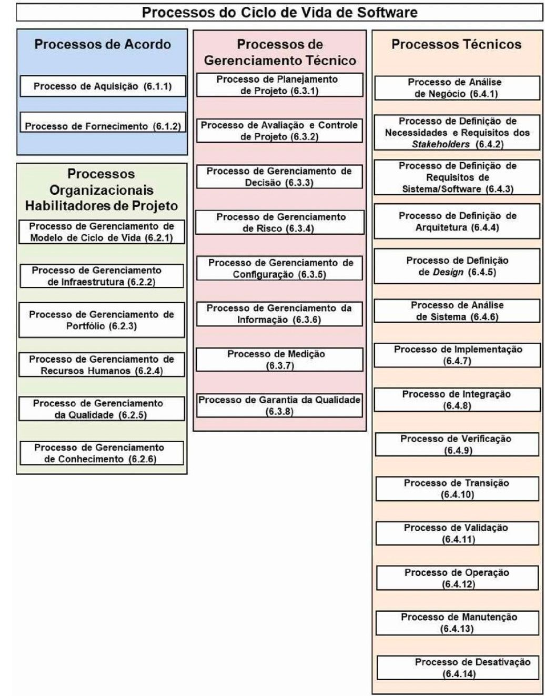
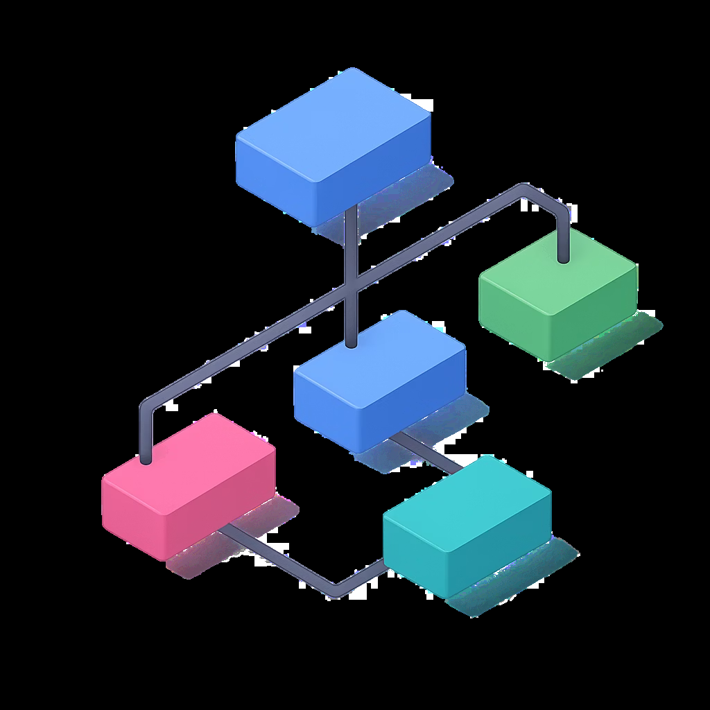
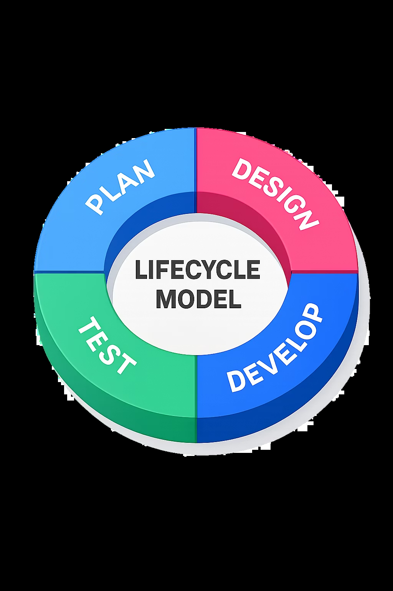
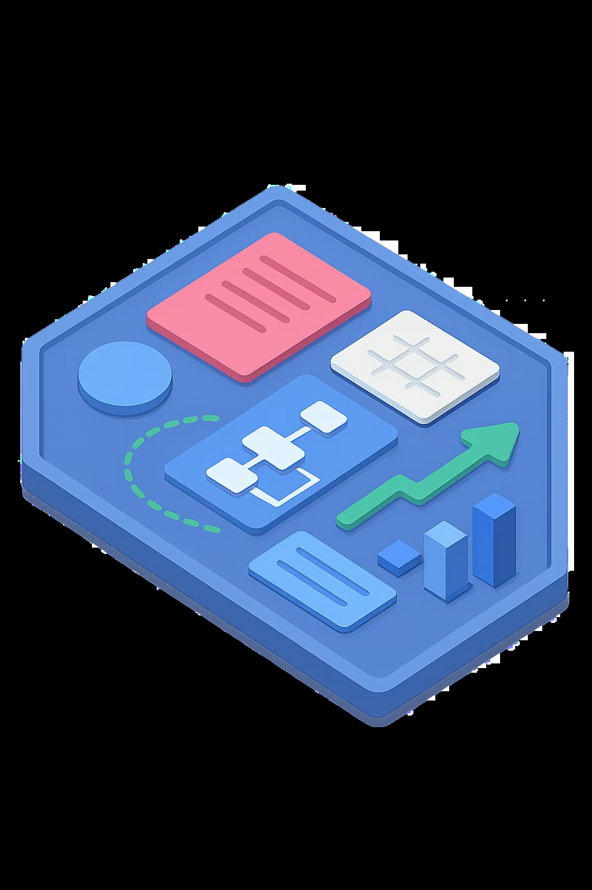

# Aula 03 04 Processos Organizacionais

> **Documento de Origem:** `aula-03-04-processos-organizacionais.pdf`  
> **Total de Slides:** 34  
> **Disciplina:** Processos de Engenharia de Software (INF0449 - UFG)  

---

## Slide 01

PROCESSOS DE ENGENHARIA DE SOFTWARE

INF0449 — Bacharelado em Engenharia de Software · UFG

AULAS 3 e 4

---

## Slide 02

### ISO/IEC/IEEE 12207:2017

PROCESSOS DO CICLO DE VIDA DE SOFTWARE

---

## Slide 03

### PROCESSOS ORGANIZACIONAIS

### HABILITADORES DE PROJETO

Fornecem recursos e infraestrutura para que os projetos atendam às necessidades dos stakeholders

Atuam no nível estratégico: aplicam-se fora e durante o ciclo de vida dos projetos

Gerenciam riscos em situações de incerteza e concorrência

São 6 processos:

Ciclo de Vida

Infraestrutura

Portfólio

#### RH

Qualidade

Conhecimento

---

## Slide 04

CAPÍTULO 1 DE 3 PROCESSO 1: GERENCIAMENTO DE MODELO DE CICLO DE VIDA

Seção 6.2.1 — ABNT NBR ISO/IEC/IEEE 12207:2021

---

## Slide 05

### PROCESSO 1

### GERENCIAMENTO DE MODELO DE CICLO DE VIDA

### O propósito é definir, manter e garantir

disponibilidade das políticas, processos e modelos de ciclo de vida da organização para uso em todos os seus projetos.

#### RESULTADOS ESPERADOS

POLÍTICAS DEFINIDAS

MODELOS AVALIADOS

Gerenciamento e desenvolvimento dos modelos do SDLC são fornecidos

Cascata, ágil, iterativo — revisados periodicamente

🏢 Exemplo prático: Uma fábrica de software define que todos os projetos usarão Scrum com sprints de 2 semanas — isso é o Gerenciamento de Modelo de Ciclo de Vida em ação.

#### MELHORIAS IMPLEMENTADAS
Lições aprendidas capturadas e disponibilizadas

#### RESPONSABILIDA DE
Responsabilidad es claras para toda a organização

---

## Slide 06

### PROCESSO 1

### GERENCIAMENTO DE MODELO DE CICLO DE VIDA

Melhorar o processo do

Ciclo de

Vida

As três atividades formam um ciclo contínuo de melhoria organizacional, garantindo que os modelos permaneçam adequados à realidade dos projetos.

Estabelecer

o processo do Ciclo de

Vida

Avaliar o processo do

Ciclo de

Vida

---

## Slide 07

### EXEMPLO PRÁTICO

### PROCESSO 1 — GERENCIAMENTO

DE MODELO DE CICLO DE VIDA

A SoftBrasil, uma fábrica de software, adota o Scrum como modelo padrão de ciclo de vida e aplica o Processo 1 da ISO 12207:2017 da seguinte forma:

#### 📋 POLÍTICAS DEFINIDAS

#### 📊 MODELOS AVALIADOS

A SoftBrasil documenta que todos os projetos devem usar Scrum com sprints de 2 semanas, com cerimônias obrigatórias: planning, review e retrospectiva.

Ao final de cada trimestre, o comitê técnico revisa se o Scrum ainda é adequado ou se projetos específicos precisam de Kanban ou de um modelo híbrido.

#### 🚀 MELHORIAS IMPLEMENTADAS
Após retrospectivas, a empresa incorpora ao modelo padrão a prática de "Definition of Done" revisada, baseada em lições aprendidas de projetos anteriores.

#### 👤 RESPONSABILIDADES DEFINIDAS
O Gerente de Engenharia é formalmente responsável por manter e comunicar o modelo de ciclo de vida a todos os times.

> **💡 Resultado: todos os projetos da SoftBrasil partem de uma base comum, reduzindo retrabalho e facilitando a alocação de pessoas entre equipes.**

---

## Slide 08

CAPÍTULO 2 DE 3 PROCESSO 2: GERENCIAMENTO DE INFRAESTRUTURA

Seção 6.2.2 — ABNT NBR ISO/IEC/IEEE 12207:2021

---

## Slide 09

### PROCESSO 2

### GERENCIAMENTO DE INFRAESTRUTURA

O PROPÓSITO é fornecer infraestrutura e serviços — instalações, ferramentas, hardware, software e comunicações — para apoiar os projetos ao longo de todo o ciclo de vida.

#### RESULTADOS ESPERADOS

→ requisitos de infra definidos

→ elementos de infra identificados e especificados

→ elementos de infra desenvolvidos ou adquiridos

→ elementos de infra disponibilizados

#### ATIVIDADES

Estabelecer a infraestrutura

Manter a infraestrutura

🖥️ Exemplo prático: Uma empresa provisiona repositórios Git, pipelines CI/CD (GitHub Actions) e ambientes de teste em nuvem para todos os times de desenvolvimento.

---

## Slide 10

CAPÍTULO 3 DE 3 PROCESSO 3: GERENCIAMENTO DE PORTFÓLIO

Seção 6.2.3 — ABNT NBR ISO/IEC/IEEE 12207:2021

---

## Slide 11

### PROCESSO 3

GERENCIAMENTO DE PORTFÓLIO

O propósito é iniciar e sustentar projetos adequados, suficientes e necessários a fim de satisfazer os objetivos estratégicos da organização, proporcionando investimento de recursos físicos e financeiros adequados.

Para sistemas de software, inclui também o gerenciamento de linha de produtos, portfólio de ativos e catálogo de serviços.

---

## Slide 12

### PROCESSO 3: GERENCIAMENTO DE PORTFÓLIO

### RESULTADOS ESPERADOS

#### OPORTUNIDADES
Oportunidades alinhadas à estratégia organizacional

#### IDENTIFICAÇÃO
Projetos identificados

#### ALOCAÇÃO DE RECURSOS
Recursos alocados

#### GESTÃO DE PROJETO
Responsabilidades de gestão de projeto definidas

#### SUSTENTAÇÃO
Projetos que atendem ao acordo e requisitos dos stakeholders são sustentados

#### REQUISITOS DOS STAKEHOLDERS
Projetos que não atendem ao acordo ou requisitos dos stakeholders são cancelados/redirecion ados

#### REQUISITOS PROJETO
Projetos que não atendem ao acordo ou requisitos são cancelados/redirecion ados

#### ENCERRADOS
Projetos que atendem completamente ao acordo e a todos os requisitos são encerrados

---

## Slide 13

### PROCESSO 3: GERENCIAMENTO DE PORTFÓLIO

### AS 3 ATIVIDADES CENTRAIS

**1. DEFINIR E AUTORIZAR**  
Identificar oportunidades, priorizar, alocar recursos e autorizar o início dos projetos selecionados

**2. AVALIAR O PORTFÓLIO**  
Confirmar viabilidade contínua — os projetos  justificam o investimento?

**3. ENCERRAR PROJETOS**  
Cancelar quando riscos superam benefícios; capturar lições aprendidas de projetos cancelados

🏦 Exemplo prático: Um banco cancela o projeto de app legado após análise de portfólio revelar que o ROI projetado caiu 60% com a entrada de um concorrente fintech.

---

## Slide 14

### 💬 DISCUSSÃO: DECISÃO DE PORTFÓLIO

Uma empresa de software tem 4 projetos em andamento, mas orçamento para sustentar apenas 3. Qual você cancelaria?

Projeto Situação Contexto Risco

A 80% concluído, cliente estratégico

Atraso de 2 meses Médio

B 30% concluído Mercado em declínio, equipe desmotivada

Alto

C 50% concluído Alta demanda de mercado, equipe produtiva

Baixo

D 10% concluído Tecnologia inovadora que coloca a empresa a frente dos concorrentes

Muito Alto

Justifique com base nos critérios do Gerenciamento de Portfólio da ISO 12207 — riscos, benefícios, alinhamento estratégico e viabilidade contínua.

---

## Slide 15

CAPÍTULO 4 DE 6 PROCESSO 4: GERENCIAMENTO DE RECURSOS HUMANOS

Seção 6.2.4 — ABNT NBR ISO/IEC/IEEE 12207:2021

---

## Slide 16

#### PROCESSO 4

#### GERENCIAMENTO DE RECURSOS HUMANOS

O propósito é fornecer à organização recursos humanos adequados e manter suas competências, de forma consistente com as necessidades do negócio.

🧑‍💼 Exemplo prático:

Uma empresa de software mapeia as competências necessárias para seus projetos ágeis e contrata desenvolvedores com experiência em TDD e DevOps.

---

## Slide 17

### PROCESSO 4

### GERENCIAMENTO DE RECURSOS HUMANOS

#### RESULTADOS ESPERADOS

#### COMPETÊNCIAS IDENTIFICADAS

Habilidades necessárias para os projetos são definidas e documentadas

#### PESSOAS DISPONIBILIZADAS
Recursos humanos com as competências requeridas são fornecidos aos projetos

#### DESENVOLVIMENTO CONTÍNUO
Treinamentos e capacitações são planejados e executados

#### CONHECIMENTO RETIDO
Conhecimento crítico é preservado mesmo com rotatividade de pessoal

---

## Slide 18

### PROCESSO 4

### GERENCIAMENTO DE RECURSOS HUMANOS

#### ATIVIDADES

Adquirir e prover habilidades — contratar, alocar ou terceirizar conforme necessidade

Identificar habilidades necessárias para cada projeto e habilidades de cada pessoa

Desenvolver habilidades — planejar treinamentos, certificações e mentoria

---

## Slide 19

### EXEMPLO PRÁTICO

### PROCESSO 4 — GERENCIAMENTO DE RECURSOS HUMANOS

A SoftBrasil precisa montar um time para um novo projeto de sistema bancário em nuvem e aplica o Processo 4 da ISO 12207:2017:

#### 🎯 COMPETÊNCIAS IDENTIFICADAS
O gerente de projeto lista as habilidades necessárias: Java, AWS, segurança de dados e metodologia Scrum.

#### 👥 PESSOAS DISPONIBILIZADAS
Dois desenvolvedores internos são realocados de outros projetos; um especialista em cloud é contratado via processo seletivo.

#### 📚 DESENVOLVIMENTO CONTÍNUO
A equipe recebe treinamento em certificação AWS e workshop interno de LGPD aplicada a sistemas financeiros.

#### 🧠 CONHECIMENTO RETIDO
Toda a documentação técnica e decisões de arquitetura são registradas na wiki interna para evitar perda de conhecimento com saída de membros.

> **💡 Resultado: O projeto inicia com um time competente, treinado e com processos de retenção de conhecimento — reduzindo riscos de atraso por falta de habilidade.**

---

## Slide 20

CAPÍTULO 5 DE 6 PROCESSO 5: GERENCIAMENTO DE QUALIDADE

Seção 6.2.5 — ABNT NBR ISO/IEC/IEEE 12207:2021

---

## Slide 21

### GERENCIAMENTO DE QUALIDADE

#### PROCESSO 5

O propósito é assegurar que os produtos, serviços e implementações de processos da organização atendam aos objetivos de qualidade organizacional e satisfaçam os stakeholders.

✅ Exemplo prático: Uma empresa define critérios de qualidade como cobertura mínima de testes de 80% e zero defeitos críticos antes de qualquer release em produção.

---

## Slide 22

#### PROCESSO 5

#### GERENCIAMENTO DE QUALIDADE

#### RESULTADOS ESPERADOS

PROCEDIMENTOS E CRITÉRIOS DEFINIDOS

#### AVALIAÇÕES REALIZADAS

Produtos e processos são avaliados, os dados de qualidade são coletados, analisados e reportados

Políticas, requisitos e critérios de qualidade estabelecidos

#### MELHORIAS APLICADAS
Problemas de qualidade identificados são tratados e corrigidos

---

## Slide 23

#### PROCESSO 5

#### GERENCIAMENTO DE QUALIDADE

#### ATIVIDADES

- **01.** Estabelecer os padrões de qualidade organizacional
- **02.** Planejar a qualidade — definir objetivos, critérios e métricas de qualidade organizacional

Avaliar a qualidade — realizar auditorias, revisões e inspeções de produtos e processos

**03. Realizar a gestão da qualidade — tratar não- conformidades e promover melhoria contínua**

---

## Slide 24

### EXEMPLO PRÁTICO

### PROCESSO 5 — GERENCIAMENTO DE QUALIDADE

A SoftBrasil implementa o Processo 5 da ISO 12207:2017 para garantir a qualidade do sistema bancário em desenvolvimento:

#### 📐 CRITÉRIOS DEFINIDOS
O time define: cobertura de testes ≥ 80%, tempo de resposta da API ≤ 200ms e zero vulnerabilidades críticas antes do release.

#### 🔍 AVALIAÇÕES REALIZADAS
A cada sprint, o QA realiza testes de regressão automatizados e uma auditoria de código é feita antes de cada entrega ao cliente.

#### 📊 DADOS COLETADOS
Um dashboard no SonarQube exibe métricas de qualidade em tempo real: bugs, code smells, cobertura e dívida técnica acumulada.

#### 🔧 MELHORIAS APLICADAS
Após identificar 3 falhas recorrentes de validação de entrada, o time atualiza o checklist de code review e adiciona testes específicos ao pipeline CI.

Resultado: O sistema chega ao cliente com qualidade mensurável e rastreável — reduzindo retrabalho pós-entrega e aumentando a confiança do cliente.

---

## Slide 25

CAPÍTULO 6 DE 6 PROCESSO 6: GERENCIAMENTO DE CONHECIMENTO

Seção 6.2.6 — ABNT NBR ISO/IEC/IEEE 12207:2021

---

## Slide 26

### GERENCIAMENTO DE CONHECIMENTO

#### PROCESSO 6

O propósito é criar e sustentar a capacidade de gerenciar, compartilhar e proteger o conhecimento da organização, garantindo que esteja disponível para os projetos que dele necessitam.

Exemplo prático: Uma empresa mantém uma base de conhecimento interna com decisões arquiteturais, registro de incidentes e guias de boas práticas acessíveis a todos os times.

---

## Slide 27

### PROCESSO 6

### GERENCIAMENTO DE CONHECIMENTO

#### RESULTADOS ESPERADOS

CONHECIMENTO IDENTIFICADO

Conhecimento relevantes para a organização identificados e catalogados

#### CONHECIMENTO DESENVOLVIDO
Competências e habilidades são desenvolvidas ou adquiridas

#### CONHECIMENTO COMPARTILHADO
Conhecimento é disponibilizado e disseminado entre os times e projetos

#### CONHECIMENTO PROTEGIDO
Dados de uso do conhecimento são coletados e analisador

---

## Slide 28

#### PROCESSO 6

#### GERENCIAMENTO DE CONHECIMENTO

#### ATIVIDADES

- **01.** Estabelecer os padrões de qualidade organizacional
- **02.** Planejar o gerenciamento do conhecimento — identificar necessidades e definir estratégias de captura e compartilhamento

Compartilhar o conhecimento — disponibilizar ativos de conhecimento para os projetos e times

**03. Usar o conhecimento — aplicar o conhecimento disponível para melhorar processos e resultados**

---

## Slide 29

### EXEMPLO PRÁTICO

### PROCESSO 6 — GERENCIAMENTO DE CONHECIMENTO

A SoftBrasil aplica o Processo 6 da ISO 12207:2017 para evitar a perda de conhecimento crítico após a conclusão do projeto bancário:

#### 🗂️ CONHECIMENTO IDENTIFICADO
O time mapeia os ativos críticos: decisões de arquitetura, integrações com APIs bancárias, regras de negócio complexas e soluções para bugs recorrentes.

#### 💾 CONHECIMENTO ARMAZENADO
Toda a documentação é registrada no Confluence: ADRs (Architecture Decision Records), runbooks, post- mortems e guias de onboarding para novos membros.

#### 🔗 CONHECIMENTO COMPARTILHADO
Sessões quinzenais de 'Tech Talk' são realizadas para que desenvolvedores apresentem soluções e aprendizados do projeto para outros times da empresa.

#### 🔒 CONHECIMENTO PROTEGIDO
O repositório de conhecimento tem controle de acesso por perfil, backup automático diário e política de retenção de 5 anos para documentos críticos.

> **💡 Resultado: Quando dois desenvolvedores seniores saem da empresa, o novo time consegue dar continuidade ao projeto sem perda de produtividade — graças ao conhecimento documentado e acessível.**

---

## Slide 30

### COMO OS 6 PROCESSOS SE CONECTAM

CICLO DE VIDA DEFINE AS REGRAS

Modelos e processos padrão que todos os projetos devem seguir

QUALIDADE DEFINE O PADRÃO DE EXCELÊNCIA

Critérios, auditorias e melhorias contínuas em produtos e processos

> **📌 Juntos, esses 6 processos criam a base organizacional para que qualquer projeto de software nasça com padrão, estrutura, pessoas, qualidade e conhecimento.**

#### INFRAESTRUTURA MONTA O CAMPO
Ferramentas, ambientes e recursos disponíveis para os times

#### PORTFÓLIO DECIDE QUEM JOGA
Quais projetos existem, recebem recursos e continuam ativos

#### RH ESCALA O TIME
Pessoas com as competências certas são alocadas e desenvolvidas

#### CONHECIMENTO PRESERVA O APRENDIZADO
Lições aprendidas e boas práticas ficam disponíveis para todos

---

## Slide 31

#### ATIVIDADE CONTÍNUA MANUAL DE PROCESSO
PROJETO INTEGRADOR DA DISCIPLINA

---

## Slide 32

### ESTRUTURA COMPLETA DO MANUAL DE PROCESSO

### PARTE 0 - APRESENTAÇÃO DO SOFTWARE

#### PARTE 1 - PROCESSOS DE ACORDO

PARTE 2 - PROCESSOS ORGANIZACIONAIS HABILITADORES - ATIVIDADE EM SALA HOJE

PARTE 3 - PROCESSOS DE GERENCIAMENTO TÉCNICO

#### PARTE 4 - PROCESSOS TÉCNICOS

> **⚠️ Atenção: Nem todos os módulos serão cobertos na disciplina com a mesma profundidade — o foco será nos processos trabalhados em cada bloco temático da ementa.**

---

## Slide 33

### ATIVIDADE DE EQUIPE EM SALA

### PARTE 2 - PROCESSOS ORGANIZACIONAIS HABILITADORES

### Modelo de ciclo de vida adotado e justificado

Inventário de infraestrutura e ferramentas necessárias

Justificativa estratégica e viabilidade do projeto

Papéis, competências e plano de capacitação (RACI)

Plano de qualidade com critérios e métricas

Estratégia de gestão do conhecimento

> **📌 Referência: Seção 6.2 da ISO 12207:2017**

> **⚠️ Atenção: Os artefatos não precisam ser extensos — precisam ser consistentes, justificados e aplicados ao seu projeto real. Qualidade > quantidade.**

---

## Slide 34

### ATÉ A PRÓXIMA AULA!

#### PROFA TACIANA KUDO

taciana@ufg.br

(62) 98111-7137

Atenção: Slides gerados pelo Gamma.AI

---

