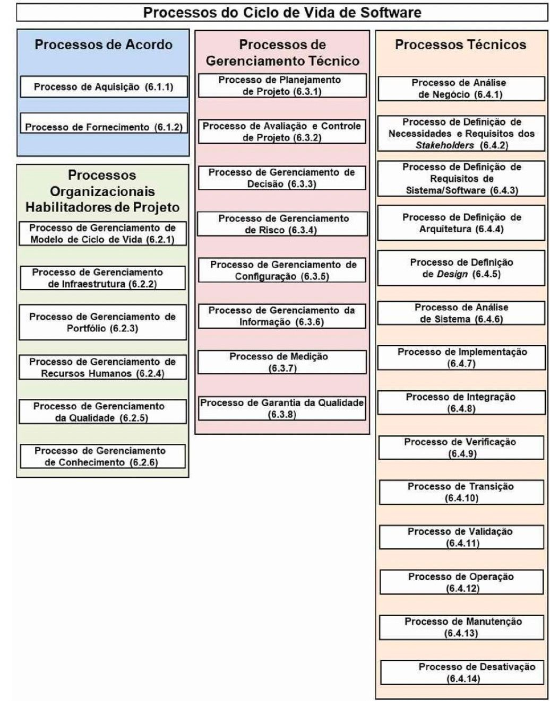
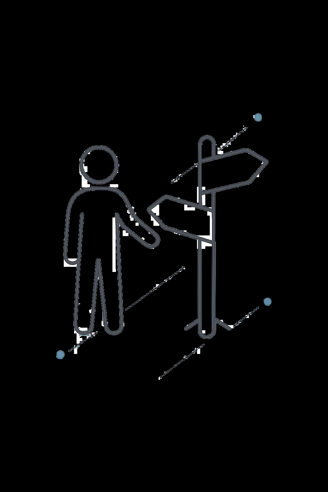
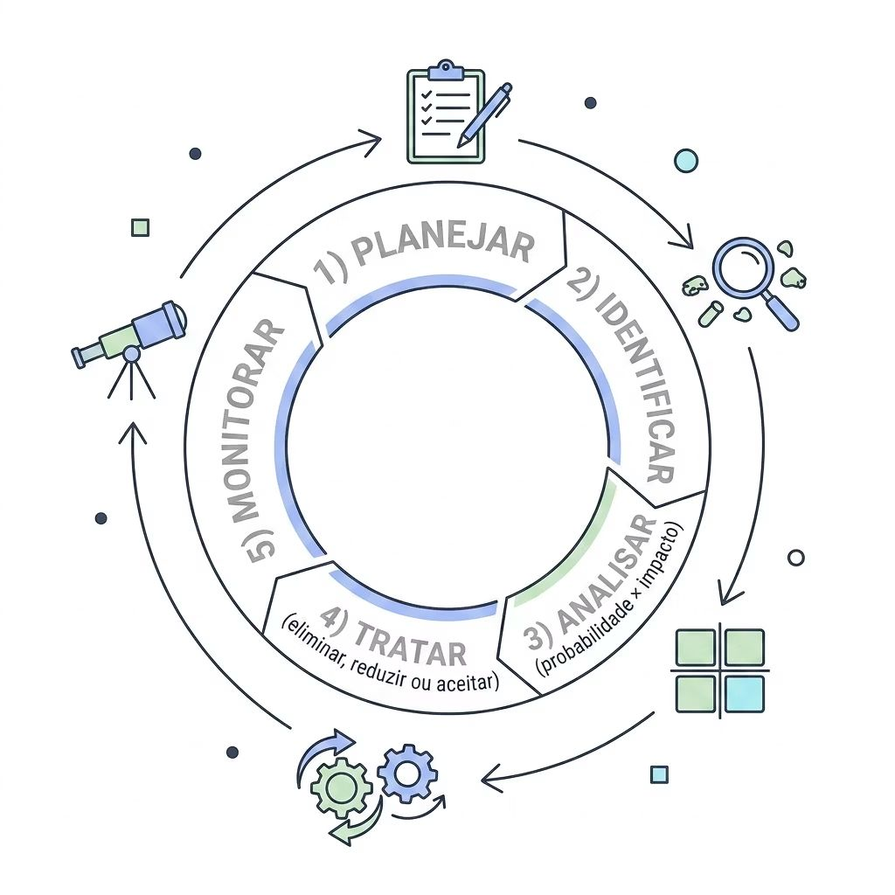
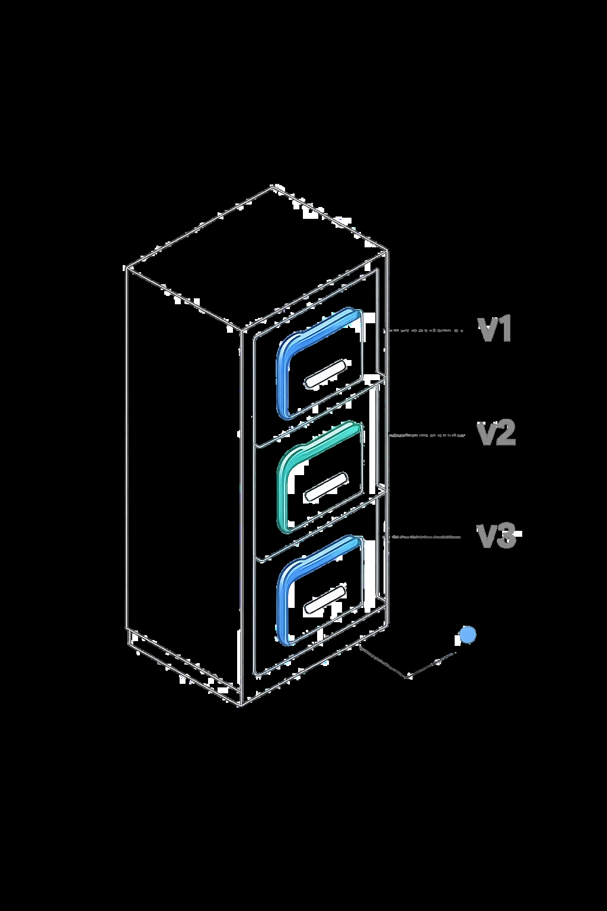

# Aula 05 Processos Gerenciamento Tecnico

> **Documento de Origem:** `aula-05-processos-gerenciamento-tecnico.pdf`  
> **Total de Slides:** 20  
> **Disciplina:** Processos de Engenharia de Software (INF0449 - UFG)  

---

## Slide 01

PROCESSOS DE ENGENHARIA DE SOFTWARE

INF0449 — Bacharelado em Engenharia de Software · UFG

#### AULA 5

---

## Slide 02

#### PROCESSOS DE GERENCIAMENTO TÉCNICO
ISO/IEC/IEEE 12207:2021 — Introdução aos 8 Processos Técnicos de Gerenciamento

---

## Slide 03

### ISO/IEC/IEEE 12207:2017

PROCESSOS DO CICLO DE VIDA DE SOFTWARE

---

## Slide 04

### O QUE É GERENCIAMENTO TÉCNICO?

#### DEFINIÇÃO

Aplicação de recursos técnicos e administrativos para planejar, organizar e controlar as funções de engenharia. Os Processos de Gerenciamento Técnico gerenciam os recursos e ativos alocados pela gerência organizacional para atender aos acordos dentro e entre organizações.

#### PAPEL NA NORMA

Elo entre os Processos Organizacionais e os Processos Técnicos — garantem que o esforço técnico seja planejado, monitorado e controlado de forma sistemática.

---

## Slide 05

### O QUE É GERENCIAMENTO TÉCNICO?

#### OS 8 PROCESSOS
PLANEJAMENTO DE PROJETO

AVALIAÇÃO E CONTROLE

GERENCIAMENTO DE DECISÃO

GESTÃO DE RISCOS

GERENCIAMENTO DE CONFIGURAÇÃO

GERENCIAMENTO DA INFORMAÇÃO

MEDIÇÃO GARANTIA DA QUALIDADE

---

## Slide 06

PARTE 1 PLANEJAR E CONTROLAR O PROJETO

Processos 6.3.1 · 6.3.2 — Planejamento de Projeto e Avaliação e Controle de Projeto

---

## Slide 07

### 6.3.1 PLANEJAMENTO DE PROJETO

Produzir e coordenar planos efetivos e viáveis — escopo, cronograma, recursos, papéis e responsabilidades.

#### PLANEJAR

Custo, cronograma

e infraestrutura

DEFINIR PROJETO

EAP, ciclo de vida,

entregáveis

#### ATIVAR PROJETO

Aprovação formal e

mobilização

#### ATIVIDADES-CHAVE

Definir o projeto: EAP e modelo de ciclo de vida

Planejar custo, cronograma e infraestrutura

Ativar o projeto com aprovação formal

#### ARTEFATO DO MANUAL DE PROCESSO
Plano de Desenvolvimento de Software (PDS) com EAP, cronograma e matriz de responsabilidades.

---

## Slide 08

### 🛠️ ATIVIDADE — CONSTRUINDO

O PDS DA EQUIPE

**1. ELABORAR O MÓDULO "PLANEJAMENTO"**  
Cada equipe produz o módulo de Planejamento do seu Manual de Processo, contendo: escopo do projeto, EAP com pelo menos 3 níveis e cronograma com marcos e critérios de conclusão.

**2. CRITÉRIO DE ACEITE**  
O plano deve ser viável (recursos disponíveis) e rastreável — cada entregável ligado a uma tarefa da EAP.

**3. DINÂMICA DE REVISÃO**  
30 min de elaboração + 10 min de revisão cruzada entre equipes.

---

## Slide 09

### 6.3.2 AVALIAÇÃO E

CONTROLE DE PROJETO

Avaliar se os planos são viáveis e determinar o status real do projeto — custo, cronograma e desempenho técnico. O processo direciona a execução para garantir que o desempenho esteja de acordo com os planos e cronogramas, dentro dos orçamentos projetados.

#### CICLO DE CONTROLE

Desvios detectados → ação corretiva

Replanejamento quando necessário

Autorização formal para avançar ao próximo marco

Enquanto 6.3.1 cria o plano, 6.3.2 verifica continuamente se ele ainda é válido.

---

## Slide 10

#### PARTE 2 DECIDIR E GERENCIAR RISCOS
Processos 6.3.3 · 6.3.4 — Gerenciamento de Decisão e Gestão de Riscos

---

## Slide 11

### 6.3.3 GERENCIAMENTO DE DECISÃO

#### AS 4 ATIVIDADES

- **1. IDENTIFICAR A DECISÃO**  
  Definir o problema, escopo e alternativas viáveis
- **2. DEFINIR CRITÉRIOS E PESOS**  
  Critérios técnicos, custo, risco e impacto
- **3. AVALIAR ALTERNATIVAS**  
  Pontuar alternativas com base nos critérios estabelecidos
- **4. REGISTRAR LÓGICA E PREMISSAS**  
  Documentar formalmente a decisão (ex: Architecture Decision Records — ADR)

---

## Slide 12

### 6.3.4 GESTÃO DE RISCOS

Identificar, analisar, tratar e monitorar continuamente os riscos ao longo de todo o ciclo de vida do produto ou serviço.

#### EXEMPLO DE RISK REGISTER

| Risco | Probabilidade | Impacto | Prioridade | Resposta |
| :--- | :---: | :---: | :---: | :--- |
| **Saída de membro-chave** | Alta | Alto | Crítico | Documentar conhecimento; backup de papel |
| **Requisitos instáveis** | Média | Alto | Alto | Revisões semanais com stakeholders |
| **Atraso em dependência externa** | Baixa | Médio | Médio | Identificar alternativa de fornecedor |

---

## Slide 13

### 🛠️ ATIVIDADE — MATRIZ DE

DECISÃO + RISK REGISTER

#### PARTE A — DECISÃO

Escolha uma decisão técnica real do projeto (banco de dados, arquitetura, linguagem). Monte uma matriz de decisão ponderada com:

≥ 3 alternativas avaliadas

≥ 4 critérios com pesos

Lógica da escolha final registrada

#### PARTE B — RISCOS

Identifique e classifique os principais riscos do projeto:

≥ 5 riscos identificados

Classificados por probabilidade e impacto

Plano de resposta para os 3 de maior prioridade

#### ENTREGÁVEL
Módulos "Decisão" e "Riscos" do Manual de Processo — prontos para revisão cruzada entre equipes.

---

## Slide 14

### PARTE 3

CONTROLAR ARTEFATOS E INFORMAÇÕES

Processos 6.3.5 · 6.3.6 · 6.3.7 · 6.3.8 — Configuração, Informação, Medição e Qualidade

---

## Slide 15

### 6.3.5 GERENCIAMENTO DE CONFIGURAÇÃO

#### PROPÓSITO

Gerenciar e controlar elementos e configurações do sistema durante o ciclo de vida — garantindo consistência entre o produto e sua definição de configuração associada.

#### CONCEITOS-CHAVE

Na prática: Git + política de branches (main protegida, PRs obrigatórios, tags de versão) = GC aplicado.

#### ITEM DE CONFIGURAÇÃO (IC)
Qualquer artefato sob controle formal

#### BASELINE
Snapshot aprovado — referência imutável

#### CONTROLE DE MUDANÇA
Processo formal para alterar ICs

---

## Slide 16

### 6.3.6 · 6.3.7 · 6.3.8 — INFORMAÇÃO,

MEDIÇÃO E QUALIDADE

#### 6.3.6 GERENCIAMENTO DA INFORMAÇÃO
Garantir que informações corretas cheguem às pessoas certas no momento certo — documentação, rastreabilidade e controle de acesso ao longo de todo o ciclo de vida.

#### 6.3.7 MEDIÇÃO
Coletar dados objetivos para apoiar decisões: identificar necessidades de informação → definir métricas → coletar e verificar dados → analisar e reportar resultados para as partes interessadas.

#### 6.3.8 GARANTIA DA QUALIDADE
Auditar processos e produtos para garantir conformidade com políticas e requisitos de qualidade — atuando de forma independente da equipe de desenvolvimento para fornecer confiança objetiva.

---

## Slide 17

#### ATIVIDADE CONTÍNUA MANUAL DE PROCESSO
PROJETO INTEGRADOR DA DISCIPLINA

---

## Slide 18

### ESTRUTURA COMPLETA DO MANUAL DE PROCESSO

### PARTE 0 - APRESENTAÇÃO DO SOFTWARE

#### PARTE 1 - PROCESSOS DE ACORDO

PARTE 2 - PROCESSOS ORGANIZACIONAIS HABILITADORES

PARTE 3 - PROCESSOS DE GERENCIAMENTO TÉCNICO - ATIVIDADE EM SALA HOJE

#### PARTE 4 - PROCESSOS TÉCNICOS

> **⚠️ Atenção: Nem todos os módulos serão cobertos na disciplina com a mesma profundidade — o foco será nos processos trabalhados em cada bloco temático da ementa.**

---

## Slide 19

### ATIVIDADE DE EQUIPE EM SALA

### PARTE 3 - PROCESSOS DE GERENCIAMENTO TÉCNICO

Plano de projeto: escopo, cronograma, recursos e entregas

Plano de gestão de riscos: riscos identificados, probabilidade, impacto e respostas

Plano de gestão de configuração: controle de versões, branches e releases

Registro de decisões técnicas relevantes (ADRs)

Métricas de acompanhamento do projeto

> **📌 Referência: Seção 6.3 da ISO 12207:2017**

> **⚠️ Atenção: Os artefatos não precisam ser extensos — precisam ser consistentes, justificados e aplicados ao seu projeto real. Qualidade > quantidade.**

---

## Slide 20

### ATÉ A PRÓXIMA AULA!

#### PROFA TACIANA KUDO

taciana@ufg.br

(62) 98111-7137

Atenção: Slides gerados pelo Gamma.AI

---

