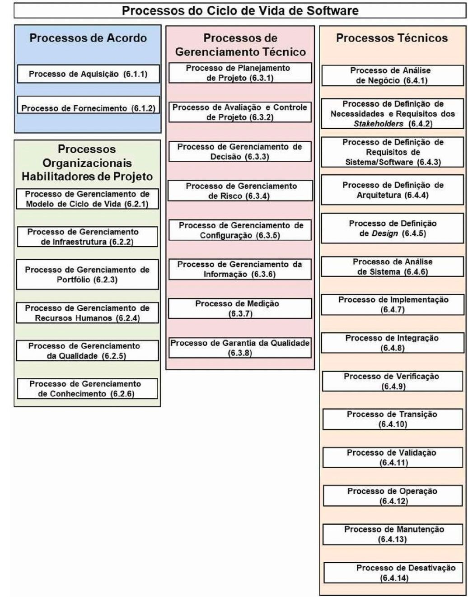
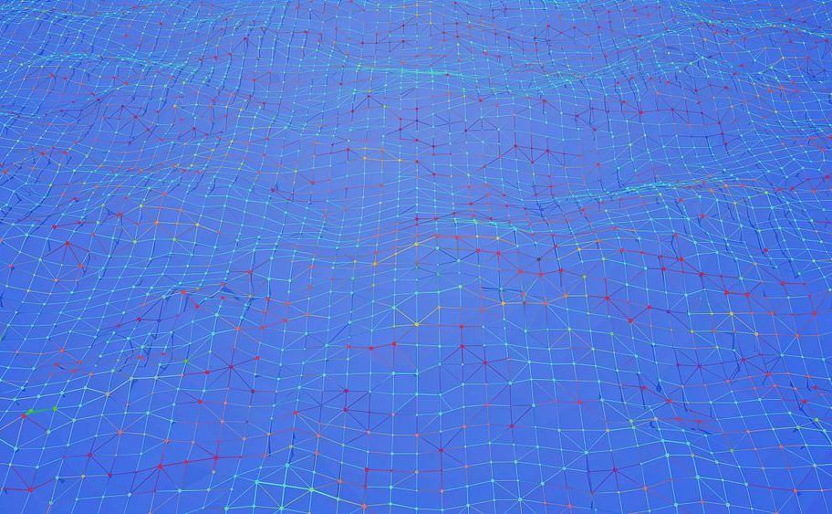
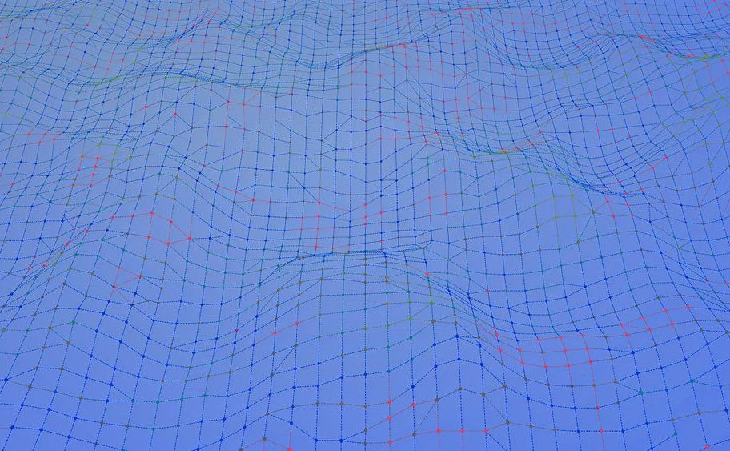

# Aula 06 Processos Tecnicos

> **Documento de Origem:** `aula-06-processos-tecnicos.pdf`  
> **Total de Slides:** 41  
> **Disciplina:** Processos de Engenharia de Software (INF0449 - UFG)  

---

## Slide 01

PROCESSOS DE ENGENHARIA DE SOFTWARE

INF0449 — Bacharelado em Engenharia de Software · UFG

#### AULA 6

---

## Slide 02

### ISO/IEC/IEEE 12207:2017

PROCESSOS DO CICLO DE VIDA DE SOFTWARE

---

## Slide 03

### PROCESSOS TÉCNICOS: ANÁLISE DO NEGÓCIO

PROCESSOS TÉCNICOS: PROCESSOS DE ANÁLISE DO NEGÓCIO

#### PROPÓSITO
Identificar problemas ou oportunidades de negócio

#### ATIVIDADES PRINCIPAIS
Preparação da análise do negócio

Definir o espaço de solução

Definição do problema/oportunidade

Caracterização da solução

Caracterizar o contexto operacional

Estabelecer viabilidade da solução proposta

Avaliação de alternativas de solução

Gestão do conceito de operação

---

## Slide 04

### PROCESSOS TÉCNICOS: ANÁLISE DO NEGÓCIO

#### SAÍDAS DO PROCESSO

- **01. DECLARAÇÃO DO PROBLEMA/OPORTUNIDADE**  
  Descrição formal do problema ou oportunidade identificada no negócio.
- **02. CONCEITO DE OPERAÇÃO (CONOPS)**  
  Documento que descreve como o sistema será operado pelos usuários e stakeholders.
- **03. REQUISITOS DE NEGÓCIO**  
  Conjunto de necessidades e restrições derivadas da análise do negócio.
- **04. AVALIAÇÃO DE VIABILIDADE**  
  Análise da viabilidade técnica, econômica e operacional da solução proposta.
- **05. RASTREABILIDADE PARA STAKEHOLDERS**  
  Mapeamento dos requisitos às necessidades e expectativas dos stakeholders.

---

## Slide 05

### PROCESSOS TÉCNICOS: STAKEHOLDERS

PROCESSOS TÉCNICOS: PROCESSO DE DEFINIÇÃO DE NECESSIDADES E REQUISITOS DOS STAKEHOLDERS

#### PROPÓSITO
Identificar todos os stakeholders relevantes

#### ATIVIDADES PRINCIPAIS

Preparação do processo

Elicitação das necessidades

Elicitar necessidades, expectativas e restrições

Identificação dos stakeholders

Definição dos requisitos dos stakeholders

Gestão dos requisitos dos stakeholders

Transformar necessidades em requisitos mensuráveis

Estabelecer critérios de aceitação do sistema

Análise e validação dos requisitos

---

## Slide 06

### PROCESSOS TÉCNICOS: STAKEHOLDERS

PROCESSOS TÉCNICOS: PROCESSO DE DEFINIÇÃO DE NECESSIDADES E REQUISITOS DOS STAKEHOLDERS

#### SAÍDAS DO PROCESSO

- **01. REGISTRO DOS STAKEHOLDERS**  
  Lista identificada e classificada de todos os stakeholders envolvidos.

**02. NECESSIDADES DOS STAKEHOLDERS**  
Declaração das necessidades, expectativas e restrições capturadas.

**03. REQUISITOS DOS STAKEHOLDERS**  
Conjunto formal de requisitos derivados das necessidades identificadas.

**04. CRITÉRIOS DE ACEITAÇÃO**  
Condições mensuráveis que o sistema deve satisfazer para ser aceito.

---

## Slide 07

### PROCESSOS TÉCNICOS:

PROCESSO DE DEFINIÇÃO DE REQUISITOS DE SISTEMAS/SOFTWARE

Segundo a ISO 12207:2017, o processo de requisitos transforma necessidades dos stakeholders em um conjunto completo, consistente e verificável de requisitos de sistema — a fundação para todas as decisões técnicas subsequentes.

#### ELICITAÇÃO

#### ANÁLISE

#### ESPECIFICAÇÃO

#### VALIDAÇÃO

Identificar e capturar necessidades dos stakeholders

Refinar, priorizar e resolver conflitos entre requisitos

Documentar de forma clara, completa e rastreável

Confirmar que os requisitos refletem as necessidades reais

---

## Slide 08

### PROCESSO DE DEFINIÇÃO DE REQUISITOS DE SISTEMAS/SOFTWARE

ELICITAÇÃO DE REQUISITOS

ENTREVISTAS E WORKSHOPS

Com stakeholders para capturar necessidades explícitas e implícitas

#### PROTOTIPAÇÃO

Para validar entendimento e revelar requisitos ocultos

A elicitação é iterativa — novos requisitos surgem à medida que o entendimento do sistema evolui.

#### ANÁLISE DE DOCUMENTOS
Contratos, regulamentos e sistemas legados existentes

#### OBSERVAÇÃO E ETNOGRAFIA
Do ambiente de uso real do sistema

#### BRAINSTORMING E CASOS DE USO
Para explorar cenários e fluxos alternativos

---

## Slide 09

### PROCESSO DE DEFINIÇÃO DE REQUISITOS DE SISTEMAS/SOFTWARE

ANÁLISE E ESPECIFICAÇÃO DE REQUISITOS

#### ANÁLISE
Identificar conflitos e ambiguidades entre requisitos

#### ESPECIFICAÇÃO

Linguagem clara, sem ambiguidade

Requisitos mensuráveis e verificáveis

Rastreabilidade desde a origem (stakeholder) até o teste

Formato: SRS (Software Requirements Specification) ou equivalente

Classificar: funcionais, não funcionais, de interface, de restrição

Priorizar com stakeholders (ex: MoSCoW)

Verificar viabilidade técnica e de custo

> **📌 ISO 12207:2017 — Seção 6.4.1: System/Software Requirements Definition Process**

---

## Slide 10

### PROCESSO DE DEFINIÇÃO DE REQUISITOS DE SISTEMAS/SOFTWARE

RASTREABILIDADE DE REQUISITOS

A rastreabilidade garante que cada requisito possa ser rastreado desde sua origem (stakeholder) até os artefatos de design, código e testes — e vice-versa.

**01. NECESSIDADE DO STAKEHOLDER**  
origem identificada e documentada

**02. REQUISITO DO SISTEMA**  
especificado no SRS com ID único

**03. COMPONENTE DE DESIGN**  
arquitetura e módulos que o implementam

**05. CASO DE TESTE**  
verificação e validação do requisito

> **⚠️ Requisitos sem rastreabilidade são um risco: mudanças podem quebrar o sistema sem que a equipe perceba o impacto.**

---

## Slide 11

### PROCESSO DE DEFINIÇÃO DE REQUISITOS DE SISTEMAS/SOFTWARE

VALIDAÇÃO DE REQUISITOS

Validar requisitos significa confirmar que o que foi especificado realmente representa o que os stakeholders precisam — antes de qualquer linha de código ser escrita.

#### CRITÉRIOS DE UM BOM REQUISITO (SMART)

#### ESPECÍFICO

sem ambiguidade, com significado único

#### TÉCNICAS DE VALIDAÇÃO

Revisões formais com stakeholders

Prototipagem e demonstrações

Checklists de qualidade de requisitos

Revisão por pares (peer review)

Simulações e modelos executáveis

#### MENSURÁVEL
possui critério de aceitação verificável

#### ATINGÍVEL
tecnicamente e economicamente viável

#### RELEVANTE
alinhado ao objetivo do sistema

#### TESTÁVEL
pode ser verificado por inspeção ou teste

> **📌 Um requisito não validado é uma suposição — e suposições custam caro na fase de implementação.**

---

## Slide 12

ATIVIDADE EM SALA PROJETO INTEGRADOR DA DISCIPLINA

---

## Slide 13

### ESTRUTURA COMPLETA DO MANUAL DE PROCESSO

### PARTE 0 - APRESENTAÇÃO DO SOFTWARE

#### PARTE 1 - PROCESSOS DE ACORDO

PARTE 2 - PROCESSOS ORGANIZACIONAIS HABILITADORES

PARTE 3 - PROCESSOS DE GERENCIAMENTO TÉCNICO

PARTE 4 - PROCESSOS TÉCNICOS - ATIVIDADE EM SALA HOJE: REQUISITOS

> **⚠️ Atenção: Nem todos os módulos serão cobertos na disciplina com a mesma profundidade — o foco será nos processos trabalhados em cada bloco temático da ementa.**

---

## Slide 14

### ATIVIDADE DE EQUIPE EM SALA

#### PARTE 4 - PROCESSOS TÉCNICOS

#### REQUISITOS

Documento de requisitos do sistema (funcionais, não funcionais, restrições)

Rastreabilidade de requisitos

Critérios de aceitação

Registro de stakeholders e necessidades elicitadas

> **📌 Referência: Seção 6.4 da ISO 12207:2017**

> **⚠️ Atenção: Os artefatos não precisam ser extensos — precisam ser consistentes, justificados e aplicados ao seu projeto real. Qualidade > quantidade.**

---

## Slide 15

CONTINUAÇÃO: PROCESSOS TÉCNICOS

---

## Slide 16

### PROCESSOS TÉCNICOS: ARQUITETURA

PROCESSOS TÉCNICOS: PROCESSO DE DEFINIÇÃO DE ARQUITETURA

#### PROPÓSITO
Definir a estrutura de alto nível do sistema

#### ATIVIDADES PRINCIPAIS

Preparação do processo de arquitetura

Alocação de requisitos aos elementos

Avaliação de alternativas de arquitetura

Definição dos elementos arquiteturais

Definição de interfaces entre elementos

Gestão da arquitetura do sistema

Identificar os componentes e suas responsabilidades

Estabelecer interfaces entre os elementos arquiteturais

Garantir que os requisitos sejam alocados à arquitetura

Avaliar alternativas arquiteturais

---

## Slide 17

### PROCESSOS TÉCNICOS: ARQUITETURA

PROCESSOS TÉCNICOS: PROCESSO DE DEFINIÇÃO DE ARQUITETURA

#### SAÍDAS DO PROCESSO

- **01. DOCUMENTO DE ARQUITETURA**  
  Descrição formal da estrutura, componentes e interfaces do sistema

- **04. AVALIAÇÃO ARQUITETURAL**  
  Registro das alternativas consideradas e justificativa das decisões tomadas

**02. ALOCAÇÃO DE REQUISITOS**  
Mapeamento de cada requisito ao(s) elemento(s) arquitetural(is) responsável(is)

**03. ESPECIFICAÇÃO DE INTERFACES**  
Definição formal das interfaces entre os componentes do sistema

**05. RASTREABILIDADE**  
Vínculo entre requisitos dos stakeholders e elementos da arquitetura

---

## Slide 18

### PROCESSOS TÉCNICOS: DESIGN

PROCESSOS TÉCNICOS: PROCESSO DE DEFINIÇÃO DE DESIGN

#### PROPÓSITO
Detalhar os elementos arquiteturais em componentes implementáveis

#### ATIVIDADES PRINCIPAIS
Preparação do processo de design

Especificar algoritmos, estruturas de dados e lógica interna

Transformação da arquitetura em design detalhado

Especificação de estruturas de dados e algoritmos

Gestão do design do software

Especificação de interfaces de componentes

Avaliação do design

Definir interfaces detalhadas entre componentes

Garantir que o design satisfaz todos os requisitos alocados

Fornecer base suficiente para a implementação

---

## Slide 19

### PROCESSOS TÉCNICOS: DESIGN

PROCESSOS TÉCNICOS: PROCESSO DE DEFINIÇÃO DE DESIGN

#### SAÍDAS DO PROCESSO

- **01. DOCUMENTO DE DESIGN DETALHADO**  
  Especificação completa dos componentes, algoritmos e estruturas de dados

- **04. AVALIAÇÃO DO DESIGN**  
  Registro das decisões de design e justificativas técnicas adotadas

**02. ESPECIFICAÇÃO DE INTERFACES**  
Definição precisa das interfaces internas e externas dos componentes

**03. MODELO DE DADOS**  
Estruturas de dados, entidades, relacionamentos e restrições do sistema

---

## Slide 20

### PROCESSOS TÉCNICOS: ANÁLISE DE SISTEMA

PROCESSOS TÉCNICOS: PROCESSO DE ANÁLISE DE SISTEMA

#### PROPÓSITO
Analisar o problema ou oportunidade no contexto do sistema

#### ATIVIDADES PRINCIPAIS
Preparação do processo de análise

Análise do problema/oportuni dade no contexto do sistema

Identificação de restrições e premissas

Gestão da análise do sistema

Definir o conceito de solução do sistema

Definição do conceito de solução

Avaliação de alternativas de solução

Identificar restrições técnicas, operacionais e de negócio

Avaliar alternativas de solução do sistema

Estabelecer a viabilidade da solução proposta

---

## Slide 21

### PROCESSOS TÉCNICOS: ANÁLISE DE SISTEMA

PROCESSOS TÉCNICOS: PROCESSO DE ANÁLISE DE SISTEMA

#### SAÍDAS DO PROCESSO

- **01. CONCEITO DE SOLUÇÃO DO SISTEMA**  
  Descrição da solução proposta e como ela atende às necessidades identificadas

- **04. AVALIAÇÃO DE VIABILIDADE**  
  Análise técnica, econômica e operacional da solução escolhida

**02. RESTRIÇÕES E PREMISSAS**  
Limitações técnicas, operacionais, regulatórias e de negócio consideradas

**03. ALTERNATIVAS AVALIADAS**  
Registro das opções consideradas e critérios utilizados na seleção

**05. RASTREABILIDADE**  
Vínculo entre o conceito de solução e as necessidades dos stakeholders

---

## Slide 22

ATIVIDADE EM SALA PROJETO INTEGRADOR DA DISCIPLINA

---

## Slide 23

### ESTRUTURA COMPLETA DO MANUAL DE PROCESSO

### PARTE 0 - APRESENTAÇÃO DO SOFTWARE

#### PARTE 1 - PROCESSOS DE ACORDO

PARTE 2 - PROCESSOS ORGANIZACIONAIS HABILITADORES

PARTE 3 - PROCESSOS DE GERENCIAMENTO TÉCNICO

PARTE 4 - PROCESSOS TÉCNICOS - ATIVIDADE EM SALA HOJE: ARQUITETURA E DESIGN

> **⚠️ Atenção: Nem todos os módulos serão cobertos na disciplina com a mesma profundidade — o foco será nos processos trabalhados em cada bloco temático da ementa.**

---

## Slide 24

### ATIVIDADE DE EQUIPE EM SALA

#### PARTE 4 - PROCESSOS TÉCNICOS

#### ARQUITETURA E DESIGN

Documento de arquitetura do sistema (visão geral, componentes, interfaces)

Decisões arquiteturais (ADRs)

Diagramas de design (UML, C4, etc.)

Justificativa das escolhas tecnológicas

> **📌 Referência: Seção 6.4 da ISO 12207:2017**

> **⚠️ Atenção: Os artefatos não precisam ser extensos — precisam ser consistentes, justificados e aplicados ao seu projeto real. Qualidade > quantidade.**

---

## Slide 25

CONTINUAÇÃO: PROCESSOS TÉCNICOS

---

## Slide 26

### PROCESSOS TÉCNICOS: IMPLEMENTAÇÃO E INTEGRAÇÃO

PROCESSOS TÉCNICOS: PROCESSO DE IMPLEMENTAÇÃO

#### CODIFICAÇÃO
Desenvolvimento de componentes conforme padrões e design definidos

#### TESTE UNITÁRIO
Verificação isolada de cada unidade de software

#### INTEGRAÇÃO
Combinação incremental e controlada dos componentes

#### VERIFICAÇÃO DA INTEGRAÇÃO
Confirmação de que o sistema integrado atende aos requisitos

---

## Slide 27

### PROCESSOS TÉCNICOS: IMPLEMENTAÇÃO E INTEGRAÇÃO

CODIFICAÇÃO E PADRÕES DE IMPLEMENTAÇÃO

A codificação não é apenas escrever código — é traduzir decisões de design em software confiável, legível e mantível, seguindo padrões estabelecidos pela equipe e pela organização.

#### BOAS PRÁTICAS DE CODIFICAÇÃO

Seguir guias de estilo e convenções da equipe (ex: Google Style Guide)

Código autoexplicativo com nomes significativos

Funções pequenas e com responsabilidade única (SRP)

Revisão de código obrigatória (code review)

#### CONFORMIDADE COM O DESIGN

Rastreabilidade entre código e requisitos (ex: comentários com ID do requisito)

Aderência à arquitetura definida (sem desvios não documentados)

Registro de decisões técnicas (ADRs) quando houver mudança

Documentação inline e gerada automaticamente (ex: JSDoc, Javadoc)

Controle de versão com commits atômicos e mensagens claras

> **📌 ISO 12207:2017 — Seção 6.4.5: Software Construction Process**

---

## Slide 28

### PROCESSOS TÉCNICOS: IMPLEMENTAÇÃO E INTEGRAÇÃO

TESTES UNITÁRIOS E DE COMPONENTE

Cada unidade de software deve ser verificada isoladamente antes de ser integrada. Os testes unitários garantem que o comportamento individual de cada componente está correto e documentado.

#### O QUE TESTAR?

#### COMPORTAMENTO ESPERADO

saídas corretas para entradas válidas

#### BOAS PRÁTICAS

Testes independentes e repetíveis (sem estado compartilhado)

Nomenclatura clara: dado_quando_então (given_when_then)

Cobertura de código como métrica de qualidade (mínimo 80%)

Automatização com CI/CD (ex: JUnit, pytest, Jest)

Mocks e stubs para isolar dependências externas

#### CASOS DE BORDA
limites, valores nulos, entradas inválidas

#### TRATAMENTO DE ERROS
exceções e falhas controladas

#### DESEMPENHO MÍNIMO
tempo de resposta dentro do aceitável

> **📌 ISO 12207:2017 — Seção 6.4.6: Software Qualification Testing Process**

---

## Slide 29

### PROCESSOS TÉCNICOS: IMPLEMENTAÇÃO E INTEGRAÇÃO

PROCESSOS TÉCNICOS: PROCESSOS DE INTEGRAÇÃO

A integração define como os componentes desenvolvidos separadamente são combinados em um sistema funcional. A escolha da estratégia impacta diretamente a detecção de falhas e o ritmo de entrega.

#### BIG BANG

#### TOP-DOWN

Todos os componentes integrados de uma vez. Simples, mas dificulta o isolamento de falhas. Indicado apenas para sistemas pequenos.

Integração a partir dos módulos de mais alto nível, usando stubs para simular os inferiores. Valida a arquitetura cedo.

#### BOTTOM-UP
Integração a partir dos módulos de mais baixo nível, usando drivers para simular os superiores. Valida componentes fundamentais primeiro.

#### INCREMENTAL / CONTÍNUA
Integração frequente e automatizada (CI). Detecta conflitos rapidamente. Padrão da indústria moderna.

> **💡 A integração contínua (CI) é a abordagem recomendada para projetos ágeis — integre cedo, integre sempre.**

---

## Slide 30

### PROCESSOS TÉCNICOS: IMPLEMENTAÇÃO E INTEGRAÇÃO

#### RASTREABILIDADE ENTRE CÓDIGO E REQUISITOS

A rastreabilidade na implementação garante que cada trecho de código pode ser vinculado a um requisito específico — e que nenhum requisito ficou sem implementação.

- **01. REQUISITO IDENTIFICADO**  
  ID único no SRS (ex: REQ-042)
- **02. TASK/ISSUE CRIADA**  
  Vinculada ao requisito no gerenciador (ex: Jira, GitHub Issues)
- **03. BRANCH DE DESENVOLVIMENTO**  
  Nomeada com referência ao requisito ou issue
- **04. COMMITS RASTREÁVEIS**  
  Mensagens referenciam o ID do requisito (ex: `feat: REQ-042 - login com OAuth`)
- **05. PULL REQUEST REVISADO**  
  Revisão de código com checklist de conformidade
- **06. CASO DE TESTE VINCULADO**  
  Teste automatizado referencia o mesmo ID de requisito

> **⚠️ Sem rastreabilidade, mudanças de requisito geram retrabalho silencioso — o código muda, mas ninguém sabe o que foi afetado.**

---

## Slide 31

### PROCESSOS TÉCNICOS: IMPLEMENTAÇÃO E INTEGRAÇÃO

PLANO DE INTEGRAÇÃO E CRITÉRIOS DE ACEITAÇÃO

O plano de integração define a sequência, os responsáveis, os ambientes e os critérios que determinam se a integração foi bem-sucedida — antes de qualquer código ser combinado.

#### O QUE O PLANO DE INTEGRAÇÃO DEVE CONTER

CRITÉRIOS DE ACEITAÇÃO DA INTEGRAÇÃO

#### SEQUÊNCIA DE INTEGRAÇÃO

Todos os testes de integração passando (sem falhas bloqueantes)

ordem dos componentes e dependências

Nenhuma regressão nos testes unitários existentes

Cobertura de código mantida ou melhorada

Ausência de conflitos de interface entre módulos

Documentação de integração atualizada

#### AMBIENTE DE INTEGRAÇÃO
configuração de infraestrutura e dados de teste

#### RESPONSÁVEIS
quem integra, quem revisa, quem aprova

#### CRONOGRAMA
marcos e janelas de integração

#### PROCEDIMENTOS DE ROLLBACK
como reverter em caso de falha

> **📌 ISO 12207:2017 — Seção 6.4.7: Software Integration Process**

---

## Slide 32

### PROCESSOS TÉCNICOS:

VERIFICAÇÃO E VALIDAÇÃO

#### MECANISMOS FORMAIS

Revisões conjuntas entre equipe técnica e cliente

Auditorias de qualidade independentes

Análise de conformidade com critérios pré- definidos

Testes de aceitação orientados a cenários reais

#### VERIFICAÇÃO
"Estamos construindo o produto corretamente?" — Confirma que os produtos refletem fielmente os requisitos especificados em cada fase.

#### VALIDAÇÃO
"Estamos construindo o produto certo?" — Confirma que o produto atende ao uso pretendido pelo stakeholder em seu ambiente real.

---

## Slide 33

### PROCESSOS TÉCNICOS: VERIFICAÇÃO E VALIDAÇÃO

#### VERIFICAÇÃO VS. VALIDAÇÃO: A DISTINÇÃO FUNDAMENTAL

Embora frequentemente confundidas, verificação e validação respondem a perguntas distintas e ocorrem em momentos diferentes do ciclo de vida do sistema.

| Critério de Comparação | Verificação | Validação |
| :--- | :--- | :--- |
| **Pergunta Central** | *"Estamos construindo o produto corretamente?"* | *"Estamos construindo o produto certo?"* |
| **Foco** | Conformidade com especificações e requisitos definidos | Adequação ao uso pretendido pelo stakeholder |
| **Quando Ocorre** | Em cada fase do ciclo de vida (contínua) | Ao final de fases ou do projeto |
| **Quem Realiza** | Equipe técnica interna | Stakeholders e usuários reais |
| **Exemplos** | Revisão de código, inspeção de design, análise estática | Testes de aceitação, demonstrações, pilotos em produção |

> **📌 ISO 12207:2017 — Seção 6.4.11 (Verificação) e 6.4.12 (Validação)**

---

## Slide 34

### PROCESSOS TÉCNICOS: VERIFICAÇÃO E VALIDAÇÃO

TÉCNICAS DE VERIFICAÇÃO

A verificação utiliza técnicas estáticas e dinâmicas para confirmar que cada artefato do sistema está em conformidade com os requisitos e padrões definidos.

#### TÉCNICAS ESTÁTICAS (SEM EXECUÇÃO)
Revisão por pares (Peer Review) — inspeção informal do código ou documento por colegas

#### TÉCNICAS DINÂMICAS (COM EXECUÇÃO)

Testes de unidade — verificação isolada de componentes

Testes de integração — verificação das interfaces entre módulos

Testes de regressão — garantia de que mudanças não quebraram o existente

Análise de cobertura — percentual do código exercitado pelos testes

Testes de desempenho — verificação de requisitos não funcionais

Inspeção formal (Fagan) — revisão estruturada com papéis definidos e checklist

Análise estática de código — ferramentas automatizadas (ex: SonarQube, ESLint)

Revisão de design — avaliação da arquitetura e decisões técnicas

Walkthrough — autor guia a equipe pelo artefato para detectar problemas

> **💡 Técnicas estáticas detectam até 60% dos defeitos antes da execução — e custam muito menos para corrigir.**

---

## Slide 35

### PROCESSOS TÉCNICOS: VERIFICAÇÃO E VALIDAÇÃO

TÉCNICAS DE VALIDAÇÃO

A validação confirma que o sistema entregue atende às necessidades reais dos stakeholders no seu contexto de uso — não apenas ao que foi especificado.

#### TESTES DE ACEITAÇÃO DO USUÁRIO (UAT)
usuários reais executam cenários representativos do uso cotidiano. Critério final de aprovação do sistema.

#### PROTOTIPAGEM E DEMONSTRAÇÕES
versões parciais ou simuladas do sistema são apresentadas aos stakeholders para coleta de feedback antecipado.

#### TESTES ALFA E BETA
alfa: ambiente controlado com usuários selecionados; beta: ambiente real com grupo ampliado antes do lançamento oficial.

#### REVISÕES COM STAKEHOLDERS
sessões formais onde o sistema é avaliado contra os objetivos de negócio e necessidades originais.

#### PILOTOS EM PRODUÇÃO
implantação controlada em subconjunto real de usuários para validar comportamento em ambiente de produção.

> **⚠️ Validação tardia é cara: descobrir que o sistema não atende às necessidades reais após a entrega pode inviabilizar o projeto.**

---

## Slide 36

### PROCESSOS TÉCNICOS: VERIFICAÇÃO, VALIDAÇÃO E TRANSIÇÃO

PROCESSO DE TRANSIÇÃO DO SISTEMA

A transição é o processo que move o sistema verificado e validado do ambiente de desenvolvimento para o ambiente operacional — de forma controlada, segura e documentada.

#### PLANEJAMENTO DA TRANSIÇÃO
definição de cronograma, responsáveis, ambientes e critérios de sucesso da implantação

#### PREPARAÇÃO DO AMBIENTE
configuração de infraestrutura de produção, migração de dados e instalação de dependências

#### TREINAMENTO DOS USUÁRIOS
capacitação das equipes operacionais e usuários finais antes da entrada em produção

#### IMPLANTAÇÃO CONTROLADA
execução da transição com estratégia definida (big bang, faseada, canary release ou blue-green)

#### VERIFICAÇÃO PÓS-IMPLANTAÇÃO
confirmação de que o sistema opera corretamente no ambiente real

#### ACEITE FORMAL
aprovação pelos stakeholders e encerramento formal da fase de desenvolvimento

> **📌 ISO 12207:2017 — Seção 6.4.13: Software Transition Process. A transição bem planejada reduz riscos operacionais e garante continuidade do negócio.**

---

## Slide 37

### PROCESSOS TÉCNICOS: VERIFICAÇÃO E VALIDAÇÃO

PLANO DE V&V: O QUE DOCUMENTAR

O Plano de Verificação e Validação (V&V Plan) é o artefato central desta fase — define o que será verificado/validado, como, quando, por quem e com quais critérios de sucesso.

#### ESTRUTURA DO PLANO DE V&V

#### ESCOPO

#### ABORDAGEM

quais artefatos e componentes serão cobertos

técnicas estáticas e dinâmicas selecionadas

PARA O PROJETO DE VOCÊS, O PLANO DEVE INCLUIR:

Lista de requisitos a serem verificados (com IDs)

Casos de teste mapeados a cada requisito

Responsável por cada atividade de V&V

Ferramentas utilizadas (ex: Jest, Postman, SonarQube)

Critério de aceite definido com o cliente/professor

Registro de resultados e defeitos encontrados

#### CRITÉRIOS DE ENTRADA E SAÍDA
condições para iniciar e encerrar cada atividade

#### RECURSOS E RESPONSÁVEIS
equipe, ferramentas e ambientes necessários

#### CRONOGRAMA
marcos de verificação alinhados ao plano de projeto

#### CRITÉRIOS DE ACEITAÇÃO
métricas mensuráveis de qualidade (ex: cobertura ≥ 80%, zero defeitos críticos)

> **📌 Referência: Seção 6.4.11–6.4.13 da ISO 12207:2017**

---

## Slide 38

### PROCESSOS TÉCNICOS: OPERAÇÃO, MANUTENÇÃO E DESCONTINUAÇÃO

PROCESSOS TÉCNICOS: OPERAÇÃO, MANUTENÇÃO E DESCONTINUAÇÃO

Segundo a ISO 12207:2017, após a transição do sistema para produção, três processos garantem sua continuidade, evolução e encerramento responsável ao longo de todo o ciclo de vida operacional.

#### OPERAÇÃO

Compreende a execução do sistema em ambiente real, o suporte contínuo aos usuários e o monitoramento de desempenho. Inclui o tratamento de incidentes operacionais e a garantia de que o sistema opere dentro dos parâmetros e requisitos estabelecidos.

> **📌 ISO 12207:2017 — Seções 6.4.14 (Operação), 6.4.15 (Manutenção) e 6.4.16 (Descontinuação)**

#### MANUTENÇÃO
Processo estruturado de modificação do sistema após a entrega, abrangendo manutenção corretiva (correção de defeitos), adaptativa (adequação ao ambiente), perfectiva (melhorias de qualidade) e preventiva (redução de riscos futuros).

#### DESCONTINUAÇÃO
Planejamento e execução da retirada controlada do sistema de operação: migração ou arquivamento seguro de dados, notificação formal de stakeholders e encerramento de contratos e infraestrutura de suporte.

---

## Slide 39

ATIVIDADE EM SALA PROJETO INTEGRADOR DA DISCIPLINA

---

## Slide 40

### ESTRUTURA COMPLETA DO MANUAL DE PROCESSO

### PARTE 0 - APRESENTAÇÃO DO SOFTWARE

#### PARTE 1 - PROCESSOS DE ACORDO

PARTE 2 - PROCESSOS ORGANIZACIONAIS HABILITADORES

PARTE 3 - PROCESSOS DE GERENCIAMENTO TÉCNICO

PARTE 4 - PROCESSOS TÉCNICOS - ATIVIDADE EM SALA HOJE: VERIFICAÇÃO, VALIDAÇÃO E TRANSIÇÃO

> **⚠️ Atenção: Nem todos os módulos serão cobertos na disciplina com a mesma profundidade — o foco será nos processos trabalhados em cada bloco temático da ementa.**

---

## Slide 41

### ATIVIDADE DE EQUIPE EM SALA

#### PARTE 4 - PROCESSOS TÉCNICOS

#### VERIFICAÇÃO, VALIDAÇÃO E TRANSIÇÃO

Plano de verificação e validação

Critérios de aceitação por stakeholder

Relatório de testes de aceitação

Plano de transição/implantação do sistema

> **📌 Referência: Seção 6.4 da ISO 12207:2017**

> **⚠️ Atenção: Os artefatos não precisam ser extensos — precisam ser consistentes, justificados e aplicados ao seu projeto real. Qualidade > quantidade.**

---

