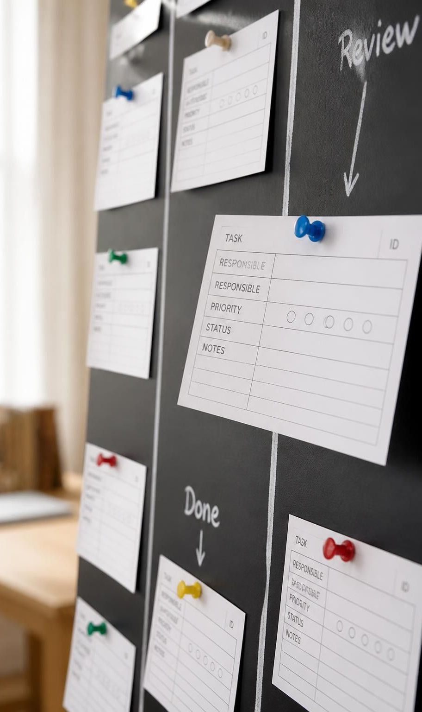

# Aula 07 Modelos Qualidade Processos Software

> **Documento de Origem:** `aula-07-modelos-qualidade-processos-software.pdf`  
> **Total de Slides:** 25  
> **Disciplina:** Processos de Engenharia de Software (INF0449 - UFG)  

---

## Slide 01

### Processos de Engenharia de Software

Modelos de qualidade de processos de software

ISO/IEC 330xx, CMMI e MPS.BR

Profa. Juliana Souza-Zinader

Disciplina de Processos de Engenharia de Software

---

## Slide 02

### Objetivos da aula

Explicar a finalidade dos modelos de qualidade de processos.

Diferenciar capacidade de processo e maturidade organizacional.

Descrever como planejar e acompanhar uma melhoria.

Explicar como uma avaliação usa critérios e evidências.

Aplicar os conceitos ao capítulo 6 do Manual de Processos de Software.

---

## Slide 03

### O que muda em relação às aulas anteriores

A ISO/IEC/IEEE 12207:2017 organiza os processos do ciclo de vida; estes referenciais avaliam a execução e orientam a melhoria.

Antes Quais processos fazem parte do ciclo de vida?

Como descrevê-los no manual?

Agora Como avaliar e melhorar esses processos?

O que precisa ficar mais claro ou funcionar melhor?

O trabalho continua sendo o projeto integrador da equipe.

> *Fonte: R1–R3, R6.*

---

## Slide 04

### Qualidade do produto e qualidade do processo

Produto

Características e comportamento do software entregue.

Ex.: o sistema salva corretamente os dados.

Processo

Adequação da forma de trabalhar para gerar resultados consistentes.

Ex.: a equipe define como verificar e registra o resultado.

Bons processos favorecem a qualidade do produto, que ainda precisa de verificação e validação.

> *Fonte: R1–R4.*

---

## Slide 05

### Para que servem os modelos

de qualidade de processos

Comparar

A situação da equipe com critérios conhecidos.

Identificar

Pontos fortes e lacunas.

Priorizar

Melhorias.

Verificar

A evolução ao longo do tempo.

Tarefas sem responsável mostram a necessidade de definir e acompanhar responsabilidades. As práticas devem fazer sentido para o contexto.

> *Fonte: R2–R7.*

---

## Slide 06

### Capacidade e maturidade são coisas diferentes

Capacidade de processo Como um processo consegue atingir seus objetivos?

Maturidade organizacional Como um conjunto de processos está organizado e consolidado na unidade avaliada?

Uma equipe pode organizar bem os testes e ainda ter dificuldade de planejar tarefas.

Níveis de modelos diferentes não têm equivalência automática.

> *Fonte: R2–R6.*

---

## Slide 07

### ISO/IEC 330xx: a família de

normas de avaliação de processos

33001:2015

Conceitos e terminologia.

33002:2015

Requisitos para realizar avaliações.

33004:2015

Requisitos para modelos de referência, avaliação e maturidade.

33020:2019

Estrutura de medição da capacidade de processos.

Continua a evolução da ISO/IEC 15504 (SPICE).

> *Fonte: R2–R3.*

---

## Slide 08

### ISO/IEC 33020 mede a capacidade em seis níveis

| Nível | Classificação |
| :---: | :--- |
| **0** | Incompleto |
| **1** | Executado |
| **2** | Gerenciado |
| **3** | Estabelecido |
| **4** | Previsível |
| **5** | Inovador |

O nível depende da avaliação dos atributos e das regras aplicáveis.

> *Traduções didáticas. Fonte: R3.*

---

## Slide 09

### CMMI

Capability Maturity Model Integration, mantido pela ISACA/CMMI Institute para orientar a melhoria de capacidade e desempenho.

#### Níveis de Maturidade (0 a 5)

| Nível | Classificação |
| :---: | :--- |
| **0** | Incompleto |
| **1** | Inicial |
| **2** | Gerenciado |
| **3** | Definido |
| **4** | Gerenciado quantitativamente |
| **5** | Em otimização |

#### Capacidade por área de prática (Níveis de 0 a 3)

Com padrões organizacionais, vários projetos usam orientações comuns, adaptadas ao contexto.

> *CMMI V3.0. Fonte: R4–R5.*

---

## Slide 10

### MPS.BR

Programa coordenado pela Softex; o foco é o modelo MR-MPS-SW. O modelo orienta os resultados esperados e o método MA-MPS orienta a avaliação.

| Nível | Descrição (Níveis de G a A) |
| :---: | :--- |
| **G** | Parcialmente Gerenciado |
| **F** | Gerenciado |
| **E** | Parcialmente Definido |
| **D** | Largamente Definido |
| **C** | Definido |
| **B** | Gerenciado Quantitativamente |
| **A** | Em Otimização |

Uma prática isolada não determina um nível.

> *Guias MPS 2024. Fonte: R6–R7.*

---

## Slide 11

### Comparando os referenciais

| Referencial | Finalidade | Níveis |
| :--- | :--- | :--- |
| **ISO/IEC 330xx** | Normas para estruturar avaliações | Capacidade 0–5 na 33020 |
| **CMMI** | Melhoria de desempenho | Maturidade 0–5 e capacidade 0–3 |
| **MPS.BR** | Melhoria no contexto brasileiro | Maturidade G–A |

Todos trabalham com critérios explícitos.

A escolha considera objetivos, contexto, recursos e exigências dos clientes.

---

## Slide 12

### Melhorar um processo é

mudar a forma de trabalhar

Uma melhoria define o problema e suas evidências, a mudança proposta, quem executa e como verificar aplicação e efeitos.

Uma tarefa parou porque ninguém sabia quem a faria; a melhoria é definir o responsável ao criar cada tarefa.

O modelo orienta a análise e a equipe transforma isso em ações.

> *Fonte: R4, R8–R9.*

---

## Slide 13

### IDEAL: cinco fases para

implementar a melhoria

**01. Iniciar**  
Definir objetivo e obter apoio.

**02. Diagnosticar**  
Entender a situação atual.

**03. Estabelecer**  
Planejar as ações.

**04. Agir**  
Experimentar e aplicar a mudança.

**05. Aprender**  
Analisar resultados e ajustar.

Comece com um problema pequeno e um recorte bem definido.

> *Modelo do Software Engineering Institute. Fonte: R8.*

---

## Slide 14

### O plano de melhoria transforma intenção em ação

### Campo

Plano de melhoria

Exemplo: tarefas sem responsável

Problema Tarefas sem responsável definido.

Ação Definir responsável e prazo ao criar cada tarefa e conferir nas revisões do quadro.

Responsável e prazo Ana atualiza o quadro antes da próxima revisão.

Evidência Quadro atualizado e registro da conferência.

Resultado esperado Reduzir dúvidas sobre quem executa cada tarefa.

Exemplo fictício, baseado em R8.

---

## Slide 15

### Como manter a melhoria

Incorporar a ação à rotina.

Orientar quem participará.

Manter os registros necessários.

Revisar dificuldades e resultados.

Ajustar a prática quando o contexto mudar.

A cada revisão do quadro, conferir se as tarefas têm responsável. O procedimento deve ser proporcional ao trabalho e pode integrar abordagens ágeis.

> *Fonte: R4, R8.*

---

## Slide 16

### Avaliar é comparar evidências

com critérios definidos

**01. Critérios definidos**  

**02. Evidências**  
Examinar o quadro e apontar as tarefas sem nome associado.

**03. Resultado**  
Pontos fortes, lacunas e prioridades de melhoria.

O escopo deve deixar claro o que foi examinado e os limites da conclusão.

> *Fonte: R2, R5, R7.*

---

## Slide 17

### O que é uma evidência

Informação verificável que sustenta uma conclusão.

O que se analisa Evidência

Trabalho planejado Plano com atividades, responsáveis e prazos.

Execução acompanhada Registro de acompanhamento.

Problemas tratados Registro do problema e da decisão.

O manual descreve a forma prevista de trabalhar; os registros mostram o que aconteceu.

A revisão documental avalia clareza e completude do manual, mas sozinha não comprova a execução.

> *Fonte: R2, R7.*

---

## Slide 18

### Como realizar uma avaliação

- **01. Definir o escopo da avaliação** (processos, unidades, objetivos)
- **02. Identificar a equipe de avaliação** e os papéis
- **03. Reunir documentos e outras evidências**
- **04. Comparar evidências com critérios**
- **05. Analisar inconsistências** e lacunas encontradas
- **06. Registrar resultados**, pontos fortes e oportunidades de melhoria

---

## Slide 19

### Como interpretar o resultado

| Elemento | Exemplo |
| :--- | :--- |
| **Critério** | Toda tarefa deve ter responsável definido. |
| **Evidência** | A tarefa “revisar requisitos” está sem responsável no quadro. |
| **Conclusão** | Completar a definição da tarefa e conferir o campo nas revisões. |

Essa evidência sustenta conclusão sobre a tarefa examinada.

Atribuir nível formal exige analisar o conjunto de critérios e seguir as regras do modelo.

> *Exemplo fictício. Fonte: R2–R7.*

---

## Slide 20

### Como os três temas se conectam

Avaliação de processos

Verifica a situação com critérios e

evidências.
**2.** Modelos de qualidade

Oferecem referências para analisar

a forma de trabalhar.
**1.** Implementação da melhoria

Transforma uma necessidade em ação.
**3.** Depois de avaliar, identifica-se o que melhorar; depois de mudar, avalia-se de novo.

---

## Slide 21

### Referências: normas e modelos

R1 ISO/IEC/IEEE 12207:2017, processos do ciclo de vida de software.

R2 ISO/IEC 33001, 33002 e 33004:2015.

#### R3 ISO/IEC 33020:2019.

R4 ISACA/CMMI Institute, CMMI Levels of Capability and Performance.

Links: iso.org/standard/54175 · 54176 · 54178 · 78526

cmmiinstitute.com/learning/appraisals/levels

---

## Slide 22

### Referências: avaliação e melhoria

R5 CMMI Institute, Types of CMMI Appraisals (CMMI V3.0, 2023).

R6 Softex, Guia Geral MPS de Software:2024.

R7 Softex, Guia de Avaliação:2024, Partes I e II.

R8 Software Engineering Institute, The IDEAL Model (2001).

R9 Unterkalmsteiner et al., IEEE TSE, v. 38, n. 2, 2012, DOI 10.1109/TSE.2011.26.

---

## Slide 23

Aplicação no projeto integrador: capítulo 6

Avaliação e melhoria dos processos de software, usando o próprio Manual de Processos de Software.

Recorte único

Seções aproveitadas

Planejamento e acompanhamento do projeto, inspirado em Gerência de Projetos do MR-MPS-SW.

4.1 plano de projeto 4.2 gestão de riscos 4.5 métricas de acompanhamento

> *As perguntas são adaptações didáticas, não uma avaliação formal MPS.BR. Fonte: R6.*

---

## Slide 24

### Estrutura do capítulo 6

| Seção | Título | Conteúdo |
| :---: | :--- | :--- |
| **6.1** | Referencial e recorte | Modelo adotado e parte analisada. |
| **6.2** | Diagnóstico do manual | Respostas às quatro perguntas. |
| **6.3** | Plano de uma melhoria | Lacuna, ação, responsável e prazo. |
| **6.4** | Atualização e verificação | Trecho revisado e comparação com a versão anterior. |
| **6.5** | Acompanhamento da execução | Como verificar o uso da melhoria. |

---

## Slide 25

### Entrega do capítulo 6

Breve texto sobre referencial e recorte

Tabela de diagnóstico com as quatro perguntas

Plano para uma melhoria

Trecho revisado do manual, com a seção

Forma de acompanhar a aplicação

Critérios: coerência do diagnóstico, uso de evidências, viabilidade da ação, atualização do manual e clareza do acompanhamento.

A conclusão deve se limitar ao que a equipe verificou.

---

