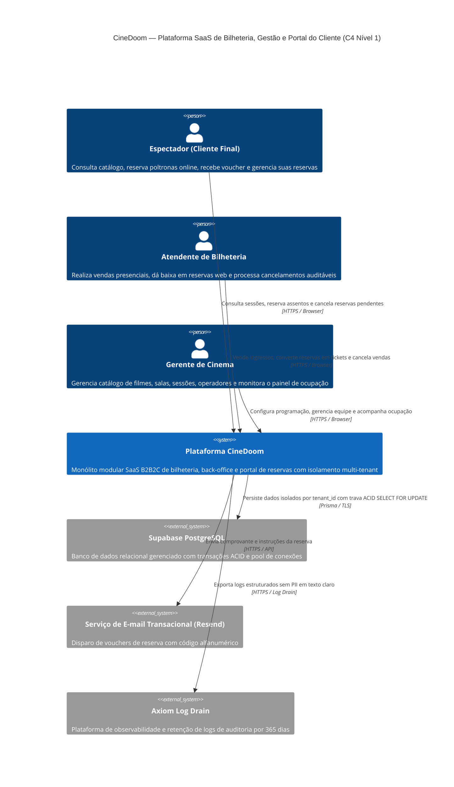
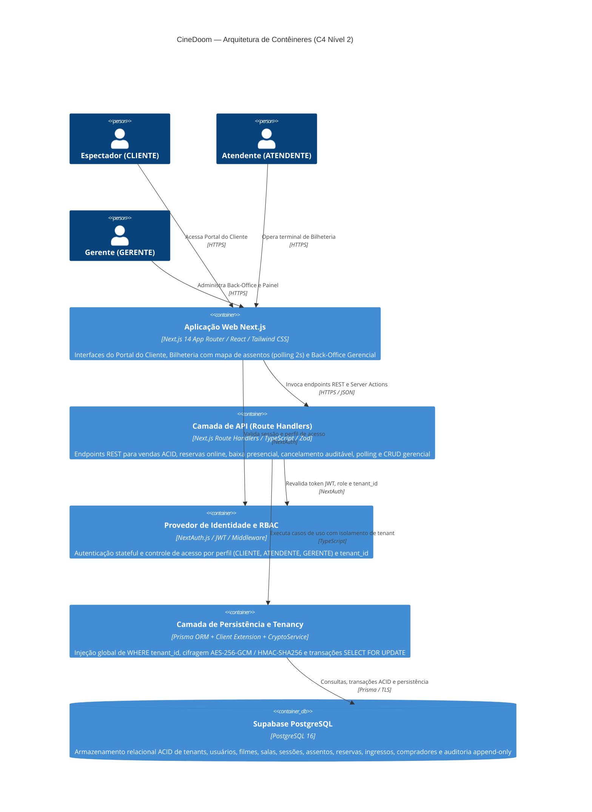

# Arquitetura da Solução (C4 Níveis 1 e 2) — CineDoom

> **Documento Técnico Oficial — CineSoft Solutions (UFG/INF — Processos de Software 2026/1)**
> Rastreabilidade direta com [`cinedoom-spec.md`](../cinedoom-spec.md) (`RF-01` a `RF-18`, `RNF-01` a `RNF-06`, `RN-01` a `RN-12`, `CA-01` a `CA-14`, `RES-01` a `RES-06`) e [`ADR-001` a `ADR-014`](../adr/).

## Resumo Executivo

Plataforma SaaS integrada de bilheteria presencial, back-office gerencial e portal do cliente para cinemas independentes e redes regionais no Brasil: monólito modular construído em **Next.js 14 (App Router) + Prisma ORM + Supabase PostgreSQL**, com isolamento multi-tenant lógico por linha (`tenant_id`), trava ACID pessimista anti-double-booking via `SELECT FOR UPDATE`, atualização de mapa de assentos por polling a cada 2 segundos, controle de acesso baseado em papéis (`ATENDENTE`, `GERENTE` e `CLIENTE`) via NextAuth.js, proteção criptográfica de PII/LGPD com CPF cifrado em **`AES-256-GCM`** e indexado via **`HMAC-SHA256`**, notificações transacionais de reserva e implantação contínua na Vercel com ambientes de *preview* isolados por branch.

---

## 1. Decisões Arquiteturais de Solução (Macroarquitetura)

### AD-1. Monólito modular Next.js 14 App Router como única unidade de implantação (`ADR-001`)

- **Reversível:** Sim
- **Racional:** Equipe enxuta de 4 engenheiros e horizonte de entrega de 21 dias (`RES-01`); o App Router unifica Server Components (SSR) e Route Handlers (API REST) sem sobrecarga operacional de múltiplos serviços distribuídos; a separação interna por módulos de domínio independentes (`bilheteria`, `catalogo`, `identidade`, `ocupacao`, `portal`, `compradores`, `tenancy`) garante manutenibilidade (`RNF-06`) sem acoplamento de deploy.
- **Atributo de Qualidade (ISO/IEC 25010):** Manutenibilidade (*Maintainability*)
- **Estratégia (*Build vs. Buy*):** Reúso de framework (*Reuse*)
- **Alternativas consideradas:**
  - Microsserviços em NestJS — *rejeitada:* sobrecarga operacional de rede, orquestração e transações distribuídas desproporcional para o escopo do MVP.
  - Frontend Next.js + Backend API separado — *rejeitada:* duplica pipelines de deploy, configuração de CORS e sincronização de contratos tipados sem ganho prático.

### AD-2. PostgreSQL 16 via Supabase como banco primário e único repositório relacional (`ADR-004`, `ADR-005`)

- **Reversível:** Não
- **Racional:** Suporte transacional ACID nativo com `SELECT FOR UPDATE` para impedir vendas ou reservas duplas (`RNF-02`, `CA-01`, `CA-09`); isolamento row-level por `tenant_id`; pool de conexões gerenciado (`DATABASE_URL`) para a aplicação e conexões diretas (`DIRECT_URL`) para migrações Prisma; escalonamento automático e alta confiabilidade operacional (`RES-01`).
- **Atributo de Qualidade (ISO/IEC 25010):** Confiabilidade (*Reliability*)
- **Estratégia (*Build vs. Buy*):** Contratação de PaaS gerenciado (*Buy*)
- **Alternativas consideradas:**
  - PlanetScale MySQL — *rejeitada:* limitações históricas em chaves estrangeiras e fluxos de bloqueio pessimista em branches serverless.
  - Instância autogerenciada de PostgreSQL em VM — *rejeitada:* sobrecarga operacional de manutenção e configuração incompatível com os objetivos do projeto.

### AD-3. Isolamento multi-tenant lógico por linha (`tenant_id`) em esquema compartilhado (`ADR-003`)

- **Reversível:** Não
- **Racional:** Menor custo operacional e simplicidade de migrações de banco no horizonte do MVP (`RES-01`, `RES-02`); uma *Prisma Client Extension* injeta automaticamente o filtro `WHERE tenant_id` em todas as consultas de entidades de negócio (`RN-12`), impedindo vazamento de dados entre cinemas (`CA-04`).
- **Atributo de Qualidade (ISO/IEC 25010):** Segurança e Eficiência de Custos (*Security / Cost*)
- **Estratégia (*Build vs. Buy*):** Construção própria (*Make*)
- **Alternativas consideradas:**
  - *Schema-per-tenant* — *rejeitada:* custo operacional elevado em ambiente serverless e complexidade de execução de migrações em dezenas de esquemas.
  - *Database-per-tenant* — *rejeitada:* inviável financeiramente e operacionalmente para redes de pequeno porte.

### AD-4. NextAuth.js com Prisma Adapter e controle de acesso RBAC (`ATENDENTE`, `GERENTE`, `CLIENTE`) via JWT (`ADR-004`, `ADR-014`)

- **Reversível:** Sim
- **Racional:** Integração nativa com o Next.js App Router; os claims `role` e `tenant_id` são assinados no token JWT, permitindo que o middleware de borda valide permissões e contexto de locatário antes mesmo da execução dos Route Handlers (`RF-01`, `RF-14`, `RN-01`, `CA-05`, `CA-10`).
- **Atributo de Qualidade (ISO/IEC 25010):** Segurança (*Security*)
- **Estratégia (*Build vs. Buy*):** Reúso (*Reuse*)
- **Alternativas consideradas:**
  - Auth0 / Clerk — *rejeitada:* custo recorrente por usuário ativo mensal (MAU) incompatível com a restrição de orçamento zero (`RES-01`) e risco de *vendor lock-in*.
  - Implementação manual de JWT sem biblioteca — *rejeitada:* risco desnecessário de vulnerabilidades de sessão e rotação de tokens.

### AD-5. Proteção de CPF com hash `HMAC-SHA256` para busca indexada e cifra `AES-256-GCM` para exibição (`ADR-008`)

- **Reversível:** Não
- **Racional:** Cumpre rigorosamente a LGPD (`RF-09`, `RNF-03`, `RN-07`, `CA-06`); o resumo `HMAC-SHA256` com chave secreta server-side (`CINEDOOM_CPF_HMAC_KEY`) permite busca determinística O(1) no índice do banco sem vulnerabilidade a ataques de *rainbow table* sobre o universo finito de CPFs brasileiros; a cifragem autenticada `AES-256-GCM` (`CPF_ENCRYPTION_KEY`) permite recuperação controlada apenas em fluxos autorizados.
- **Atributo de Qualidade (ISO/IEC 25010):** Segurança e Confidencialidade (*Security*)
- **Estratégia (*Build vs. Buy*):** Construção própria sobre módulo nativo `node:crypto` (*Make*)
- **Alternativas consideradas:**
  - CPF em texto plano (*plaintext*) — *rejeitada:* violação direta da LGPD e exposição total em caso de vazamento.
  - Hash SHA-256 simples sem chave HMAC — *rejeitada:* vulnerável a reversão por *rainbow table* pré-computada.

### AD-6. Auditoria imutável de cancelamentos (*append-only*) com bloqueio via trigger PostgreSQL (`ADR-006`)

- **Reversível:** Não
- **Racional:** O critério `CA-03` (`AC-3`) e a regra `RN-06` exigem registro de auditoria imutável antes da liberação do assento; o controle no nível do banco de dados (trigger `BEFORE UPDATE OR DELETE` lançando exceção `P0001`) garante imutabilidade independentemente da camada de aplicação.
- **Atributo de Qualidade (ISO/IEC 25010):** Confiabilidade e Rastreabilidade (*Reliability*)
- **Estratégia (*Build vs. Buy*):** Construção própria (*Make*)
- **Alternativas consideradas:**
  - Serviço externo de auditoria no caminho crítico — *rejeitada:* adiciona latência e ponto de falha na transação de cancelamento.
  - *Soft-delete* simples na tabela de ingressos — *rejeitada:* não garante imutabilidade nem histórico de motivos exigidos por `CA-03`.

### AD-7. Atualização do mapa de assentos por polling HTTP a cada 2 segundos (`ADR-007`)

- **Reversível:** Sim
- **Racional:** Simplicidade arquitetural e total compatibilidade com o modelo *stateless serverless* da Vercel; conexões persistentes (WebSockets/SSE) sofrem desconexões e custos por tempo de execução em funções serverless; o intervalo de 2 segundos em `GET /api/sessoes/[id]/assentos` atende integralmente a `RF-05`, `RNF-01` e `CA-02` (`AC-2`).
- **Atributo de Qualidade (ISO/IEC 25010):** Compatibilidade e Eficiência (*Compatibility*)
- **Estratégia (*Build vs. Buy*):** Construção própria (*Make*)
- **Alternativas consideradas:**
  - WebSockets nativos — *rejeitada:* funções serverless da Vercel não mantêm estado de conexão persistente.
  - Server-Sent Events (SSE) — *rejeitada:* sujeito a limites de timeout de execução em funções serverless.

### AD-8. Implantação contínua na Vercel com *preview environments* e banco Supabase (`ADR-005`)

- **Reversível:** Sim
- **Racional:** Integração nativa zero-config para Next.js; cada Pull Request gera um ambiente de pré-visualização isolado na Vercel com testes E2E e validação de migrações antes do merge para produção.
- **Atributo de Qualidade (ISO/IEC 25010):** Manutenibilidade (*Maintainability*)
- **Estratégia (*Build vs. Buy*):** Contratação de PaaS (*Buy*)
- **Alternativas consideradas:**
  - Fly.io / Railway — *rejeitada:* exige gerenciamento manual de contêineres Docker e sobrecarga operacional desnecessária.

### AD-9. Portal do Cliente com reserva atômica sem gateway financeiro e expiração *Just-in-Time* (`ADR-012`)

- **Reversível:** Não
- **Racional:** Viabiliza o módulo de autoatendimento do espectador dentro das restrições do projeto (`RES-01`, `RES-04`); a reserva online bloqueia a poltrona com status `RESERVED` via `SELECT FOR UPDATE` (`RF-13`, `CA-09`) e sua expiração a 60 minutos da sessão (`RN-08`, `RN-11`) é avaliada sob demanda (*Just-in-Time*) nas consultas e transações (`RF-18`, `CA-14`), dispensando infraestrutura externa de *workers* Redis/BullMQ.
- **Atributo de Qualidade (ISO/IEC 25010):** Confiabilidade e Custo (*Reliability / Cost*)
- **Estratégia (*Build vs. Buy*):** Construção própria (*Make*)

### AD-10. Notificação transacional de reserva desacoplada por adaptador (`ADR-013`)

- **Reversível:** Sim
- **Racional:** Garante o envio do comprovante com código alfanumérico (`CD-XXXX`) e instruções de pagamento presencial ao e-mail do cliente (`RF-15`, `CA-11`); o padrão *Adapter* permite utilizar provedor SMTP/Resend em produção e registro estruturado em console durante testes automatizados.
- **Atributo de Qualidade (ISO/IEC 25010):** Usabilidade e Manutenibilidade (*Usability / Maintainability*)
- **Estratégia (*Build vs. Buy*):** Híbrida (*Buy* para Resend / *Make* para o Adapter)

---

## 2. Diagramas de Arquitetura (Modelo C4)

### 2.1 Diagrama de Contexto do Sistema (C4 Nível 1)

### 2.2 Diagrama de Contêineres (C4 Nível 2)

---

## 3. Catálogo de Componentes de Solução

| ID | Nome do Componente | Responsabilidade Arquitetural | Depende de |
|----|--------------------|-------------------------------|------------|
| **C-1** | Aplicação Web Next.js | Renderização SSR e componentes reativos para o Portal do Cliente, Mapa de Assentos com polling de 2s, Painel de Ocupação e Back-Office; middleware de borda para proteção de rotas. | C-2, C-3, C-5 |
| **C-2** | Camada de API (Route Handlers) | Endpoints REST para venda ACID (`RF-06`), reserva online (`RF-13`), baixa presencial (`RF-17`), cancelamento auditável (`RF-08`, `RF-16`), polling de assentos (`RF-05`) e CRUD gerencial (`RF-02` a `RF-04`). | C-3, C-4 |
| **C-3** | Provedor NextAuth.js & RBAC | Autenticação com credenciais, emissão e validação de JWT contendo `tenant_id` e `role` (`ATENDENTE`, `GERENTE`, `CLIENTE`). | C-4, C-5 |
| **C-4** | Prisma ORM + Extensão de Tenancy | Cliente de banco tipado com *Client Extension* que injeta `WHERE tenant_id` automaticamente (`RN-12`) e executa transações com `SELECT FOR UPDATE` (`RN-05`, `RN-08`). | C-5 |
| **C-5** | Supabase PostgreSQL | Persistência relacional durável das 11 entidades do modelo de dados, com pool de conexões e trigger de imutabilidade em `cancellation_audits` (`RN-06`). | — |
| **C-6** | Vercel Edge Network | Hospedagem serverless do monólito Next.js, distribuição de assets estáticos via CDN e criação de ambientes de *preview* por branch. | C-1, C-2 |

---

## 4. Matriz de Riscos Arquiteturais

| ID | Descrição do Risco | Probabilidade | Impacto | Estratégia de Mitigação Implementada |
|----|--------------------|---------------|---------|--------------------------------------|
| **R-1** | Sobrecarga de conexões elevar a latência da transação de venda acima do alvo p95 < 800ms (`RNF-01`). | Média | Alto | Uso de pool de conexões gerenciado habilitado por padrão, conexão direta para migrações (`DIRECT_URL`), índices compostos otimizados e monitoramento contínuo de percentis p95/p99. |
| **R-2** | Polling de 2s em múltiplos terminais esgotar o limite de conexões concorrentes do banco em dias de estreia. | Média | Alto | Roteamento de leituras por conexão pooled no Supabase e cabeçalhos `Cache-Control: no-store` enxutos no endpoint de assentos. |
| **R-3** | Omissão acidental de filtro `tenant_id` em consulta SQL bruta causar vazamento entre cinemas concorrentes. | Baixa | Alto | *Prisma Client Extension* global (`ADR-003`) combinada com bateria automatizada de **500 cenários cross-tenant** no CI (`CA-04`, `CT-04`, `CT-18`). |
| **R-4** | Vazamento ou necessidade de rotação da chave simétrica de cifragem de CPF (`AES-256-GCM`). | Baixa | Alto | Armazenamento exclusivo em *Vercel Environment Secrets* e procedimento documentado de rotação anual com re-cifragem em lote (`ADR-008`). |
| **R-5** | Contenção ou *deadlock* em `SELECT FOR UPDATE` sob 50 requisições concorrentes para a mesma poltrona. | Baixa | Alto | Uso de `FOR UPDATE NOWAIT` / timeout de 3s e ordenação determinística de IDs de assentos na transação, retornando `HTTP 409 Conflict` imediato (`CA-01`, `CT-01`). |

---

## 5. Criptografia em Repouso e em Trânsito

- **Criptografia na Camada de Aplicação (`ADR-008`, `RF-09`, `CA-06`):** O CPF do comprador é cifrado antes da persistência utilizando **`AES-256-GCM`** (com vetor de inicialização aleatório de 96 bits e tag de autenticação de 128 bits) através da chave `CPF_ENCRYPTION_KEY`. Para buscas exatas sem descriptografia, armazena-se na coluna `cpf_hash` o resumo determinístico **`HMAC-SHA256`** gerado com a chave secreta `CINEDOOM_CPF_HMAC_KEY`.
- **Criptografia de Infraestrutura:** O Supabase PostgreSQL cifra todos os volumes de armazenamento e backups em repouso com **AES-256**. Toda a comunicação entre navegador, Vercel Edge e Supabase ocorre exclusivamente sob **TLS 1.3** / SSL.

---

## 6. Controle de Acesso e Auditoria Imutável

- **Controle de Acesso Baseado em Papéis (`RF-01`, `RF-14`, `RN-01`, `CA-05`):**
  - **`CLIENTE`:** Acesso restrito ao Portal do Cliente (`/portal/**`, reserva de poltronas e cancelamento das próprias reservas pendentes).
  - **`ATENDENTE`:** Acesso às rotas operacionais de bilheteria do seu cinema (`/bilheteria/**`, venda presencial, baixa de reservas e cancelamento auditável); recebe `HTTP 403 Forbidden` ao tentar acessar rotas de gestão.
  - **`GERENTE`:** Acesso integral ao seu cinema tenant, incluindo back-office de filmes, salas, sessões, gestão de atendentes e painel de ocupação em tempo real.
- **Auditoria Imutável (`RF-08`, `RN-06`, `CA-03`):** A tabela `cancellation_audits` é protegida por trigger nativo no PostgreSQL que bloqueia qualquer instrução `UPDATE` ou `DELETE`, garantindo preservação perpétua do operador executante, motivo e carimbo de tempo UTC.

---

## 7. Definições de Governança Consolidadas

As questões arquiteturais levantadas na concepção inicial do projeto foram formalmente decididas e incorporadas às especificações:
1. **Papel Jurídico na LGPD (`ADR-009`):** Os cinemas clientes atuam como **Controladores** dos dados de seus espectadores e a CineSoft Solutions atua como **Operadora Tecnológica** sob contrato DPA padronizado.
2. **Direito ao Esquecimento e Retenção (`ADR-009`):** Prazo de retenção fiscal de 5 anos para registros de venda, com mecanismo de **anonimização *in-place*** (`POST /api/titulares/anonimizar`) para atendimento ao Art. 18 da LGPD em até 15 dias.
3. **Onboarding de Tenants (`RES-03`):** Provisionamento controlado via script interno (`pnpm run provisionar-tenant`), sem *self-signup* público no MVP.
4. **Comprovante de Venda e Reserva (`ADR-013`, `RF-15`):** Emissão de voucher digital em tela e envio de comprovante por e-mail transacional com código alfanumérico (`CD-XXXX`).
