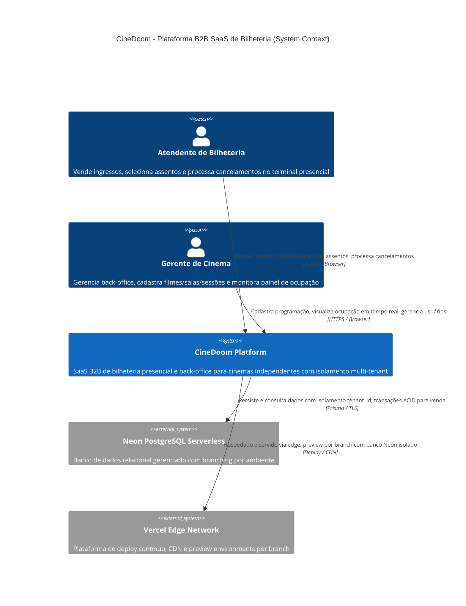
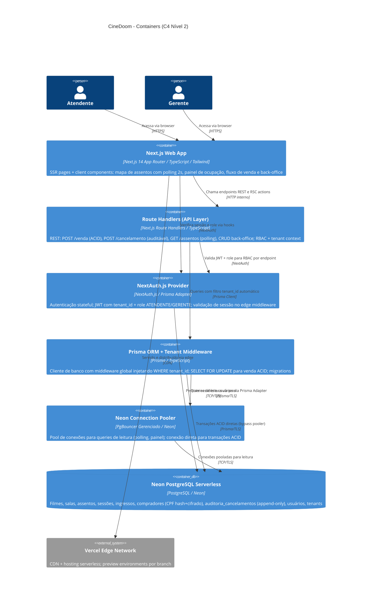

# Solution Architect (C4 L1-2) — CineDoom — plataforma B2B SaaS para cinemas independentes e redes de pequeno/méd

> Artefato derivado de `.specs/features/F-CINEDOOM-PLATAFORMA-B2B-SAAS-C/spec.md` e gerado pelo agente **Solution Architect (C4 L1-2)**
> via AI-4SDLC Platform. **Regenerative work product** (não-canonical SDD).
> Não edite manualmente — re-gere via `sdlc resume`.

## Resumo

Plataforma B2B SaaS de bilheteria presencial e back-office para cinemas independentes no Brasil: monólito modular Next.js 14 + Prisma ORM + Neon PostgreSQL Serverless com isolamento multi-tenant por row-level (tenant_id), trava ACID anti-double-booking via SELECT FOR UPDATE, polling de mapa de assentos a 2s, RBAC ATENDENTE/GERENTE via NextAuth.js, proteção de PII/LGPD com CPF cifrado AES-256-GCM + hash SHA-256 e deploy contínuo na Vercel com preview environments por branch.

## Decisões arquiteturais

### AD-1. Monólito modular Next.js 14 App Router como única unidade de deploy

- **Reversível:** sim
- **Racional:** time pequeno e horizonte MVP; App Router unifica SSR e API Route Handlers sem overhead de serviços separados; módulos independentes por pasta (bilheteria, backoffice, auth, tenancy, ocupacao) garantem maintainability sem acoplamento de deploy
- **Quality driver (ISO 25010):** maintainability
- **Build vs. buy:** reuse
- **Alternativas consideradas:**
  - microserviços NestJS — _rejeitada:_ overhead operacional desproporcional para MVP sem ganho de escala no horizonte
  - Next.js + API separada — _rejeitada:_ aumenta complexidade de deploy e CORS sem justificativa

### AD-2. PostgreSQL Serverless via Neon como banco primário e único datastore

- **Reversível:** não
- **Racional:** ACID nativo com SELECT FOR UPDATE para anti-double-booking; suporte a row-level isolation por tenant_id; branching de banco por preview environment no Vercel; escala a zero reduzindo custo para tenants de baixo volume
- **Quality driver (ISO 25010):** reliability
- **Build vs. buy:** buy
- **Alternativas consideradas:**
  - PlanetScale MySQL — _rejeitada:_ sem suporte nativo a SELECT FOR UPDATE no branch workflow
  - Supabase PostgreSQL — _rejeitada:_ funcional porém Neon tem integração nativa de branching com Vercel

### AD-3. Row-level isolation com tenant_id em shared schema (decisão do stakeholder)

- **Reversível:** não
- **Racional:** menor custo operacional e simplicidade de migrations no horizonte MVP; middleware Prisma injeta filtro global WHERE tenant_id automaticamente impedindo vazamento cross-tenant
- **Quality driver (ISO 25010):** cost
- **Build vs. buy:** make
- **Alternativas consideradas:**
  - schema-per-tenant (rejeitada: custo operacional alto em Neon Serverless
  - migrations complexas por tenant)
  - database-per-tenant — _rejeitada:_ inviável em Neon para dezenas de cinemas de pequeno porte

### AD-4. NextAuth.js stateful com Prisma Adapter e RBAC ATENDENTE/GERENTE via JWT

- **Reversível:** sim
- **Racional:** integração nativa com Next.js App Router; roles persistidos em DB evitam round-trips extras; middleware de rota valida role e tenant_id antes do handler sem overhead externo
- **Quality driver (ISO 25010):** security
- **Build vs. buy:** reuse
- **Alternativas consideradas:**
  - Auth0/Clerk — _rejeitada:_ custo por MAU inviável para B2B com operadores fixos + vendor lock-in
  - JWT custom sem biblioteca — _rejeitada:_ risco de vulnerabilidades sem biblioteca auditada

### AD-5. CPF armazenado como hash SHA-256 para lookup + valor cifrado AES-256-GCM para exibição

- **Reversível:** não
- **Racional:** LGPD exige proteção de dado sensível (CPF é PII); hash determinístico permite busca sem expor valor; cifração simétrica com CMK permite exibição controlada para perfil autorizado; decisão do stakeholder sobre campos coletados
- **Quality driver (ISO 25010):** security
- **Build vs. buy:** make
- **Alternativas consideradas:**
  - CPF em plaintext — _rejeitada:_ violação LGPD + exposição em vazamento de DB
  - tokenização via vault externo — _rejeitada:_ custo e complexidade excessivos para MVP

### AD-6. Tabela auditoria_cancelamentos append-only no PostgreSQL com REVOKE UPDATE/DELETE para o role da aplicação

- **Reversível:** não
- **Racional:** AC-3 exige registro imutável antes de liberar assento; controle no nível DB (REVOKE + trigger de proteção) garante imutabilidade sem custo de serviço externo; tenant_id obrigatório na tabela mantém isolamento
- **Quality driver (ISO 25010):** reliability
- **Build vs. buy:** make
- **Alternativas consideradas:**
  - audit log em serviço externo — _rejeitada:_ latência adicional no caminho crítico de cancelamento
  - soft-delete sem tabela separada — _rejeitada:_ não garante imutabilidade exigida pelo AC-3

### AD-7. Client-side polling a 2s via Route Handler GET /api/sessoes/[id]/assentos para mapa de assentos

- **Reversível:** sim
- **Racional:** simplicidade de implementação sem infraestrutura adicional; WebSockets incompatíveis com modelo serverless da Vercel; latência de 2s aceitável para fluxo presencial B2B conforme AC-2; SSE tem mesmo problema de conexão persistente
- **Quality driver (ISO 25010):** compatibility
- **Build vs. buy:** make
- **Alternativas consideradas:**
  - WebSockets — _rejeitada:_ Vercel serverless não suporta conexões persistentes nativamente
  - Server-Sent Events — _rejeitada:_ mesmo limitação de conexão persistente em serverless

### AD-8. Deploy contínuo na Vercel com preview environments por branch e Neon database branching

- **Reversível:** sim
- **Racional:** zero-config para Next.js; preview environments isolados por branch com banco Neon próprio facilitam QA sem risco de contaminar produção; integração nativa Vercel + Neon
- **Quality driver (ISO 25010):** maintainability
- **Build vs. buy:** buy
- **Alternativas consideradas:**
  - Fly.io — _rejeitada:_ requer Dockerfile e configuração adicional sem ganho para stack Next.js puro
  - Railway — _rejeitada:_ sem branching de banco integrado equivalente ao Neon + Vercel

## Diagramas (C4)

### Contexto do sistema (C4 nível 1)

### Containers (C4 nível 2)

## Componentes

| ID | Nome | Responsabilidade | Depende de |
|----|------|------------------|------------|
| C-1 | Next.js Web App | SSR pages e client components para mapa de assentos interativo com polling, painel de ocupação e fluxo de venda; edge middleware de proteção de rotas com validação de JWT e role | C-2, C-3, C-5 |
| C-2 | Route Handlers (API Layer) | Endpoints REST: venda ACID de ingresso, cancelamento auditável, polling de disponibilidade de assentos, back-office CRUD (filmes/salas/sessões), painel de ocupação; injeção de contexto de tenant e RBAC por perfil | C-4, C-5 |
| C-3 | NextAuth.js Session Provider | Autenticação stateful com Prisma Adapter; emissão e validação de JWT contendo tenant_id e role; gerenciamento de sessão para ATENDENTE e GERENTE | C-5, C-6 |
| C-4 | Prisma ORM + Tenant Middleware | Cliente de banco type-safe com middleware global injetando WHERE tenant_id em todas as queries de entidades de negócio; gestão de migrations; transações com SELECT FOR UPDATE para venda ACID | C-5, C-6 |
| C-5 | Neon PostgreSQL Serverless (Primary DB) | Armazenamento durável de filmes, salas, assentos, sessões, ingressos, compradores (CPF hash + cifrado), usuários, tenants e auditoria_cancelamentos (append-only); tabela de sessões NextAuth | — |
| C-6 | Neon Connection Pooler (PgBouncer Gerenciado) | Pool de conexões para queries de leitura (polling de mapa, painel de ocupação) mitigando limite de conexões concorrentes do Serverless; conexão direta para transações ACID (bypass do pooler) | C-5 |
| C-7 | Vercel Edge Network | Hosting do monólito Next.js; CDN para assets estáticos; preview environments por branch; edge middleware para roteamento e cabeçalhos de segurança | C-1, C-2 |

## Riscos

| ID | Descrição | Likelihood | Impacto | Mitigação |
|----|-----------|------------|---------|-----------|
| R-1 | Neon Serverless cold start eleva latência da transação de venda ACID acima do p95 800ms em horários de baixo uso | medium | high | habilitar Neon Pooler para todas as queries de leitura; configurar warm-up periódico via Vercel Cron; monitorar p95 com Vercel Analytics e alertar desde o primeiro deploy em produção |
| R-2 | Polling a 2s de múltiplos terminais simultâneos esgota o limite de conexões concorrentes do Neon Serverless em dias de pico (estreias) | medium | high | rotear queries de polling exclusivamente pelo Neon Pooler; implementar stale-while-revalidate de 1s no Route Handler do mapa; definir limite de instâncias de polling por sessão no cliente |
| R-3 | Bypass do middleware tenant_id por query raw no Prisma ou migration incorreta vaza dados entre cinemas | low | high | suite de 500 cenários de isolamento cross-tenant (AC-4/NFR Security); lint rule ESLint proibindo queries Prisma.$queryRaw sem tenant_id explícito; revisão obrigatória em PRs que toquem camada de dados |
| R-4 | Chave de cifração do CPF armazenada apenas em variável de ambiente Vercel sem política de rotação formal | medium | high | documentar política de rotação ≤365 dias no runbook; planejar migração para AWS KMS (CMK) antes do go-live em produção; implementar job de re-encriptação incremental para rotação sem downtime |
| R-5 | Deadlocks em SELECT FOR UPDATE sob 50 threads concorrentes tentando o mesmo assento | low | high | timeout explícito de 3s na transação Prisma; ordem determinística de lock por assento_id para evitar deadlock circular; retry automático com backoff exponencial (máx 3 tentativas) no handler de venda |
| R-6 | Papel jurídico LGPD da plataforma (controlador vs. operador) não definido impacta implementação de direito ao esquecimento e retenção de dados | medium | medium | levar para open_questions; não implementar exclusão/anonimização de dados de compradores sem parecer jurídico; DPO ou assessoria legal deve ser consultada antes do go-live |
| R-7 | Vercel serverless function timeout (10s padrão) atingido durante pico de concorrência na venda ACID com Neon em cold start | low | medium | configurar maxDuration explícito na função de venda; implementar feedback visual de timeout no front-end; monitorar duração média de transação e alertar se p99 > 5s |

## Encryption at-rest

CPF cifrado com AES-256-GCM no nível de aplicação (antes de persistir) usando chave simétrica gerenciada via AWS KMS (customer-managed key, CMK); rotation policy ≤365 dias com job de re-encriptação incremental documentado no runbook; hash SHA-256 determinístico armazenado em coluna separada para lookup sem exposição do valor; Neon PostgreSQL Serverless com encryption-at-rest nativo (AES-256, chaves gerenciadas pelo provedor Neon/AWS); variáveis de ambiente de produção na Vercel protegidas por Vercel Secrets (não expostas em preview environments nem logs de build); CMK a ser migrado de variável de ambiente para AWS KMS antes do go-live em produção.

## Access control & audit log

RBAC need-to-know com dois perfis: ATENDENTE (acesso somente às rotas de bilheteria do seu tenant — venda, cancelamento, mapa de assentos; HTTP 403 em rotas de gerenciamento) e GERENTE (acesso completo ao tenant — back-office, cadastros, painel, gestão de usuários); tenant_id validado em cada request via JWT, impedindo acesso cross-tenant; tabela auditoria_cancelamentos com REVOKE UPDATE/DELETE para o role da aplicação (append-only) + trigger de proteção bloqueando alterações diretas; acesso a CPF decifrado e e-mail de compradores restrito a perfil GERENTE com log de acesso em tabela audit_pii_access (user_id, tenant_id, ingresso_id, operação, timestamp UTC) protegida por REVOKE UPDATE/DELETE; ausência de storage WORM nativo no stack Vercel/Neon mitigada por controles de nível DB e integridade verificável periodicamente via hash-chain de registros de auditoria.

## Perguntas em aberto

- Qual o papel jurídico da plataforma sob LGPD: controlador ou operador em relação aos dados dos compradores coletados pelos cinemas clientes — e quem assina o DPA?
- Qual a política de retenção e prazo de exclusão de dados de compradores (direito ao esquecimento LGPD) e qual perfil pode executar a operação?
- O onboarding de novos tenants (cinemas) será self-service pelo Gerente ou provisionado manualmente pela equipe CineDoom — há necessidade de fluxo de signup no MVP?
- Existe um modelo de plano/billing por tenant que imponha limites (número de sessões, usuários, ingressos/mês) a serem validados pelo sistema no MVP?
- A tabela auditoria_cancelamentos deve ser consultável diretamente pelo Gerente via painel ou é acesso exclusivo de suporte/compliance interno CineDoom?
- Há exigência de emissão de recibo ou comprovante de venda (mesmo offline) para o comprador — impressão ou e-mail estão no escopo futuro imediato?
