# Design de Experiência do Usuário (UX), Fluxos de Navegação e Wireframes — CineDoom

> **Documento Técnico Oficial — CineSoft Solutions (UFG/INF — Processos de Software 2026/1)**
> Rastreabilidade direta com [`cinedoom-spec.md`](../cinedoom-spec.md) (`HU-01` a `HU-11`, `RF-01` a `RF-18`, `RNF-04`, `RNF-05`, `CA-01` a `CA-14`).

## Resumo Executivo

Especificação de Experiência do Usuário (UX) para a plataforma SaaS **CineDoom**: contempla as jornadas de navegação, fluxos de interação em Mermaid, protótipos de baixa fidelidade (*wireframes* ASCII), diretrizes do sistema de design e requisitos de acessibilidade (**WCAG 2.1 Nível AA**) para os perfis **Atendente**, **Gerente** e **Espectador (Cliente)**.

---

## 1. Fluxos de Usuário (Jornadas de Interação)

### FLOW-1. Autenticação e Roteamento por Perfil (`RF-01`, `RF-14`, `CA-05`, `CA-10`)

Fluxo de login com NextAuth.js e roteamento condicional automático conforme o papel do usuário autenticado (`ATENDENTE`, `GERENTE` ou `CLIENTE`).

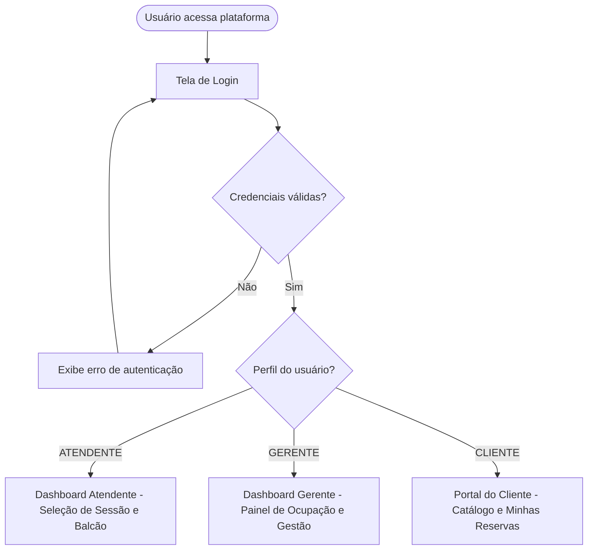

### FLOW-2. Atendente — Seleção de Sessão e Abertura do Mapa (`RF-05`, `CA-02`)

O Atendente visualiza as sessões do dia, seleciona uma sessão e abre o mapa de assentos com polling automático a cada 2 segundos para atualização de disponibilidade em tempo real.

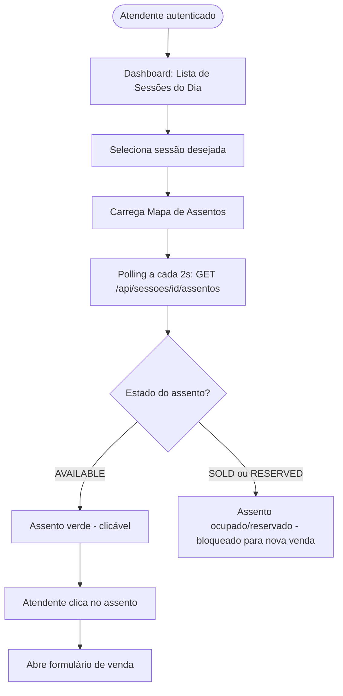

### FLOW-3. Atendente — Venda Presencial de Ingresso (`RF-06`, `RF-07`, `RF-09`, `CA-01`, `CA-06`)

Fluxo ACID de venda de ingresso com validação de formulário, trava atômica anti-double-booking (`SELECT FOR UPDATE`), proteção criptográfica de CPF (`HMAC-SHA256` + `AES-256-GCM`) e feedback imediato em caso de conflito de concorrência.

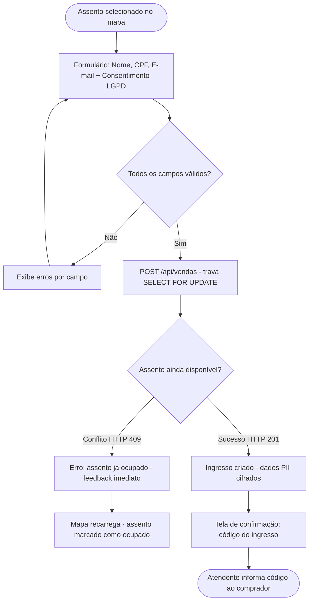

### FLOW-4. Atendente — Cancelamento Auditável de Ingresso (`RF-08`, `RN-06`, `CA-03`)

Fluxo de cancelamento com registro imutável em tabela de auditoria *append-only* antes da liberação do assento, garantindo rastreabilidade por usuário e carimbo de tempo UTC.

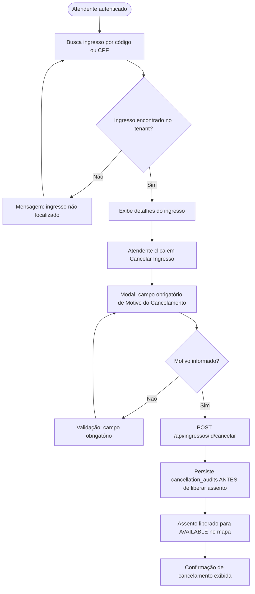

### FLOW-5. Gerente — Painel de Ocupação em Tempo Real (`RF-10`, `CA-07`)

Painel de ocupação do Gerente exibindo percentual de assentos vendidos e reservados por sessão do dia corrente, isolado por `tenant_id`.

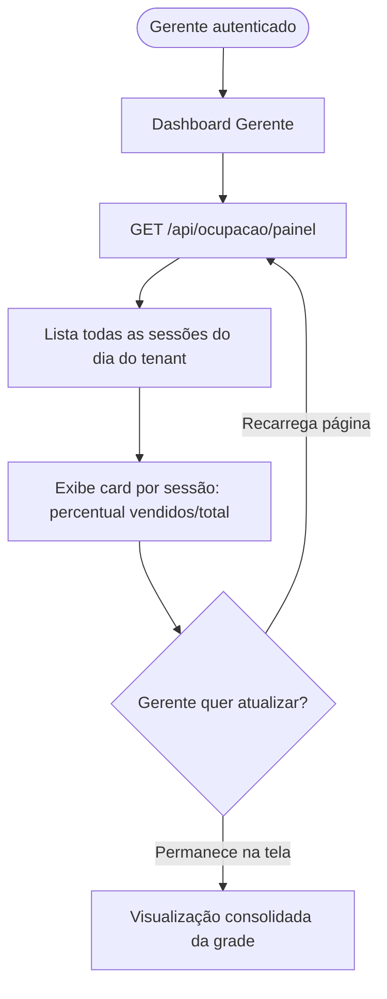

### FLOW-6. Gerente — Cadastro e Gestão de Filmes (`RF-02`, `RN-02`, `CA-08`)

CRUD de filmes acessível exclusivamente ao Gerente, com validação de campos obrigatórios e isolamento por `tenant_id`.

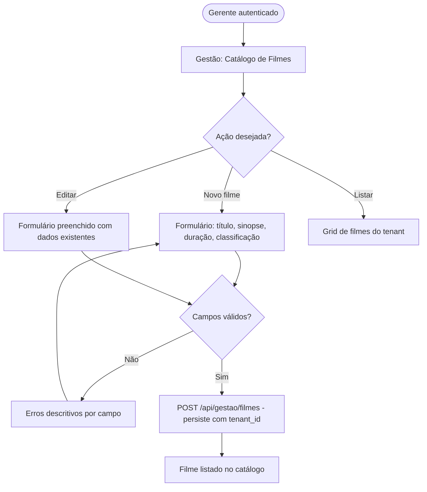

### FLOW-7. Gerente — Cadastro de Salas e Layout de Assentos (`RF-03`, `RN-02`, `CA-08`)

Gestão de salas com definição de layout de fileiras e colunas de assentos, restrita ao Gerente, com persistência isolada por tenant.

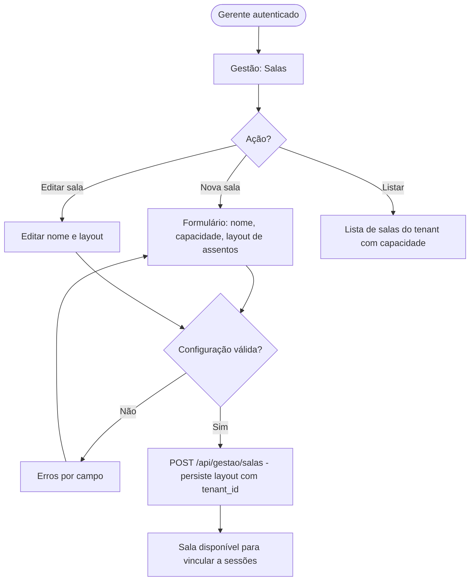

### FLOW-8. Gerente — Criação e Gestão de Sessões (`RF-04`, `RN-03`, `RN-04`, `CA-08`)

Criação de sessões vinculando filme, sala e horário, com pré-população automática de `SessionSeat` e validação de conflito de agenda, restrita ao Gerente.

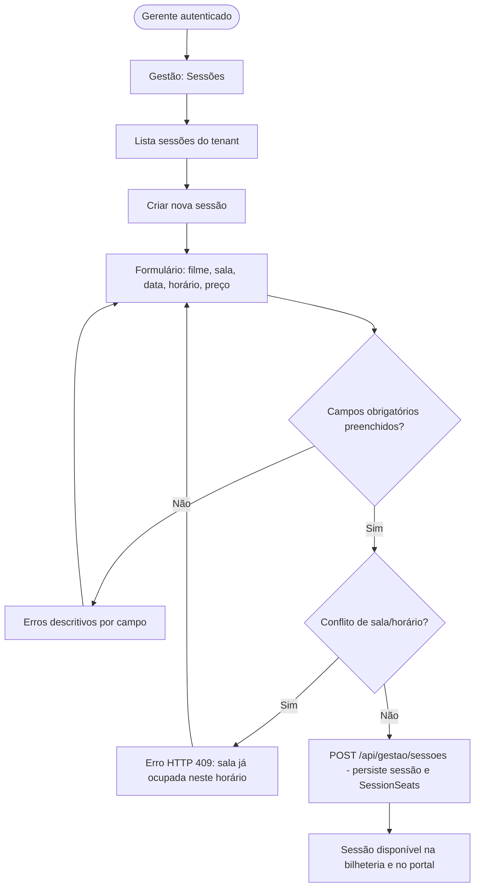

### FLOW-9. Gerente — Gestão de Usuários Atendentes (`RF-01`, `RN-01`, `CA-05`)

O Gerente cria e gerencia contas de Atendentes vinculadas ao seu cinema tenant com papel `ATENDENTE`, controlando o acesso granular à bilheteria.

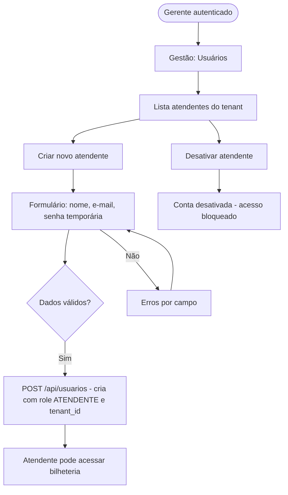

### FLOW-10. Controle de Acesso RBAC — Bloqueio de Rota Restrita (`RF-01`, `RN-01`, `CA-05`)

O middleware RBAC intercepta tentativas de acesso de Atendente ou Cliente a rotas restritas ao Gerente, retornando `HTTP 403 Forbidden`.

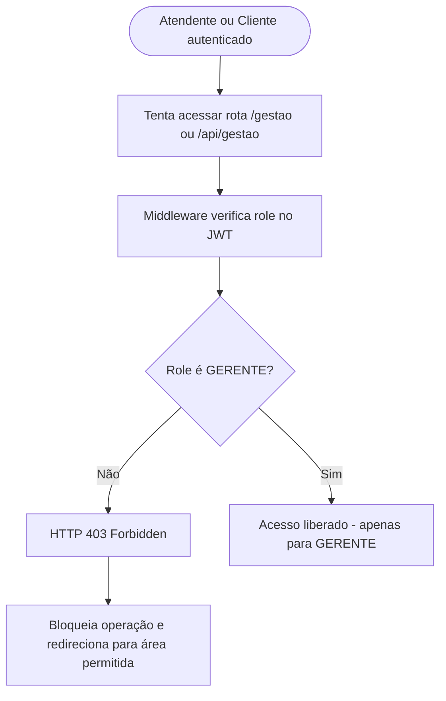

### FLOW-11. Espectador — Reserva Online no Portal e Baixa Presencial (`RF-12` a `RF-18`, `CA-09` a `CA-14`)

Jornada híbrida do espectador no Portal do Cliente: consulta de filmes e sessões, seleção de assento (> 60 min antes do início), emissão de voucher `CD-XXXX` por e-mail e conversão presencial em ingresso vendido (`SOLD`) no balcão da bilheteria.

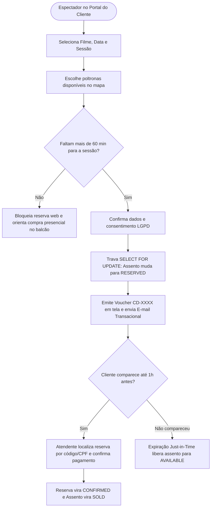

---

## 2. Protótipos de Baixa Fidelidade (Wireframes)

### SCREEN-1: Login

```text
+----------------------------------+
|         CINEDOOM                 |
|                                  |
|  E-mail:  [___________________]  |
|  Senha:   [___________________]  |
|                                  |
|         [  Entrar  ]             |
|                                  |
|  * Erro: credenciais inválidas   |
+----------------------------------+
```

### SCREEN-2: Dashboard Atendente — Sessões do Dia

```text
+--------------------------------------------------+
| CINEDOOM  |  Olá, Atendente  |  [Sair]          |
+--------------------------------------------------+
| Sessões de Hoje - 05/11/2026                     |
+--------------------------------------------------+
| [14:00] Duna: Parte Dois - Sala 1 - 40/120 vend. |
| [16:30] Ainda Estou Aqui - Sala 2 - 80/100 vend. |
| [19:00] O Brutalista     - Sala 1 -  5/120 vend. |
| [21:30] Anora            - Sala 3 -  0/150 vend. |
+--------------------------------------------------+
| Selecione uma sessão para abrir o mapa           |
+--------------------------------------------------+
```

### SCREEN-3: Mapa de Assentos

```text
+-------------------------------------------------------+
| CINEDOOM | Duna: Parte Dois - Sala 1 - 19:00 | [Sair] |
+-------------------------------------------------------+
| [V]=Vendido [R]=Reservado [D]=Disponível [S]=Selec.   |
|  Atualização automática a cada 2s                     |
+-------------------------------------------------------+
|  TELA  ===============================================|
|  A: [D][D][V][V][D][D][D][R][D][D]                    |
|  B: [D][V][V][D][D][D][V][V][D][D]                    |
|  C: [D][D][D][D][S][D][D][D][D][D]                    |
|  D: [V][V][V][D][D][D][D][V][V][V]                    |
|  E: [D][D][D][D][D][D][D][D][D][D]                    |
+-------------------------------------------------------+
| Assento selecionado: C-05     [Confirmar Seleção]     |
+-------------------------------------------------------+
```

### SCREEN-4: Formulário de Venda de Ingresso

```text
+------------------------------------------+
| CINEDOOM | Venda de Ingresso             |
+------------------------------------------+
| Sessão: Duna: Parte Dois - Sala 1 - 19:00|
| Assento: C-05                            |
+------------------------------------------+
| Nome completo: [_______________________] |
| CPF:           [___.___.___-__]          |
| E-mail:        [_______________________] |
|                                          |
| [x] Concordo com coleta de dados (LGPD)  |
|     Timestamp de consentimento: UTC      |
+------------------------------------------+
|  [Cancelar]        [Confirmar Venda]     |
+------------------------------------------+
```

### SCREEN-5: Confirmação de Venda

```text
+------------------------------------------+
| CINEDOOM | Venda Confirmada ✓            |
+------------------------------------------+
|  Ingresso #ING-2026-00847                |
|  Comprador: João Silva                   |
|  Sessão: Duna: Parte Dois - Sala 1 19:00 |
|  Assento: C-05                           |
|  Pagamento: Presencial (registrado)      |
+------------------------------------------+
|  Informe o código ao comprador.          |
+------------------------------------------+
|  [Nova Venda]     [Voltar ao Mapa]       |
+------------------------------------------+
```

### SCREEN-6: Cancelamento de Ingresso

```text
+------------------------------------------+
| CINEDOOM | Cancelar Ingresso             |
+------------------------------------------+
| Buscar ingresso:                         |
| Código: [___________]  [Buscar]          |
+------------------------------------------+
| Ingresso #ING-2026-00847                 |
| Comprador: João Silva                    |
| Sessão: Duna: Parte Dois - Sala 1 19:00  |
| Assento: C-05                            |
+------------------------------------------+
| Motivo do cancelamento: (obrigatório)    |
| [________________________________________|
|  ______________________________________] |
+------------------------------------------+
| Executor: atendente@cinema.com           |
|  [Voltar]      [Confirmar Cancelamento]  |
+------------------------------------------+
```

### SCREEN-7: Dashboard Gerente — Painel de Ocupação

```text
+-----------------------------------------------------------+
| CINEDOOM  |  Olá, Gerente  |  Ocupação do Dia  |  [Sair]  |
+-----------------------------------------------------------+
| Painel de Ocupação - 05/11/2026  [Recarregar]             |
+-----------------------------------------------------------+
| Sessão                | Sala   | Vendidos | Total | %     |
+-----------------------+--------+----------+-------+-------+
| 14:00 Duna: Parte 2   | Sala 1 |   40     |  120  | 33.3% |
| 16:30 Ainda Estou Aqui| Sala 2 |   80     |  100  | 80.0% |
| 19:00 O Brutalista    | Sala 1 |    5     |  120  |  4.2% |
| 21:30 Anora           | Sala 3 |    0     |  150  |  0.0% |
+-----------------------------------------------------------+
| [Gerenciar Filmes] [Salas] [Sessões] [Usuários]           |
+-----------------------------------------------------------+
```

### SCREEN-8: Gestão (Back-office) — Catálogo de Filmes

```text
+----------------------------------------------+
| CINEDOOM Gestão | Filmes              [Sair] |
+----------------------------------------------+
| [+ Novo Filme]              [Buscar: ______] |
+----------------------------------------------+
| Título           | Duração | Classif | Ações |
+------------------+---------+---------+-------+
| Duna: Parte Dois | 166 min | 14 anos | [Ed.] |
| Ainda Estou Aqui | 135 min | 14 anos | [Ed.] |
| O Brutalista     | 215 min | 16 anos | [Ed.] |
+----------------------------------------------+
| Voltar ao Painel                             |
+----------------------------------------------+
```

### SCREEN-9: Formulário de Filme (Criar/Editar)

```text
+----------------------------------------------+
| CINEDOOM | Novo Filme                        |
+----------------------------------------------+
| Título:        [__________________________]  |
| Sinopse:       [__________________________]  |
|                [__________________________]  |
| Duração (min): [______]                      |
| Classificação: [14 anos v]                   |
| Diretor:       [__________________________]  |
+----------------------------------------------+
| * Campo obrigatório                          |
+----------------------------------------------+
|  [Cancelar]           [Salvar Filme]         |
+----------------------------------------------+
```

### SCREEN-10: Gestão (Back-office) — Salas

```text
+----------------------------------------------+
| CINEDOOM Gestão | Salas               [Sair] |
+----------------------------------------------+
| [+ Nova Sala]                                |
+----------------------------------------------+
| Nome    | Capacidade | Linhas | Cols | Ações |
+---------+------------+--------+------+-------+
| Sala 1  |    120     |   10   |  12  | [Ed.] |
| Sala 2  |    100     |   10   |  10  | [Ed.] |
| Sala 3  |    150     |   12   |  13  | [Ed.] |
+----------------------------------------------+
| Voltar ao Painel                             |
+----------------------------------------------+
```

### SCREEN-11: Gestão (Back-office) — Sessões

```text
+------------------------------------------------------------+
| CINEDOOM Gestão | Sessões                           [Sair] |
+------------------------------------------------------------+
| [+ Nova Sessão]           Filtrar por data: [__________]   |
+------------------------------------------------------------+
| Filme              | Sala   | Data       | Hora  | Ações   |
+--------------------+--------+------------+-------+---------+
| Duna: Parte Dois   | Sala 1 | 05/11/2026 | 14:00 | [Ed.]   |
| Ainda Estou Aqui   | Sala 2 | 05/11/2026 | 16:30 | [Ed.]   |
| Anora              | Sala 3 | 05/11/2026 | 21:30 | [Ed.]   |
+------------------------------------------------------------+
| Voltar ao Painel                                           |
+------------------------------------------------------------+
```

### SCREEN-12: Gestão (Back-office) — Usuários

```text
+----------------------------------------------+
| CINEDOOM Gestão | Usuários            [Sair] |
+----------------------------------------------+
| [+ Novo Atendente]                           |
+----------------------------------------------+
| Nome         | E-mail             | Status   |
+--------------+--------------------+----------+
| Ana Souza    | ana@cinema.com     | Ativo    |
| Carlos Lima  | carlos@cinema.com  | Ativo    |
| Marcos Reis  | marcos@cinema.com  | Inativo  |
+----------------------------------------------+
| Novo Atendente:                              |
| Nome:  [________________________]            |
| Email: [________________________]            |
| Senha: [________________________]            |
| [Criar Conta de Atendente]                   |
+----------------------------------------------+
```

---

## 3. Diretrizes do Sistema de Design (Design System)

- **Paleta de Cores:** Primária `#1A1A2E` (azul escuro cinema), secundária/CTA `#E94560` (vermelho ingresso), fundos neutros `#F5F5F5` e `#FFFFFF`, texto principal `#2D2D2D` e texto secundário `#6B7280`.
- **Semântica de Estados de Poltrona:**
  - Verde `#22C55E`: Disponível (`AVAILABLE`)
  - Vermelho `#EF4444`: Vendido/Ocupado (`SOLD`)
  - Âmbar `#F59E0B`: Reservado Online (`RESERVED`)
  - Azul `#3B82F6`: Selecionado na operação atual
  - Cinza `#9CA3AF`: Bloqueado/Manutenção (`BLOCKED`)
- **Tipografia e Espaçamento:** Fonte principal `Inter` (títulos `24px/700`, subtítulos `18px/600`, corpo `14px/400`, legendas `12px/400`); grade de espaçamento base de `4px` (`4, 8, 12, 16, 24, 32, 48px`).
- **Componentes Reutilizáveis:** `SeatMap`, `SessionCard`, `OccupancyTable`, `FormField` (com erro descritivo por campo conforme `CA-08`), `ConfirmationModal` e `BadgeRole`.

---

## 4. Diretrizes de Acessibilidade (WCAG 2.1 Nível AA — `RNF-04`)

- **Contraste Visual:** Razão de contraste mínima de `4.5:1` para textos de corpo e `3:1` para textos grandes e elementos gráficos.
- **Navegação por Teclado no Mapa de Assentos:** Cada poltrona possui `aria-label` descritivo (ex.: *"Assento C-05, disponível"*) e suporte completo a navegação via `Tab` e seleção com `Enter` ou `Space`.
- **Independência de Cor (Daltonismo):** Estados comunicados via `aria-pressed` (selecionado) e `aria-disabled` (vendido/reservado/bloqueado), acompanhados de rótulos textuais e ícones.
- **Formulários Acessíveis:** Atributos `aria-required` em todos os campos obrigatórios (`CA-06`, `CA-08`) e `aria-describedby` vinculando cada input à sua mensagem de erro específica.
- **Modais de Confirmação:** Foco contido dentro do modal (*focus trap*), fechamento por tecla `Escape` e atributos `role="dialog"` e `aria-modal="true"`.
- **Atualização Silenciosa no Polling de 2s:** As atualizações periódicas do mapa de assentos (`CA-02`) não deslocam o foco do teclado do operador; conflitos de concorrência (`HTTP 409`, `CA-01`) são anunciados via `aria-live="assertive"`.
- **Área de Toque:** Dimensão mínima de `44x44px` (WCAG 2.5.5) nos botões de poltrona para operação ergonômica em terminais touchscreen de bilheteria (`RNF-04`, `RNF-05`).
