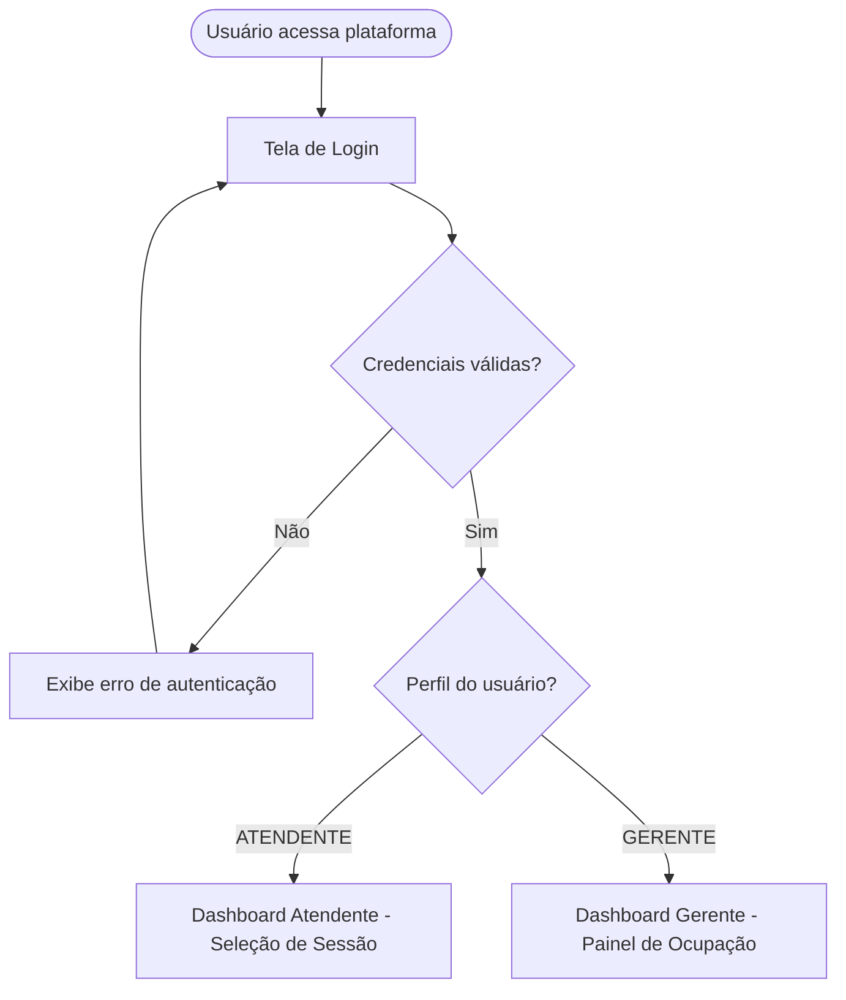
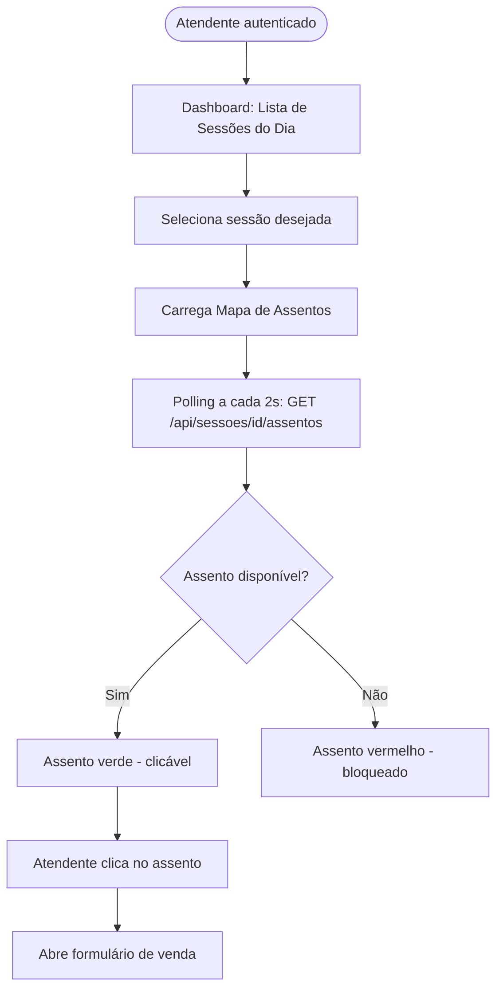
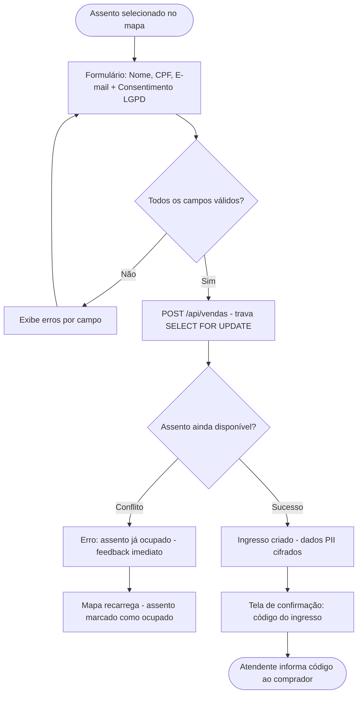
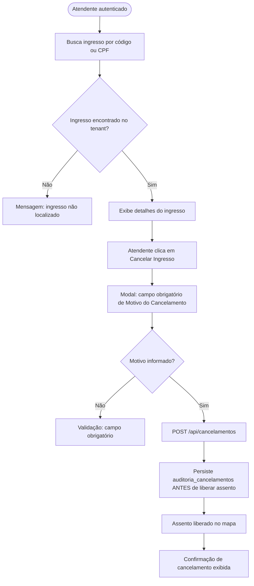
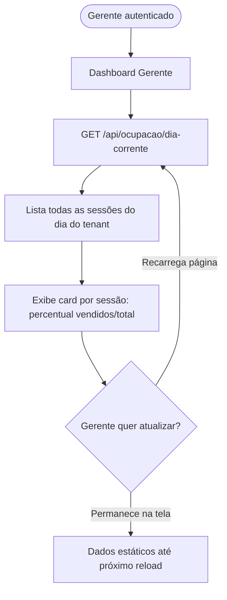
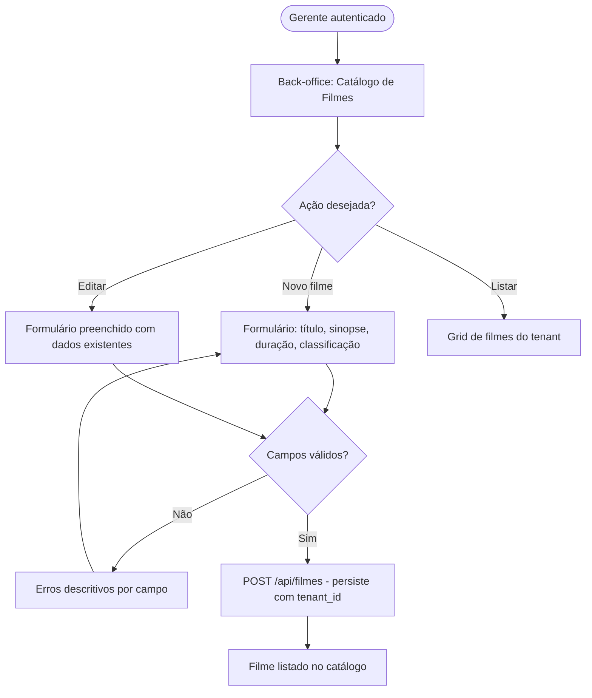
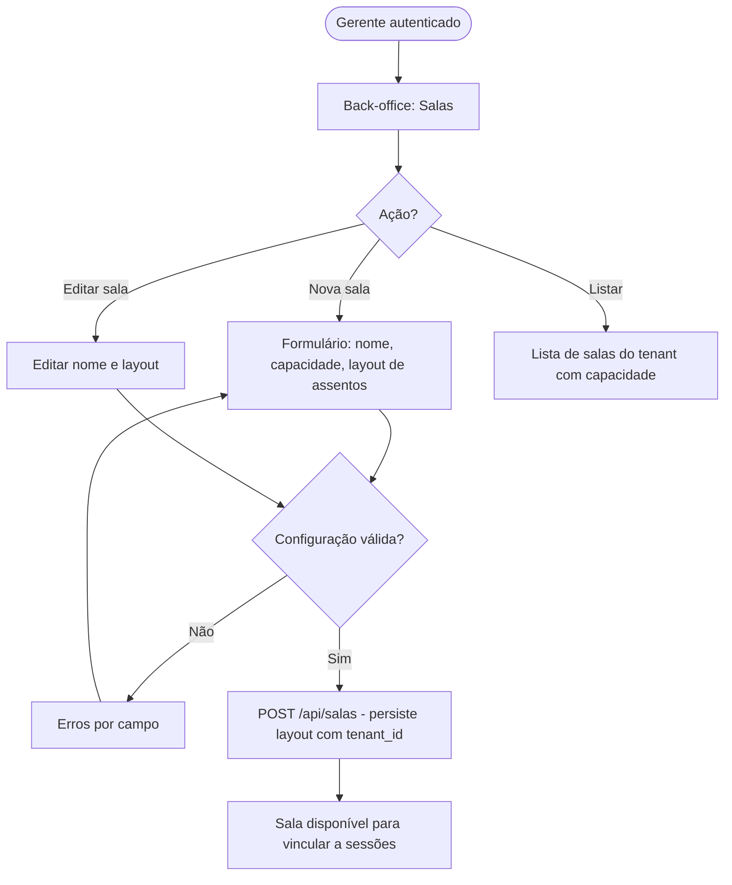
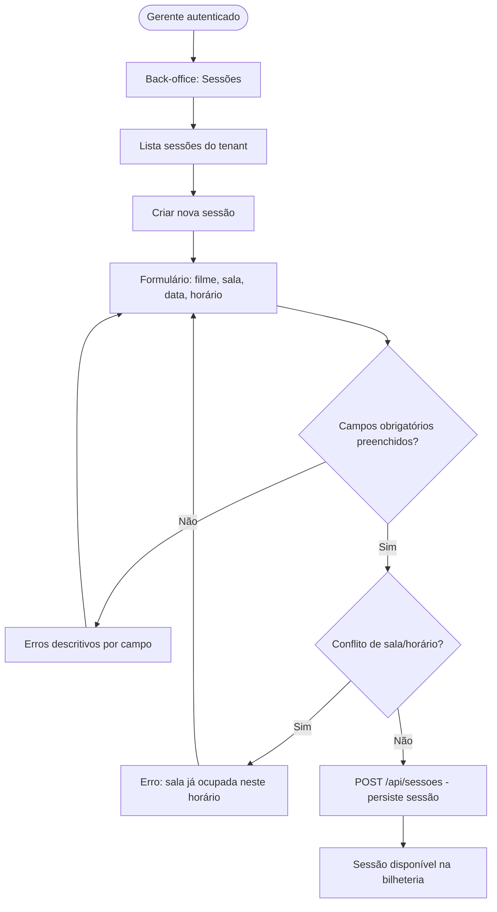
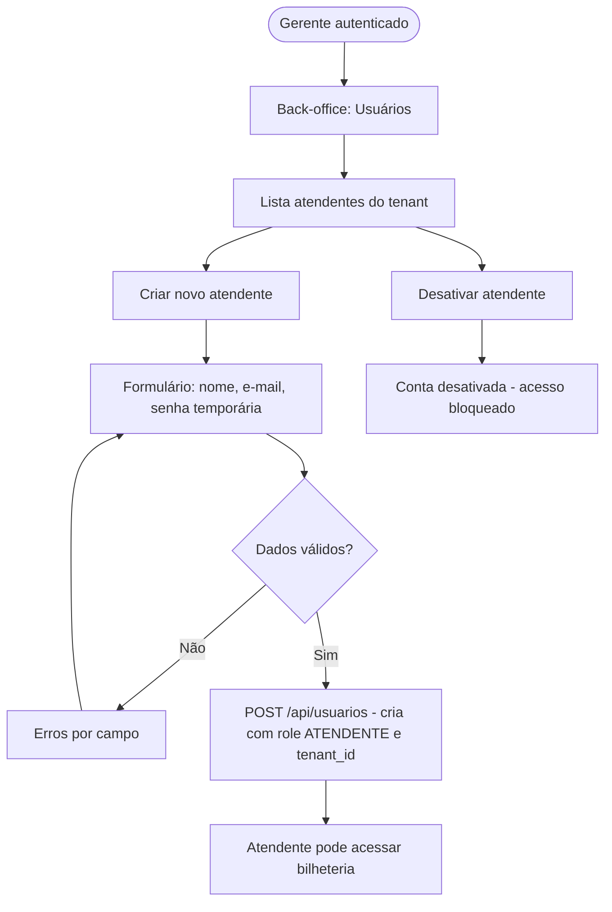
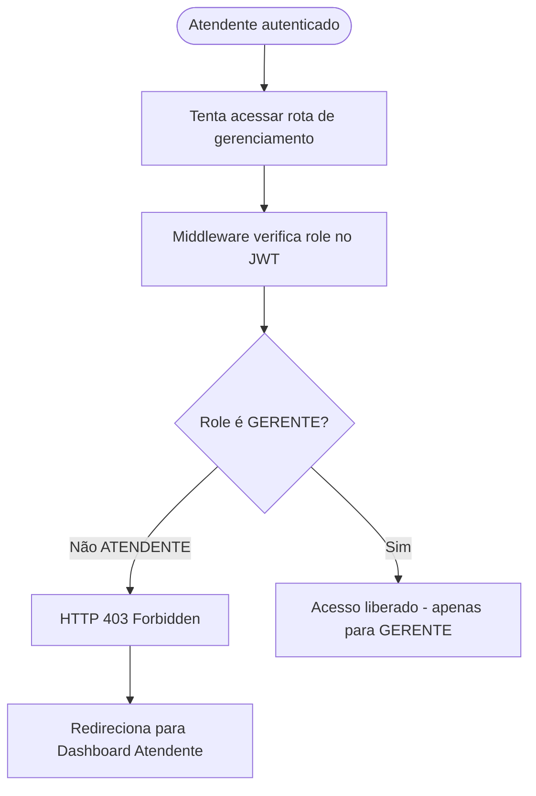

# UX — CineDoom — plataforma B2B SaaS para cinemas independentes e redes de pequeno/méd

> Artefato derivado de `.specs/features/F-CINEDOOM-PLATAFORMA-B2B-SAAS-C/spec.md` e gerado pelo agente **UX**
> via AI-4SDLC Platform. **Regenerative work product** (não-canonical SDD).
> Não edite manualmente — re-gere via `sdlc resume`.

## Resumo

UX design para plataforma B2B SaaS de bilheteria presencial e back-office para cinemas independentes: fluxos de autenticação, venda de ingresso com mapa de assentos, cancelamento auditável, painel de ocupação em tempo real e back-office de gestão (filmes, salas, sessões, usuários) para perfis Atendente e Gerente.

## User flows

### FLOW-1. Autenticação e Roteamento por Perfil

Fluxo de login com NextAuth.js e roteamento condicional por role ATENDENTE ou GERENTE após autenticação bem-sucedida.



### FLOW-2. Atendente - Seleção de Sessão e Abertura do Mapa

Atendente visualiza sessões do dia, seleciona uma sessão e abre o mapa de assentos com polling automático de 2 segundos para atualização de disponibilidade em tempo real.



### FLOW-3. Atendente - Venda de Ingresso (Fluxo Principal)

Fluxo ACID de venda de ingresso com validação de formulário, trava atômica anti-double-booking, cifragem de CPF e feedback imediato em caso de conflito de concorrência.



### FLOW-4. Atendente - Cancelamento Auditável de Ingresso

Fluxo de cancelamento com registro imutável em auditoria antes da liberação do assento, garantindo rastreabilidade por usuário e timestamp UTC.



### FLOW-5. Gerente - Painel de Ocupação em Tempo Real

Painel de ocupação do Gerente exibindo percentual de assentos vendidos por sessão do dia corrente, isolado por tenant_id, com atualização via reload de página.



### FLOW-6. Gerente - Cadastro e Gestão de Filmes

CRUD de filmes acessível exclusivamente ao Gerente, com validação de campos obrigatórios e isolamento por tenant_id.



### FLOW-7. Gerente - Cadastro de Salas e Layout de Assentos

Gestão de salas com definição de layout de assentos, restrita ao Gerente, com persistência isolada por tenant.



### FLOW-8. Gerente - Criação e Gestão de Sessões

Criação de sessões vinculando filme, sala e horário, com validação de conflito de agenda e campos obrigatórios, restrita ao Gerente.



### FLOW-9. Gerente - Gestão de Usuários Atendentes

Gerente cria e gerencia contas de Atendentes vinculadas ao seu tenant com role ATENDENTE, controlando acesso granular à bilheteria.



### FLOW-10. Controle de Acesso RBAC - Atendente tenta rota proibida

Middleware RBAC intercepta tentativa de acesso de Atendente a rotas restritas ao Gerente, retornando HTTP 403 e redirecionando para área permitida.



## Wireframes

### SCREEN-1: Login

```
+----------------------------------+
|         CINEDOOM                 |
|                                  |
|  E-mail:  [___________________]  |
|  Senha:   [___________________]  |
|                                  |
|         [  Entrar  ]             |
|                                  |
|  * Erro: credenciais inválidas   |
+----------------------------------+
```

### SCREEN-2: Dashboard Atendente - Sessões do Dia

```
+--------------------------------------------------+
| CINEDOOM  |  Olá, Atendente  |  [Sair]          |
+--------------------------------------------------+
| Sessões de Hoje - 12/07/2025                     |
+--------------------------------------------------+
| [14:00] Matrix IV  - Sala 1  - 40/120 vendidos   |
| [16:30] Divertida Mente 3 - Sala 2 - 80/100      |
| [19:00] Matrix IV  - Sala 1  - 5/120 vendidos    |
| [21:30] Oppenheimer - Sala 3 - 0/150 vendidos    |
+--------------------------------------------------+
| Selecione uma sessão para abrir o mapa           |
+--------------------------------------------------+
```

### SCREEN-3: Mapa de Assentos

```
+-------------------------------------------------------+
| CINEDOOM | Matrix IV - Sala 1 - 19:00 | [Sair]      |
+-------------------------------------------------------+
| [V]=Vendido  [D]=Disponível  [S]=Selecionado          |
|  Atualização automática a cada 2s                     |
+-------------------------------------------------------+
|  TELA  ================================================|
|  A: [D][D][V][V][D][D][D][V][D][D]                   |
|  B: [D][V][V][D][D][D][V][V][D][D]                   |
|  C: [D][D][D][D][D][D][D][D][D][D]                   |
|  D: [V][V][V][D][D][D][D][V][V][V]                   |
|  E: [D][D][D][D][D][D][D][D][D][D]                   |
+-------------------------------------------------------+
| Assento selecionado: --      [Confirmar Seleção]      |
+-------------------------------------------------------+
```

### SCREEN-4: Formulário de Venda de Ingresso

```
+------------------------------------------+
| CINEDOOM | Venda de Ingresso             |
+------------------------------------------+
| Sessão: Matrix IV - Sala 1 - 19:00       |
| Assento: C-05                            |
+------------------------------------------+
| Nome completo: [_______________________] |
| CPF:           [___.___.___-__]          |
| E-mail:        [_______________________] |
|                                          |
| [x] Concordo com coleta de dados (LGPD) |
|     Timestamp de consentimento: --       |
+------------------------------------------+
|  [Cancelar]        [Confirmar Venda]     |
+------------------------------------------+
```

### SCREEN-5: Confirmação de Venda

```
+------------------------------------------+
| CINEDOOM | Venda Confirmada ✓            |
+------------------------------------------+
|  Ingresso #ING-2025-00847                |
|  Comprador: João Silva                   |
|  Sessão: Matrix IV - Sala 1 - 19:00      |
|  Assento: C-05                           |
|  Pagamento: Offline (registrado)         |
+------------------------------------------+
|  Informe o código ao comprador.          |
+------------------------------------------+
|  [Nova Venda]     [Voltar ao Mapa]       |
+------------------------------------------+
```

### SCREEN-6: Cancelamento de Ingresso

```
+------------------------------------------+
| CINEDOOM | Cancelar Ingresso             |
+------------------------------------------+
| Buscar ingresso:                         |
| Código: [___________]  [Buscar]          |
+------------------------------------------+
| Ingresso #ING-2025-00847                 |
| Comprador: João Silva                    |
| Sessão: Matrix IV - Sala 1 - 19:00       |
| Assento: C-05                            |
+------------------------------------------+
| Motivo do cancelamento: (obrigatório)    |
| [________________________________________|
|  ________________________________________|
|  ______________________________________] |
+------------------------------------------+
| Executor: atendente@cinema.com           |
|  [Voltar]      [Confirmar Cancelamento]  |
+------------------------------------------+
```

### SCREEN-7: Dashboard Gerente - Painel de Ocupação

```
+-----------------------------------------------------------+
| CINEDOOM  |  Olá, Gerente  |  Ocupação do Dia  |  [Sair] |
+-----------------------------------------------------------+
| Painel de Ocupação - 12/07/2025  [Recarregar]            |
+-----------------------------------------------------------+
| Sessão                | Sala   | Vendidos | Total | %    |
+-----------------------+--------+----------+-------+------+
| 14:00 Matrix IV       | Sala 1 |   40     |  120  | 33%  |
| 16:30 Divertida Mente | Sala 2 |   80     |  100  | 80%  |
| 19:00 Matrix IV       | Sala 1 |    5     |  120  |  4%  |
| 21:30 Oppenheimer     | Sala 3 |    0     |  150  |  0%  |
+-----------------------------------------------------------+
| [Gerenciar Filmes] [Salas] [Sessões] [Usuários]          |
+-----------------------------------------------------------+
```

### SCREEN-8: Back-office - Catálogo de Filmes

```
+----------------------------------------------+
| CINEDOOM Back-Office | Filmes         [Sair] |
+----------------------------------------------+
| [+ Novo Filme]              [Buscar: ______] |
+----------------------------------------------+
| Título           | Duração | Classif | Ações |
+------------------+---------+---------+-------+
| Matrix IV        | 148 min | 14 anos | [Ed.] |
| Divertida Mente3 | 100 min | Livre   | [Ed.] |
| Oppenheimer      | 180 min | 14 anos | [Ed.] |
+----------------------------------------------+
| Voltar ao Painel                             |
+----------------------------------------------+
```

### SCREEN-9: Formulário de Filme (Criar/Editar)

```
+----------------------------------------------+
| CINEDOOM | Novo Filme                           |
+----------------------------------------------+
| Título:        [__________________________]  |
| Sinopse:       [__________________________]  |
|                [__________________________]  |
| Duração (min): [______]                      |
| Classificação: [Livre v]                     |
| Gênero:        [__________________________]  |
+----------------------------------------------+
| * Campo obrigatório                          |
+----------------------------------------------+
|  [Cancelar]           [Salvar Filme]         |
+----------------------------------------------+
```

### SCREEN-10: Back-office - Gestão de Salas

```
+----------------------------------------------+
| CINEDOOM Back-Office | Salas          [Sair] |
+----------------------------------------------+
| [+ Nova Sala]                                |
+----------------------------------------------+
| Nome    | Capacidade | Linhas | Cols | Ações  |
+---------+------------+--------+------+--------+
| Sala 1  |    120     |   10   |  12  | [Ed.]  |
| Sala 2  |    100     |   10   |  10  | [Ed.]  |
| Sala 3  |    150     |   12   |  13  | [Ed.]  |
+----------------------------------------------+
| Voltar ao Painel                             |
+----------------------------------------------+
```

### SCREEN-11: Back-office - Sessões

```
+------------------------------------------------------------+
| CINEDOOM Back-Office | Sessões                   [Sair] |
+------------------------------------------------------------+
| [+ Nova Sessão]           Filtrar por data: [__________] |
+------------------------------------------------------------+
| Filme              | Sala   | Data       | Hora  | Ações  |
+--------------------+--------+------------+-------+--------+
| Matrix IV          | Sala 1 | 12/07/2025 | 14:00 | [Ed.]  |
| Divertida Mente 3  | Sala 2 | 12/07/2025 | 16:30 | [Ed.]  |
| Oppenheimer        | Sala 3 | 12/07/2025 | 21:30 | [Ed.]  |
+------------------------------------------------------------+
| Voltar ao Painel                                         |
+------------------------------------------------------------+
```

### SCREEN-12: Back-office - Gestão de Usuários

```
+----------------------------------------------+
| CINEDOOM Back-Office | Usuários       [Sair] |
+----------------------------------------------+
| [+ Novo Atendente]                           |
+----------------------------------------------+
| Nome         | E-mail             | Status    |
+--------------+--------------------+-----------+
| Ana Souza    | ana@cinema.com     | Ativo      |
| Carlos Lima  | carlos@cinema.com  | Ativo      |
| Marcos Reis  | marcos@cinema.com  | Inativo    |
+----------------------------------------------+
| Novo Atendente:                              |
| Nome:  [________________________]            |
| Email: [________________________]            |
| Senha: [________________________]            |
| [Criar Conta de Atendente]                   |
+----------------------------------------------+
```

## Design system notes

Paleta: primária #1A1A2E (azul escuro cinema), secundária #E94560 (vermelho ingresso/CTA), neutros #F5F5F5 (fundo), #FFFFFF (cards), #2D2D2D (texto principal), #6B7280 (texto secundário). Semântica de status de assentos: verde #22C55E (disponível), vermelho #EF4444 (vendido/ocupado), azul #3B82F6 (selecionado pelo atendente atual), cinza #9CA3AF (bloqueado/manutenção). Tipografia: Inter como fonte principal; heading 24px/700, subheading 18px/600, body 14px/400, caption 12px/400; line-height 1.5 para body. Spacing: escala 4px base (4, 8, 12, 16, 24, 32, 48px). Componentes-chave: SeatMap (grid responsivo de assentos com estados visuais distintos), SessionCard (card de sessão com barra de ocupação visual), OccupancyTable (tabela com coluna de percentual com barra progress inline), FormField (label + input + mensagem de erro por campo), ConfirmationModal (modal de confirmação para ações destrutivas como cancelamento), BadgeRole (chip ATENDENTE/GERENTE com cores distintas). Bordas: radius 6px para cards e inputs, 4px para badges. Sombra: shadow-sm para cards elevados. Modo escuro não previsto no MVP.

## Acessibilidade

- WCAG 2.1 AA: contraste mínimo 4.5:1 para texto body e 3:1 para texto grande — verificar vermelho #E94560 sobre fundos claros
- Mapa de assentos: cada assento deve ter aria-label descritivo (ex: 'Assento C-05, disponível') e ser navegável via teclado (Tab + Enter/Space para selecionar)
- Estados de assento comunicados via aria-pressed (selecionado) e aria-disabled (vendido/bloqueado), não apenas cor — daltonismo (deuteranopia) requer ícone ou padrão além da cor
- Formulário de venda: aria-required em todos os campos obrigatórios; aria-describedby vinculando campo ao respectivo erro inline; foco gerenciado para primeiro campo com erro após submit
- Modal de cancelamento: foco preso dentro do modal (focus trap) enquanto aberto; fechamento via Escape; aria-modal=true e role=dialog com aria-labelledby
- Painel de ocupação: tabela com caption descritiva, scope=col em headers, dados numéricos alinhados à direita para leitura consistente com screen readers
- Polling de 2s do mapa: atualizações via JavaScript não devem mover o foco do usuário nem causar anúncio automático de screen reader a cada ciclo — usar aria-live=off na região do mapa e anunciar apenas mudanças relevantes
- Tamanho mínimo de área clicável dos assentos: 44x44px (WCAG 2.5.5) para uso em tablets touchscreen na bilheteria
- Skip link 'Pular para o conteúdo principal' visível ao receber foco no topo de cada página
- Mensagens de erro de concorrência (assento já vendido) devem ser anunciadas via aria-live=assertive para feedback imediato ao atendente
